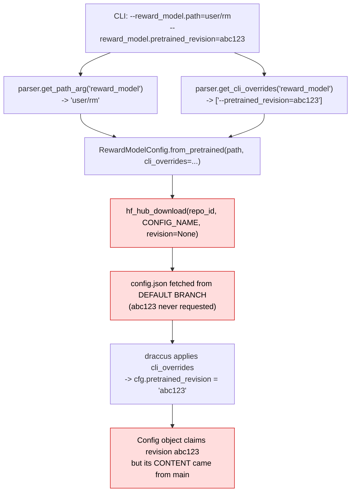
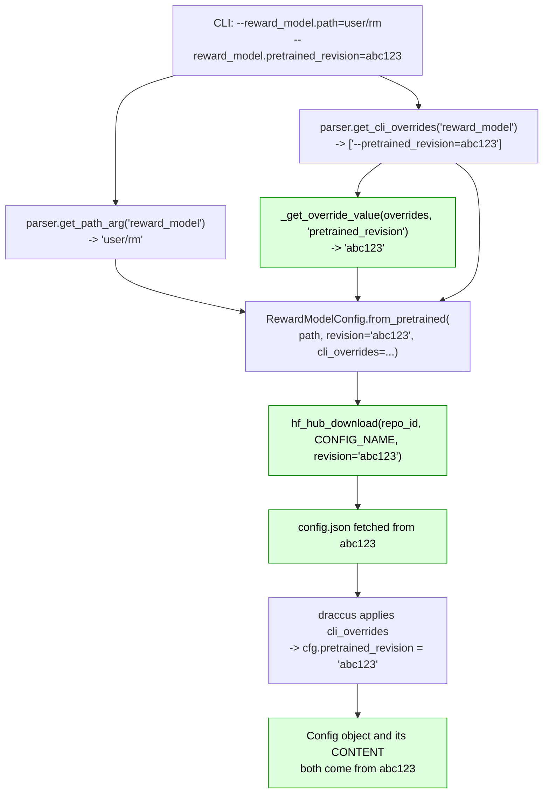
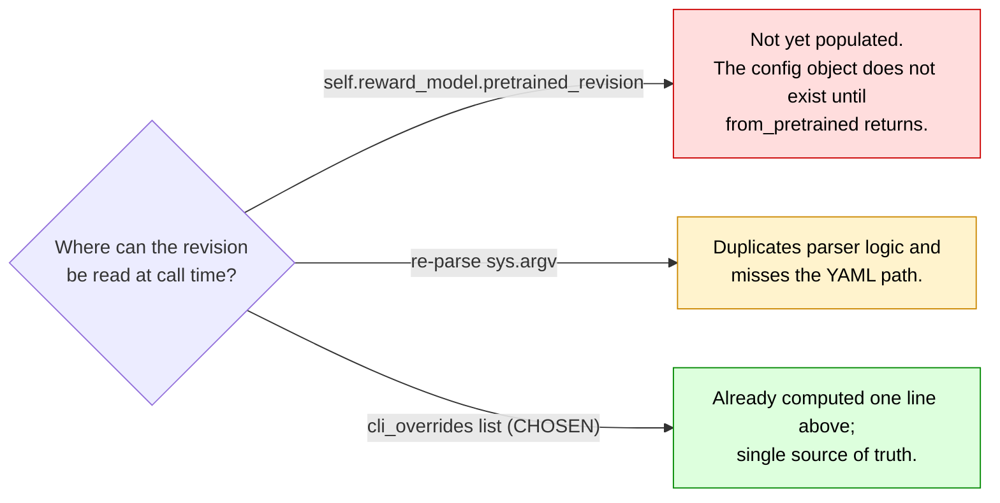
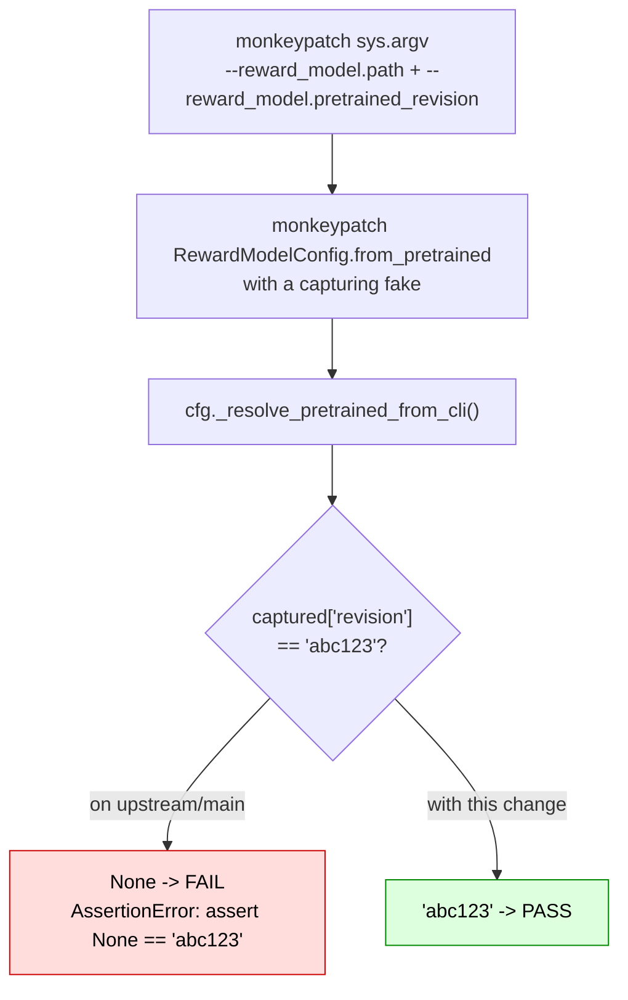

# `--reward_model.pretrained_revision` is silently ignored

|                   |                                                                                                  |
| ----------------- | ------------------------------------------------------------------------------------------------ |
| **Branch**        | `fix/reward-model-pretrained-revision` (replica: `replica/fix-reward-model-pretrained-revision`) |
| **Base**          | `upstream/main` @ `b9cb121c`                                                                     |
| **Commit**        | `a829f73d`                                                                                       |
| **Files changed** | `src/lerobot/configs/train.py`, `tests/configs/test_reward_model_revision.py`                    |
| **Upstream repo** | `huggingface/lerobot`                                                                            |
| **PR**            | [huggingface/lerobot#4909](https://github.com/huggingface/lerobot/pull/4909)                     |
| **Related**       | #3867 (policy half, claimed by PR #3901), #3820 (introduced `pretrained_revision`)               |

---

## 1. The issue

`RewardModelConfig` offers a `pretrained_revision` field so a Hub reward model can be pinned to a
commit, branch, or tag:

```python
# src/lerobot/configs/rewards.py:59-60
# Optional Hub revision (commit hash, branch, or tag) to pin the pretrained reward model version.
pretrained_revision: str | None = None
```

and its `from_pretrained` accepts a `revision` and forwards it to the Hub download:

```python
# src/lerobot/configs/rewards.py:112-137 (abridged)
def from_pretrained(cls, pretrained_name_or_path, *, revision: str | None = None, **reward_kwargs):
    ...
    config_file = hf_hub_download(
        repo_id=model_id,
        filename=CONFIG_NAME,
        revision=revision,          # <-- plumbing is already here
        ...
    )
```

But the **call site never passes it**:

```python
# src/lerobot/configs/train.py, _resolve_pretrained_from_cli() — BEFORE
if reward_model_path:
    cli_overrides = parser.get_cli_overrides("reward_model")
    self.reward_model = RewardModelConfig.from_pretrained(
        reward_model_path, cli_overrides=cli_overrides   # no revision=
    )
```

So `--reward_model.pretrained_revision=<sha>` is **accepted, parsed, and stored on the config**, while
the `config.json` that defines the model is **always downloaded from the Hub default branch**. The
failure is silent: no error, no warning, and the config object afterwards even _shows_ the requested
revision — so the pin looks like it worked.

### Why `cli_overrides` cannot carry it

This is the non-obvious part. The revision _is_ present in `cli_overrides` as
`--pretrained_revision=<sha>`, so it is tempting to assume it already takes effect. It cannot, because
of ordering: `draccus` applies `cli_overrides` to the dataclass **only after** `from_pretrained` has
already fetched `config.json` from the Hub. By the time the override is applied, the download that it
was supposed to influence has finished.



The red path is the bug: the download happens **before** the override that should have steered it.

### Impact

- Pinning a reward model to a reproducible revision does not work for config resolution.
- Because the resulting object reports the requested revision, the discrepancy is invisible — a run
  that looks pinned can silently drift when the Hub default branch moves.
- Affects RL / HIL-SERL style training driven by `--reward_model.path`.

---

## 2. The modification

Two changes, both in `src/lerobot/configs/train.py`.

### 2a. A helper to read a value out of the de-nested override list

`parser.get_cli_overrides("reward_model")` returns entries already stripped of their prefix, e.g.
`["--pretrained_revision=abc123"]`. The helper pulls one out by name:

```python
def _get_override_value(overrides: list[str] | None, name: str) -> str | None:
    """Return the value of `--<name>=<value>` in a de-nested override list, or None if absent.

    The list is the one produced by `parser.get_cli_overrides`, whose entries have already had
    their `--<field>.` prefix stripped.
    """
    if not overrides:
        return None
    prefix = f"--{name}="
    for override in overrides:
        if override.startswith(prefix):
            return override.removeprefix(prefix)
    return None
```

### 2b. Pass the revision at the call site

```diff
 if reward_model_path:
     cli_overrides = parser.get_cli_overrides("reward_model")
+    # `pretrained_revision` has to be passed explicitly: draccus only applies
+    # `cli_overrides` once the config has already been downloaded, so relying on
+    # them alone would always resolve the Hub default branch.
     self.reward_model = RewardModelConfig.from_pretrained(
-        reward_model_path, cli_overrides=cli_overrides
+        reward_model_path,
+        revision=_get_override_value(cli_overrides, "pretrained_revision"),
+        cli_overrides=cli_overrides,
     )
     self.reward_model.pretrained_path = str(Path(reward_model_path))
```

### Flow after the fix



### Decision: why read from the overrides instead of `self.reward_model.pretrained_revision`



### Deliberately left out of scope

- **The policy path.** `PreTrainedConfig.from_pretrained` has the identical gap a few lines below
  (issue #3867). It is already addressed by open PR #3901, so this change does not touch it.
- **YAML overrides.** The `policy` branch merges `parser.get_yaml_overrides("policy")` with the CLI
  overrides; the `reward_model` branch only reads CLI overrides. That asymmetry is a separate
  inconsistency, raised as a question for reviewers rather than fixed here.

### Backward compatibility

None broken. With the flag absent, `_get_override_value` returns `None`, which is exactly the value
previously passed implicitly — the Hub default branch.

---

## 3. Tests

New file `tests/configs/test_reward_model_revision.py`, following the monkeypatch pattern already used
by `tests/configs/test_resume_from_hub.py`. No Hub access, no GPU, no hardware.



| Test                                                            | Asserts                                                                           |
| --------------------------------------------------------------- | --------------------------------------------------------------------------------- |
| `test_reward_model_pretrained_revision_reaches_from_pretrained` | the revision reaches `from_pretrained`. **Fails on `main`**, passes with the fix. |
| `test_reward_model_revision_defaults_to_none_when_not_given`    | no flag -> `revision is None`, i.e. unchanged behaviour                           |

The config object is built with `object.__new__(TrainPipelineConfig)` and only the three fields
`_resolve_pretrained_from_cli` touches (`resume`, `policy`, `reward_model`), so the test does not drag
in a dataset, optimizer, or device.

### Verification performed

```console
$ uv run pytest tests/configs/test_reward_model_revision.py -q    # on upstream/main, pre-fix
1 failed, 1 passed
E  AssertionError: assert None == 'abc123'

$ uv run pytest tests/configs/test_reward_model_revision.py tests/configs/ tests/test_yaml_policy_path.py -q
Testing with DEVICE='cpu'
95 passed, 18 skipped in 2.33s
```

Quality hooks on the changed files — `ruff format`, `ruff`, `typos`, `pyupgrade`, `bandit`, `mypy`,
`gitleaks` — all pass.

> The full `pytest` suite was **not** run. This sandbox is CPU-only with 2 cores and no GPU, so the
> GPU/hardware test tiers are out of reach.

---

## 4. PR description

The text below is what accompanies the PR against `huggingface/lerobot:main`.

---

### Title

```
fix(configs): pin the reward-model config to --reward_model.pretrained_revision
```

### Summary / Motivation

`RewardModelConfig` exposes a `pretrained_revision` field (added in #3820) and its `from_pretrained` already accepts `revision` and forwards it to `hf_hub_download`. But `TrainPipelineConfig._resolve_pretrained_from_cli` never passes it, so `--reward_model.pretrained_revision` is accepted and stored on the config while the `config.json` download always resolves the Hub default branch. The pin silently does nothing.

The value cannot arrive via `cli_overrides`: draccus applies those only _after_ `from_pretrained` has already fetched the file, so the call site has to read the revision out of the de-nested overrides explicitly.

### Related issues

- Related: #3867 — the same root cause on the **policy** path. That half is already covered by @pranjalbhatia710's open PR #3901, so this PR deliberately leaves it alone and fixes only the `reward_model` call site, which #3901 does not touch.
- Follow-up to: #3820, which introduced `pretrained_revision`.

> Note for whoever merges second: #3901 introduces an identically-named `_get_override_value` helper in this same file. Whichever lands first should keep the helper and the other can drop its copy — the two are interchangeable.

### What changed

- `_resolve_pretrained_from_cli` now passes `revision=` to `RewardModelConfig.from_pretrained`, read from the de-nested `--reward_model.*` overrides.
- Added a small `_get_override_value(overrides, name)` helper for that lookup.
- Not a breaking change: with the flag absent the value is `None`, which is exactly the previous behaviour (Hub default branch).

### How was this tested (or how to run locally)

New file `tests/configs/test_reward_model_revision.py`, following the monkeypatch pattern already used in `tests/configs/test_resume_from_hub.py` (no Hub access, no GPU):

- `test_reward_model_pretrained_revision_reaches_from_pretrained` — asserts the revision reaches `from_pretrained`. **Fails on `main`** with `AssertionError: assert None == 'abc123'`, passes with this change.
- `test_reward_model_revision_defaults_to_none_when_not_given` — guards the no-flag case.

```
$ uv run pytest tests/configs/test_reward_model_revision.py tests/configs/ tests/test_yaml_policy_path.py -q
Testing with DEVICE='cpu'
95 passed, 18 skipped in 2.33s
```

Quality hooks on the changed files (ruff format, ruff, typos, pyupgrade, gitleaks, bandit, mypy) all pass.

### Checklist (required before merge)

- [x] Linting/formatting run (`pre-commit run` on the changed files — all hooks pass)
- [x] Relevant tests pass locally (`tests/configs/`, `tests/test_yaml_policy_path.py`). The full `pytest` suite was **not** run: this sandbox is CPU-only with 2 cores, so GPU/hardware tiers are out of reach.
- [ ] Documentation updated — not applicable, no public API or docs change
- [ ] CI is green — will watch after opening
- [x] Community Review: reviewed #4695 — https://github.com/huggingface/lerobot/pull/4695#pullrequestreview-5479555784

### Reviewer notes

- Worth a look at whether the `reward_model` branch should also pick up `parser.get_yaml_overrides("reward_model")`, which the `policy` branch does but this one does not. That looked like a separate inconsistency so I left it out to keep the diff focused — say the word and I'll fold it in.
- I could not exercise this against a real gated/pinned Hub reward-model repo; the test asserts the kwarg reaches `from_pretrained` rather than the download result.

### AI assistance disclosure

Per [AI_POLICY.md](https://github.com/huggingface/lerobot/blob/main/AI_POLICY.md): this change was written with AI assistance. The defect was confirmed by reading `configs/train.py` and `configs/rewards.py` on `main`, the test was run locally and verified to fail before the fix and pass after, and I have reviewed the diff. Flagging the two open questions above as the places where reviewer judgement would help most.
