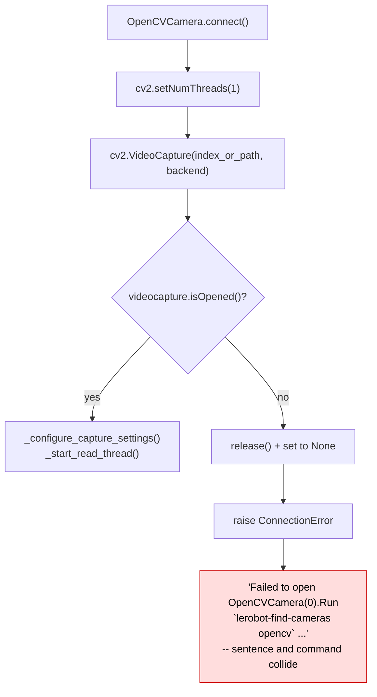
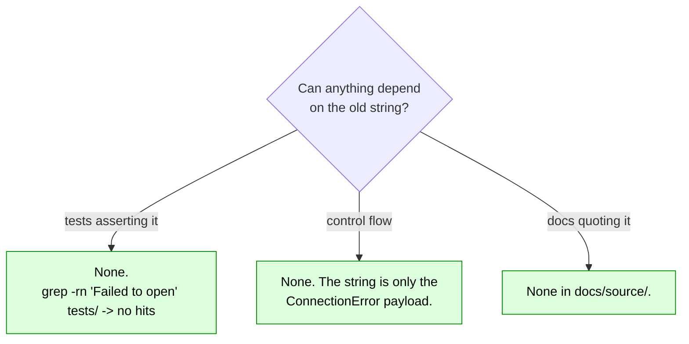
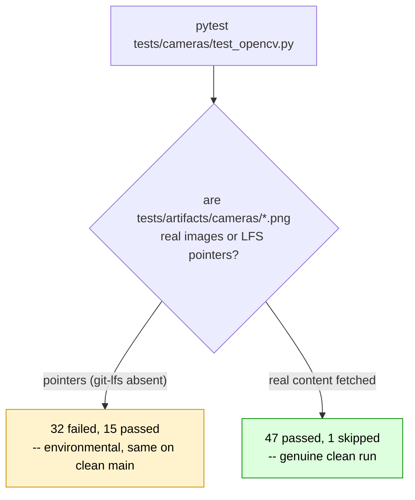

# Missing space in the OpenCV camera open-failure message

|                   |                                                                                    |
| ----------------- | ---------------------------------------------------------------------------------- |
| **Branch**        | `fix/opencv-open-error-message` (replica: `replica/fix-opencv-open-error-message`) |
| **Base**          | `upstream/main` @ `b9cb121c`                                                       |
| **Commit**        | `fa9dee77`                                                                         |
| **Files changed** | `src/lerobot/cameras/opencv/camera_opencv.py` (1 line)                             |
| **Upstream repo** | `huggingface/lerobot`                                                              |
| **PR**            | [huggingface/lerobot#4910](https://github.com/huggingface/lerobot/pull/4910)       |
| **Related issue** | None filed — found by reading the source                                           |

---

## 1. The issue

When `cv2.VideoCapture` cannot open the requested device, `OpenCVCamera.connect()` raises a
`ConnectionError` whose f-string is missing a space between the sentence and the command it
recommends:

```python
# src/lerobot/cameras/opencv/camera_opencv.py:169-173 — BEFORE
if not self.videocapture.isOpened():
    self.videocapture.release()
    self.videocapture = None
    raise ConnectionError(
        f"Failed to open {self}.Run `lerobot-find-cameras opencv` to find available cameras."
    )
```

`{self}` renders via `OpenCVCamera.__str__` (`camera_opencv.py:127`) as e.g. `OpenCVCamera(0)` —
confirmed by instantiating the camera and formatting it — so the user sees:

```
ConnectionError: Failed to open OpenCVCamera(0).Run `lerobot-find-cameras opencv` to find available cameras.
```

`OpenCVCamera(0).Run` reads as a single token — it looks like an attribute access or a typo in the
device name rather than the end of one sentence and the start of the next. The remediation command is
the single most useful part of the message, and the missing space is exactly where the eye breaks.



This is the most common first-run failure for anyone plugging in a USB camera (wrong index, wrong
`/dev/video*` path, device busy, or missing permissions), so it is a high-traffic message.

---

## 2. The modification

One character.

```diff
 raise ConnectionError(
-    f"Failed to open {self}.Run `lerobot-find-cameras opencv` to find available cameras."
+    f"Failed to open {self}. Run `lerobot-find-cameras opencv` to find available cameras."
 )
```

Resulting message:

```
ConnectionError: Failed to open OpenCVCamera(0). Run `lerobot-find-cameras opencv` to find available cameras.
```


### Risk assessment



No behavioural change, no API change, no test depends on the literal.

---

## 3. Tests

No new test. Asserting on a human-readable error string would pin prose that is expected to be
reworded, and the repo does not test these messages elsewhere. The existing OpenCV suite is the
regression guard.

### Verification performed

`tests/cameras/test_opencv.py` is fully mock-based (`patch(".../cv2.VideoCapture",
new=MockLoopingVideoCapture)`), so no physical camera is needed — but it **does** need the git-lfs
artifacts under `tests/artifacts/cameras/`.



git-lfs is not installed in this sandbox, so the checked-out artifacts were pointer files and the
suite failed 32/15 — **identically on clean `upstream/main`**, confirming the failures were
environmental rather than caused by this change. Fetching the real objects from
`media.githubusercontent.com` (sizes matched the pointer `size` fields) produced a genuine run:

```console
$ uv run pytest tests/cameras/test_opencv.py -q
Testing with DEVICE='cpu'
47 passed, 1 skipped in 4.54s
```

The artifacts were fetched into the working tree only to run the suite and were **never committed** —
only `camera_opencv.py` is staged in `eda5b6b1`.

Quality hooks on the changed file — `ruff format`, `ruff`, `typos`, `pyupgrade`, `bandit`, `mypy`,
`gitleaks` — all pass.

---

## 4. PR description

The text below is what accompanies the PR against `huggingface/lerobot:main`.

---

### Title

```
fix(cameras): add the missing space in the OpenCV open-failure message
```

### Summary / Motivation

`OpenCVCamera.connect()` raises its open-failure message without a space between the sentence and the command it suggests, so users see:

```
ConnectionError: Failed to open OpenCVCamera(0).Run `lerobot-find-cameras opencv` to find available cameras.
```

The `.Run` reads as one token and makes the suggested command easy to miss. One-character fix.

### Related issues

- None filed; found while reading `camera_opencv.py`.

### What changed

- `src/lerobot/cameras/opencv/camera_opencv.py`: `{self}.Run` -> `{self}. Run` in the `ConnectionError` raised when `VideoCapture` fails to open.

No behavioural change; no test asserts this string.

### How was this tested (or how to run locally)

```
$ uv run pytest tests/cameras/test_opencv.py -q
Testing with DEVICE='cpu'
47 passed, 1 skipped in 4.54s
```

(These tests are fully mock-based via `MockLoopingVideoCapture`, so no camera is needed — but they do need the git-lfs artifacts under `tests/artifacts/cameras/` to be fetched.)

### Checklist (required before merge)

- [x] Linting/formatting run (`pre-commit run` on the changed file — all hooks pass)
- [x] Relevant tests pass locally (`tests/cameras/test_opencv.py`: 47 passed, 1 skipped)
- [ ] Documentation updated — not applicable
- [ ] CI is green — will watch after opening
- [x] Community Review: reviewed #4695 — https://github.com/huggingface/lerobot/pull/4695#pullrequestreview-5479555784

### Reviewer notes

- Trivial string fix; the only judgement call is whether it is worth a standalone PR or should ride along with another cameras change. Happy to close it if you would rather batch it.

### AI assistance disclosure

Per [AI_POLICY.md](https://github.com/huggingface/lerobot/blob/main/AI_POLICY.md): found and written with AI assistance. Verified by reading the raised string on `main` and running the OpenCV camera suite locally.
