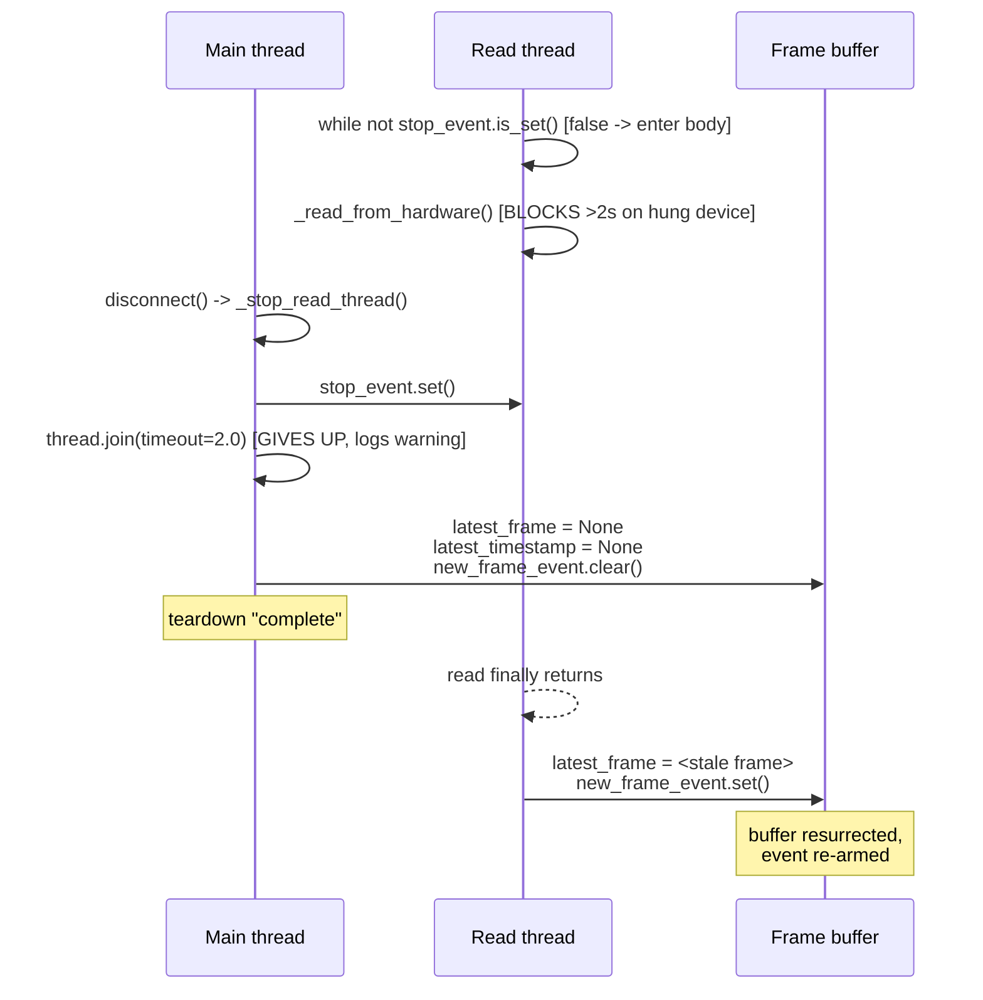
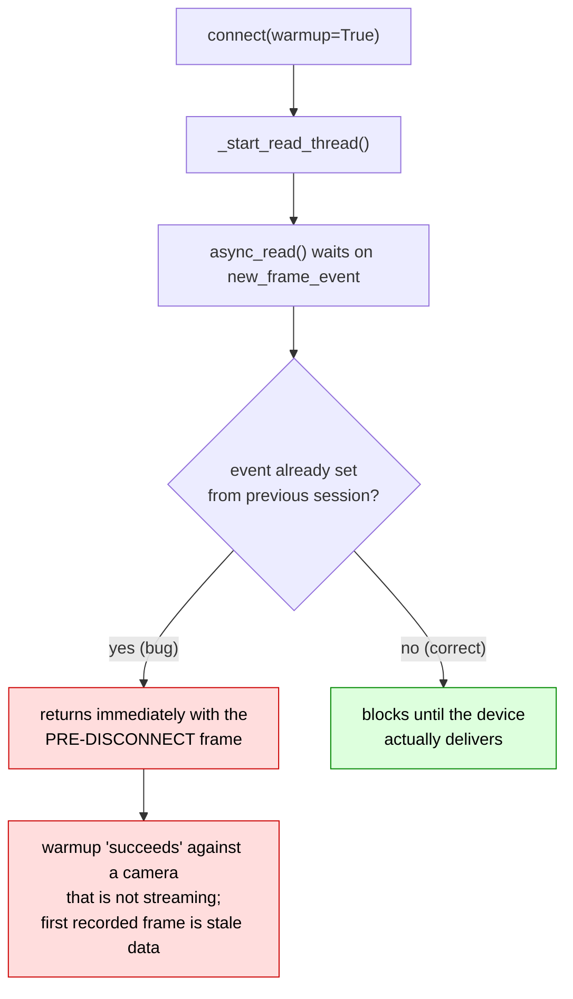
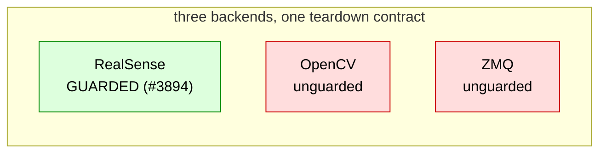
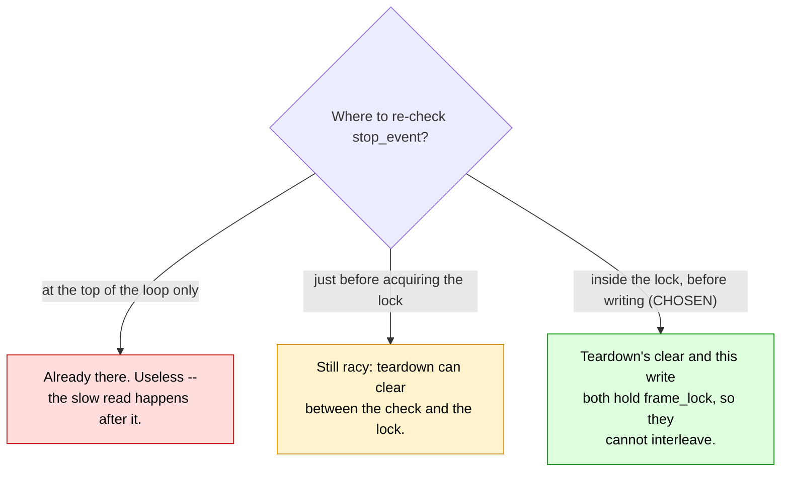
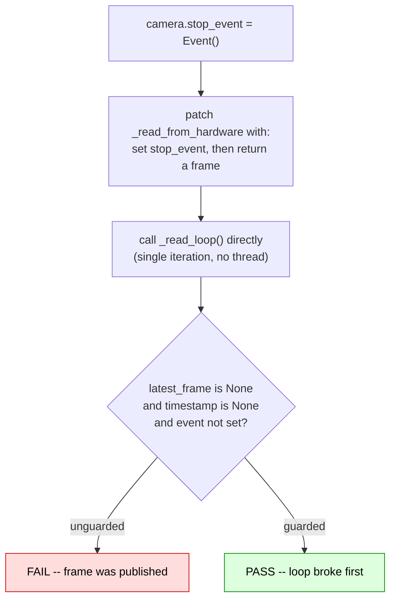

# A late camera frame can resurrect the buffer after `disconnect()`

|                   |                                                                                                                                   |
| ----------------- | --------------------------------------------------------------------------------------------------------------------------------- |
| **Branch**        | `fix/camera-read-loop-stop-parity` (replica: `replica/fix-camera-read-loop-stop-parity`)                                          |
| **Base**          | `upstream/main` @ `b9cb121c`                                                                                                      |
| **Commit**        | `f9a410de`                                                                                                                        |
| **Files changed** | `cameras/opencv/camera_opencv.py`, `cameras/zmq/camera_zmq.py`, `tests/cameras/test_opencv.py`, `tests/cameras/test_zmq.py` (new) |
| **Upstream repo** | `huggingface/lerobot`                                                                                                             |
| **PR**            | [huggingface/lerobot#4911](https://github.com/huggingface/lerobot/pull/4911)                                                      |
| **Related**       | Follows #3894 (`bad0260a`), context in #3571 (closed) and #3812 (merged)                                                          |
| **Source**        | Self-found — a parity gap, no issue filed                                                                                         |

---

## 1. The issue

### The teardown contract

`_stop_read_thread()` (`camera_opencv.py`) does four things in order:

```python
def _stop_read_thread(self) -> None:
    if self.stop_event is not None:
        self.stop_event.set()                       # 1. ask the thread to stop

    if self.thread is not None and self.thread.is_alive():
        self.thread.join(timeout=2.0)               # 2. BOUNDED wait -- may give up
        if self.thread.is_alive():
            logger.warning(f"{self} read thread did not terminate within timeout.")

    self.thread = None
    self.stop_event = None

    with self.frame_lock:                           # 3. clear the buffer
        self.latest_frame = None
        self.latest_timestamp = None
        self.new_frame_event.clear()
```

Step 2 is **bounded**. It logs a warning and proceeds even if the thread is still alive. So step 3
can run while a read is still in flight.

### The race

A hardware read can comfortably outlive a 2-second join:

- OpenCV: `videocapture.read()` on a hung or unplugged UVC device.
- ZMQ: `socket.recv_string()` blocks up to `timeout_ms`, whose **default is 5000 ms** — more than
  double the join timeout.

When that read finally returns, the thread proceeds to publish. Nothing stops it:

```python
# camera_opencv.py _read_loop -- BEFORE
while not stop_event.is_set():          # checked here, but the read below takes seconds
    try:
        raw_frame = self._read_from_hardware()
        processed_frame = self._postprocess_image(raw_frame)
        capture_time = time.perf_counter()

        with self.frame_lock:
            self.latest_frame = processed_frame     # <-- repopulates the cleared buffer
            self.latest_timestamp = capture_time
        self.new_frame_event.set()                  # <-- re-arms the event
```

The `while` condition was evaluated _before_ the slow read. By the time the body publishes, the stop
has already happened and the buffer has already been cleared.



### Why it matters

The damage is not the stale pointer — it is the **re-armed event**. On the next session:



So `connect(warmup=True)` — whose entire purpose is to prove the camera delivers frames — can pass
against a dead device, and the first frame handed to the recording loop is data from before the
disconnect.

### This is a known hazard, already fixed — in one backend only

The RealSense backend already guards against exactly this:

```python
# src/lerobot/cameras/realsense/camera_realsense.py
with self.frame_lock:
    # Under the lock, so a late frame cannot resurrect the buffer _stop_read_thread() cleared.
    if stop_event.is_set():
        break
```

That comment names the failure precisely. It arrived with **#3894**, and the commit scope is the
whole story:

```console
$ git show --stat --format="" bad0260a
 src/lerobot/cameras/realsense/camera_realsense.py | 147 +++++++++++++-----
 tests/cameras/test_realsense.py                   | 161 +++++++++++++++++-
 2 files changed, 271 insertions(+), 37 deletions(-)
```

Only RealSense. The OpenCV and ZMQ backends share the identical `_stop_read_thread` contract and were
never patched.



Supporting history: in **#3571** (closed) @CarolinePascal described this same mechanism — _"there is
a chance the previous iteration completed after `_stop_read_thread()` had already been called, hence
messing up all the cleaning that had been done on `self.latest...` attributes"_. **#3812** (merged)
fixed a _related but different_ bug — a `stop_event` `None`-dereference, solved by snapshotting it
into a local — but did not add the under-lock re-check.

---

## 2. The modification

Three lines per backend, textually identical to the merged RealSense code, comment included.

```diff
 # src/lerobot/cameras/opencv/camera_opencv.py
                 with self.frame_lock:
+                    # Under the lock, so a late frame cannot resurrect the buffer _stop_read_thread() cleared.
+                    if stop_event.is_set():
+                        break
                     self.latest_frame = processed_frame
                     self.latest_timestamp = capture_time
                 self.new_frame_event.set()
```

```diff
 # src/lerobot/cameras/zmq/camera_zmq.py
                 with self.frame_lock:
+                    # Under the lock, so a late frame cannot resurrect the buffer _stop_read_thread() cleared.
+                    if stop_event.is_set():
+                        break
                     self.latest_frame = frame
                     self.latest_timestamp = capture_time
                 self.new_frame_event.set()
```

### Why the check must be _inside_ the lock



`_stop_read_thread` clears the buffer while holding `frame_lock`. Checking the flag under the same
lock is what makes "has a stop been requested?" and "write the frame" one atomic decision.

### Deadlock analysis

`break` from inside a `with` block releases the lock as it unwinds, and `_stop_read_thread` only
acquires `frame_lock` _after_ its join returns. No lock-ordering cycle exists. No new state is
introduced — `stop_event` is the local snapshot already taken at the top of `_read_loop` (the #3812
change).

---

## 3. Tests

Both are ports of the upstream RealSense test
`tests/cameras/test_realsense.py::test_read_loop_does_not_publish_after_stop_requested`. Neither
needs a camera: the race is driven deterministically by setting `stop_event` from _inside_ the patched
`_read_from_hardware`, which reproduces exactly the "stop landed mid-read" ordering.



| Test                                                                                 | Notes                                                                                                                                                                                         |
| ------------------------------------------------------------------------------------ | --------------------------------------------------------------------------------------------------------------------------------------------------------------------------------------------- |
| `tests/cameras/test_opencv.py::test_read_loop_does_not_publish_after_stop_requested` | added to the existing file; needed a new `from threading import Event` import                                                                                                                 |
| `tests/cameras/test_zmq.py`                                                          | **new file** — `camera_zmq.py` had no test coverage at all. Guarded by `pytest.importorskip("zmq")` because `ZMQCamera.__init__` hard-requires pyzmq, which is absent from the base test tier |

### Verification performed

Each half was verified independently. For ZMQ I reverted just that source file and re-ran, to prove
the test actually catches the defect rather than merely passing:

```console
# OpenCV, before the fix
$ uv run pytest tests/cameras/test_opencv.py::test_read_loop_does_not_publish_after_stop_requested -q
E  assert array([[[0, 0, 0], ...]], shape=(480, 640, 3), dtype=uint8) is None
1 failed

# ZMQ, with its fix stashed out
$ git stash push -q src/lerobot/cameras/zmq/camera_zmq.py
$ uv run pytest tests/cameras/test_zmq.py -q
tests/cameras/test_zmq.py:52: AssertionError
1 failed

# both fixes in place
$ uv run pytest tests/cameras -q
49 passed, 3 skipped in 4.57s        # baseline on upstream/main: 47 passed, 3 skipped

$ uv run pytest tests/robots tests/teleoperators -q
143 passed, 4 skipped in 2.27s
```

Quality hooks on all four changed files — `ruff format`, `ruff`, `typos`, `pyupgrade`, `bandit`,
`mypy`, `gitleaks` — pass.

> **Environment caveat worth knowing:** `tests/artifacts/cameras/*.png` are git-lfs tracked. Without
> git-lfs the checkout holds pointer files and `tests/cameras/test_opencv.py` fails **32/15** for
> purely environmental reasons — identically on clean `upstream/main`. The real objects must be
> fetched before any camera run is meaningful.

### Honest limits

- No physical camera was available, so the _underlying stall_ (a genuinely slow USB read or a blocked
  `recv_string`) was never reproduced. The tests exercise the ordering, not real latency.
- `_read_loop` is called directly rather than via a spawned thread, so true concurrent interleaving is
  not covered — but that is also how the merged RealSense test works.

---

## 4. Deliberately out of scope

While reading these loops, a second, distinct defect surfaced in the same ZMQ file:
`ZMQCamera._cleanup()` never calls `_stop_read_thread()`. A failed `connect()` therefore leaves a live
read thread and closes the zmq socket from the main thread while the background thread is still inside
`recv_string()` on it — `zmq.Socket` is not thread-safe. PR #4187 closed this gap for OpenCV and
RealSense; `camera_zmq.py` was absent from its diff.

Left out to keep this PR to a reviewable six lines, and flagged in the PR body as a follow-up offer.

---

## 5. PR description

The text below is what accompanies the PR against `huggingface/lerobot:main`.

---

### Title

```
fix(cameras): don't publish a late frame after a stop was requested
```

### Summary / Motivation

`_stop_read_thread()` sets `stop_event`, joins the read thread with `timeout=2.0`, and then clears `latest_frame` / `latest_timestamp` / `new_frame_event` under `frame_lock`. A hardware read can outlive that **bounded** join — a hung UVC device in `videocapture.read()`, or ZMQ's `recv_string()` which blocks up to `timeout_ms` (default 5000 ms, well past the 2 s join). The frame it eventually returns then lands _after_ the buffer was cleared, repopulates it, and sets `new_frame_event`.

Consequence: after `disconnect()`, a stale frame stays referenced and `new_frame_event` stays **set**. The next `connect()` sees a pre-set "new frame" event, so `async_read()` during warmup can return a frame captured by the _previous_ session's thread instead of waiting for the device. `connect(warmup=True)` can therefore succeed against a camera that is not actually streaming, and the first frame handed to the recording loop is pre-disconnect data.

This is not a new diagnosis — it is the hazard the RealSense backend already guards against:

```python
# src/lerobot/cameras/realsense/camera_realsense.py
with self.frame_lock:
    # Under the lock, so a late frame cannot resurrect the buffer _stop_read_thread() cleared.
    if stop_event.is_set():
        break
```

That guard arrived with #3894 (commit `bad0260a`), whose diff touched **only** `camera_realsense.py` and `test_realsense.py`. The OpenCV and ZMQ backends have the identical `_stop_read_thread` contract and were simply left out. This PR closes that parity gap.

### Related issues

- Follows #3894, which introduced the guard for RealSense only.
- Context: #3571 (closed) is where @CarolinePascal described this exact failure — _"there is a chance the previous iteration completed after `_stop_read_thread()` had already been called, hence messing up all the cleaning that had been done on `self.latest...` attributes"_. #3812 (merged) fixed the related `stop_event` `None`-deref by snapshotting it locally, but did not add the under-lock re-check.

### What changed

- `src/lerobot/cameras/opencv/camera_opencv.py` — re-check `stop_event` under `frame_lock` in `_read_loop` before publishing (3 lines).
- `src/lerobot/cameras/zmq/camera_zmq.py` — same guard (3 lines).

Textually identical to the already-merged RealSense code, including the comment. `stop_event` is the local snapshot already taken at the top of each loop, so no new state is introduced. `break` inside `with self.frame_lock` releases the lock, and `_stop_read_thread` only acquires `frame_lock` after its join, so there is no deadlock.

### How was this tested (or how to run locally)

Both tests are ports of the existing upstream RealSense test `test_read_loop_does_not_publish_after_stop_requested` (`tests/cameras/test_realsense.py`). Neither needs a camera.

- `tests/cameras/test_opencv.py::test_read_loop_does_not_publish_after_stop_requested` — new.
- `tests/cameras/test_zmq.py` — **new file**; `camera_zmq.py` previously had no test coverage at all. Guarded with `pytest.importorskip("zmq")` since pyzmq is not in the base test tier.

Each was confirmed to fail before its fix and pass after — for ZMQ I reverted just that file and re-ran to check the test actually catches it:

```
# before (per-backend, with the other fix in place)
FAILED tests/cameras/test_opencv.py::test_read_loop_does_not_publish_after_stop_requested
  assert array([[[0, 0, 0], ...]], shape=(480, 640, 3), dtype=uint8) is None
FAILED tests/cameras/test_zmq.py::test_read_loop_does_not_publish_after_stop_requested

# after
$ uv run pytest tests/cameras -q
49 passed, 3 skipped in 4.57s          # baseline on main was 47 passed, 3 skipped

$ uv run pytest tests/robots tests/teleoperators -q
143 passed, 4 skipped in 2.27s
```

Note for anyone reproducing: `tests/artifacts/cameras/*.png` are git-lfs tracked, and without them `tests/cameras/test_opencv.py` fails 32/15 for purely environmental reasons. Fetch them before judging a run.

Quality hooks on the changed files (ruff format, ruff, typos, pyupgrade, bandit, mypy, gitleaks) all pass.

### Checklist (required before merge)

- [x] Linting/formatting run (`pre-commit run` on the changed files — all hooks pass)
- [x] Relevant tests pass locally (`tests/cameras`, `tests/robots`, `tests/teleoperators`). The full `pytest` suite was **not** run: this sandbox is CPU-only with 2 cores, so the GPU tiers are out of reach.
- [ ] Documentation updated — not applicable, internal threading fix
- [ ] CI is green — will watch after opening
- [x] Community Review: reviewed #4695 — https://github.com/huggingface/lerobot/pull/4695#pullrequestreview-5479555784

### Reviewer notes

- The strongest argument for this change is that it is not a new design: it is the same guard, same comment, already merged for RealSense in #3894. If you disagree with the approach, that would equally apply to the RealSense code.
- I could not reproduce the underlying stall on real hardware (no camera in my environment). The tests drive the race deterministically by setting `stop_event` from inside the patched `_read_from_hardware`, which exercises the ordering but not a genuinely slow USB/socket read.
- `tests/cameras/test_zmq.py` is a new file for a module with no previous coverage; if you would rather it live elsewhere or be folded in, say so.
- While reading these loops I also noticed `ZMQCamera._cleanup()` never calls `_stop_read_thread()` — so a failed `connect()` leaves a live read thread and closes the zmq socket from another thread (the gap PR #4187 closed for OpenCV/RealSense but not ZMQ). Deliberately **not** in this PR to keep it reviewable; happy to open a follow-up.

### AI assistance disclosure

Per [AI_POLICY.md](https://github.com/huggingface/lerobot/blob/main/AI_POLICY.md): this change was found and written with AI assistance. I verified the parity gap myself — confirmed the guard present in `camera_realsense.py` and absent in the other two backends on current `main`, confirmed via `git show --stat bad0260a` that #3894 touched only the RealSense files, and read `_stop_read_thread` to confirm the bounded-join-then-clear ordering that makes the race reachable. Both tests were run locally and each verified to fail before its fix and pass after.
