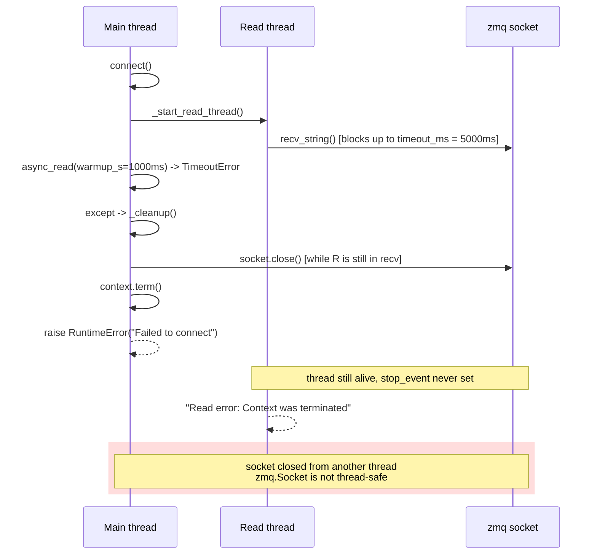
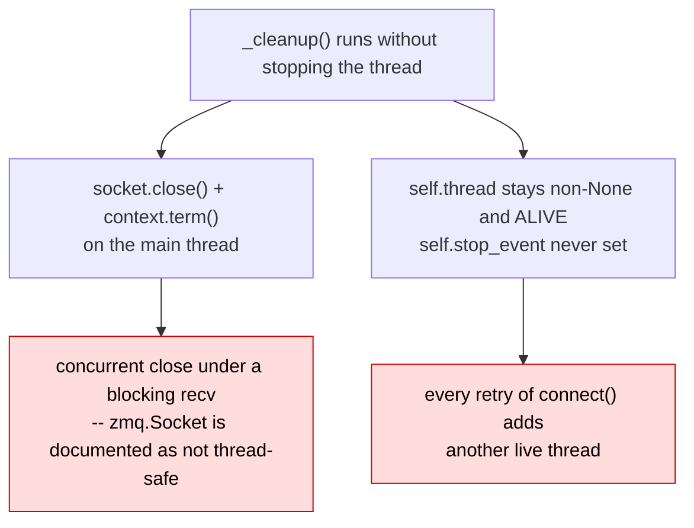
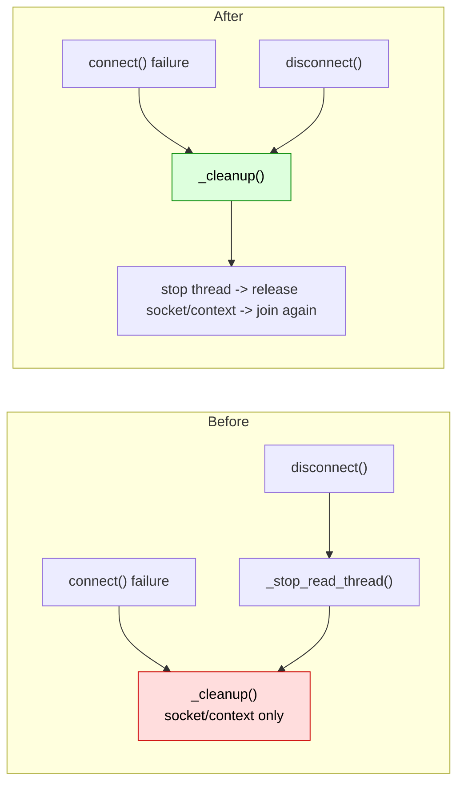
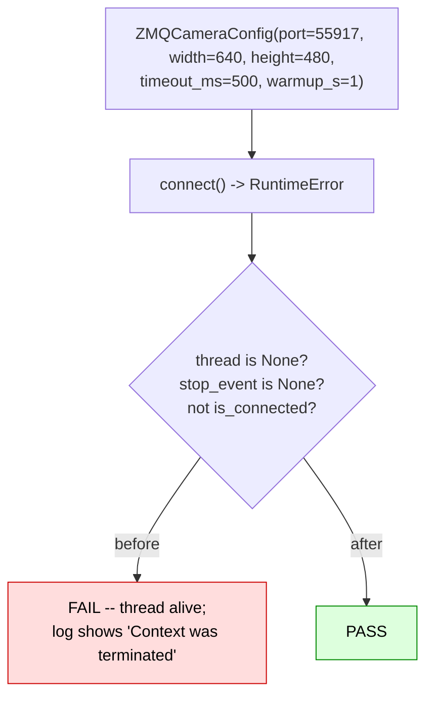

# A failed `ZMQCamera.connect()` leaves a live read thread and closes its socket underneath it

|                   |                                                                                            |
| ----------------- | ------------------------------------------------------------------------------------------ |
| **Branch**        | `fix/zmq-cleanup-stops-read-thread` (replica: `replica/fix-zmq-cleanup-stops-read-thread`) |
| **Base**          | `upstream/main` @ `b9cb121c`                                                               |
| **Commit**        | `6b61cc89`                                                                                 |
| **PR**            | [huggingface/lerobot#4912](https://github.com/huggingface/lerobot/pull/4912)               |
| **Files changed** | `cameras/zmq/camera_zmq.py`, `tests/cameras/test_zmq.py` (new)                             |
| **Related**       | Follows #4187 (merged)                                                                     |
| **Source**        | Self-found — a parity gap, no issue filed                                                  |

---

## 1. The issue

`connect()` has one failure handler, and it calls the wrong teardown:

```python
            self._start_read_thread()
            ...
            if warmup:
                ...
                with self.frame_lock:
                    if self.latest_frame is None:
                        raise ConnectionError(f"{self} failed to capture frames during warmup.")

        except Exception as e:
            self._cleanup()                       # <-- does not stop the read thread
            raise RuntimeError(f"Failed to connect to {self}: {e}") from e

    def _cleanup(self):
        """Clean up ZMQ resources."""
        self._connected = False
        if self.socket:
            self.socket.close()                   # from the MAIN thread
            self.socket = None
        if self.context:
            self.context.term()
            self.context = None
```

`_stop_read_thread()` exists, but on `upstream/main` it is only ever reached from `disconnect()`.

### The reachable failure

Nothing exotic is required — server down, wrong address, or wrong port is enough. The warmup
`async_read()` gives up after `warmup_s` (default 1 s) while the read thread is still blocked in
`recv_string()`, whose `RCVTIMEO` is `timeout_ms` — **default 5000 ms**, five times the warmup budget.



Two distinct defects fall out of that single missing call:



The lingering thread signs its own name in the logs: `Read error: Context was terminated` is emitted
by a read thread touching a context the main thread already destroyed.

### Why it was missed

With `width`/`height` left unset, `connect()` auto-detects them via a **synchronous** read _before_
starting the thread. On that path the thread never starts, so the leak cannot occur — which is
plausibly why this survived.

### Already fixed for the other two backends

`OpenCVCamera` does it correctly, and the correct version arrived with **#4187** — whose diff is the
whole story:

```console
$ gh pr view 4187 --json files
src/lerobot/cameras/opencv/camera_opencv.py
src/lerobot/cameras/realsense/camera_realsense.py
tests/cameras/test_opencv.py
tests/cameras/test_realsense.py
```

`camera_zmq.py` is absent. Post-#4187, OpenCV has exactly one teardown path, used by both the
failure handler and `disconnect()`:

```python
    def _cleanup_resources(self) -> None:
        """Stop background reads and release the capture, including after partial setup."""
        read_thread = self.thread
        videocapture = self.videocapture
        try:
            self._stop_read_thread()
        finally:
            self.videocapture = None
            try:
                if videocapture is not None:
                    videocapture.release()
            finally:
                # Releasing the device may unblock a hardware read that outlived
                # the first bounded join in _stop_read_thread().
                if read_thread is not None and read_thread.is_alive():
                    read_thread.join(timeout=2.0)
```

---

## 2. The modification

Mirror that structure, and collapse ZMQ's two teardown paths into one.



```python
    def _cleanup(self):
        """Stop background reads and release the ZMQ socket/context, including after partial setup."""
        read_thread = self.thread
        socket = self.socket
        context = self.context

        try:
            self._stop_read_thread()
        finally:
            self._connected = False
            self.socket = None
            self.context = None
            try:
                if socket is not None:
                    socket.close()
                if context is not None:
                    context.term()
            finally:
                # Closing the socket may unblock a recv that outlived the first
                # bounded join in _stop_read_thread().
                if read_thread is not None and read_thread.is_alive():
                    read_thread.join(timeout=2.0)
                    if read_thread.is_alive():  # pragma: no cover
                        logger.warning(f"{self} read thread remained alive after closing the socket.")
```

And `disconnect()` loses its now-duplicated prologue:

```diff
-        if self.thread is not None:
-            self._stop_read_thread()
-
         self._cleanup()
-
-        with self.frame_lock:
-            self.latest_frame = None
-            self.latest_timestamp = None
-            self.new_frame_event.clear()
```

Both removals are safe because `_stop_read_thread()` already sets `stop_event`, joins, nulls
`thread`/`stop_event`, **and** clears the frame buffer under `frame_lock`.

### Why the second join

The first join inside `_stop_read_thread()` is bounded at 2 s, but `recv_string()` can block for up
to 5 s. Closing the socket is what actually unblocks it, so the join has to be retried _after_ the
close — the same compromise #4187 settled on for releasing the capture device.

---

## 3. Tests

New file `tests/cameras/test_zmq.py`: `camera_zmq.py` had **no** test coverage at all before this.
`ZMQCamera.__init__` hard-requires pyzmq, so the file is guarded with
`pytest.importorskip("zmq")` — pyzmq is not in the base test tier (it arrives only via the
`lekiwi` / `unitree_g1` extras).

The test uses the ordinary failure: point the camera at a localhost port with no publisher, with
`width`/`height` set so the thread actually starts.



### Verification performed

```console
# before the fix
$ uv run pytest tests/cameras/test_zmq.py -q
tests/cameras/test_zmq.py:53: AssertionError
WARNING  lerobot.cameras.zmq.camera_zmq: Read error: ZMQCamera(...) timeout after 500ms
WARNING  lerobot.cameras.zmq.camera_zmq: Read error: Context was terminated     <-- the live thread
1 failed

# after
$ uv run pytest tests/cameras -q
48 passed, 3 skipped in 6.07s          # baseline on upstream/main: 47 passed, 3 skipped
```

The `Context was terminated` warning in the failing run is the most direct evidence available that
the thread really does outlive teardown.

Quality hooks on both files — `ruff format`, `ruff`, `typos`, `pyupgrade`, `bandit`, `mypy`,
`gitleaks` — pass.

### Honest limits

- The genuinely-blocked-`recv` case (a publisher stalling mid-send) was not reproduced; that needs a
  real peer. The test covers the reachable server-absent path, which is the common one.
- No assertion is made that `socket.close()` under a concurrent `recv` _crashes_ libzmq — only that
  it happens. The fix removes the window rather than characterising the undefined behaviour.

---

## 4. Known overlap

This creates `tests/cameras/test_zmq.py`, and so does the sibling change that adds the `stop_event`
re-check to the OpenCV and ZMQ read loops (`fix/camera-read-loop-stop-parity`). The two tests are
independent and both belong in that file; whichever lands first, the other rebases. Flagged in the PR
body so a reviewer is not surprised.

---

## 5. PR description

The text below is what accompanies the PR against `huggingface/lerobot:main`.

---

### Title

```
fix(cameras): stop the ZMQ read thread when connect() fails
```

### Summary / Motivation

`ZMQCamera.connect()`'s failure path calls `_cleanup()`, which closed the socket and terminated the context but never asked the read thread to stop — `_stop_read_thread()` was only reachable from `disconnect()`.

The common failure is the ordinary one: server down, wrong address, wrong port. Then the warmup `async_read()` raises after `warmup_s` while the read thread is still blocked in `recv_string()` (RCVTIMEO = `timeout_ms`, default **5000 ms**). Two things go wrong:

- `socket.close()` and `context.term()` run on the main thread **while the background thread is inside `recv_string()` on that same socket**. `zmq.Socket` is explicitly not thread-safe.
- After `connect()` raises, `self.thread` is non-`None` and **still alive** and `self.stop_event` is unset, so nothing ever asks it to stop. A retry loop accumulates live threads.

The lingering thread leaves its own fingerprint in the logs — `Read error: Context was terminated`, emitted by a thread reading a context the main thread already tore down.

PR #4187 ("release device handle when connect() setup fails") fixed exactly this for the OpenCV and RealSense backends; `camera_zmq.py` was absent from its diff.

### Related issues

- Follows #4187, which established the pattern for the other two backends.

### What changed

- `_cleanup()` becomes the single teardown path, mirroring `OpenCVCamera._cleanup_resources()`: stop the read thread first, then release socket and context, then join once more in case closing the socket unblocked a `recv`.
- `disconnect()` now just calls `_cleanup()`. Its explicit `_stop_read_thread()` and frame-buffer clear were redundant — `_stop_read_thread()` already clears the buffer.

### How was this tested (or how to run locally)

New file `tests/cameras/test_zmq.py` — `camera_zmq.py` previously had no test coverage at all. Guarded with `pytest.importorskip("zmq")` since pyzmq is not in the base test tier. The test points a camera at a port with no publisher, so warmup fails for the ordinary reason, and asserts the thread was stopped.

```
# before
$ uv run pytest tests/cameras/test_zmq.py -q
tests/cameras/test_zmq.py:53: AssertionError
WARNING  lerobot.cameras.zmq.camera_zmq: Read error: ZMQCamera(...) timeout after 500ms
WARNING  lerobot.cameras.zmq.camera_zmq: Read error: Context was terminated   <-- the live thread
1 failed

# after
$ uv run pytest tests/cameras -q
48 passed, 3 skipped in 6.07s        # baseline on main: 47 passed, 3 skipped
```

Quality hooks on the changed files (ruff format, ruff, typos, pyupgrade, bandit, mypy, gitleaks) all pass.

### Checklist (required before merge)

- [x] Linting/formatting run (`pre-commit run` on the changed files — all hooks pass)
- [x] Relevant tests pass locally (`tests/cameras`). Full `pytest` **not** run: CPU-only sandbox, 2 cores, so GPU tiers are unreachable.
- [ ] Documentation updated — not applicable, internal lifecycle fix
- [ ] CI is green — will watch after opening
- [x] Community Review: reviewed #4695 — https://github.com/huggingface/lerobot/pull/4695#pullrequestreview-5479555784

### Reviewer notes

- Simplifying `disconnect()` is the part worth your attention. I believe the removed lines were strictly redundant, but if you would rather I left `disconnect()` untouched and only changed `_cleanup()`, that is a one-line change.
- I could not reproduce the genuinely-blocked-`recv` case (that needs a real publisher stalling mid-send); the test covers the reachable server-absent path.
- **Note on overlap:** this creates `tests/cameras/test_zmq.py`, as does my other open PR adding the `stop_event` re-check to the OpenCV/ZMQ read loops. Whichever lands first, I will rebase the other — the two tests are independent and both belong in that file.

### AI assistance disclosure

Per [AI_POLICY.md](https://github.com/huggingface/lerobot/blob/main/AI_POLICY.md): found and written with AI assistance. I verified it myself: confirmed via `gh pr view 4187 --json files` that the merged fix skipped `camera_zmq.py`, read `_cleanup()` on `main` to confirm it never stops the thread, and ran the test to see it fail with the "Context was terminated" warning before the fix and pass after.
