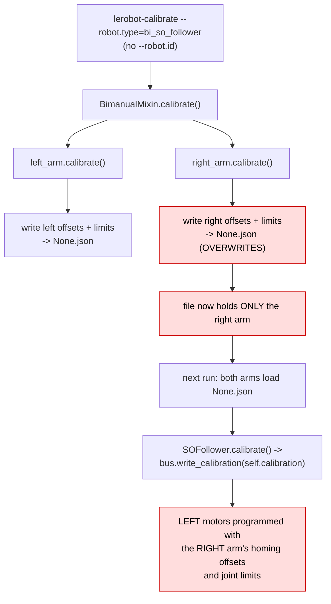
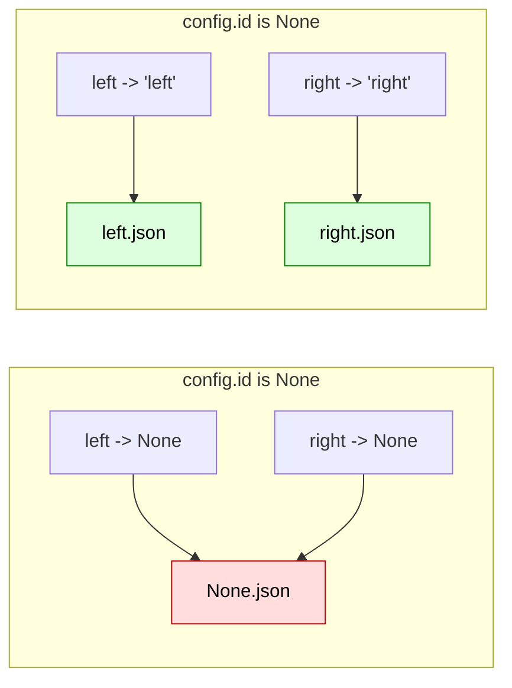
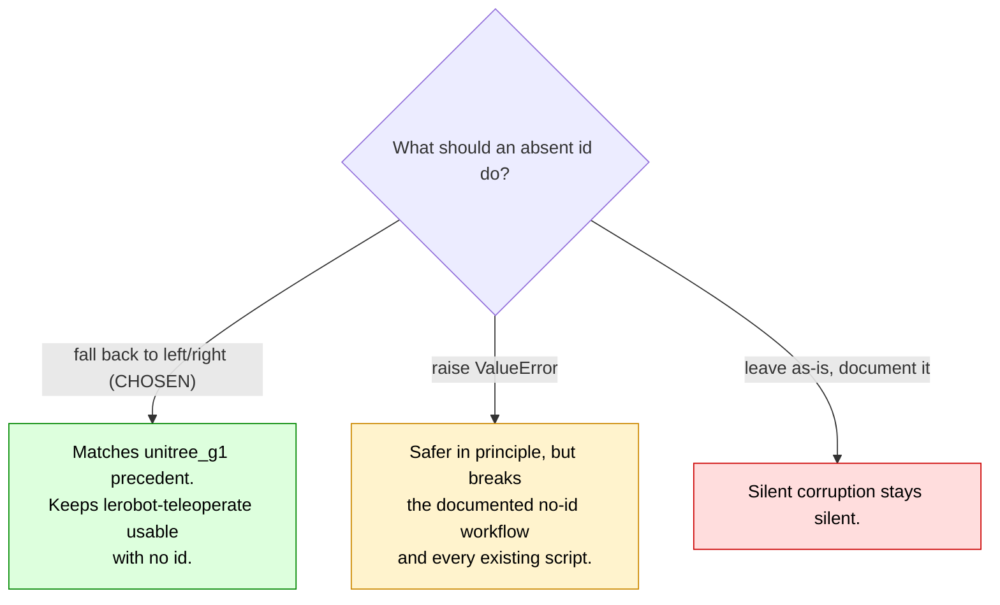
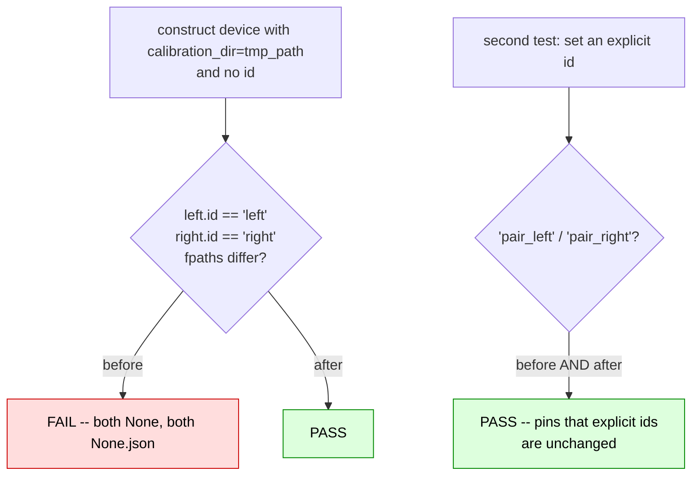

# Both arms of a bimanual robot share one calibration file

|                   |                                                                                                    |
| ----------------- | -------------------------------------------------------------------------------------------------- |
| **Branch**        | `fix/bimanual-calibration-id-collision` (replica: `replica/fix-bimanual-calibration-id-collision`) |
| **Base**          | `upstream/main` @ `b9cb121c`                                                                       |
| **Commit**        | `94a83305`                                                                                         |
| **PR**            | [huggingface/lerobot#4913](https://github.com/huggingface/lerobot/pull/4913)                       |
| **Files changed** | 7 bimanual devices (14 lines) + `tests/robots/test_bimanual_calibration_ids.py` (new)              |
| **Related**       | Pattern introduced by the bimanual consolidation refactors #2780, #3772                            |
| **Source**        | Self-found — no issue filed                                                                        |

---

## 1. The issue

Every bimanual wrapper derives its per-arm ids the same way:

```python
            id=f"{config.id}_left" if config.id else None,
            ...
            id=f"{config.id}_right" if config.id else None,
```

and the base classes turn an id into a calibration path:

```python
# src/lerobot/robots/robot.py:53  (identical in teleoperator.py)
        self.calibration_fpath = self.calibration_dir / f"{self.id}.json"
```

So when `config.id` is `None`, **both** arms stringify to `None` and land on the same file.
Confirmed by construction, no hardware needed:

```console
$ # BiSOFollower with no id
left  id: None | fpath: None.json
right id: None | fpath: None.json
SAME FILE -> True
```

All 14 sites, across 7 devices:

| file                                                       | lines  |
| ---------------------------------------------------------- | ------ |
| `robots/bi_so_follower/bi_so_follower.py`                  | 56, 70 |
| `robots/bi_openarm_follower/bi_openarm_follower.py`        | 56, 75 |
| `robots/bi_rebot_b601_follower/bi_rebot_b601_follower.py`  | 53, 74 |
| `teleoperators/bi_so_leader/bi_so_leader.py`               | 44, 52 |
| `teleoperators/bi_openarm_leader/bi_openarm_leader.py`     | 44, 59 |
| `teleoperators/bi_openarm_mini/bi_openarm_mini.py`         | 49, 57 |
| `teleoperators/bi_rebot_102_leader/bi_rebot_102_leader.py` | 47, 57 |

### How it corrupts a calibration



Half-turn homing offsets are a per-physical-arm quantity, so the left arm ends up reporting and
tracking positions offset by up to half a turn, with the wrong soft limits — on a real robot, with
no error raised anywhere.

### Why this is a live path, not a corner case

`docs/source/hil_data_collection.mdx` documents the workflow **without** ids:

```
--robot.type=bi_openarm_follower ... --teleop.type=bi_openarm_mini
```

(The reBot docs do pass an id, so they were fine.)

Nothing warns: both files resolve, both load, both validate.

### The in-repo precedent

One bimanual device already got this right, which is the strongest evidence it is an oversight
rather than a decision:

```python
# src/lerobot/teleoperators/unitree_g1/unitree_g1.py:190-191
        left_id = f"{config.id}_left" if config.id else "left"
        right_id = f"{config.id}_right" if config.id else "right"
```

---

## 2. The modification

Fourteen lines, `None` -> `"left"` / `"right"`:

```diff
-            id=f"{config.id}_left" if config.id else None,
+            id=f"{config.id}_left" if config.id else "left",
...
-            id=f"{config.id}_right" if config.id else None,
+            id=f"{config.id}_right" if config.id else "right",
```



### Design choice



### Who is and is not affected

Devices whose config carries a **default** `id` were never broken. Verified empirically:

```
BiSOFollower       -> left / right                                  (was None/None -- affected)
BiSOLeader         -> left / right                                  (was None/None -- affected)
BiOpenArmFollower  -> bi_openarm_follower_left / ..._right          (never affected)
```

So the change is a no-op for devices with a default id, and keeps their `<id>_left` naming intact.

### Behaviour change to declare

A user who previously calibrated with no id will no longer find `None.json`, and will be asked to
re-calibrate. That is the correct outcome: the file only ever contained one arm's data, so continuing
to load it is precisely the bug.

---

## 3. Tests

New `tests/robots/test_bimanual_calibration_ids.py`, parametrised over the follower and the leader.
`BiSOFollower` and `BiSOLeader` construct without a bus or any patching, so no mocks are needed.



The explicit-id test deliberately passes in both directions: it is a guard that the fix did not
disturb the `<id>_left` convention, not a demonstration of the bug.

### Verification performed

```console
# before (src reverted, tests kept)
FAILED test_arms_do_not_share_a_calibration_file_without_an_explicit_id[follower]
FAILED test_arms_do_not_share_a_calibration_file_without_an_explicit_id[leader]
2 failed, 2 passed

# after
$ uv run pytest tests/robots/test_bimanual_calibration_ids.py -q
4 passed

$ uv run pytest tests/robots tests/teleoperators -q
147 passed, 4 skipped            # baseline on upstream/main: 143 passed, 4 skipped

$ uv run pytest tests/test_control_robot.py tests/test_rollout_action_ordering.py -q
24 passed
```

Quality hooks on all 8 changed files — `ruff format`, `ruff`, `typos`, `pyupgrade`, `bandit`,
`mypy`, `gitleaks` — pass.

### Honest limits

- No bimanual hardware was available. The file collision and the fix are verified by construction;
  the corruption chain through `BimanualMixin.calibrate()` -> `write_calibration()` is traced by
  reading the code, **not** observed as a physical arm moving to the wrong position.
- Tests cover the SO follower/leader pair only. The other five devices take the identical two-line
  change but need `require_package` patching to construct, so adding five near-duplicate fixtures
  seemed worse than covering the shared behaviour once.

---

## 4. PR description

The text below is what accompanies the PR against `huggingface/lerobot:main`.

---

### Title

```
fix(robots): give each bimanual arm its own calibration file by default
```

### Summary / Motivation

Every bimanual wrapper derives its per-arm ids as:

```python
id=f"{config.id}_left" if config.id else None,
...
id=f"{config.id}_right" if config.id else None,
```

With no explicit `--robot.id` / `--teleop.id`, **both arms get `id=None`**, and `Robot.__init__` then builds `calibration_fpath = calibration_dir / f"{self.id}.json"` — so both arms resolve to the same `None.json`.

Confirmed by construction (no hardware):

```
left  id: None | fpath: None.json
right id: None | fpath: None.json
SAME FILE -> True
```

The damage is silent and persistent. `BimanualMixin.calibrate()` runs the left arm then the right, so the left arm's homing offsets and joint limits are written and then **overwritten by the right arm's**. On the next run both arms load that one file, and `write_calibration()` programs the **left arm's motors with the right arm's calibration**. Half-turn homing offsets differ per physical arm, so the left arm tracks positions offset by up to half a turn, with the wrong soft limits.

This is a documented path, not an exotic one: `docs/source/hil_data_collection.mdx` runs `--robot.type=bi_openarm_follower --teleop.type=bi_openarm_mini` with no ids.

### Related issues

- None filed. The duplicated pattern came in with the bimanual consolidation refactors (#2780, #3772).

### What changed

- Fall back to `"left"` / `"right"` instead of `None`, in all 7 bimanual devices (14 lines).

This is not a new convention — it is what the Unitree G1 teleoperator already does:

```python
# src/lerobot/teleoperators/unitree_g1/unitree_g1.py:190-191
left_id = f"{config.id}_left" if config.id else "left"
right_id = f"{config.id}_right" if config.id else "right"
```

Devices whose config carries a default `id` (e.g. `bi_openarm_follower`) were never affected and keep their existing `<id>_left` / `<id>_right` paths.

**Behaviour change to be aware of:** a user who previously calibrated without an id will no longer find `None.json` and will be asked to re-calibrate. That file only ever held one arm's data, so re-calibrating is the correct outcome rather than a regression.

### How was this tested (or how to run locally)

New `tests/robots/test_bimanual_calibration_ids.py`, parametrised over the follower and the leader. No hardware: `BiSOFollower` / `BiSOLeader` construct without a bus.

```
# before
FAILED test_arms_do_not_share_a_calibration_file_without_an_explicit_id[follower]
FAILED test_arms_do_not_share_a_calibration_file_without_an_explicit_id[leader]
2 failed, 2 passed

# after
$ uv run pytest tests/robots/test_bimanual_calibration_ids.py -q
4 passed

$ uv run pytest tests/robots tests/teleoperators -q
147 passed, 4 skipped            # baseline on main: 143 passed, 4 skipped

$ uv run pytest tests/test_control_robot.py tests/test_rollout_action_ordering.py -q
24 passed
```

The two `test_explicit_id_still_prefixes_each_arm` cases pass before _and_ after — explicit ids were never broken, and they pin that the `<id>_left` naming is unchanged.

Quality hooks on all changed files (ruff format, ruff, typos, pyupgrade, bandit, mypy, gitleaks) all pass.

### Checklist (required before merge)

- [x] Linting/formatting run (`pre-commit run` on the changed files — all hooks pass)
- [x] Relevant tests pass locally (`tests/robots`, `tests/teleoperators`, control + rollout ordering). Full `pytest` **not** run: CPU-only sandbox.
- [ ] Documentation updated — the docs that omit `--robot.id` now work correctly rather than needing a change; happy to add an explicit id to them if you prefer
- [ ] CI is green — will watch after opening
- [x] Community Review: reviewed #4695 — https://github.com/huggingface/lerobot/pull/4695#pullrequestreview-5479555784

### Reviewer notes

- **The one real decision:** fallback to `"left"`/`"right"` versus raising `ValueError("bimanual devices require an explicit id")`. I chose the fallback because it matches the existing Unitree G1 precedent and keeps `lerobot-teleoperate` usable with no id. Say the word if you would rather it were a hard error.
- I have no bimanual hardware, so I verified the file-path collision and the fix by construction, and traced the corruption chain through `BimanualMixin.calibrate()` -> `write_calibration()` by reading the code. I have not observed a physical arm move to the wrong position.
- Tests cover the SO follower/leader pair. The other five devices take the identical two-line change but need `require_package` patching to construct, so I left them to the shared pattern rather than adding five near-duplicate fixtures.

### AI assistance disclosure

Per [AI_POLICY.md](https://github.com/huggingface/lerobot/blob/main/AI_POLICY.md): found and written with AI assistance. I verified it myself: constructed both devices and printed the colliding `calibration_fpath`, grepped all 14 occurrences of the pattern, confirmed the `unitree_g1.py` precedent, and confirmed `bi_openarm_follower` was unaffected because its config sets a default id. Tests were run locally and verified to fail before the fix and pass after.
