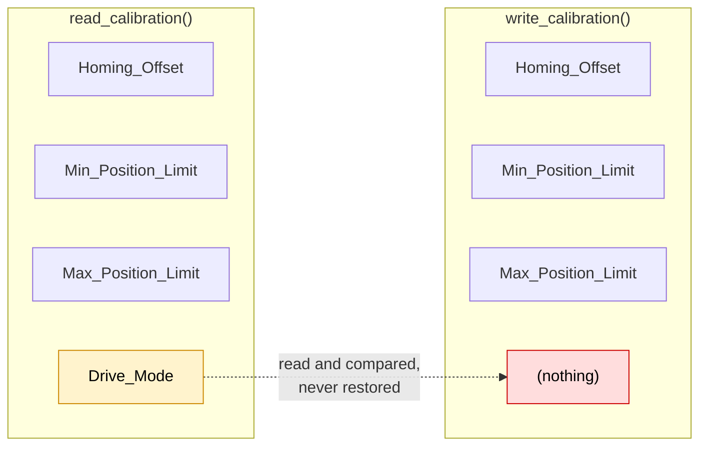
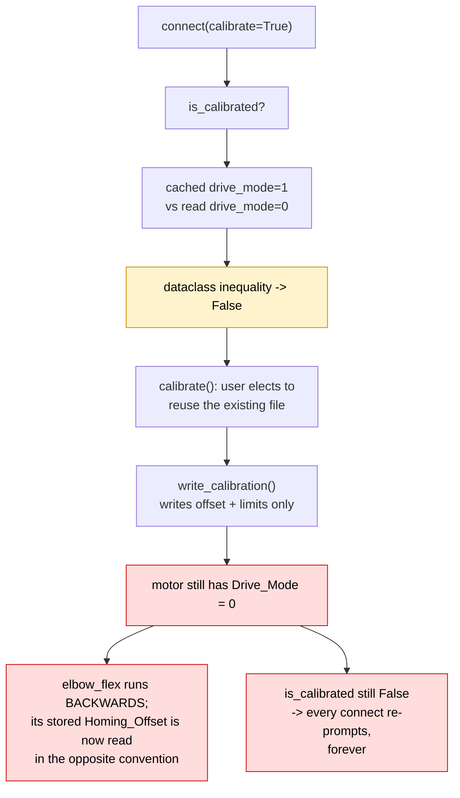
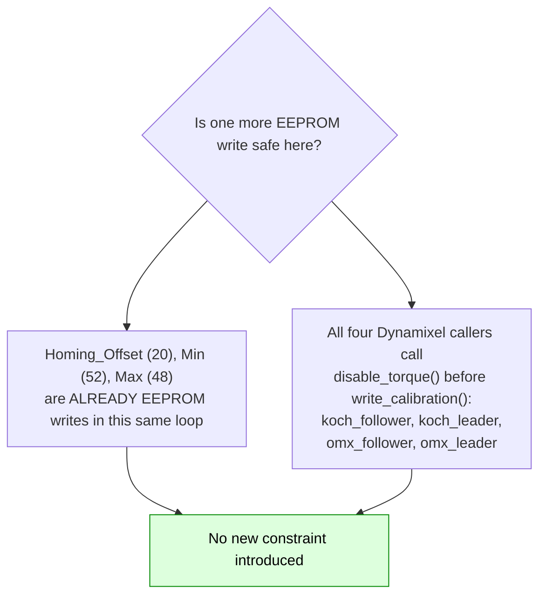
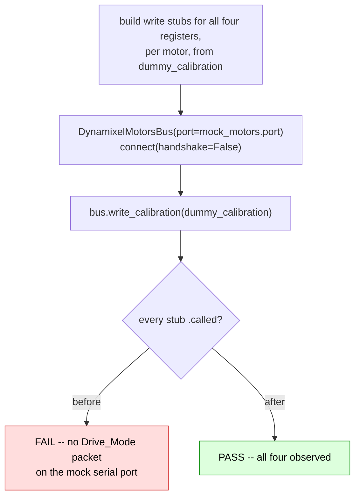

# Dynamixel calibration reads `Drive_Mode` but never writes it back

|                   |                                                                                      |
| ----------------- | ------------------------------------------------------------------------------------ |
| **Branch**        | `fix/dynamixel-write-drive-mode` (replica: `replica/fix-dynamixel-write-drive-mode`) |
| **Base**          | `upstream/main` @ `b9cb121c`                                                         |
| **Commit**        | `3c251ecb`                                                                           |
| **PR**            | [huggingface/lerobot#4914](https://github.com/huggingface/lerobot/pull/4914)         |
| **Files changed** | `motors/dynamixel/dynamixel.py`, `tests/motors/test_dynamixel.py`                    |
| **Related**       | Distinct from open PR #4672 (see §4)                                                 |
| **Source**        | Self-found — no issue filed                                                          |

---

## 1. The issue

`MotorCalibration` has four fields. Dynamixel reads all four and compares all four, but writes only
three.



```python
    @property
    def is_calibrated(self) -> bool:
        return self.calibration == self.read_calibration()      # compares drive_mode too

    def read_calibration(self) -> dict[str, MotorCalibration]:
        offsets = self.sync_read("Homing_Offset", normalize=False)
        mins = self.sync_read("Min_Position_Limit", normalize=False)
        maxes = self.sync_read("Max_Position_Limit", normalize=False)
        drive_modes = self.sync_read("Drive_Mode", normalize=False)        # <-- read
        ...

    def write_calibration(self, calibration_dict, cache: bool = True) -> None:
        for motor, calibration in calibration_dict.items():
            self.write("Homing_Offset", motor, calibration.homing_offset)
            self.write("Min_Position_Limit", motor, calibration.range_min)
            self.write("Max_Position_Limit", motor, calibration.range_max)
            # Drive_Mode never written
```

`Drive_Mode` is writable — `X_SERIES_CONTROL_TABLE` has `"Drive_Mode": (10, 1)` — is not normalised,
and has no sign-encoding entry, so `self.write("Drive_Mode", motor, v)` is a plain one-byte write.
Empirically, with `write` patched to record calls:

```
registers written by write_calibration():
    ('Homing_Offset', 'shoulder_pan', -709)
    ('Min_Position_Limit', 'shoulder_pan', 43)
    ('Max_Position_Limit', 'shoulder_pan', 1335)
    ...
Drive_Mode written at all? -> False
```

### Why it matters: nothing compensates in software

```python
# src/lerobot/motors/dynamixel/dynamixel.py:100
    apply_drive_mode = False
```

For Dynamixel, direction inversion is **not** applied in software — it has to live in the motor's
`Drive_Mode` register. (Contrast Feetech, which has no such register, hardcodes `drive_mode=0` in
`read_calibration`, and deliberately omits drive mode from its `is_calibrated` comparison. The
read/write asymmetry is Dynamixel-specific and unambiguous.)

The Koch leader has an inverted joint, and writes the register **only** inside `calibrate()`:

```python
# src/lerobot/teleoperators/koch_leader/koch_leader.py:103  (in calibrate(), fresh-calibration branch)
        self.bus.write("Drive_Mode", "elbow_flex", DriveMode.INVERTED.value)
```

`configure()` does not. So take the restore path — a calibration file exists, but the motor's
`Drive_Mode` is 0 (new or replaced motor, factory reset, or one re-flashed with Dynamixel Wizard):



The loop at **I** is the cruel part: the only branch that would fix the register is the fresh
calibration the user keeps declining, so declining it is self-perpetuating.

### Corroboration that this is an omission, not a design choice

The _other_ Dynamixel leader works around it by duplicating the write in `configure()`:

```python
# src/lerobot/teleoperators/omx_leader/omx_leader.py
 96/ 98:   self.bus.write("Drive_Mode", motor, DriveMode.INVERTED/NON_INVERTED.value)   # calibrate()
127/129:   self.bus.write("Drive_Mode", motor, DriveMode.INVERTED/NON_INVERTED.value)   # configure()
```

Koch leader has no such second write. A per-device workaround for a bus-level gap.

---

## 2. The modification

One line plus a comment, ordered first because it defines the convention the other three are
expressed in:

```diff
         for motor, calibration in calibration_dict.items():
+            # `Drive_Mode` selects the direction convention that `Homing_Offset` and the position
+            # limits are expressed in, and `read_calibration()` reads it back. Omitting it here left
+            # `is_calibrated` permanently False -- and the joint running backwards, since
+            # `apply_drive_mode` is False for Dynamixel so nothing compensates it in software.
+            self.write("Drive_Mode", motor, calibration.drive_mode)
             self.write("Homing_Offset", motor, calibration.homing_offset)
             self.write("Min_Position_Limit", motor, calibration.range_min)
             self.write("Max_Position_Limit", motor, calibration.range_max)
```

### EEPROM write safety

`Drive_Mode` is an EEPROM register, which needs torque disabled. That precondition is already met:



Cost: one extra byte written per motor per `write_calibration()` call.

---

## 3. Tests

Added `test_write_calibration_writes_drive_mode` to `tests/motors/test_dynamixel.py`, following the
`build_write_stub` idiom of the adjacent `test_reset_calibration`. There was previously **no**
`test_write_calibration` in that file at all.

The existing `dummy_calibration` fixture already sets `drive_modes = [0, 1, 0]`, so it covers an
inverted motor with no fixture change.



Assertions are made against the **actual packets** observed on a `mock_serial`-backed port, not
against patched Python calls — so no serial device is required, but the wire-level behaviour is what
is checked.

### A verification trap worth recording

`tests/motors/` **silently skips all four files** unless the protocol SDKs are present:

```console
$ uv run pytest tests/motors -q
4 skipped                 # <-- looks fine, ran nothing

$ uv sync --locked --extra test --extra dataset --extra hardware \
          --extra feetech --extra dynamixel --extra damiao
$ uv run pytest tests/motors -q
109 passed, 3 skipped     # the real baseline
```

A motor fix "verified" without those extras is not verified at all. (`scservo_sdk` = feetech,
`dynamixel_sdk` = dynamixel, `python-can` = damiao; the `hardware` extra alone only adds `pyserial`.)

### Verification performed

```console
# before (src reverted, test kept)
$ uv run pytest tests/motors/test_dynamixel.py -q -k write_calibration
tests/motors/test_dynamixel.py:388: AssertionError
1 failed, 35 deselected

# after
$ uv run pytest tests/motors -q
110 passed, 3 skipped in 2.62s          # baseline: 109 passed, 3 skipped

$ uv run pytest tests/robots tests/teleoperators -q
143 passed, 4 skipped
```

Quality hooks on both files — `ruff format`, `ruff`, `typos`, `pyupgrade`, `bandit`, `mypy`,
`gitleaks` — pass. (`ruff format` reformatted the new test on the first run; re-run clean and the
test re-verified afterwards.)

### Honest limits

- No Dynamixel hardware. The direction-reversal consequence is traced from `apply_drive_mode = False`
  plus the Koch leader's `calibrate()`-only write; it was **not** observed on a physical arm. The
  test proves the register is now written, not that the motor turns the right way.

---

## 4. Not a duplicate of PR #4672

Open PR #4672 rewrites this method as part of a unified `SerialMotorsBus`. I pulled its diff: its
`write_calibration` still writes only offset and limits. It addresses the **symptom** in
`is_calibrated` instead:

```python
# PR #4672
and (cached.drive_mode == read.drive_mode or not self._has_register(motor, "Drive_Mode"))
```

That stops `is_calibrated` from being permanently False, but leaves the register unrestored — so the
joint still runs backwards. The two changes are complementary; if #4672 lands first, the same one-line
write belongs in its unified method.

A search for any open PR writing `Drive_Mode` inside `write_calibration` returns nothing.

### Related maintainer stance, and why it does not apply

PR #4212 (closed) is the only prior maintainer comment on drive mode. @Maximellerbach declined it
with _"this is more of a hardware issue than software"_ — but that PR proposed **adding a new
calibration step to detect** a reversed gripper mounting on **Feetech** SO arms. This change adds no
step, no detection and no UX: it writes back a field `read_calibration()` already reads, for an
in-tree **Dynamixel** device that already declares `drive_mode=1` itself. Worth stating the
distinction explicitly in review.

---

## 5. PR description

The text below is what accompanies the PR against `huggingface/lerobot:main`.

---

### Title

```
fix(motors): write Drive_Mode back in DynamixelMotorsBus.write_calibration
```

### Summary / Motivation

`DynamixelMotorsBus.read_calibration()` reads `Drive_Mode` into `MotorCalibration.drive_mode`, and `is_calibrated` compares the whole dataclass:

```python
@property
def is_calibrated(self) -> bool:
    return self.calibration == self.read_calibration()

def read_calibration(self):
    ...
    drive_modes = self.sync_read("Drive_Mode", normalize=False)
```

But `write_calibration()` only writes three of the four fields:

```python
for motor, calibration in calibration_dict.items():
    self.write("Homing_Offset", motor, calibration.homing_offset)
    self.write("Min_Position_Limit", motor, calibration.range_min)
    self.write("Max_Position_Limit", motor, calibration.range_max)
    # Drive_Mode never written
```

So the register is read and compared but never restored. `Drive_Mode` is writable at address `(10, 1)` in `X_SERIES_CONTROL_TABLE`, is not normalised, and has no sign-encoding entry — a plain one-byte write.

This matters because `DynamixelMotorsBus.apply_drive_mode = False`: inversion is **not** compensated in software, it has to live in the motor's register.

Take a device that calibrates an inverted joint. The Koch leader writes `Drive_Mode` for `elbow_flex` — but only inside `calibrate()`, not `configure()`. Now reuse an existing calibration file against a motor whose `Drive_Mode` is 0 (new or replaced motor, factory reset, or one re-flashed with Dynamixel Wizard):

1. `is_calibrated` -> cached `drive_mode=1` vs. read `0` -> **False**.
2. `calibrate()` -> user elects to reuse the file -> `write_calibration()` writes offset and limits, **not** `Drive_Mode`.
3. The motor still has `Drive_Mode = 0`. Two consequences, both silent:
   - **`elbow_flex` runs in the wrong direction**, and its stored `Homing_Offset` is now interpreted in the opposite direction convention.
   - **`is_calibrated` can never become True**, so every subsequent connect reports a calibration mismatch and re-prompts — a loop the user cannot exit by declining.

Corroborating evidence that this is an omission rather than a design choice: the other Dynamixel leader works around it by duplicating the `Drive_Mode` write in `configure()` (`omx_leader.py`, lines 127/129) in addition to `calibrate()`. The Koch leader has no such second write. And `FeetechMotorsBus.is_calibrated` deliberately compares only ranges and homing offset, because Feetech has no `Drive_Mode` register — so the read/write asymmetry is Dynamixel-specific and unambiguous.

### Related issues

- None filed.

### What changed

- `write_calibration()` writes `Drive_Mode` first, before the offset and limits it defines the convention for (1 line + comment).

### How was this tested (or how to run locally)

New `tests/motors/test_dynamixel.py::test_write_calibration_writes_drive_mode`, following the `build_write_stub` pattern of the adjacent `test_reset_calibration`. The existing `dummy_calibration` fixture already sets `drive_modes = [0, 1, 0]`, so it covers an inverted motor with no fixture change. There was previously no `test_write_calibration` in this file.

No serial device needed — `mock_serial` backs the bus, and the assertions check the actual packets observed on the mock port.

```
# before
$ uv run pytest tests/motors/test_dynamixel.py -q -k write_calibration
tests/motors/test_dynamixel.py:388: AssertionError      # no Drive_Mode packet emitted
1 failed

# after
$ uv run pytest tests/motors -q
110 passed, 3 skipped in 2.62s          # baseline on main: 109 passed, 3 skipped

$ uv run pytest tests/robots tests/teleoperators -q
143 passed, 4 skipped
```

Note for reproducing: `tests/motors/` silently skips all four files unless the protocol SDKs are installed (`--extra hardware --extra feetech --extra dynamixel --extra damiao`); without them you get "4 skipped" and no signal.

Quality hooks on the changed files (ruff format, ruff, typos, pyupgrade, bandit, mypy, gitleaks) all pass.

### Checklist (required before merge)

- [x] Linting/formatting run (`pre-commit run` on the changed files — all hooks pass)
- [x] Relevant tests pass locally (`tests/motors`, `tests/robots`, `tests/teleoperators`). Full `pytest` **not** run: CPU-only sandbox.
- [ ] Documentation updated — not applicable
- [ ] CI is green — will watch after opening
- [x] Community Review: reviewed #4695 — https://github.com/huggingface/lerobot/pull/4695#pullrequestreview-5479555784

### Reviewer notes

- **Worth your judgement:** this adds one EEPROM byte write per motor per `write_calibration()`. I checked that all four Dynamixel callers (`koch_follower`, `koch_leader`, `omx_follower`, `omx_leader`) already call `disable_torque()` beforehand, which is the precondition EEPROM writes need, so no new constraint is introduced — but you know the hardware wear considerations better than I do.
- I have no Dynamixel hardware, so the direction-reversal consequence is traced from `apply_drive_mode = False` plus the Koch leader's `calibrate()`-only write, not observed on a physical arm. The test proves the register is now written; it does not prove the motor turns the right way.
- **Distinct from #4672:** that PR rewrites this method and papers over the symptom in `is_calibrated` (`cached.drive_mode == read.drive_mode or not self._has_register(...)`) while still not writing the register. If it lands first, the same one-line write belongs in its unified method.
- Possible follow-up, deliberately not bundled: the now-redundant `Drive_Mode` writes in `omx_leader.configure()` could be dropped.

### AI assistance disclosure

Per [AI_POLICY.md](https://github.com/huggingface/lerobot/blob/main/AI_POLICY.md): found and written with AI assistance. I verified it myself: confirmed `Drive_Mode` is read in `read_calibration` and absent from `write_calibration` on `main`, confirmed it is writable at `(10, 1)` in the control table, confirmed `apply_drive_mode = False`, confirmed the Koch leader writes it only in `calibrate()`, and pulled #4672's diff to confirm it does not add this write. The test was run locally and verified to fail before the fix and pass after.
