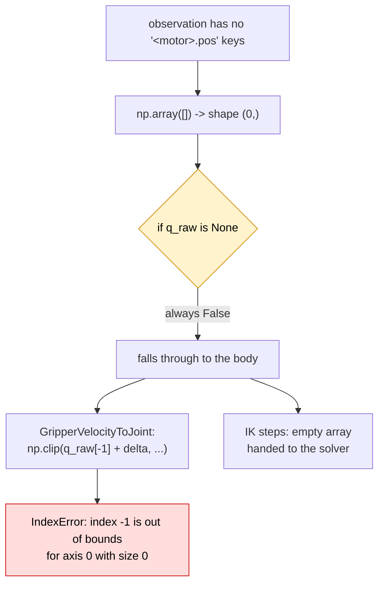
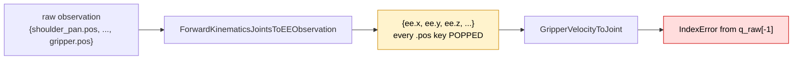
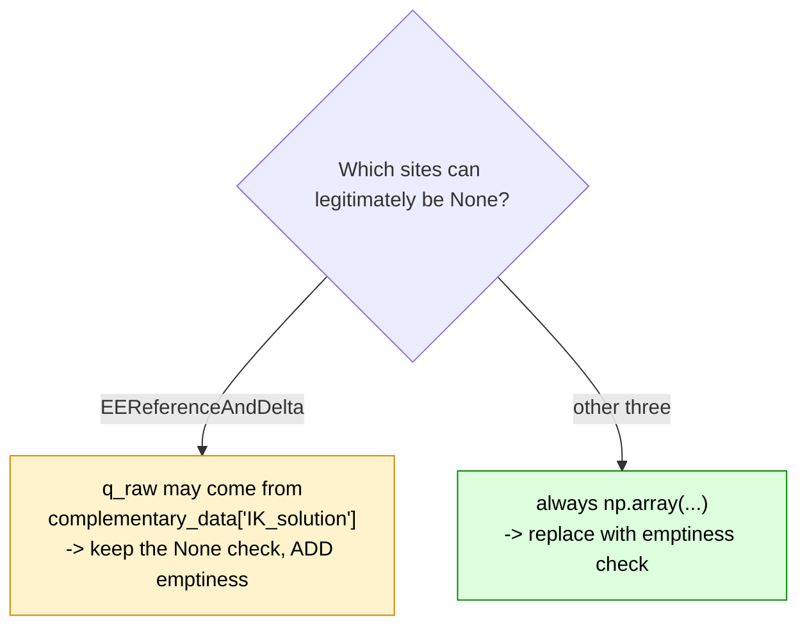
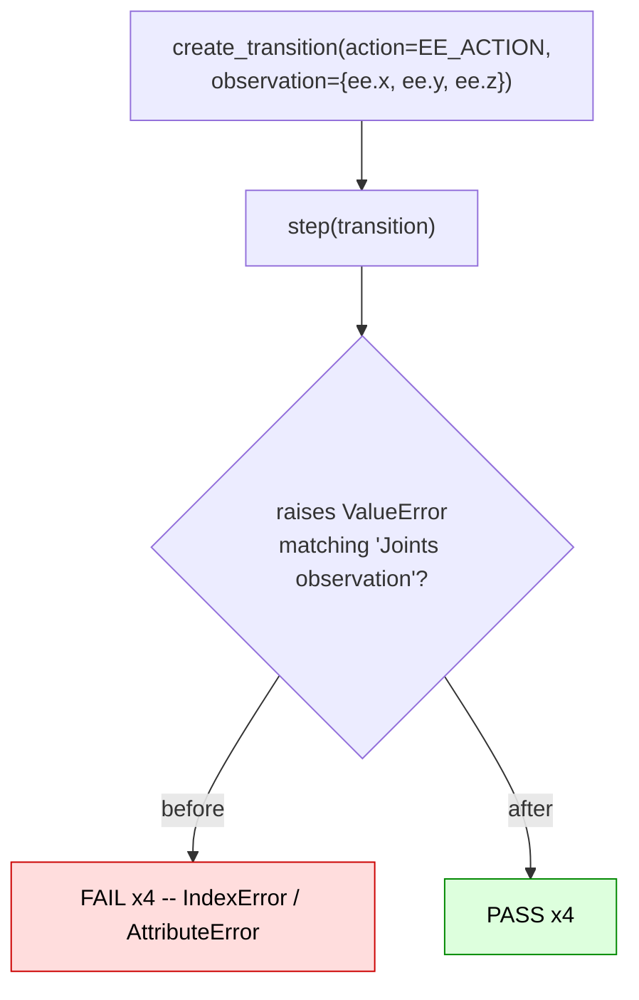

# The kinematics joints guard tests a condition that can never be true

|                   |                                                                                                     |
| ----------------- | --------------------------------------------------------------------------------------------------- |
| **Branch**        | `fix/kinematics-empty-joints-guard` (replica: `replica/fix-kinematics-empty-joints-guard`)          |
| **Base**          | `upstream/main` @ `b9cb121c`                                                                        |
| **Commit**        | `82e11dbe`                                                                                          |
| **PR**            | [huggingface/lerobot#4915](https://github.com/huggingface/lerobot/pull/4915)                        |
| **Files changed** | `robots/so_follower/robot_kinematic_processor.py`, `tests/robots/test_robot_kinematic_processor.py` |
| **Related**       | Follows #4255 (merged); orthogonal to #4442 / #4788                                                 |
| **Source**        | Self-found — no issue filed                                                                         |

---

## 1. The issue

Four kinematics steps build `q_raw` from the observation's joint keys, then guard it against `None`:

```python
        q_raw = np.array(
            [float(v) for k, v in observation.items() if isinstance(k, str) and k.endswith(".pos")],
            dtype=float,
        )
        if q_raw is None:          # np.array(...) is NEVER None
            raise ValueError("Joints observation is require for computing robot kinematics")
```

`np.array()` always returns an ndarray. When no key matches, it returns an array of **size 0** — not
`None`. The guard is dead code, and the documented `ValueError` is unreachable.



Reproduced on `upstream/main` with `observation = {"ee.x": 0.0, "ee.y": 0.0, "ee.z": 0.0}`:

```
GripperVelocityToJoint       -> IndexError: index -1 is out of bounds for axis 0 with size 0
InverseKinematicsEEToJoints  -> empty array handed to the solver
InverseKinematicsRLStep      -> empty array handed to the solver
EEReferenceAndDelta          -> empty array handed to FK
```

The `IndexError` surfaces from inside `np.clip` and mentions neither joints, nor observations, nor
which key was missing — for a condition the class explicitly documents a `ValueError` for.

### That input is reachable, not hypothetical

`compute_forward_kinematics_joints_to_ee` **pops every joint key** as it maps the observation into
EE space:

```python
for n in motor_names:
    joints.pop(f"{n}.pos")
```

So any pipeline that runs the FK-observation step before one of these steps hands them an
observation with no `.pos` keys at all:



A policy observation keyed `observation.state` rather than `<motor>.pos` reaches the same place.

### A quieter sibling, deliberately left alone

With 5 of 6 joint keys present, `GripperVelocityToJoint` integrates the **wrong joint** — `q_raw[-1]`
is `wrist_roll`, not `gripper` — and commands a bogus gripper position with **no error at all**. That
depends on the ordering assumption flagged in-source two lines above:

```python
        # TODO: This assumes gripper is the last specified joint in the robot
        gripper_pos = float(np.clip(q_raw[-1] + delta, self.clip_min, self.clip_max))
```

That TODO is issue #4442's territory (open PR #4788). This change does not touch it; it only makes
the fully-empty case loud.

---

## 2. The modification



That asymmetry is real and is why the diff is not uniform. `EEReferenceAndDelta`:

```python
        if self.use_ik_solution and complementary_data is not None and "IK_solution" in complementary_data:
            q_raw = complementary_data["IK_solution"]      # genuinely may be None
        else:
            q_raw = np.array([...], dtype=float)
```

Rather than repeat the guard at four call sites, it is factored into one module-level helper:

```python
def _assert_joints_present(q_raw: Any, observation: dict[str, Any]) -> None:
    """Raise if the observation carried no joint positions.

    `ForwardKinematicsJointsToEE*` pops every `<motor>.pos` key, so a pipeline that maps the
    observation to end-effector space before a kinematics step leaves it with nothing to read.
    """
    if q_raw is None or np.size(q_raw) == 0:
        raise ValueError(
            "Joints observation is required for computing robot kinematics: no '<motor>.pos' key "
            f"was found in the observation. Got keys: {sorted(k for k in observation if isinstance(k, str))}"
        )
```

and each of the four sites becomes a single call:

```diff
-        if q_raw is None:
-            raise ValueError("Joints observation is require for computing robot kinematics")
+        _assert_joints_present(q_raw, observation)
```

The helper tests `is None` as well as emptiness, which keeps `EEReferenceAndDelta` correct —
there `q_raw` can come from `complementary_data["IK_solution"]` and genuinely be `None`. `np.size()`
is used rather than `.size` for the same reason: an `IK_solution` need not be an ndarray.

Two deliberate details:

- The message keeps the **`"Joints observation"`** prefix, so the existing #4255 test
  (`pytest.raises(ValueError, match="Joints observation")`) still matches.
- It now lists the keys that _were_ present, because the whole failure mode is "I passed the wrong
  shape of observation and got told nothing about it". It also fixes the "is require" typo.

### The merged precedent

**#4255** fixed the adjacent condition for exactly the same underlying reason, and its test docstring
says so:

> _"These steps used to call `.copy()` on that before the None check, so the guard below them was
> unreachable and an AttributeError escaped instead."_

Same shape of defect (unreachable guard -> opaque exception escapes), same shape of fix, one
condition over. That is the strongest review argument available here.

---

## 3. Tests

Added `test_observation_without_joint_keys_raises_value_error`, parametrised over all four steps,
sitting directly below the existing `test_missing_observation_raises_value_error` block it mirrors.

No placo, no robot, no mocks: `kinematics=None` suffices, because a correct guard must fire _before_
the solver is touched. That is itself part of what the test pins.



### Verification performed

```console
# before (src reverted, tests kept)
FAILED test_observation_without_joint_keys_raises_value_error[ee_reference_and_delta]
FAILED test_observation_without_joint_keys_raises_value_error[inverse_kinematics_ee_to_joints]
FAILED test_observation_without_joint_keys_raises_value_error[gripper_velocity_to_joint]
FAILED test_observation_without_joint_keys_raises_value_error[inverse_kinematics_rl_step]
4 failed

# after
$ uv run pytest tests/robots/test_robot_kinematic_processor.py -q
10 passed          # 6 pre-existing + 4 new

$ uv run pytest tests/robots tests/teleoperators -q
147 passed, 4 skipped
```

The 6 pre-existing tests — including #4255's `observation is None` cases — pass unchanged, which is
what the retained `"Joints observation"` prefix buys.

Quality hooks on both files — `ruff format`, `ruff`, `typos`, `pyupgrade`, `bandit`, `mypy`,
`gitleaks` — pass.

### Honest limits

- With `kinematics=None`, the three non-gripper steps raised `AttributeError` before the fix rather
  than reaching the solver. That is an artefact of the test's null kinematics: in production, with a
  real `RobotKinematics`, an empty `q_raw` propagates into the solver instead. The `IndexError` in
  `GripperVelocityToJoint` is the one failure that is purely the bug, independent of test setup —
  worth being precise about rather than overclaiming all four.
- No robot was available, so nothing here is validated against a moving arm.

---

## 4. PR description

The text below is what accompanies the PR against `huggingface/lerobot:main`.

---

### Title

```
fix(so_follower): make the kinematics joints guard reachable
```

### Summary / Motivation

The four kinematics steps in `robot_kinematic_processor.py` build `q_raw` from the observation's `<motor>.pos` keys and then guard it with a condition that can never hold:

```python
q_raw = np.array(
    [float(v) for k, v in observation.items() if isinstance(k, str) and k.endswith(".pos")],
    dtype=float,
)
if q_raw is None:          # np.array(...) is never None
    raise ValueError("Joints observation is require for computing robot kinematics")
```

So an observation carrying no joint keys reaches the body. Reproduced on `main` (no hardware):

```
GripperVelocityToJoint       -> IndexError: index -1 is out of bounds for axis 0 with size 0
InverseKinematicsEEToJoints  -> empty array handed to the solver
InverseKinematicsRLStep      -> empty array handed to the solver
EEReferenceAndDelta          -> empty array handed to FK
```

`GripperVelocityToJoint` is the clearest: `q_raw[-1] + delta` inside `np.clip` raises an `IndexError` that mentions neither joints, nor observations, nor which key was missing — while the class documents a `ValueError` for exactly this case.

That input is reachable rather than hypothetical. `compute_forward_kinematics_joints_to_ee` **pops every `<motor>.pos` key**, so a pipeline that maps the observation to EE space before one of these steps leaves `q_raw` empty; so does a policy observation keyed `observation.state`.

There is also a quieter failure: with 5 of 6 joint keys present, `GripperVelocityToJoint` integrates the **wrong joint** — `q_raw[-1]` is now `wrist_roll`, not `gripper` — and commands a bogus gripper position with no error at all. This PR does not change that (it depends on the ordering TODO at the same line, which is #4442's territory); it only makes the empty case loud.

### Related issues

- Follows #4255, which made the adjacent `observation is None` guard reachable for precisely the same reason — its test docstring reads _"the guard below them was unreachable and an AttributeError escaped instead."_ This is the same fix shape for the neighbouring condition.
- Related: #4442 / #4788 cover the `.pos` **ordering** assumption, deliberately untouched here.

### What changed

- A new `_assert_joints_present(q_raw, observation)` helper raises the documented `ValueError` when the observation carried no joint positions, and names the keys that were present so the caller can see what it passed.
- All four steps call it in place of the dead `if q_raw is None` check, rather than repeating the guard inline.
- The helper keeps the `is None` case too, which `EEReferenceAndDelta` still needs: there `q_raw` can legitimately come from `complementary_data["IK_solution"]`.
- The message keeps the `"Joints observation"` prefix, so the existing #4255 test still matches, and fixes its "is require" typo.

### How was this tested (or how to run locally)

New `test_observation_without_joint_keys_raises_value_error`, parametrised over all four steps, mirroring the existing `test_missing_observation_raises_value_error` block directly above it. No placo, no robot, no mocks — `kinematics=None` is enough, because the guard must fire before the solver is touched.

```
# before
FAILED test_observation_without_joint_keys_raises_value_error[ee_reference_and_delta]
FAILED test_observation_without_joint_keys_raises_value_error[inverse_kinematics_ee_to_joints]
FAILED test_observation_without_joint_keys_raises_value_error[gripper_velocity_to_joint]
FAILED test_observation_without_joint_keys_raises_value_error[inverse_kinematics_rl_step]
4 failed

# after
$ uv run pytest tests/robots/test_robot_kinematic_processor.py -q
10 passed            # 6 pre-existing + 4 new

$ uv run pytest tests/robots tests/teleoperators -q
147 passed, 4 skipped
```

Quality hooks on the changed files (ruff format, ruff, typos, pyupgrade, bandit, mypy, gitleaks) all pass.

### Checklist (required before merge)

- [x] Linting/formatting run (`pre-commit run` on the changed files — all hooks pass)
- [x] Relevant tests pass locally (`tests/robots`, `tests/teleoperators`). Full `pytest` **not** run: CPU-only sandbox.
- [ ] Documentation updated — not applicable, the exception was already documented
- [ ] CI is green — will watch after opening
- [x] Community Review: reviewed #4695 — https://github.com/huggingface/lerobot/pull/4695#pullrequestreview-5479555784

### Reviewer notes

- **Worth checking:** whether any caller today relies on an empty `q_raw` reaching the solver. I believe not — it produces an `IndexError` inside `RobotKinematics.inverse_kinematics`'s joint loop anyway — but you would know of any in-flight work that depends on it.
- The error message includes the observation's keys. If you would rather keep exception messages terse, I am happy to drop that.
- The `EEReferenceAndDelta` case is the one asymmetry in the diff; I kept its `is None` branch deliberately rather than unifying all four, because `IK_solution` can genuinely be `None` there.
- There is a stale open PR (#3037) touching these same functions; it only moves a `.copy()` and fixes the typo, and does not add an emptiness guard. Flagging it for conflict awareness.

### AI assistance disclosure

Per [AI_POLICY.md](https://github.com/huggingface/lerobot/blob/main/AI_POLICY.md): found and written with AI assistance. I verified it myself: confirmed all four dead `q_raw is None` checks on `main`, executed each step with an EE-space observation to capture the actual `IndexError`/solver failures quoted above, confirmed `compute_forward_kinematics_joints_to_ee` pops the joint keys, and confirmed `EEReferenceAndDelta` can receive `None` from complementary data. Tests were run locally and verified to fail before the fix and pass after.
