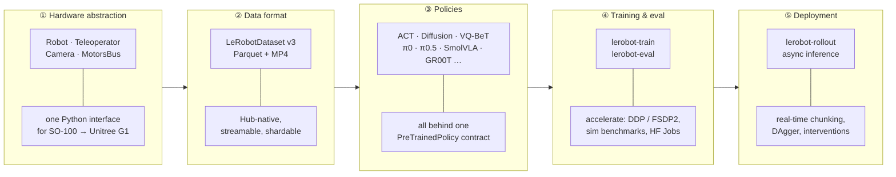
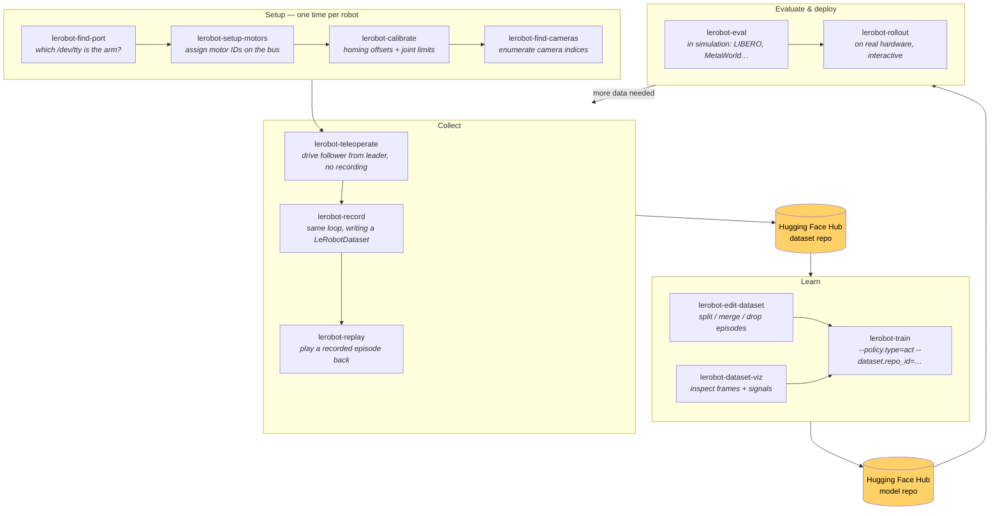
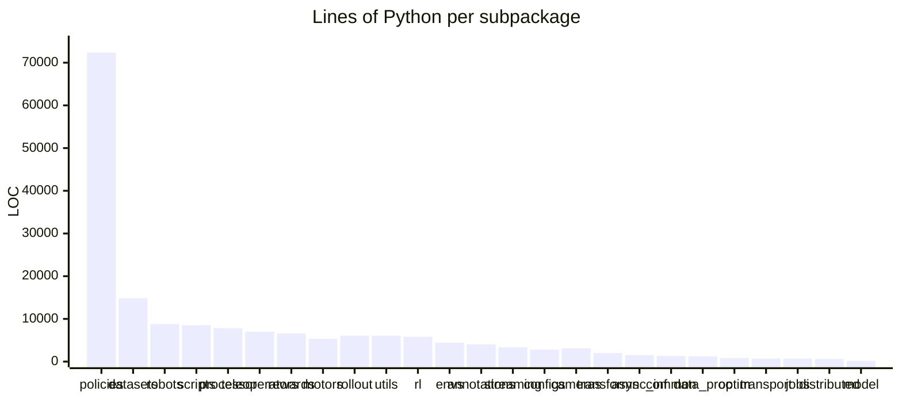

# 01 · Project Overview

[← Index](./README.md) · [Next: Architecture →](./02-architecture.md)

---

## 1. What LeRobot is

LeRobot is Hugging Face's PyTorch library for **real-world robot learning**. It is not a
single model or a single robot driver — it is an end-to-end stack that takes you from
*plugging in a motor* to *a trained policy running on that motor*, with the Hugging Face
Hub as the distribution layer for both datasets and model weights.

The repository's own one-line summary (`AGENTS.md`):

> LeRobot is a PyTorch-based library for real-world robotics, providing datasets,
> pretrained policies, and tools for training, evaluation, data collection, and robot
> control. It integrates with Hugging Face Hub for model/dataset sharing.

### The five pillars



Every pillar is *independently usable*. You can use `LeRobotDataset` without touching
hardware, drive a robot without training anything, or train a policy on someone else's
Hub dataset. That separability is the central architectural property — see
[02 · Architecture](./02-architecture.md).

---

## 2. The end-to-end user journey

This is the loop the whole repository is organised around. Each box names the CLI entry
point that performs it (all declared in `pyproject.toml` under `[project.scripts]`).



### Why the Hub is in the middle

Two of the arrows above go *through* the Hub rather than through the filesystem. That is
deliberate and shows up everywhere in the code: `LeRobotDataset`,
`PreTrainedPolicy`, `DataProcessorPipeline` and `PreTrainedConfig` all implement
`huggingface_hub.HubMixin`, so `from_pretrained` / `push_to_hub` are available uniformly.
A single `repo_id` string is enough to move a dataset, a policy, *and its matching
preprocessing* between machines.

---

## 3. The complete CLI surface

From `pyproject.toml`, `[project.scripts]` — 20 entry points. Grouped by purpose:

| Group | Command | Module | Purpose |
|---|---|---|---|
| **Discovery** | `lerobot-info` | `scripts/lerobot_info.py` | Print environment/version diagnostics |
| | `lerobot-find-port` | `scripts/lerobot_find_port.py` | Identify the serial port of a bus |
| | `lerobot-find-cameras` | `scripts/lerobot_find_cameras.py` | Enumerate connected cameras |
| | `lerobot-find-joint-limits` | `scripts/lerobot_find_joint_limits.py` | Sweep and record safe joint ranges |
| **Hardware setup** | `lerobot-setup-motors` | `scripts/lerobot_setup_motors.py` | Write motor IDs / baudrates |
| | `lerobot-setup-can` | `scripts/lerobot_setup_can.py` | Bring up a CAN interface |
| | `lerobot-calibrate` | `scripts/lerobot_calibrate.py` | Produce the per-device calibration JSON |
| **Data** | `lerobot-teleoperate` | `scripts/lerobot_teleoperate.py` | Leader → follower control loop |
| | `lerobot-record` | `scripts/lerobot_record.py` | Teleop loop + dataset writer |
| | `lerobot-replay` | `scripts/lerobot_replay.py` | Re-send a recorded action stream |
| | `lerobot-edit-dataset` | `scripts/lerobot_edit_dataset.py` | Split, merge, delete, add/remove features |
| | `lerobot-dataset-viz` | `scripts/lerobot_dataset_viz.py` | Visualise a dataset |
| | `lerobot-build-mp4-sidecar` | `scripts/lerobot_build_mp4_sidecar.py` | Index MP4s for fast streaming seeks |
| | `lerobot-annotate` | `scripts/lerobot_annotate.py` | VLM-assisted language annotation |
| | `lerobot-imgtransform-viz` | `scripts/lerobot_imgtransform_viz.py` | Preview image augmentations |
| **Train** | `lerobot-train` | `scripts/lerobot_train.py` | The training pipeline |
| | `lerobot-train-tokenizer` | `scripts/lerobot_train_tokenizer.py` | Train an action tokenizer (π0-FAST family) |
| | `lerobot-convert-dcp` | `scripts/lerobot_convert_dcp.py` | Convert distributed checkpoints |
| **Deploy** | `lerobot-eval` | `scripts/lerobot_eval.py` | Evaluate in a Gym environment |
| | `lerobot-rollout` | `scripts/lerobot_rollout.py` | Run a policy on real hardware |

---

## 4. Repository layout

```
lerobot/
├── src/lerobot/              ← the library (581 modules, ~176k lines of Python)
│   ├── scripts/              ← CLI entry points, one file per command
│   ├── configs/              ← draccus dataclass configs + CLI parser helpers
│   ├── datasets/             ← LeRobotDataset, metadata, readers/writers, streaming
│   ├── policies/             ← one subpackage per policy; PreTrainedPolicy base
│   ├── processor/            ← ProcessorStep / DataProcessorPipeline transformation graph
│   ├── robots/               ← Robot implementations (so_follower, lekiwi, unitree_g1 …)
│   ├── teleoperators/        ← Teleoperator implementations (so_leader, phone, gamepad …)
│   ├── cameras/              ← Camera implementations (opencv, realsense, zmq, reachy2)
│   ├── motors/               ← MotorsBus implementations (dynamixel, feetech, damiao, robstride)
│   ├── envs/                 ← Gym env configs/factories (libero, metaworld, robocasa …)
│   ├── rollout/              ← real-hardware deployment: engine, strategies, controller
│   ├── rl/                   ← HIL-SERL: actor, learner, replay buffer, SAC
│   ├── rewards/              ← reward models (SARM, TOPReward, Robometer, classifier)
│   ├── transport/            ← gRPC transport (services.proto) for distributed setups
│   ├── async_inference/      ← policy server + robot client for off-robot inference
│   ├── streaming/            ← HTTP range-fetch / sidecar machinery for Hub streaming
│   ├── optim/                ← optimizers and LR schedulers
│   ├── transforms/           ← image transforms
│   ├── distributed/          ← accelerate/FSDP topology helpers
│   ├── annotations/          ← VLM annotation pipeline
│   ├── jobs/                 ← HF Jobs remote dispatch
│   ├── utils/                ← constants, logging, errors, decorators, import guards
│   └── lerobot_types.py      ← the core type aliases (EnvTransition, RobotAction, …)
├── tests/                    ← pytest suite, mirrors src/ layout
├── docs/source/              ← published HF documentation (.mdx)
├── docs/intro/               ← ← you are here
├── docs/issue-deep-dives/    ← the six analysed defects
├── examples/                 ← runnable end-user scripts by use case
├── docker/                   ← user + CI images
├── .github/workflows/        ← CI (quality, fast/full tests, docs, release, security)
├── pyproject.toml            ← single source of truth: deps, extras, tool config, scripts
├── Makefile                  ← end-to-end test targets
└── AGENTS.md (= CLAUDE.md)   ← contributor/agent conventions
```

Relative size of each `src/lerobot/` subpackage (lines of Python) — useful for knowing
where the weight of the project actually sits:



Over 40 % of the codebase is `policies/` — each state-of-the-art model is vendored as its
own self-contained subpackage, and the next five subpackages together are smaller than it. The *framework* (everything else) is the part you need to
understand to work anywhere in the repo; an individual policy can be read in isolation.

---

## 5. Installing and running

```bash
# As a user
pip install lerobot
lerobot-info

# As a contributor (uv is the supported workflow)
uv sync --locked                            # base deps
uv sync --locked --extra test --extra dev   # + test & dev tooling
uv sync --locked --extra all                # everything (all policies, all robots)
git lfs install && git lfs pull             # test artifacts
```

Key commands while developing:

```bash
uv run pytest tests -svv --maxfail=10    # the suite
DEVICE=cuda make test-end-to-end         # E2E targets from the Makefile
pre-commit run --all-files               # ruff, typos, bandit, mypy
```

### Optional dependencies are load-bearing

Most policies, robots and environments live behind extras (`lerobot[aloha]`,
`lerobot[hilserl]`, `lerobot[pyzmq-dep]`, …). The convention — enforced by review and
documented in `AGENTS.md` — is:

```python
# module top
from lerobot.utils.import_utils import _zmq_available, require_package

if TYPE_CHECKING or _zmq_available:
    import zmq
else:
    zmq = None

# at use time
class ZMQCamera(Camera):
    def __init__(self, config):
        require_package("pyzmq", extra="pyzmq-dep", import_name="zmq")
```

This is what lets `import lerobot` stay cheap and lets the CLI list a robot type that the
user has not installed the driver for — the error is raised at construction, with the
`pip install` hint attached. The flags themselves live in `utils/import_utils.py`; code
must reuse them rather than calling `is_package_available` directly.

---

## 6. Tech stack

| Concern | Choice | Where it shows up |
|---|---|---|
| Language | Python ≥ 3.12 | `pyproject.toml` `requires-python` |
| Tensors / autograd | PyTorch | everywhere |
| Config + CLI | [draccus](https://github.com/dlwh/draccus) | `configs/`, every `@dataclass` config |
| Distribution | `huggingface_hub` (`HubMixin`) | datasets, policies, processors, configs |
| Tabular data | Apache Parquet via `datasets` / PyArrow | `datasets/dataset_reader.py` |
| Video | MP4 (PyAV / torchcodec), optional LanceDB backend | `datasets/video_utils.py`, `lance_backend.py` |
| Simulation | Gymnasium | `envs/` |
| Distributed training | `accelerate` (DDP, FSDP2, HSDP, CP) | `distributed/`, `scripts/lerobot_train.py` |
| Distributed inference | gRPC (`transport/services.proto`) | `transport/`, `async_inference/` |
| Packaging | `uv` + setuptools | `uv.lock`, `pyproject.toml` |
| Lint / format / types | ruff, typos, bandit, mypy via pre-commit | `.pre-commit-config.yaml` |

---

## 7. Where to go next

[02 · Architecture](./02-architecture.md) breaks the layout above into layers, states which
layer may import which, and walks each core abstraction.
