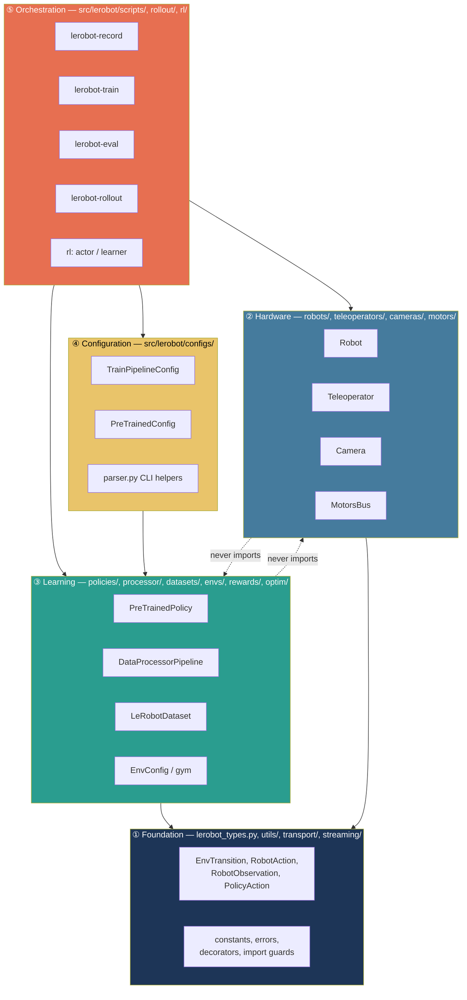
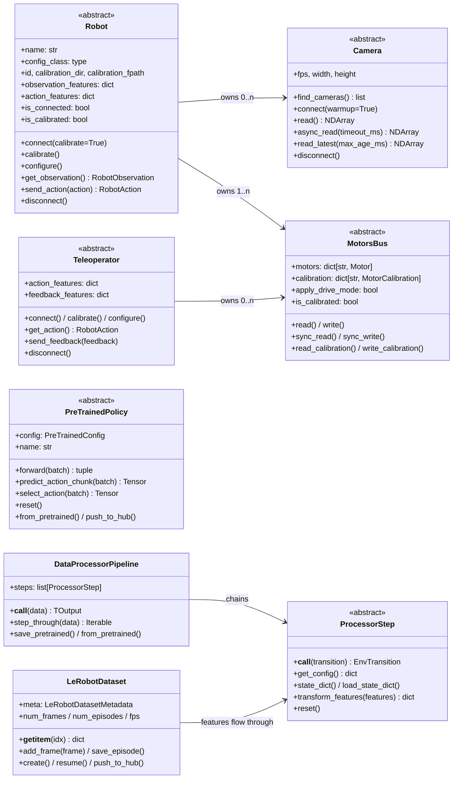
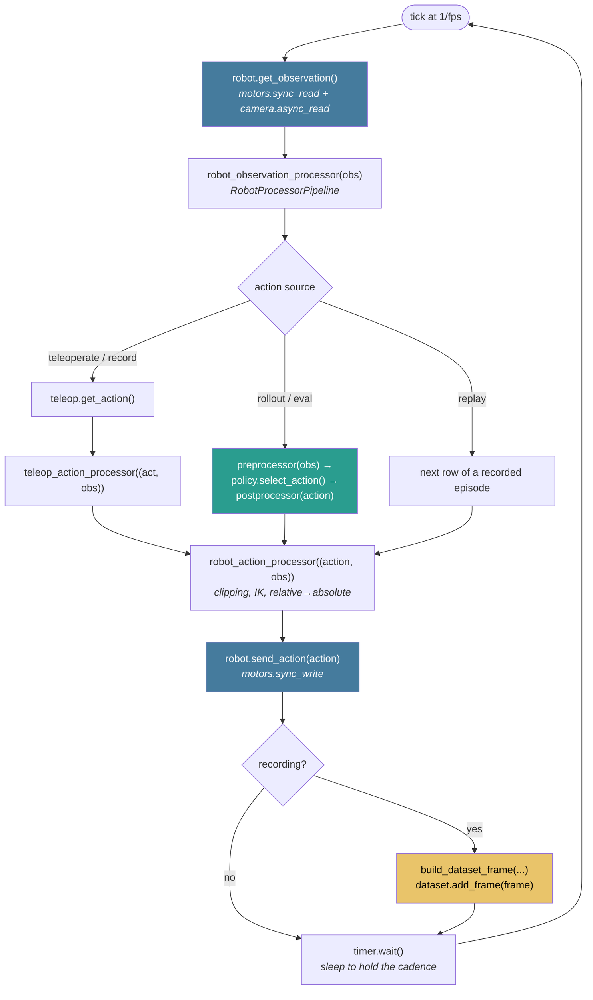
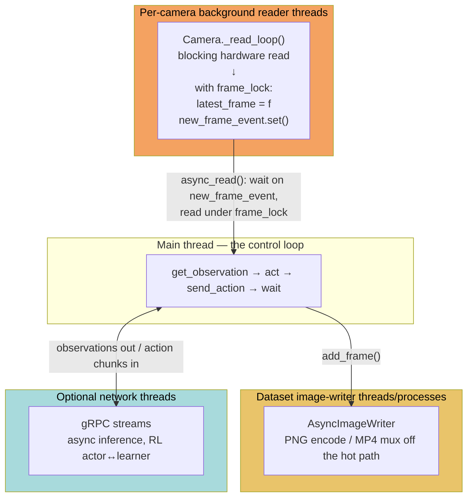
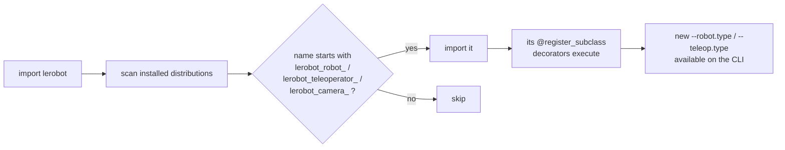
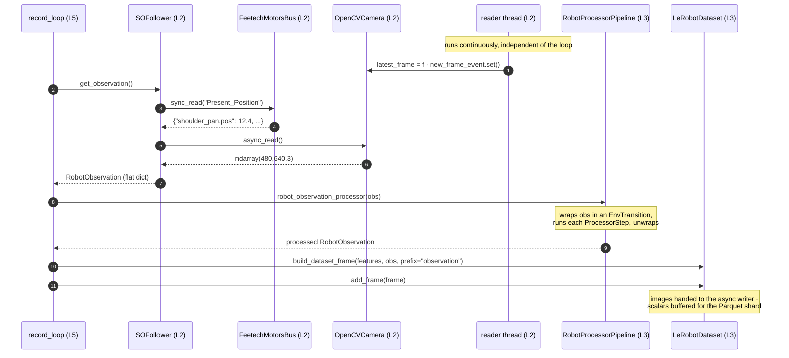

# 02 · Architecture

[← Project Overview](./01-project-overview.md) · [Index](./README.md) · [Next: Configuration & CLI →](./03-configuration-and-cli.md)

---

## 1. The shape of the system

LeRobot is a **layered** library with a strict one-way dependency rule. Nothing in the
hardware layer knows that policies exist; nothing in the policy layer knows what a serial
port is. They meet only inside the orchestration layer (the scripts) and are glued by two
neutral currencies: **feature dictionaries** and the **`EnvTransition`**.



### The dependency rule, stated precisely

1. **Foundation** (`lerobot_types.py`, `utils/`) imports nothing from LeRobot.
2. **Hardware** imports Foundation only. `robots/so_follower/so_follower.py` imports
   `MotorsBus`, `Camera`, `RobotConfig` — never a policy, never a dataset.
3. **Learning** imports Foundation only. `LeRobotDataset` has no idea whether its frames
   came from a real arm or a simulator.
4. **Configuration** may import Learning (it holds `PreTrainedConfig` subclasses) and
   Hardware configs, but not implementations.
5. **Orchestration** is the only layer allowed to import *both* Hardware and Learning.
   That is why `scripts/lerobot_record.py` is the file that knows how to turn a
   `RobotObservation` into a dataset frame.

The one *exception by design* is `src/lerobot/robots/so_follower/robot_kinematic_processor.py`:
it lives in the hardware tree but subclasses `ProcessorStep` from the learning tree. That is
a deliberate bridge — kinematics is hardware knowledge expressed as a pipeline step — and it
is also where one of the analysed bugs lived
([deep dive 05](../issue-deep-dives/05-kinematics-empty-joints-guard.md)).

### Import conventions (`AGENTS.md`)

- Prefer top-level imports.
- **Relative** (`from .sibling import X`) between files inside one module.
- **Absolute** (`from lerobot.module import X`) across modules.

This makes the dependency graph auditable by grep: an absolute import in a hardware file
that names `lerobot.policies` would be an immediate smell.

---

## 2. The two universal currencies

Everything in LeRobot moves as one of two shapes.

### 2.1 Feature dictionaries — the *flat* currency

Hardware speaks flat, string-keyed dicts of scalars and arrays:

```python
# RobotObservation / RobotAction  — src/lerobot/lerobot_types.py
RobotObservation = dict[str, Any]
RobotAction      = dict[str, Any]
```

```python
# what an SO-101 follower actually returns from get_observation()
{
  "shoulder_pan.pos": 12.4,          # float, degrees or normalised
  "shoulder_lift.pos": -30.1,
  "elbow_flex.pos": 45.0,
  "wrist_flex.pos": 2.3,
  "wrist_roll.pos": 0.0,
  "gripper.pos": 88.0,
  "front": np.ndarray (480, 640, 3), # a camera frame
  "wrist": np.ndarray (480, 640, 3),
}
```

The key *suffix* carries the semantics. `.pos` means a joint position; `ee.x` means an
end-effector coordinate. Code all over the repo filters on those suffixes:

```python
# robot_kinematic_processor.py — "give me every joint position, in order"
q_raw = np.array(
    [float(v) for k, v in observation.items() if isinstance(k, str) and k.endswith(".pos")],
    dtype=float,
)
```

Each `Robot` / `Teleoperator` must also publish the *schema* of those dicts, statically,
whether or not it is connected:

```python
@property
@abc.abstractmethod
def observation_features(self) -> dict: ...   # {"shoulder_pan.pos": float, "front": (480, 640, 3)}
@property
@abc.abstractmethod
def action_features(self) -> dict: ...
```

That "callable while disconnected" requirement is what lets `lerobot-record` build a
dataset schema *before* any hardware is touched.

### 2.2 `EnvTransition` — the *structured* currency

Everything that transforms data does so over a single TypedDict
(`src/lerobot/lerobot_types.py:46`):

```python
class EnvTransition(TypedDict):
    observation: RobotObservation | None
    action: PolicyAction | RobotAction | EnvAction | None
    reward: float | torch.Tensor | None
    done: bool | torch.Tensor | None
    truncated: bool | torch.Tensor | None
    info: dict[str, Any] | None
    complementary_data: dict[str, Any] | None
```

Keys are addressed via the `TransitionKey` constants (plain `Final[Literal[...]]` strings,
*not* an Enum — chosen so they serialise and compare cheaply):

```python
class TransitionKey:
    OBSERVATION: Final[Literal["observation"]] = "observation"
    ACTION:      Final[Literal["action"]]      = "action"
    ...
```

And the three action flavours are deliberately distinct types, so the type checker catches
a mix-up:

| Alias | Concrete type | Who produces it |
|---|---|---|
| `RobotAction` | `dict[str, Any]` | teleoperators, `robot.send_action` consumers |
| `PolicyAction` | `torch.Tensor` | `policy.select_action` |
| `EnvAction` | `np.ndarray` | Gymnasium environments |

A pipeline step that converts between them is the explicit boundary — e.g.
`processor/policy_robot_bridge.py`.

---

## 3. The core abstractions



### Why these five and not more

Each abstraction exists because something needs to be swapped at runtime from a config
string:

| Abstraction | Swapped by | Example CLI |
|---|---|---|
| `Robot` | `--robot.type=` | `--robot.type=so101_follower` |
| `Teleoperator` | `--teleop.type=` | `--teleop.type=so101_leader` |
| `Camera` | nested in robot config | `--robot.cameras="{front: {type: opencv, index_or_path: 0}}"` |
| `PreTrainedPolicy` | `--policy.type=` / `--policy.path=` | `--policy.type=act` |
| `ProcessorStep` | registry name in a saved config | `"registry_name": "normalizer_processor"` |

That mapping is implemented by draccus `ChoiceRegistry` — see
[03 · Configuration & CLI](./03-configuration-and-cli.md).

---

## 4. The control loop — the shape every runtime shares

Teleoperation, recording, replay, rollout and RL are all the *same* loop with pieces
swapped out. Understanding this one diagram explains four scripts at once.



Reference implementation: `record_loop()` in
`src/lerobot/scripts/lerobot_record.py:228`. Note the three *distinct* processor
pipelines threaded through it — they are separate because they run at different points
and have different input/output types:

```python
def record_loop(
    robot: Robot,
    ...
    teleop_action_processor: RobotProcessorPipeline[tuple[RobotAction, RobotObservation], RobotAction],
    robot_action_processor:  RobotProcessorPipeline[tuple[RobotAction, RobotObservation], RobotAction],
    robot_observation_processor: RobotProcessorPipeline[RobotObservation, RobotObservation],
    ...
)
```

- `robot_observation_processor` — runs **after** the robot, before anything sees the obs.
- `teleop_action_processor` — runs **after** the teleoperator; its output is what gets
  *recorded*.
- `robot_action_processor` — runs **before** the robot; its output is what gets *sent*.

The split matters: the recorded action and the sent action can legitimately differ (e.g.
the sent one is clipped by `max_relative_target`). A `TODO` in that function notes the
clipping should itself become a pipeline step so the two converge.

Each phase is wrapped in `timer.section(...)` so a `CycleTimer` can attribute the
per-tick budget and warn when the loop runs slow — real-time behaviour is a
first-class, measured concern, not an afterthought.

---

## 5. Threading model

Three kinds of concurrency exist, and they are the source of most of the subtle bugs in
the repo.



The camera pattern is the one to internalise, because it recurs in every backend
(`cameras/opencv/camera_opencv.py`, `cameras/zmq/camera_zmq.py`,
`cameras/realsense/camera_realsense.py`) and each copy must get the same five things
right:

1. a `stop_event` the owner sets to request shutdown,
2. a `frame_lock` protecting `latest_frame` / `latest_timestamp`,
3. a `new_frame_event` so `async_read` can block until a *fresh* frame arrives,
4. a **bounded** join that cannot hang the main loop forever, and
5. a release order such that the device is never freed while the reader is inside a
   blocking call on it.

Points (4) and (5) are in tension — a bounded join can expire while the reader is still
running. Both analysed camera bugs
([01](../issue-deep-dives/01-zmq-cleanup-stops-read-thread.md),
[02](../issue-deep-dives/02-camera-read-loop-stop-parity.md)) are different faces of that
tension. [05 · Cameras](./05-cameras.md) covers the pattern in full.

---

## 6. Extensibility: three plug points

### 6.1 Register a new type in-tree

Everything selectable from the CLI is a draccus `ChoiceRegistry` subclass:

```python
@RobotConfig.register_subclass("my_robot")
@dataclass
class MyRobotConfig(RobotConfig):
    port: str
    ...
```

…and `--robot.type=my_robot` now works. Same mechanism for policies
(`PreTrainedConfig.register_subclass`), environments (`EnvConfig`), cameras
(`CameraConfig`), teleoperators (`TeleoperatorConfig`) and reward models.

### 6.2 Register a processor step

```python
@ProcessorStepRegistry.register("my_step")
@dataclass
class MyStep(ObservationProcessorStep):
    def observation(self, observation): ...
```

The registry name is what gets written into the saved `processor_config.json`, so a
pipeline round-trips through the Hub by name — see
[08 · Processor Pipeline](./08-processor-pipeline.md).

### 6.3 Out-of-tree plugins by package name

LeRobot auto-imports any installed distribution whose name starts with
`lerobot_robot_`, `lerobot_teleoperator_` or `lerobot_camera_`. Importing it runs its
`register_subclass` decorators, so the new `type` is immediately available on the CLI
with no changes to this repo:

```bash
pip install lerobot_robot_<name> lerobot_teleoperator_<name>
lerobot-record --robot.type=<robot_name> --teleop.type=<teleoperator_name> ...
```



This is how UFACTORY xArm, Franka, AgileX Piper, GELLO, SpaceMouse, Meta Quest, ROS 2
bridges and the tactile/depth cameras are supported without vendoring any of them.

---

## 7. Module-by-module map

| Module | Entry symbols | Responsibility | Depends on |
|---|---|---|---|
| `lerobot_types.py` | `EnvTransition`, `TransitionKey`, `RobotAction`, `PolicyAction`, `EnvAction` | The shared vocabulary | — |
| `utils/` | `constants`, `errors`, `decorators`, `import_utils` | Cross-cutting helpers, optional-dep flags | — |
| `configs/` | `TrainPipelineConfig`, `PreTrainedConfig`, `parser` | Dataclass configs + CLI resolution | learning configs |
| `motors/` | `MotorsBus`, `Motor`, `MotorCalibration` | Serial/CAN bus protocol, control tables, normalization | utils |
| `cameras/` | `Camera`, `*Camera` | Frame acquisition + background reader threads | utils |
| `robots/` | `Robot`, `BimanualMixin` | Compose motors + cameras into an embodiment | motors, cameras |
| `teleoperators/` | `Teleoperator` | Human input devices → `RobotAction` | motors, cameras |
| `datasets/` | `LeRobotDataset`, `LeRobotDatasetMetadata`, `StreamingLeRobotDataset` | The v3 format: read, write, stream, edit | utils |
| `processor/` | `ProcessorStep`, `DataProcessorPipeline`, `ProcessorStepRegistry` | Declarative, serialisable data transformation | types |
| `policies/` | `PreTrainedPolicy`, `make_policy` | The models | processor, configs |
| `rewards/` | `PreTrainedRewardModel`, `make_reward_model` | Learned reward signals for RL | policies, processor |
| `envs/` | `EnvConfig`, `make_env` | Gymnasium simulation benchmarks | processor |
| `optim/` | optimizer + scheduler configs | Training hyperparameter plumbing | — |
| `distributed/` | `make_accelerator`, `ParallelDims`, FSDP helpers | Multi-GPU topology | configs |
| `transforms/` | image transforms | Augmentation (CPU or GPU) | — |
| `streaming/` | sidecar, range-fetch, episode cache | Read datasets straight off the Hub | datasets |
| `transport/` | `services.proto`, generated gRPC stubs, `utils.py` | Wire protocol for distributed setups | — |
| `rollout/` | `InferenceEngine`, `RolloutStrategy`, `RolloutController`, `InteractiveSession` | Deploy a policy on real hardware | policies, robots, datasets |
| `rl/` | `actor`, `learner`, `ReplayBuffer`, SAC | HIL-SERL online learning | policies, transport, rewards |
| `annotations/` | steerable VLM pipeline | Auto-label episodes with language | datasets |
| `jobs/` | `submit_to_hf` | Dispatch a training run to HF Jobs | configs |
| `scripts/` | one `main()` per CLI command | Orchestration | everything |

---

## 8. Reading the layer boundaries in practice

A concrete trace of how one observation crosses every layer, during `lerobot-record`:



Observe what *didn't* happen: the dataset never learned the robot's name, the robot never
learned the dataset's schema, and the processor never learned either. The orchestration
layer carried the knowledge. That is the architecture.

---

## 9. Where to go next

- The config/CLI machinery that selects all of the above:
  [03 · Configuration & CLI](./03-configuration-and-cli.md)
- The hardware contracts in detail: [04 · Robots & Teleoperators](./04-robots-and-teleoperators.md)
- The data currency in detail: [08 · Processor Pipeline](./08-processor-pipeline.md)
