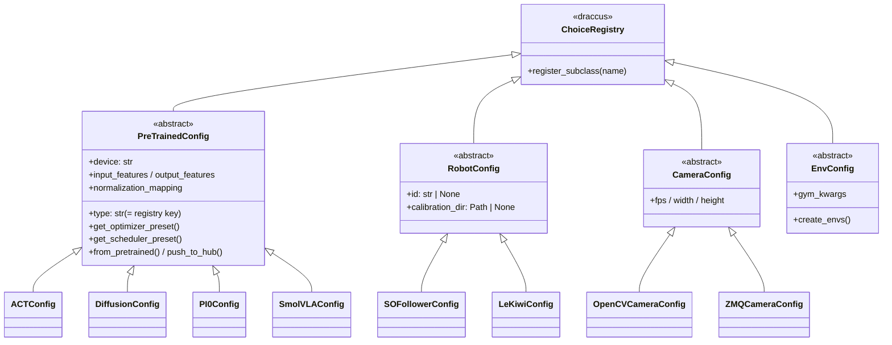
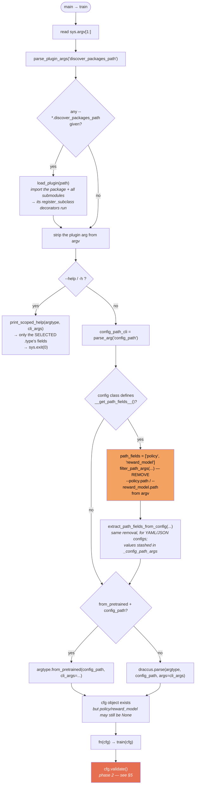
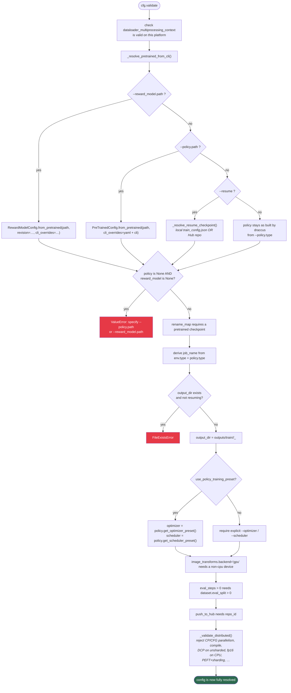
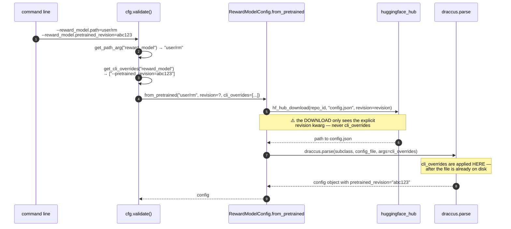
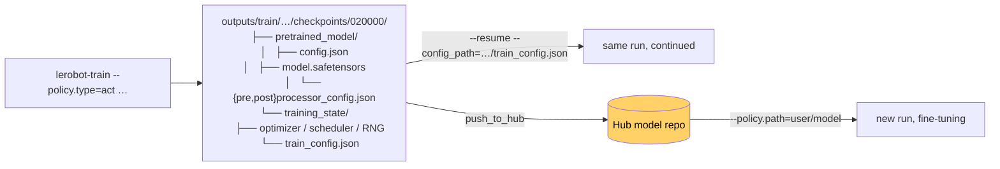

# 03 · Configuration & the CLI

[← Architecture](./02-architecture.md) · [Index](./README.md) · [Next: Robots & Teleoperators →](./04-robots-and-teleoperators.md)

---

## 1. Why this deserves its own document

LeRobot has no YAML schema of its own, no config registry singleton, and no `argparse`
calls in its scripts. Every runtime knob is a **field on a Python dataclass**, and the CLI
is *derived* from those dataclasses by [draccus](https://github.com/dlwh/draccus).

That gives one source of truth, type-checked defaults, and `--help` for free. It also
means the config layer carries real logic — including a two-phase resolution dance for
`--policy.path` that is the direct cause of
[deep dive 06](../issue-deep-dives/06-reward-model-pretrained-revision.md). You cannot
debug a LeRobot run without understanding this file set:

```
src/lerobot/configs/
├── train.py       ← TrainPipelineConfig: the top-level training config
├── policies.py    ← PreTrainedConfig: base class for every policy config
├── rewards.py     ← RewardModelConfig
├── default.py     ← DatasetConfig, EvalConfig, WandBConfig, …
├── types.py       ← FeatureType, NormalizationMode, PolicyFeature, PipelineFeatureType
├── parser.py      ← the CLI machinery: wrap(), parse_arg, get_cli_overrides, plugins
└── eval.py / recipes/
```

---

## 2. Dataclasses in, CLI out

```python
# src/lerobot/configs/train.py
@dataclass
class TrainPipelineConfig(HubMixin):
    dataset: DatasetConfig
    env: envs.EnvConfig | None = None
    policy: PreTrainedConfig | None = None
    reward_model: RewardModelConfig | None = None
    output_dir: Path | None = None
    resume: bool = False
    seed: int | None = 1000
    batch_size: int = 8
    steps: int = 100_000
    save_freq: int = 20_000
    optimizer: OptimizerConfig | None = None
    scheduler: LRSchedulerConfig | None = None
    parallelism: ParallelismConfig = field(default_factory=ParallelismConfig)
    accelerator: AcceleratorConfig = field(default_factory=AcceleratorConfig)
    ema: EMAConfig = field(default_factory=EMAConfig)
    wandb: WandBConfig = field(default_factory=WandBConfig)
    peft: PeftConfig | None = None
    job: JobConfig = field(default_factory=JobConfig)
    rename_map: dict[str, str] = field(default_factory=dict)
    ...
```

Nesting maps to dotted CLI paths, mechanically:

```bash
lerobot-train \
  --dataset.repo_id=lerobot/aloha_mobile_cabinet \
  --policy.type=act \
  --policy.device=cuda \
  --batch_size=64 \
  --steps=200000 \
  --wandb.enable=true \
  --accelerator.gradient_accumulation.steps=4
```

Dicts and lists are accepted as inline literals, which is how cameras get configured:

```bash
  --robot.cameras="{ front: {type: opencv, index_or_path: 0, width: 1920, height: 1080, fps: 30} }"
```

A whole config can also be supplied as a file and then selectively overridden:

```bash
lerobot-train --config_path=my_run.yaml --steps=50000
```

---

## 3. Polymorphism: `ChoiceRegistry`

`--policy.type=act` has to construct an `ACTConfig`, while `--policy.type=pi0` constructs
a `PI0Config` with entirely different fields. draccus's `ChoiceRegistry` provides that:



Registration is a one-line decorator:

```python
@PreTrainedConfig.register_subclass("act")
@dataclass
class ACTConfig(PreTrainedConfig):
    chunk_size: int = 100
    n_action_steps: int = 100
    ...
```

The registry key lands in the serialised `config.json` as `"type": "act"`, which is how
`from_pretrained` recovers the right subclass from a Hub repo.

### The scoped-help problem

draccus's stock parser eagerly registers *every* registered choice before parsing, so
`lerobot-train --help` would print the union of all ~25 policy configs. `parser.py`
works around this with `_register_scoped_actions()` and `print_scoped_help()`, which
recurse only into the subclass the user actually selected via the `.type` argument:

```python
# configs/parser.py:211
def _register_scoped_actions(wrapper, parser, cli_args):
    """Like draccus's own Wrapper.register_actions, but for a ChoiceType field only recurses into
    the already-selected subclass (per CLI `.type` args), instead of every registered choice."""
```

The docstring carries an explicit maintenance warning — it mirrors draccus 0.11.x
internals and must be re-checked on upgrade.

---

## 4. `@parser.wrap()` — what actually happens on startup

Every CLI entry point is one decorated function:

```python
# src/lerobot/scripts/lerobot_train.py:543
@parser.wrap()
def train(cfg: TrainPipelineConfig) -> None:
    ...
```

`wrap()` is a superset of `draccus.wrap`. It does four extra things, in this order:



### Why `--policy.path` has to be *removed* from argv

`PreTrainedConfig` subclasses have no field called `path`. If `--policy.path=...` reached
draccus it would be a hard decoding error. But the path is exactly what determines *which*
subclass to build and what its field defaults are — so it cannot be handled by draccus
either.

The resolution: `filter_path_args` deletes it from `argv` before parsing, and
`parser.get_path_arg("policy")` re-reads it later from `sys.argv`. `filter_path_args` also
rejects the contradictory combination up front:

```python
if get_path_arg(field, args):
    if get_type_arg(field, args):
        raise ArgumentError(...)   # --policy.path AND --policy.type is ambiguous
```

This "re-read `sys.argv` later" pattern is the sharp edge of the whole design. It is
documented in the code itself:

```python
# src/lerobot/configs/train.py:196
def _resolve_pretrained_from_cli(self) -> None:
    """Resolve the pretrained source passed on the CLI into a loaded config.

    The pretrained paths (`--policy.path`, `--reward_model.path`) and `--config_path`
    are only recoverable by re-reading the CLI args: draccus has already consumed them
    by the time `validate()` runs, so they are not reflected on `self`.
    """
```

---

## 5. Phase 2: `validate()` and the pretrained-source priority

`validate()` is called as the *first* statement of `train()` (and of the other scripts),
before any GPU, dataset or distributed initialisation. Everything that can fail fast,
fails here.



Two properties worth remembering because other code depends on them:

```python
@property
def is_reward_model_training(self) -> bool:
    return self.reward_model is not None

@property
def trainable_config(self) -> PreTrainedConfig | RewardModelConfig:
    return self.reward_model if self.is_reward_model_training else self.policy
```

`validate()` guarantees exactly one of the two is set, so `trainable_config` is the
single handle the training script uses from then on.

---

## 6. `parser.py` helper reference

These four functions are the entire "re-read argv" toolkit. Knowing their exact
semantics is what distinguishes a correct call site from a broken one.

| Helper | Signature | Returns |
|---|---|---|
| `parse_arg` | `(arg_name, args=None)` | the value of `--arg_name=V` **or** `--arg_name V`; `None` if absent or if the next token starts with `--` |
| `get_path_arg` | `(field_name, args=None)` | `parse_arg(f"{field}.path")`, falling back to `_config_path_args` (populated from a YAML config) |
| `get_type_arg` | `(field_name, args=None)` | `parse_arg(f"{field}.type")` |
| `get_cli_overrides` | `(field_name, args=None)` | every `--field.X[=V]` **de-nested** to `--X[=V]`, excluding `type` and `path` |

`get_cli_overrides` is the subtle one. Given:

```bash
lerobot-train --reward_model.path=user/rm --reward_model.pretrained_revision=abc123 --reward_model.device cpu
```

it returns:

```python
["--pretrained_revision=abc123", "--device", "cpu"]
```

Note three things: the `--reward_model.` prefix is **stripped**, `path` is **dropped**,
and a space-separated value is preserved as a *second list element*. Both the `=` form
and the space form must therefore be handled by anything that reads a value out of that
list — which is precisely the bug fixed in
[deep dive 06](../issue-deep-dives/06-reward-model-pretrained-revision.md).

Source, verbatim:

```python
# configs/parser.py:71
def get_cli_overrides(field_name: str, args: Sequence[str] | None = None) -> list[str] | None:
    if args is None:
        args = sys.argv[1:]
    attr_level_args = []
    detect_string = f"--{field_name}."
    excluded_names = (draccus.CHOICE_TYPE_KEY, PATH_KEY)   # ("type", "path")
    for index, arg in enumerate(args):
        if not arg.startswith(detect_string):
            continue
        denested_arg = arg.removeprefix(detect_string)
        if denested_arg.split("=", maxsplit=1)[0] in excluded_names:
            continue
        attr_level_args.append(f"--{denested_arg}")
        if "=" not in arg and index + 1 < len(args) and not args[index + 1].startswith("--"):
            attr_level_args.append(args[index + 1])
    return attr_level_args


# configs/parser.py:100
def parse_arg(arg_name: str, args: Sequence[str] | None = None) -> str | None:
    if args is None:
        args = sys.argv[1:]          # ← the default that bites you
    option = f"--{arg_name}"
    for index, arg in enumerate(args):
        if arg.startswith(f"{option}="):
            return arg.removeprefix(f"{option}=")
        if arg == option and index + 1 < len(args) and not args[index + 1].startswith("--"):
            return args[index + 1]
    return None
```

> ⚠️ `args=None` means "fall back to `sys.argv[1:]`". When you want to search a
> *de-nested* override list you must pass it explicitly — `parse_arg(name, args=overrides or [])` —
> or the lookup silently searches the raw command line instead, where the names are still
> prefixed and will never match.

---

## 7. The `cli_overrides` ordering trap

This is the single most important thing to understand about `from_pretrained` on configs,
and it generalises to policies and reward models alike.



The config object ends up *claiming* `pretrained_revision="abc123"` while the bytes it was
built from came from the default branch. The fix is for the call site to extract the
revision out of the override list and forward it as the explicit `revision=` kwarg —
before the download. Full analysis:
[deep dive 06](../issue-deep-dives/06-reward-model-pretrained-revision.md).

---

## 8. Out-of-tree plugin discovery via the CLI

Besides the name-prefix auto-discovery described in
[02 · Architecture §6.3](./02-architecture.md#63-out-of-tree-plugins-by-package-name),
any config field can point at a package to import before parsing:

```bash
lerobot-eval --env.type=my_env --env.discover_packages_path=my_package.envs ...
```

`load_plugin()` imports the package *and iterates every submodule* so that all
`register_subclass` decorators have executed by the time draccus looks up
`--env.type=my_env`:

```python
# configs/parser.py
def load_plugin(plugin_path: str) -> None:
    package_module = importlib.import_module(plugin_path, __package__)
    for _finder, pkg_name, _ispkg in pkgutil.iter_modules(package_module.__path__, package_module.__name__ + "."):
        importlib.import_module(pkg_name)
```

Failures are wrapped in `PluginLoadError` with the offending CLI argument appended, so a
typo in the package path produces an actionable message rather than an `unknown choice`
error from draccus.

---

## 9. Configs are Hub artifacts too

`TrainPipelineConfig` extends `HubMixin`, and so does `PreTrainedConfig`. Consequences:

- Every checkpoint directory contains `train_config.json` — the **exact** config the run
  used, including values resolved at validate time.
- `--resume` with `--config_path=<that file>` re-parses it, so a resumed run is bit-for-bit
  configured like the original. CLI flags still override, by design.
- `--config_path=<hub repo id>` downloads the latest checkpoint into a fresh local run
  directory and resumes from there (`common/train_utils.py:resolve_resume_checkpoint`).
- A resumed run keeps `pretrained_path` pointing at the model it *originally started
  from*, so the published model card's `base_model` stays correct, while weights and
  processors load from `checkpoint_path`.



---

## 10. Checklist: adding a config field

1. Add the field to the dataclass with a type annotation **and** a default (or make it
   required deliberately — a required field without a default breaks `--config_path`-less
   invocations).
2. Add a comment above it; those comments are the de facto `--help` text in this repo.
3. If it constrains other fields, add the fail-fast to `validate()` — not to the
   consuming code.
4. If it selects an implementation, make it a `ChoiceRegistry` subclass rather than a
   string plus an `if`/`elif` ladder.
5. If it must be readable *before* draccus parses (i.e. it decides which class to build),
   it belongs in `__get_path_fields__` + `parser.get_path_arg`, and you must handle both
   the `=` and space-separated CLI forms.
6. Add a test under `tests/configs/`. The regression test in
   `tests/configs/test_reward_model_revision.py` is a good template: it constructs a bare
   config with `object.__new__`, monkeypatches `sys.argv`, and asserts on what reached
   `from_pretrained`.
