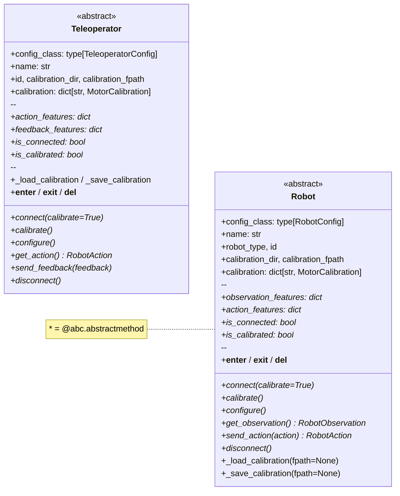
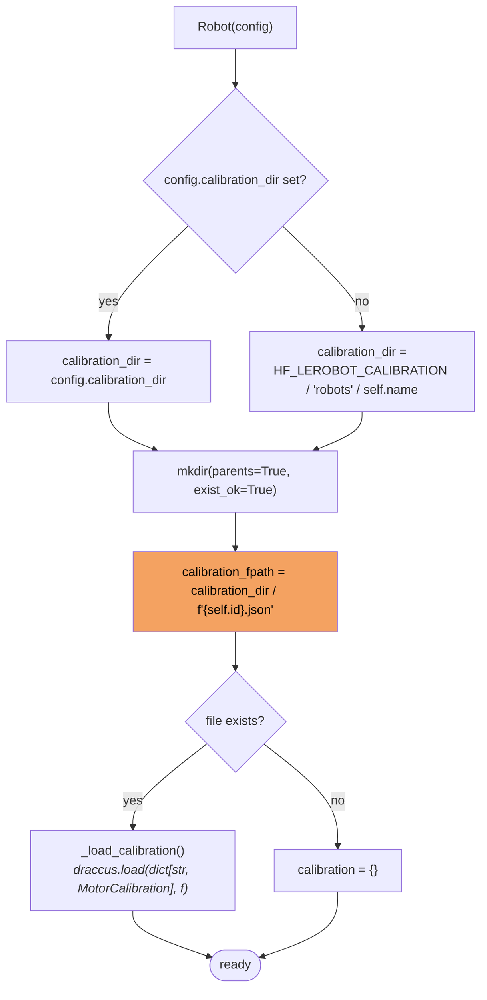
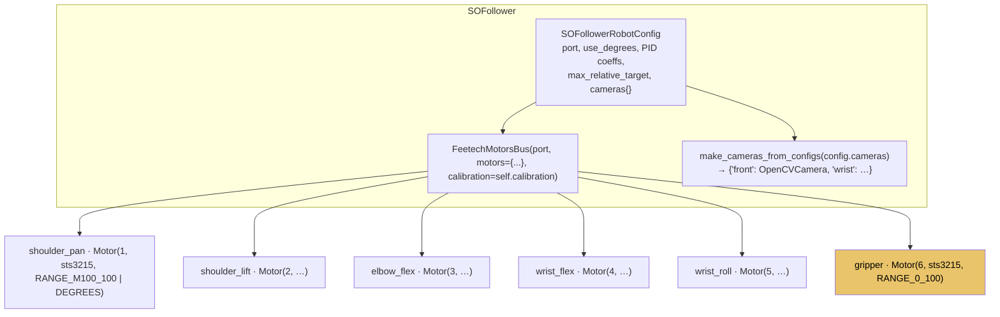
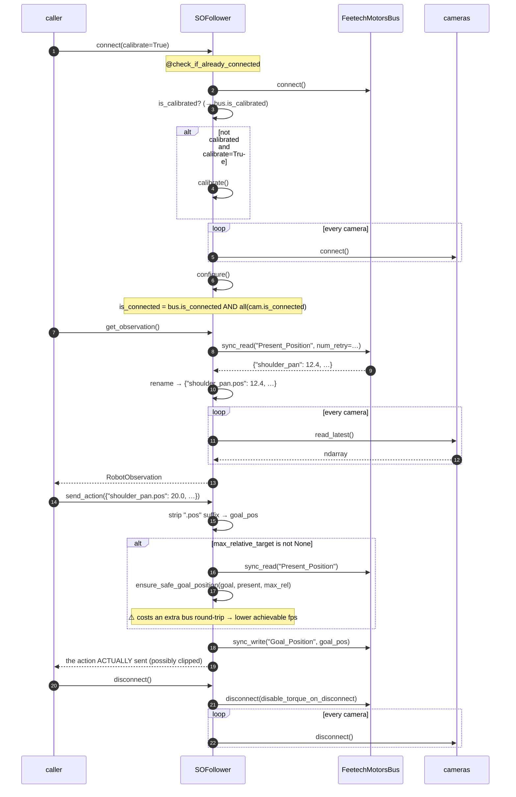
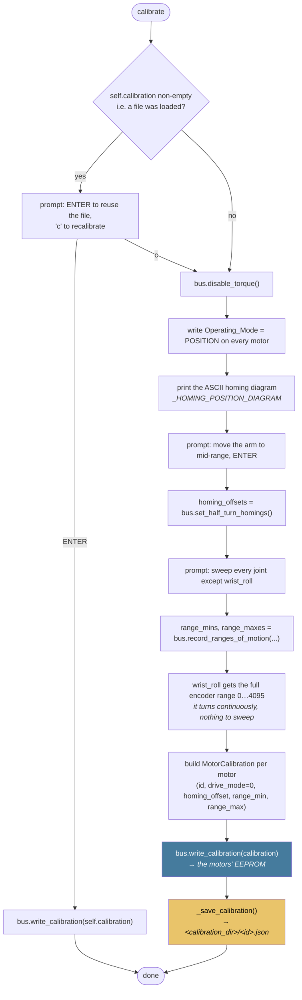
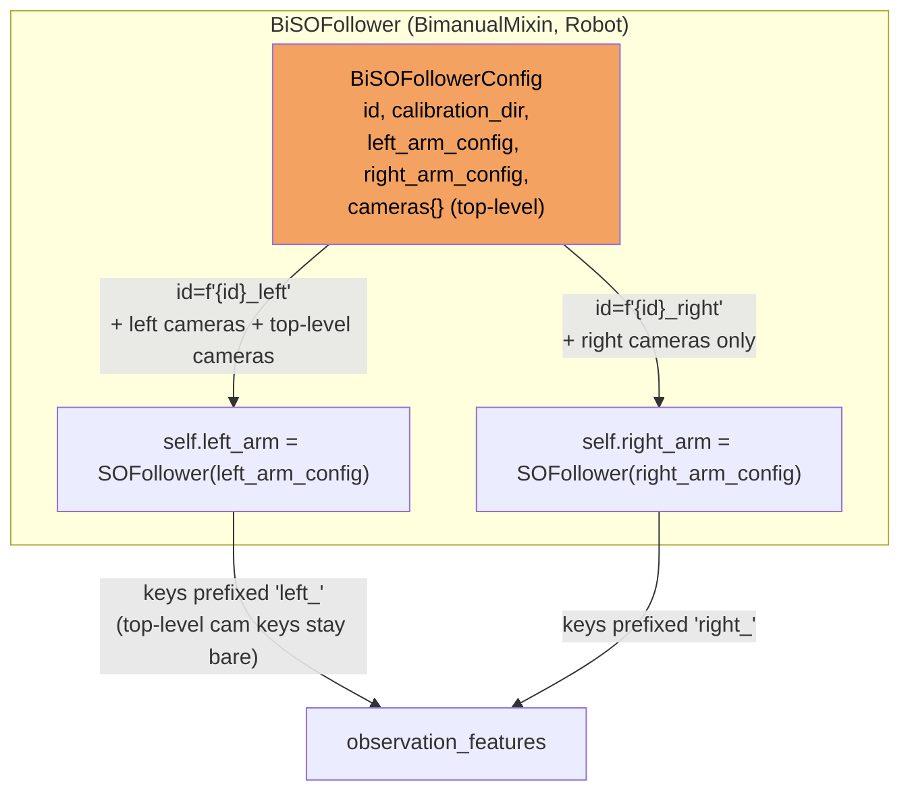
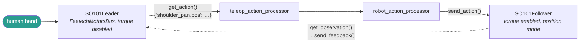
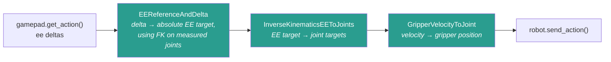
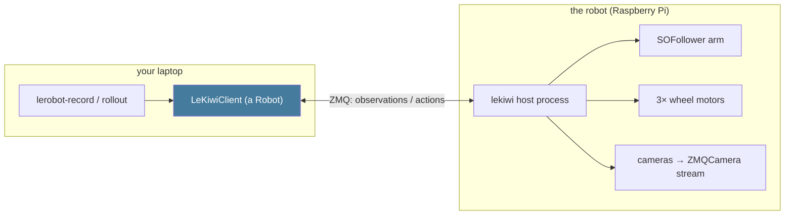
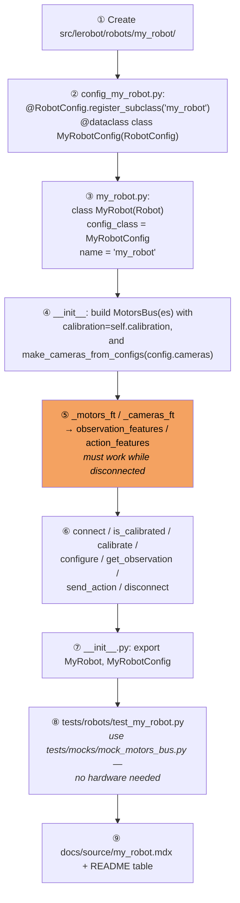

# 04 · Robots & Teleoperators

[← Configuration & CLI](./03-configuration-and-cli.md) · [Index](./README.md) · [Next: Cameras →](./05-cameras.md)

---

## 1. The two mirrored contracts

`Robot` (`src/lerobot/robots/robot.py:30`) and `Teleoperator`
(`src/lerobot/teleoperators/teleoperator.py`) are deliberately near-symmetric. A robot
*consumes* actions and *produces* observations; a teleoperator *produces* actions and
*consumes* feedback.



### The eight-member contract

| Member | Must work while disconnected? | Purpose |
|---|---|---|
| `observation_features` / `action_features` | **Yes — explicitly required** | Static schema, used to build dataset features before any hardware is touched |
| `is_connected` | Yes | Guard for every I/O method |
| `connect(calibrate=True)` | — | Open ports, open cameras, calibrate if needed, then `configure()` |
| `is_calibrated` | — | `True` if hardware state matches the cached calibration (`True` if N/A) |
| `calibrate()` | — | Collect offsets/limits, populate `self.calibration`, persist it |
| `configure()` | — | One-time runtime setup: operating mode, PID gains, torque limits |
| `get_observation()` / `send_action()` | No — raise if disconnected | The hot path |
| `disconnect()` | — | Release everything; typically disables torque first |

The docstring on `observation_features` spells out the disconnected requirement:

> *Note: this property should be able to be called regardless of whether the robot is
> connected or not.*

That is not a nicety. `lerobot-record` calls `hw_to_dataset_features(robot.observation_features, ...)`
to create the dataset schema, and `lerobot-train` reads feature shapes to size the policy —
both before or without a live device.

---

## 2. Base-class behaviour you inherit for free

`Robot.__init__` does more than store the config — it resolves and loads calibration:

```python
# src/lerobot/robots/robot.py:45
def __init__(self, config: RobotConfig):
    self.robot_type = self.name
    self.id = config.id
    self.calibration_dir = (
        config.calibration_dir if config.calibration_dir
        else HF_LEROBOT_CALIBRATION / ROBOTS / self.name
    )
    self.calibration_dir.mkdir(parents=True, exist_ok=True)
    self.calibration_fpath = self.calibration_dir / f"{self.id}.json"
    self.calibration: dict[str, MotorCalibration] = {}
    if self.calibration_fpath.is_file():
        self._load_calibration()
```



> ⚠️ **The whole identity of a calibration file is `self.id`.** Two device objects with the
> same `id` and the same `calibration_dir` resolve to the *same file* — and since
> `__init__` loads eagerly, the second one silently adopts the first one's offsets. That is
> exactly the bimanual defect analysed in
> [deep dive 04](../issue-deep-dives/04-bimanual-calibration-id-collision.md): both arms
> defaulted to `id=None`, i.e. both read and wrote `None.json`.

Three more inherited behaviours matter:

```python
def __enter__(self):            # `with MyRobot(cfg) as robot:` connects
    self.connect(); return self

def __exit__(self, *exc):       # …and always disconnects, even on error
    self.disconnect()

def __del__(self):              # destructor safety net
    try:
        if self.is_connected:
            self.disconnect()
    except Exception:           # nosec B110
        pass
```

The `__del__` net is why a crashed script usually still leaves motors in a safe state —
but it is best-effort only (interpreter shutdown ordering is not guaranteed), so the
context-manager form is the supported pattern.

### The connection guards

`utils/decorators.py` provides the two decorators used throughout the hardware layer:

```python
@check_if_not_connected      # raise DeviceNotConnectedError if not self.is_connected
def get_observation(self): ...

@check_if_already_connected  # raise DeviceAlreadyConnectedError if self.is_connected
def connect(self, calibrate=True): ...
```

They read `self.is_connected`, so a subclass that computes that property incorrectly
breaks every guarded method at once. Note the consequence for *partial* setup: if
`connect()` fails halfway, `is_connected` is `False`, so `disconnect()` — which is itself
guarded in most implementations — will refuse to run. Cleanup therefore has to happen on
the failure path *inside* `connect()`. Getting that wrong is
[deep dive 01](../issue-deep-dives/01-zmq-cleanup-stops-read-thread.md).

---

## 3. A real implementation, end to end: `SOFollower`

`src/lerobot/robots/so_follower/so_follower.py` is the canonical single-arm robot — the
SO-100/SO-101 family. It is worth reading in full once; here is its anatomy.

### 3.1 Composition



Two details with real consequences:

- The **gripper uses a different normalization mode** (`RANGE_0_100`) from the body joints
  (`RANGE_M100_100`, or `DEGREES` when `use_degrees=True`). A gripper has no meaningful
  negative side.
- `calibration=self.calibration` is passed by reference *at construction*, so the bus is
  wired to whatever the base class loaded from `<id>.json`.

### 3.2 Feature schema

```python
@property
def _motors_ft(self) -> dict[str, type]:
    return {f"{motor}.pos": float for motor in self.bus.motors}

@property
def _cameras_ft(self) -> dict[str, tuple]:
    features = {}
    for cam_key, cam in self.cameras.items():
        if getattr(cam, "use_rgb", True):
            features[cam_key] = (cam.height, cam.width, 3)
        if isinstance(cam, DepthCamera) and cam.use_depth:
            features[f"{cam_key}_depth"] = (cam.height, cam.width, 1)
    return features

@cached_property
def observation_features(self): return {**self._motors_ft, **self._cameras_ft}
@cached_property
def action_features(self):      return self._motors_ft
```

The comment on `_cameras_ft` — *"Same predicate as `get_observation()`, so the two key sets
always agree"* — marks a real invariant: if the schema and the runtime dict disagree on
depth keys, `build_dataset_frame` silently drops or errors on a column.

`@cached_property` is used because camera `height`/`width` may be auto-detected on connect;
caching freezes the schema once, after which it is stable for the dataset writer.

### 3.3 Lifecycle



`send_action` returning the *clipped* action rather than the requested one is a contract
detail that `lerobot-record` relies on — and a `TODO` in `record_loop` notes that today the
recorded action is the *pre*-clip value, so the two can diverge.

Note also `cam.read_latest()` rather than `cam.async_read()`: the follower never blocks the
control loop waiting for a fresh frame. It takes whatever the background reader last
published, subject to a staleness bound. See [05 · Cameras](./05-cameras.md).

### 3.4 Calibration



Calibration is written to **two** places: the motors themselves (so the hardware
normalises positions) and a JSON file (so `is_calibrated` can detect drift and so a
replacement controller board can be re-provisioned). `is_calibrated` is literally
`self.calibration == self.read_calibration()` — a field-by-field comparison of cached
vs. on-device state.

That equality is why a `write_calibration` that forgets to write a field that
`read_calibration` *reads* can never converge:
[deep dive 03](../issue-deep-dives/03-dynamixel-write-drive-mode.md).

### 3.5 `configure()`

```python
def configure(self) -> None:
    with self.bus.torque_disabled():
        self.bus.configure_motors()
        for motor in self.bus.motors:
            self.bus.write("Operating_Mode", motor, OperatingMode.POSITION.value)
            self.bus.write("P_Coefficient", motor, self.config.position_p_coefficient)
            self.bus.write("I_Coefficient", motor, self.config.position_i_coefficient)
            self.bus.write("D_Coefficient", motor, self.config.position_d_coefficient)
            if motor == "gripper":
                self.bus.write("Max_Torque_Limit", motor, 500)   # 50% — avoid burnout
                self.bus.write("Protection_Current", motor, 250) # 50%
                self.bus.write("Overload_Torque", motor, 25)     # 25% when overloaded
```

The gripper special-case is physical-safety code: a gripper that stalls against an object
will cook its motor at full torque. `torque_disabled()` is a context manager because many
Feetech/Dynamixel EEPROM registers are read-only while torque is enabled.

### 3.6 Model aliases

```python
SO100Follower = SOFollower
SO101Follower = SOFollower
```

The SO-100 and SO-101 share the implementation; only the config subclass (and therefore the
`--robot.type` key and its defaults) differ. This alias-plus-config pattern is how the repo
avoids duplicating a driver per hardware revision.

---

## 4. Bimanual robots: composition, not inheritance

A two-armed robot is **two single-arm robots inside a wrapper**, not a 12-motor bus.



`BimanualMixin` (`src/lerobot/utils/bimanual.py:22`) supplies only the *lifecycle*
delegation — the parts that are identical for every bimanual embodiment:

```python
class BimanualMixin:
    """Inherit BEFORE the Robot / Teleoperator base so the mixin's methods
    take precedence in the MRO::

        class BiFooFollower(BimanualMixin, Robot): ...
    """
    @property
    def is_connected(self) -> bool:  return self.left_arm.is_connected and self.right_arm.is_connected
    @property
    def is_calibrated(self) -> bool: return self.left_arm.is_calibrated and self.right_arm.is_calibrated

    @check_if_already_connected
    def connect(self, calibrate=True): self.left_arm.connect(calibrate); self.right_arm.connect(calibrate)
    def calibrate(self):               self.left_arm.calibrate();        self.right_arm.calibrate()
    def configure(self):               self.left_arm.configure();        self.right_arm.configure()
    @check_if_not_connected
    def disconnect(self):              self.left_arm.disconnect();       self.right_arm.disconnect()
```

The concrete class keeps ownership of the feature dicts and the data-routing methods,
because *those* differ per embodiment. `BiSOFollower` does the key prefixing:

```python
def get_observation(self) -> RobotObservation:
    obs_dict = {}
    for key, value in self.left_arm.get_observation().items():
        obs_dict[key if key in self._top_level_cam_keys else f"left_{key}"] = value
    for key, value in self.right_arm.get_observation().items():
        obs_dict[f"right_{key}"] = value
    return obs_dict

def send_action(self, action: RobotAction) -> RobotAction:
    left_action  = {k.removeprefix("left_"):  v for k, v in action.items() if k.startswith("left_")}
    right_action = {k.removeprefix("right_"): v for k, v in action.items() if k.startswith("right_")}
    ...
```

### The "top-level cameras" wrinkle

A bimanual rig usually has a scene camera that belongs to neither arm. The config lets you
declare it at the top level; it is then *opened by the left arm* (so somebody owns its
lifecycle) but its observation key stays **unprefixed**:

```python
self._top_level_cam_keys = set(config.cameras)
_collisions = (self._top_level_cam_keys & set(config.left_arm_config.cameras)
               | self._top_level_cam_keys & set(config.right_arm_config.cameras))
if _collisions:
    raise ValueError(f"Top-level camera names collide with per-arm camera names: {sorted(_collisions)}")
left_arm_cameras = {**config.left_arm_config.cameras, **config.cameras}
```

The explicit collision check exists because `{**a, **b}` would otherwise silently drop one
of two identically-named cameras.

### The per-arm `id` derivation — and its bug

Each arm needs a *distinct* `id`, because `id` is what names the calibration file (§2).
Every bimanual wrapper in the repo derives it the same way:

```python
left_arm_config  = SOFollowerRobotConfig(id=f"{config.id}_left"  if config.id else "left",  ...)
right_arm_config = SOFollowerRobotConfig(id=f"{config.id}_right" if config.id else "right", ...)
```

The `else` branch used to be `None`, which collapsed both arms onto `None.json`.
Seven files were affected — three robots and four teleoperators. Full analysis:
[deep dive 04](../issue-deep-dives/04-bimanual-calibration-id-collision.md).

---

## 5. Teleoperators

The leader-arm teleoperators are structurally simpler than followers — they *read* joint
positions and never command them (torque stays off so a human can backdrive them).



The catalogue is broader than "leader arms", though — a teleoperator is *any* source of
`RobotAction`:

| Family | Examples | Notes |
|---|---|---|
| Leader arms | `so_leader`, `koch_leader`, `omx_leader`, `openarm_leader`, `rebot_102_leader` | Joint-space, 1:1 with the follower; share a `MotorsBus` |
| Bimanual leaders | `bi_so_leader`, `bi_openarm_leader`, `bi_rebot_102_leader`, `bi_openarm_mini` | `BimanualMixin` wrappers over two leaders |
| Human interfaces | `keyboard`, `gamepad`, `phone` | Produce *deltas* / velocities, not absolute joints — usually paired with an IK processor |
| Simulated / bridged | via third-party `lerobot_teleoperator_*` plugins | GELLO, SpaceMouse, Meta Quest, … |

`send_feedback` is the asymmetric member. Most devices ignore it; those that can render
force feedback (or, for `unitree_g1`, need the follower state echoed back) implement it.
`record_loop` calls it conditionally for exactly that reason:

```python
act = teleop.get_action()
if robot.name == "unitree_g1":
    teleop.send_feedback(obs)
```

### Delta-action teleoperators need a processor

A gamepad has no joints. It emits something like
`{"delta_x": 0.02, "delta_y": 0.0, "delta_z": -0.01, "gripper_vel": 1.0}`, which has to
become joint targets:



Those three steps live in `src/lerobot/robots/so_follower/robot_kinematic_processor.py` and
all read joint positions out of the observation by `.pos` suffix. The guard that was
supposed to catch "no joints in the observation" was written as `if q_raw is None`, which a
`np.array(...)` never is — see
[deep dive 05](../issue-deep-dives/05-kinematics-empty-joints-guard.md).

---

## 6. The LeKiwi case: a robot that is a network client

`robots/lekiwi/` is worth a look because it shows the abstraction holding up under a
completely different transport. LeKiwi is a mobile base + arm where the compute is on the
robot, so the *host* object (`lekiwi_client`) talks ZMQ to a host process on the robot:



From the control loop's point of view nothing changes — `get_observation()` and
`send_action()` have the same signatures. This is also the only robot for which
`record_loop` supports a **list** of teleoperators (one arm leader + a keyboard driving the
base), and the code says so explicitly:

```python
if not (teleop_arm and teleop_keyboard and len(teleop) == 2 and robot.name == "lekiwi_client"):
    raise ValueError(
        "For multi-teleop, the list must contain exactly one KeyboardTeleop and one arm "
        "teleoperator. Currently only supported for LeKiwi robot."
    )
```

---

## 7. Implementing your own robot



Checklist of things that are easy to get wrong, each drawn from a real defect in this repo:

- [ ] `id` must uniquely identify the calibration file. If your robot composes sub-devices,
      give each a distinct non-`None` `id`.
- [ ] `observation_features` must list exactly the keys `get_observation()` returns —
      including conditional ones like depth.
- [ ] `is_connected` must be `False` after a *partially failed* `connect()`, and your
      failure path must clean up what it already opened.
- [ ] If `write_calibration` writes a subset of what `read_calibration` reads,
      `is_calibrated` can never return `True`.
- [ ] Background threads (cameras, network readers) must be stopped before the resource
      they are blocked on is released.
- [ ] Guard optional SDK imports with the `_foo_available` flag pattern plus
      `require_package(...)` at construction.

Out-of-tree? Skip steps ① and ⑨: publish a package named `lerobot_robot_<name>` with the
same `register_subclass` call and LeRobot will auto-import it
([02 §6.3](./02-architecture.md#63-out-of-tree-plugins-by-package-name)).

---

## 8. Supported hardware (in-tree)

| Robots (`src/lerobot/robots/`) | Teleoperators (`src/lerobot/teleoperators/`) |
|---|---|
| `so_follower` (SO-100/101/10X), `bi_so_follower` | `so_leader`, `bi_so_leader` |
| `koch_follower` | `koch_leader` |
| `omx_follower` | `omx_leader` |
| `openarm_follower`, `bi_openarm_follower` | `openarm_leader`, `bi_openarm_leader`, `openarm_mini`, `bi_openarm_mini` |
| `rebot_b601_follower`, `bi_rebot_b601_follower` | `rebot_102_leader`, `bi_rebot_102_leader` |
| `lekiwi` (mobile base, ZMQ client/host) | `keyboard` |
| `hope_jr` (arm + hand) | `gamepad` |
| `unitree_g1` (humanoid, multiple embodiments) | `phone` |
| `reachy2` | |
| `earthrover_mini_plus` | |

Plus a growing third-party ecosystem (xArm, UR5e, Franka, AgileX Piper, Trossen WidowX,
ARX5, I2RT YAM, …) discovered by package name.

---

## 9. Next

[05 · Cameras](./05-cameras.md) covers the one part of the hardware layer that is
genuinely concurrent — and the source of the two hardest bugs in the deep-dive folder.
