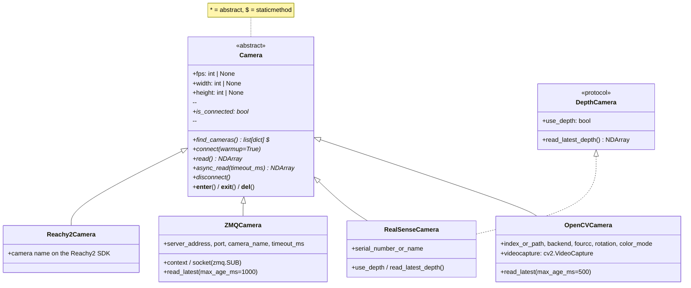
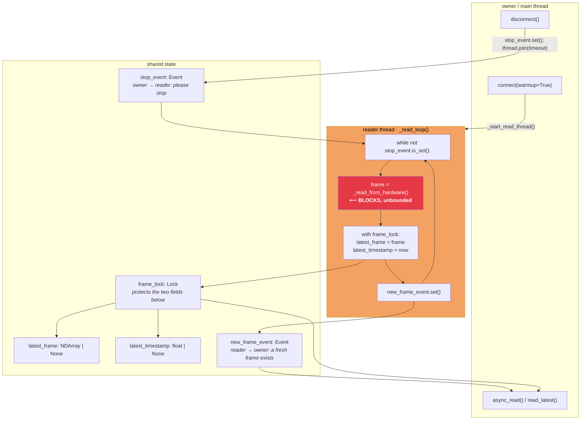
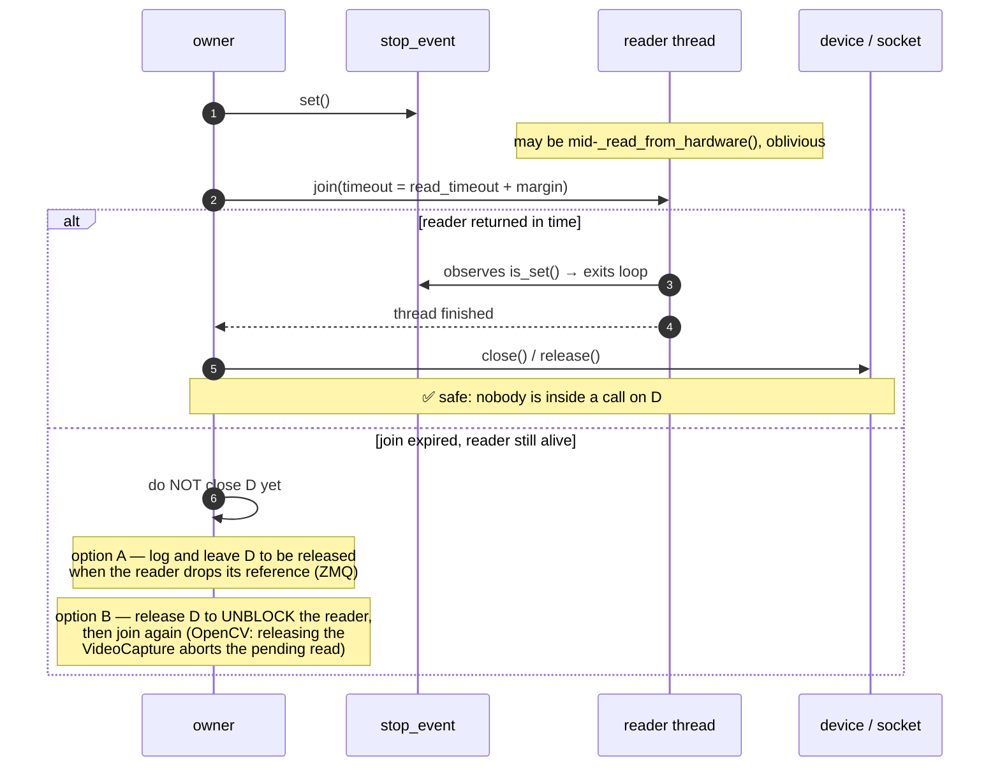
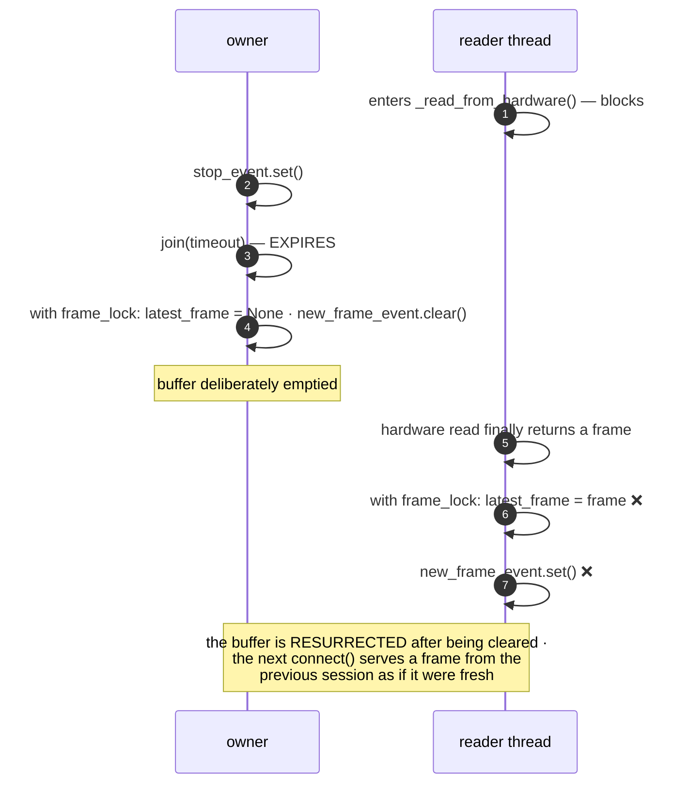
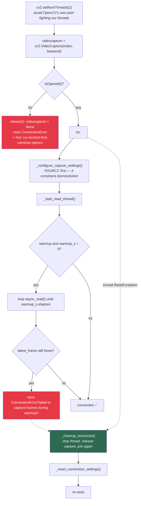
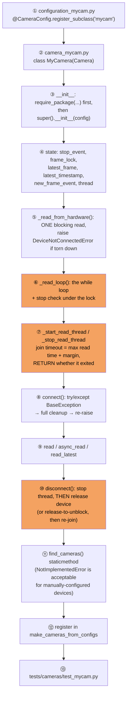

# 05 · Cameras

[← Robots & Teleoperators](./04-robots-and-teleoperators.md) · [Index](./README.md) · [Next: Motors & Calibration →](./06-motors-and-calibration.md)

---

## 1. Why cameras are the hardest part of the hardware layer

Motors are synchronous: you write a register, you read a register, the bus round-trip is
bounded and predictable. Cameras are not. A USB webcam read can block for an arbitrary
time, a network camera can stall on a dropped publisher, and a RealSense frame set arrives
on the SDK's schedule — not yours.

So every camera backend runs a **background reader thread** and the control loop reads a
shared buffer. That one design decision brings in a lock, two events, a join with a
timeout, and an ordering requirement between "stop the thread" and "release the device".
Both hard bugs in the deep-dive folder live in that machinery:

- [01 · ZMQ `_cleanup()` closed a socket under a live reader](../issue-deep-dives/01-zmq-cleanup-stops-read-thread.md)
- [02 · Read loops published a frame after stop was requested](../issue-deep-dives/02-camera-read-loop-stop-parity.md)

Read this document before either of those.

---

## 2. The `Camera` contract

`src/lerobot/cameras/camera.py:25`



### The three read methods — and when to use which

This is the single most consequential API distinction in the camera layer.

| Method | Blocks? | Returns | Use when |
|---|---|---|---|
| `read()` | **Yes**, on the hardware (or on a fresh frame from the thread) | a new frame | One-off capture, warmup, calibration tooling |
| `async_read(timeout_ms)` | Up to `timeout_ms`, only if no *unconsumed* frame exists | the latest **unconsumed** frame | You want every processed frame to be fresh — effectively syncing your loop to the camera's FPS |
| `read_latest(max_age_ms)` | **No** | whatever is in the buffer, if younger than `max_age_ms` | Fixed-cadence control loops that must never stall; raises if the frame is stale |

The base-class docstring for `async_read` states the contract precisely:

> Essentially, this method returns the latest unconsumed frame, waiting if necessary for a
> new one to arrive within the specified timeout.
> […] Causes of a timeout usually include: very low camera FPS, heavy processing load, or
> if the camera is disconnected.

Note which one the robots actually use:

```python
# src/lerobot/robots/so_follower/so_follower.py — get_observation()
obs_dict[cam_key] = cam.read_latest()
```

`read_latest()`, not `async_read()`. A follower at 30 Hz must not have its tick extended
because a camera hiccuped; it prefers a 20 ms-old frame over a late one. The staleness
bound is the safety valve — if the reader has genuinely died, `read_latest` raises rather
than feeding the policy a frozen image forever.

---

## 3. The background reader pattern

Every backend implements the same five-part structure. Learn it once.



The red box is the whole problem. `_read_from_hardware()` is an *unbounded blocking call*
into a driver, an SDK, or a socket. While the reader sits inside it:

- it cannot observe `stop_event`,
- it is holding a reference to the device/socket,
- and `thread.join(timeout=...)` in the owner will expire while it is still alive.

Every correct shutdown sequence has to cope with all three.

### `_start_read_thread` — idempotent restart

```python
# cameras/zmq/camera_zmq.py:274
def _start_read_thread(self) -> None:
    if self.stop_event is not None:
        self.stop_event.set()
    if self.thread is not None and self.thread.is_alive():
        self.thread.join(timeout=2.0)

    with self.frame_lock:               # clear any frame from a previous session
        self.latest_frame = None
        self.latest_timestamp = None
        self.new_frame_event.clear()

    self.stop_event = Event()
    self.thread = Thread(target=self._read_loop, daemon=True, name=f"{self}_read_loop")
    self.thread.start()
    time.sleep(0.1)                      # give the reader a head start
```

Two things to notice:

1. It **clears the buffer** before starting. A frame left over from a previous connect
   would otherwise be served as if it were current — which is precisely how the "late
   frame" bug became observable ([deep dive 02](../issue-deep-dives/02-camera-read-loop-stop-parity.md)).
2. `daemon=True` means a stuck reader won't block interpreter exit. That's a safety net,
   not a correctness argument — a daemon thread still holds the device while the process
   is alive.

### `async_read` — the consumer side

```python
# cameras/opencv/camera_opencv.py:543
@check_if_not_connected
def async_read(self, timeout_ms: float = 200) -> NDArray[Any]:
    if self.thread is None or not self.thread.is_alive():
        raise RuntimeError(f"{self} read thread is not running.")

    if not self.new_frame_event.wait(timeout=timeout_ms / 1000.0):
        raise TimeoutError(f"Timed out waiting for frame from camera {self} after {timeout_ms} ms. "
                           f"Read thread alive: {self.thread.is_alive()}.")

    with self.frame_lock:
        frame = self.latest_frame
        self.new_frame_event.clear()      # mark this frame as consumed

    if frame is None:
        raise RuntimeError(f"Internal error: Event set but no frame available for {self}.")
    return frame
```

The `frame is None` branch reads like defensive paranoia, but it is exactly the state a
race can produce: `new_frame_event` set while `latest_frame` is `None`. The fix for
[deep dive 02](../issue-deep-dives/02-camera-read-loop-stop-parity.md) closes the inverse
hole — `latest_frame` populated *after* the buffer was deliberately cleared.

### `read_latest` — the peek

```python
# cameras/zmq/camera_zmq.py:341
@check_if_not_connected
def read_latest(self, max_age_ms: int = 1000) -> NDArray[Any]:
    if self.thread is None or not self.thread.is_alive():
        raise RuntimeError(f"{self} read thread is not running.")

    with self.frame_lock:
        frame = self.latest_frame
        timestamp = self.latest_timestamp

    if frame is None or timestamp is None:
        raise RuntimeError(f"{self} has not captured any frames yet.")

    age_ms = (time.perf_counter() - timestamp) * 1e3
    if age_ms > max_age_ms:
        raise TimeoutError(f"{self} latest frame is too old: {age_ms:.1f} ms (max allowed: {max_age_ms} ms).")
    return frame
```

Note that it does **not** touch `new_frame_event` — peeking does not consume. And it reads
*both* fields under one lock acquisition, so the frame and its timestamp can never be
mismatched. This is why `latest_frame` and `latest_timestamp` must always be written
together, under the lock, as a pair.

---

## 4. Shutdown: the ordering problem

Here is the sequence every backend must get right, and the two ways it has gone wrong.

### 4.1 The correct sequence



Whether option A or B is correct depends on the driver:

- **OpenCV**: releasing the `VideoCapture` *unblocks* a pending `read()`. So release, then
  join again. `OpenCVCamera._cleanup_resources` does exactly that:

  ```python
  # cameras/opencv/camera_opencv.py
  def _cleanup_resources(self) -> None:
      """Stop background reads and release the capture, including after partial setup."""
      read_thread = self.thread
      videocapture = self.videocapture
      try:
          self._stop_read_thread()
      finally:
          self.videocapture = None
          try:
              if videocapture is not None:
                  videocapture.release()
          finally:
              # Releasing the device may unblock a hardware read that outlived
              # the first bounded join in _stop_read_thread().
              if read_thread is not None and read_thread.is_alive():
                  read_thread.join(timeout=2.0)
                  if read_thread.is_alive():
                      logger.warning(f"{self} read thread remained alive after releasing the capture.")
  ```

- **ZMQ**: closing a socket that another thread is blocked on in `recv` is **not** safe —
  pyzmq/libzmq sockets are not thread-safe and the behaviour ranges from an assertion
  failure to a crash. So the only correct move is *not* to close it; drop the reference
  and let it be collected once the reader returns. That is what the fix in
  [deep dive 01](../issue-deep-dives/01-zmq-cleanup-stops-read-thread.md) implements.

### 4.2 Choosing the join timeout

A fixed `join(timeout=2.0)` is wrong whenever the blocking read can legitimately take
longer than 2 s. `ZMQCamera` sets `zmq.RCVTIMEO = self.timeout_ms`, which is
user-configurable and routinely exceeds 2 s. The fixed join therefore expired *in normal
operation*, not just under failure.

The fix makes the join outlast the read it is waiting for:

```python
self.thread.join(timeout=self.timeout_ms / 1000.0 + 2.0)
```

**Rule of thumb for any new backend:** the join timeout must be
`(the maximum time _read_from_hardware can block) + margin`, and
`_stop_read_thread` must report whether the thread actually exited so the caller can
decide what is safe to release.

### 4.3 Publishing after a stop

Even a correct join does not make the reader's *last* write safe. Consider:



The fix is a second `stop_event` check, taken **under the lock**, immediately before the
write:

```python
with self.frame_lock:
    # Under the lock, so a late frame cannot resurrect the buffer _stop_read_thread() cleared.
    if stop_event.is_set():
        break
    self.latest_frame = processed_frame
    self.latest_timestamp = capture_time
self.new_frame_event.set()
```

Why *under* the lock and not before it? Because `_stop_read_thread` clears the buffer while
holding `frame_lock`. Checking outside the lock would leave the classic
check-then-act window: observe "not stopped", get descheduled, the owner clears the buffer,
resume, write. Taking the check and the write under the same lock the clearer uses makes
them mutually exclusive. Full analysis:
[deep dive 02](../issue-deep-dives/02-camera-read-loop-stop-parity.md).

---

## 5. `connect()` and the partial-failure path

`connect()` acquires several resources in sequence, and any of them can fail. The handling
is not uniform across backends — worth knowing which pattern you are reading.

### OpenCV — the thorough version



Note `except BaseException`, not `except Exception`: a `KeyboardInterrupt` during warmup
must still release the camera. And the cleanup itself is wrapped so a failure *in cleanup*
is logged rather than masking the original error:

```python
except BaseException:
    try:
        self._cleanup_resources()
    except Exception:
        logger.exception(f"Failed to fully clean up {self} after connect() failed.")
    self._reset_connection_settings()
    raise
```

### ZMQ — the shape of the bug

```python
# cameras/zmq/camera_zmq.py:116 — before the fix
@check_if_already_connected
def connect(self, warmup: bool = True) -> None:
    try:
        self.context = zmq.Context()
        self.socket = self.context.socket(zmq.SUB)
        self.socket.setsockopt_string(zmq.SUBSCRIBE, "")
        self.socket.setsockopt(zmq.RCVTIMEO, self.timeout_ms)
        self.socket.setsockopt(zmq.CONFLATE, True)         # keep only the newest message
        self.socket.connect(f"tcp://{self.server_address}:{self.port}")
        self._connected = True

        if self.width is None or self.height is None:
            temp_frame = self._read_from_hardware()        # thread not running yet
            self.height, self.width = temp_frame.shape[:2]

        self._start_read_thread()                          # ← thread now exists

        if warmup:
            ... # async_read in a loop; raise ConnectionError if no frame
    except Exception as e:
        self._cleanup()                                    # ← did NOT stop the thread
        raise RuntimeError(f"Failed to connect to {self}: {e}") from e
```

`_cleanup()` closed the socket and terminated the context but never set `stop_event`. A
failed warmup therefore left a live thread blocked in `recv_string()` on a socket being
closed from under it — and a retry loop accumulated one such thread per attempt. That is
[deep dive 01](../issue-deep-dives/01-zmq-cleanup-stops-read-thread.md).

Two ZMQ socket options worth knowing, because they shape the semantics:

- `zmq.CONFLATE = True` — the socket keeps only the **most recent** message. There is no
  backlog, so a slow consumer gets the newest frame rather than a queue of stale ones. This
  is the right choice for video and it is why `read_latest` is meaningful here.
- `zmq.RCVTIMEO = timeout_ms` — `recv_string()` raises `zmq.Again` after this long, which
  `_read_from_hardware` converts into a `TimeoutError`. **This is also the upper bound on
  how long the reader can be unresponsive to `stop_event`.**

---

## 6. Backends

| Backend | Config type | Module | Notes |
|---|---|---|---|
| OpenCV | `opencv` | `cameras/opencv/camera_opencv.py` | USB/CSI webcams and video files; FOURCC, rotation, `color_mode` (RGB/BGR), backend selection |
| Intel RealSense | `intelrealsense` | `cameras/realsense/camera_realsense.py` | Implements `DepthCamera`; `use_depth` adds a `<key>_depth` observation |
| ZMQ | `zmq` | `cameras/zmq/camera_zmq.py` | Remote cameras over a `zmq.SUB` socket; JSON payload with base64 JPEG |
| Reachy 2 | `reachy2_camera` | `cameras/reachy2_camera/reachy2_camera.py` | Via the Reachy 2 SDK |
| Third-party | any | `lerobot_camera_*` packages | Auto-discovered by package-name prefix |

Construction goes through one factory (`cameras/utils.py:25`):

```python
def make_cameras_from_configs(camera_configs: dict[str, CameraConfig]) -> dict[str, Camera]:
    cameras = {}
    for key, cfg in camera_configs.items():
        if   cfg.type == "opencv":          from .opencv import OpenCVCamera;                cameras[key] = OpenCVCamera(cfg)
        elif cfg.type == "intelrealsense":  from .realsense.camera_realsense import RealSenseCamera; cameras[key] = RealSenseCamera(cfg)
        elif cfg.type == "reachy2_camera":  ...
        elif cfg.type == "zmq":             ...
        else:
            try:
                cameras[key] = cast(Camera, make_device_from_device_class(cfg))   # third-party plugin
            except Exception as e:
                raise ValueError(f"Error creating camera {key} with config {cfg}: {e}") from e
    return cameras
```

The imports are **inside** the branches, so `import lerobot` never pulls in `pyrealsense2`
or `pyzmq`. A `TODO(Steven)` notes the first-party branches should eventually collapse into
the generic `make_device_from_device_class` path used by plugins.

### The ZMQ wire format

```
{
  "timestamps": {"head_camera": 1732041234.56, ...},
  "images":     {"head_camera": "<base64-encoded JPEG>", ...}
}
```

`_read_from_hardware` picks `images[self.camera_name]` if present, otherwise the first
entry, base64-decodes it and runs `cv2.imdecode`. A publisher implementation ships in
`cameras/zmq/image_server.py` — that is what runs on a LeKiwi.

---

## 7. Configuring cameras from the CLI

`CameraConfig` is a `ChoiceRegistry` with three shared fields (`fps`, `width`, `height`),
so cameras are declared inline inside a robot config:

```bash
lerobot-record \
  --robot.type=so101_follower \
  --robot.port=/dev/ttyACM0 \
  --robot.cameras="{
      front: {type: opencv, index_or_path: 0, width: 1920, height: 1080, fps: 30},
      wrist: {type: opencv, index_or_path: 2, width: 640,  height: 480,  fps: 30}
  }" \
  ...
```

The dict keys become the observation keys (`obs["front"]`, `obs["wrist"]`) and the dataset
column names. Leaving `width`/`height` unset asks the backend to auto-detect — which the
ZMQ backend does by taking one direct read *before* starting the thread:

```python
if self.width is None or self.height is None:
    # Read directly from hardware because the thread isn't running yet
    temp_frame = self._read_from_hardware()
    self.height, self.width = temp_frame.shape[:2]
```

Use `lerobot-find-cameras` to enumerate what is attached before writing the config.

---

## 8. Implementing a camera backend: the checklist



The orange boxes are the ones the two hard bugs were in. Concretely, assert all of this in
your tests:

- [ ] A `connect()` that fails after the thread started leaves `thread is None`,
      `stop_event is None`, `is_connected == False`, `latest_frame is None`.
- [ ] `_cleanup()` never closes the device while the reader is inside
      `_read_from_hardware()`.
- [ ] A read that returns *after* `stop_event` was set does not repopulate
      `latest_frame` / set `new_frame_event`.
- [ ] `read_latest()` raises `TimeoutError` on a stale frame rather than returning it.
- [ ] `async_read()` raises `RuntimeError` when the thread is dead, not a silent `None`.

Both regression tests in the deep-dive folder are written against mocks only — no camera
hardware required. `tests/cameras/test_zmq.py` and `tests/cameras/test_opencv.py` are good
templates:

```python
def test_read_loop_does_not_publish_after_stop_requested():
    camera = ZMQCamera(ZMQCameraConfig(server_address="127.0.0.1", width=640, height=480, warmup_s=0))
    camera.stop_event = Event()

    def read_then_request_stop():
        camera.stop_event.set()                      # the stop lands mid-read
        return np.zeros((480, 640, 3), np.uint8)

    with patch.object(camera, "_read_from_hardware", side_effect=read_then_request_stop):
        camera._read_loop()

    assert camera.latest_frame is None
    assert camera.latest_timestamp is None
    assert not camera.new_frame_event.is_set()
```

---

## 9. Next

[06 · Motors & Calibration](./06-motors-and-calibration.md) — the synchronous half of the
hardware layer, and the `write_calibration` / `read_calibration` symmetry that
[deep dive 03](../issue-deep-dives/03-dynamixel-write-drive-mode.md) broke.
