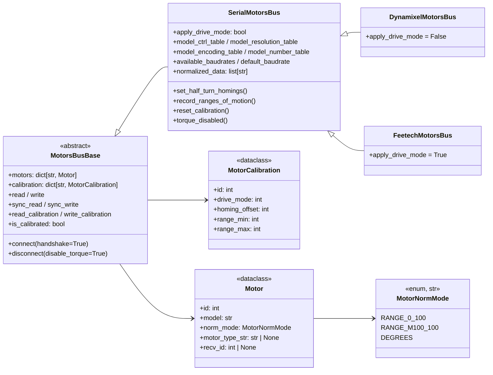
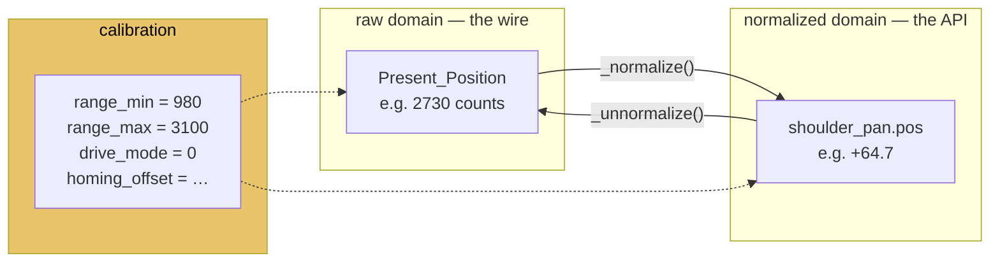
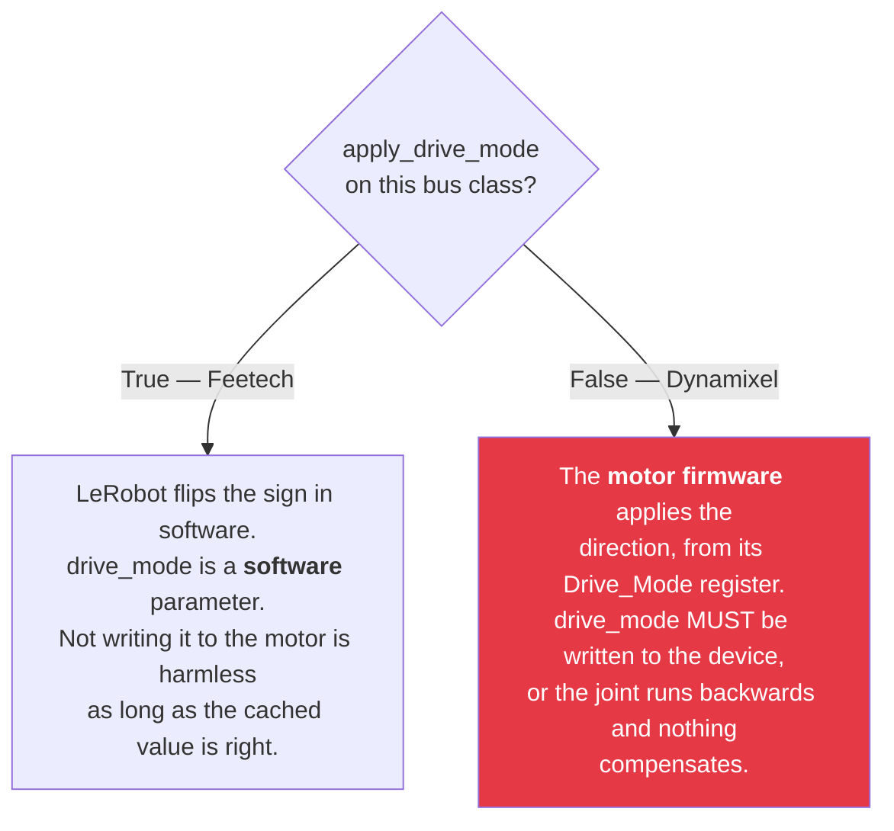
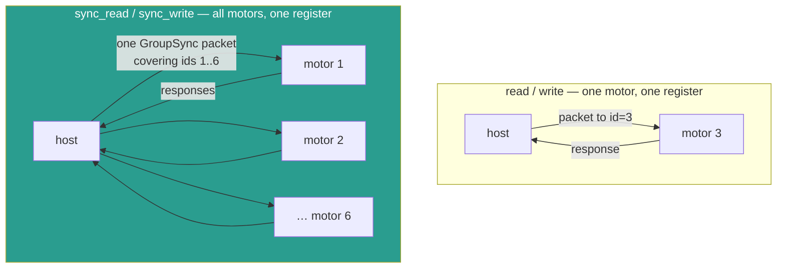
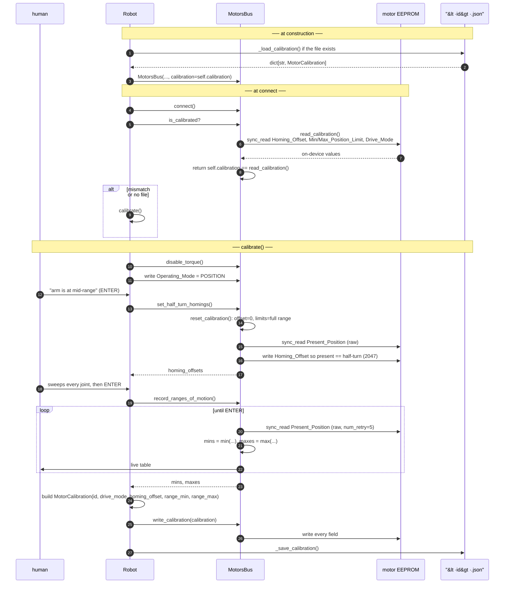
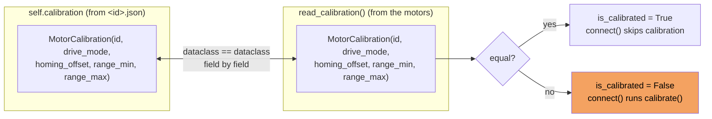
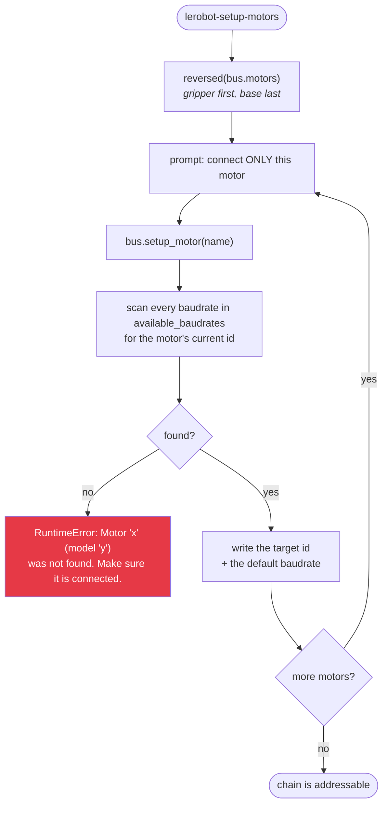

# 06 · Motors & Calibration

[← Cameras](./05-cameras.md) · [Index](./README.md) · [Next: LeRobotDataset →](./07-dataset.md)

---

## 1. What this layer does

`src/lerobot/motors/` owns everything between "a Python float" and "a byte on a serial
bus". It is the lowest level of the stack and the only place in LeRobot that knows about
register addresses, two's-complement encodings and baudrates.

```
src/lerobot/motors/
├── motors_bus.py        ← MotorsBusBase, SerialMotorsBus, Motor, MotorCalibration, MotorNormMode
├── encoding_utils.py    ← two's-complement / sign-magnitude helpers
├── calibration_gui.py   ← optional GUI for the calibration sweep
├── dynamixel/
│   ├── dynamixel.py     ← DynamixelMotorsBus
│   └── tables.py        ← X_SERIES_CONTROL_TABLE, model tables
├── feetech/
│   ├── feetech.py       ← FeetechMotorsBus
│   └── tables.py        ← STS/SCS control tables
├── damiao/              ← CAN-based
└── robstride/           ← CAN-based
```

Its responsibilities, in order of how often you will touch them:

1. **Normalization** — turn raw encoder counts into `-100…100`, `0…100` or degrees, and back.
2. **Calibration** — homing offsets, joint limits, direction convention; persist and verify.
3. **Protocol** — single and group (sync) reads/writes, retries, sign encoding.
4. **Provisioning** — assign motor IDs, set baudrates, write EEPROM configuration.

---

## 2. The three data types



`MotorCalibration` has exactly **five** fields, and every one of them participates in
normalization or in the `is_calibrated` check. Forgetting any one of them in
`write_calibration` breaks the subsystem — see §6 and
[deep dive 03](../issue-deep-dives/03-dynamixel-write-drive-mode.md).

---

## 3. Normalization: the raw↔human conversion

A Feetech STS3215 has a 12-bit encoder: `0…4095`. Nobody wants to reason in counts, and no
policy should be trained on them (they are hardware-specific). So the bus normalizes.



The three modes, from `_normalize` / `_unnormalize` in `motors_bus.py:854`:

| Mode | Forward (raw → norm) | Used for |
|---|---|---|
| `RANGE_M100_100` | `((v − min)/(max − min)) × 200 − 100` | body joints — symmetric about centre |
| `RANGE_0_100` | `((v − min)/(max − min)) × 100` | grippers — no meaningful negative side |
| `DEGREES` | `(v − mid) × 360 / max_res`, with `mid = (min+max)/2` | when `use_degrees=True`; physical units, independent of the recorded range |

Three details that matter in practice:

**Clamping is built in.** Both directions bound the value before converting:

```python
bounded_val = min(max_, max(min_, val))          # _normalize
bounded_val = min(100.0, max(-100.0, val))       # _unnormalize, RANGE_M100_100
```

So commanding `shoulder_pan.pos = 500` does not drive the motor past its recorded limit —
it saturates. This is a *second* safety layer under the robot-level
`max_relative_target` clipping.

**A degenerate range is fatal, not silent:**

```python
if max_ == min_:
    raise ValueError(f"Invalid calibration for motor '{motor}': min and max are equal.")
```

which is why `record_ranges_of_motion` refuses to return such a range in the first place:

```python
same_min_max = [motor for motor in motor_names if mins[motor] == maxes[motor]]
if same_min_max:
    raise ValueError(f"Some motors have the same min and max values:\n{pformat(same_min_max)}")
```

i.e. "you forgot to move that joint during the sweep".

**`DEGREES` ignores the recorded range for scaling** — it uses the encoder resolution and
the *midpoint* only. That makes degree-mode positions comparable across robots of the same
model even if their sweeps differed, at the cost of not saturating at the mechanical limits
in the same way.

### `drive_mode` and `apply_drive_mode`

`drive_mode` records the **direction convention**: whether increasing encoder counts mean
"up" or "down" for that joint. It appears in normalization as a sign flip:

```python
drive_mode = self.apply_drive_mode and self.calibration[motor].drive_mode
...
normalized_values[id_] = -norm if drive_mode else norm                  # RANGE_M100_100
normalized_values[id_] = 100 - norm if drive_mode else norm             # RANGE_0_100
```

But look at the `and`: the flip only happens if the **bus class** opts in.

```python
class DynamixelMotorsBus(SerialMotorsBus):
    apply_drive_mode = False     # ← the motor firmware handles direction itself

class FeetechMotorsBus(SerialMotorsBus):
    apply_drive_mode = True      # ← LeRobot compensates in software
```



This asymmetry is the whole root cause of
[deep dive 03](../issue-deep-dives/03-dynamixel-write-drive-mode.md): the same missing
`self.write("Drive_Mode", ...)` is benign on Feetech and a physical-motion bug on Dynamixel.

---

## 4. Control tables

A motor's registers are addressed by `(address, byte_length)`. Each family ships a table:

```python
# src/lerobot/motors/dynamixel/tables.py
X_SERIES_CONTROL_TABLE = {
    ...
    "Drive_Mode":         (10, 1),
    "Homing_Offset":      (20, 4),
    "Max_Position_Limit": (48, 4),
    "Min_Position_Limit": (52, 4),
    ...
}
```

Lookup goes through three helpers in `motors_bus.py` that all fail loudly:

```python
def get_ctrl_table(model_ctrl_table, model):            # KeyError: "Control table for model=… not found."
def get_address(model_ctrl_table, model, data_name):    # KeyError: "Address for 'X' not found in <model> control table."
def assert_same_address(model_ctrl_table, models, name) # NotImplementedError if two models disagree
```

`assert_same_address` is the precondition for **sync** operations: a group read/write sends
one packet for one `(address, length)` across many motor IDs, so a bus mixing two models
whose `Present_Position` lives at different addresses cannot be sync-read. The check turns
that into an explicit `NotImplementedError` instead of garbage data.

### `read` / `write` vs `sync_read` / `sync_write`



The control loop uses only the sync forms — `sync_read("Present_Position")` and
`sync_write("Goal_Position", goal_pos)` — because a 6-motor arm at 30 Hz cannot afford six
round-trips per tick. The single forms are for configuration, where latency does not matter
and per-motor values differ.

Both accept `normalize=` (default `True`) and `num_retry=`. Serial buses on USB adapters do
drop packets; `num_read_retries` is surfaced all the way up to the robot config.

---

## 5. The calibration lifecycle



### `set_half_turn_homings` — why reset first

```python
def set_half_turn_homings(self, motors=None):
    motor_names = self._get_motors_list(motors)
    self.reset_calibration(motor_names)                        # ← offset = 0, limits = full range
    actual_positions = self.sync_read("Present_Position", motor_names, normalize=False)
    homing_offsets = self._get_half_turn_homings(actual_positions)
    for motor, offset in homing_offsets.items():
        self.write("Homing_Offset", motor, offset)
    return homing_offsets
```

`reset_calibration` is called first because the present position must be read in *raw,
uncompensated* counts — reading it through a stale homing offset would compute an offset
relative to an offset. Note `normalize=False` for the same reason.

The goal is that the mechanical mid-range maps to the encoder mid-point (`2047` on a 12-bit
device), so the usable travel is symmetric in both directions.

### `is_calibrated` is an equality, and that is the key insight

```python
@property
def is_calibrated(self) -> bool:
    return self.calibration == self.read_calibration()
```



This gives drift detection for free: swap a motor, reflash a controller, or plug in a
different arm with the same `id`, and the mismatch is caught at connect time.

But it also creates a hard invariant:

> **`write_calibration` must write every field that `read_calibration` reads.**

If it does not, the comparison can never succeed for any value other than the device's
current one — `is_calibrated` returns `False` forever and `connect()` re-runs calibration
every single time. That is the failure signature of
[deep dive 03](../issue-deep-dives/03-dynamixel-write-drive-mode.md).

Here is the asymmetry it had, side by side:

```python
# DynamixelMotorsBus.read_calibration — reads FOUR registers
offsets     = self.sync_read("Homing_Offset",      normalize=False)
mins        = self.sync_read("Min_Position_Limit", normalize=False)
maxes       = self.sync_read("Max_Position_Limit", normalize=False)
drive_modes = self.sync_read("Drive_Mode",         normalize=False)   # ← read

# DynamixelMotorsBus.write_calibration — wrote THREE  (before the fix)
for motor, calibration in calibration_dict.items():
    self.write("Homing_Offset",      motor, calibration.homing_offset)
    self.write("Min_Position_Limit", motor, calibration.range_min)
    self.write("Max_Position_Limit", motor, calibration.range_max)
    #                                                              ← Drive_Mode never written
```

---

## 6. Provisioning: `setup_motors` and `lerobot-setup-motors`

A fresh motor ships with ID 1. A daisy-chain needs IDs 1…6. You cannot assign them with
everything connected, because every motor would answer to ID 1 — hence the one-at-a-time
protocol:

```python
# SOFollower.setup_motors()
def setup_motors(self) -> None:
    for motor in reversed(self.bus.motors):
        input(f"Connect the controller board to the '{motor}' motor only and press enter.")
        self.bus.setup_motor(motor)
        print(f"'{motor}' motor id set to {self.bus.motors[motor].id}")
```



`reversed(...)` is deliberate: you work from the end of the chain inward, so each newly
provisioned motor can stay plugged in as you move down.

`configure_motors()` then applies family-wide EEPROM tuning. For Dynamixel, that is the
response delay:

```python
def configure_motors(self, return_delay_time=0) -> None:
    # By default, Dynamixel motors have a 500µs delay response time (value 250 on
    # 'Return_Delay_Time'). We ensure this is reduced to the minimum of 2µs (value 0).
    for motor in self.motors:
        self.write("Return_Delay_Time", motor, return_delay_time)
```

500 µs × 6 motors × 2 directions is a meaningful fraction of a 33 ms control tick — this
one write is worth real Hz.

### `torque_disabled()`

```python
with self.bus.torque_disabled():
    self.bus.configure_motors()
    ...
```

Most EEPROM registers on these motors are **read-only while torque is enabled**. The
context manager guarantees torque is restored even if a write raises — important, because
leaving an arm limp mid-configuration drops it.

---

## 7. Sign encoding

Encoder offsets can be negative, but the wire carries unsigned bytes. Two families, two
conventions:

```python
# Dynamixel: two's complement
def _encode_sign(self, data_name, ids_values):
    for id_ in ids_values:
        model = self._id_to_model(id_)
        encoding_table = self.model_encoding_table.get(model)
        if encoding_table and data_name in encoding_table:
            n_bytes = encoding_table[data_name]
            ids_values[id_] = encode_twos_complement(ids_values[id_], n_bytes)
    return ids_values
```

Feetech uses sign-magnitude for some registers instead. Both live behind the abstract
`_encode_sign` / `_decode_sign` pair, and the per-model `model_encoding_table` decides
*which* registers need it (`Homing_Offset` is the main one). `_serialize_data` then
refuses anything out of range:

```python
if value < 0:
    raise ValueError(f"Negative values are not allowed: {value}")
max_value = {1: 0xFF, 2: 0xFFFF, 4: 0xFFFFFFFF}.get(length)
if value > max_value:
    raise ValueError(f"Value {value} exceeds the maximum for {length} bytes ({max_value}).")
```

So a sign-encoding bug surfaces as a loud `ValueError` at the serialization boundary rather
than as a wrapped-around position. (A related real defect — half-turn homing offsets that
were not representable in the Feetech encoding — was fixed upstream in #4940.)

---

## 8. Testing without hardware

`tests/mocks/mock_motors_bus.py` provides a stub serial device driven by *stubs*: you
declare the exact byte sequence you expect and assert it was sent.

```python
def test_write_calibration_writes_drive_mode(mock_motors, dummy_motors, dummy_calibration):
    write_stubs = []
    for motor in dummy_motors.values():
        calibration = dummy_calibration[...]
        write_stubs += [
            mock_motors.build_write_stub(*X_SERIES_CONTROL_TABLE["Drive_Mode"], motor.id, calibration.drive_mode),
            mock_motors.build_write_stub(*X_SERIES_CONTROL_TABLE["Homing_Offset"], motor.id,
                                         encode_twos_complement(calibration.homing_offset, 4)),
            mock_motors.build_write_stub(*X_SERIES_CONTROL_TABLE["Min_Position_Limit"], motor.id, calibration.range_min),
            mock_motors.build_write_stub(*X_SERIES_CONTROL_TABLE["Max_Position_Limit"], motor.id, calibration.range_max),
        ]

    bus = DynamixelMotorsBus(port=mock_motors.port, motors=dummy_motors)
    bus.connect(handshake=False)
    bus.write_calibration(dummy_calibration)

    assert all(mock_motors.stubs[stub].called for stub in write_stubs)
    assert bus.calibration == dummy_calibration
```

Three things this style buys you:

- It asserts at the **protocol** level (address, length, value), so a regression that
  writes the right value to the wrong register fails.
- `encode_twos_complement(..., 4)` in the expected value documents the encoding as part of
  the test.
- `handshake=False` skips the ping phase, so no motor needs to answer.

`tests/motors/test_dynamixel.py` and `tests/motors/test_feetech.py` additionally assert
against the control tables themselves (`*_CONTROL_TABLE[...]` is spread into every stub) —
the cheapest possible defence against a typo in an address. (A real defect of exactly that
shape — a trailing space in the Feetech `Acceleration_Multiplier` name — was fixed upstream
in #4926.)

---

## 9. Checklist: adding a motor family

- [ ] `tables.py` with the control table(s), resolution table, model-number table,
      baudrate table, and the encoding table for signed registers.
- [ ] Subclass `SerialMotorsBus` (or `MotorsBusBase` for a non-serial transport).
- [ ] **Decide `apply_drive_mode`** and document why. If `False`, `write_calibration`
      *must* write `Drive_Mode` to the device.
- [ ] Implement `_encode_sign` / `_decode_sign`, `_get_half_turn_homings`.
- [ ] Implement `read_calibration` and `write_calibration` over the **same field set** —
      then verify with a test that `is_calibrated` becomes `True` after a write.
- [ ] Implement `configure_motors` for family-wide EEPROM tuning.
- [ ] Add `tests/motors/test_<family>.py` using `mock_motors_bus`, asserting reads and
      writes against the family's control table rather than against literal addresses.

---

## 10. Next

[07 · LeRobotDataset](./07-dataset.md) — where the observations and actions produced by the
last three documents actually get stored.
