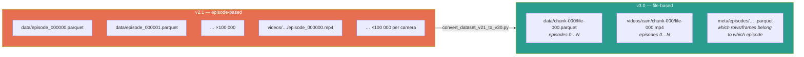
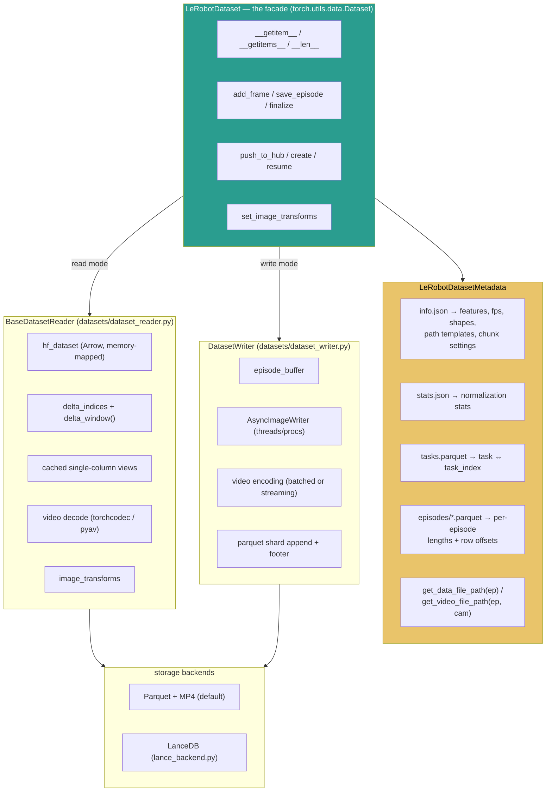
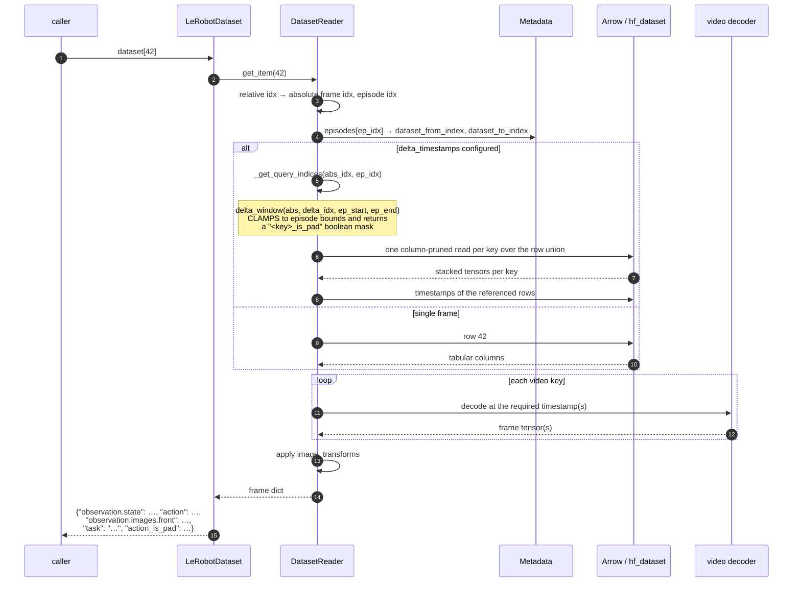
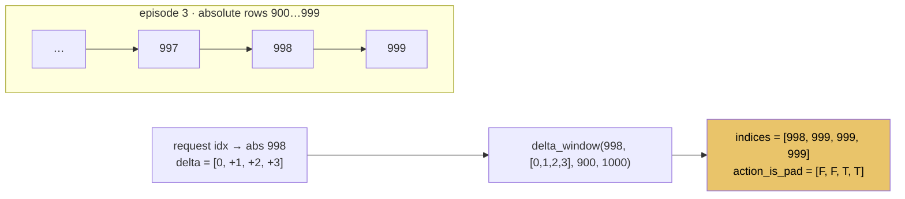
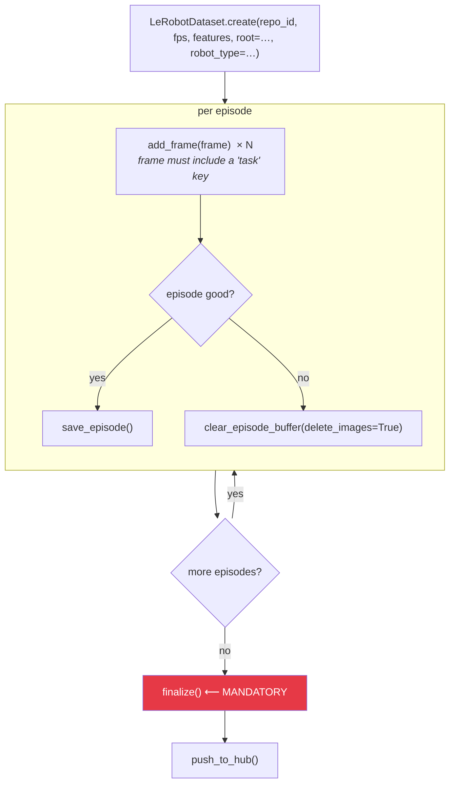
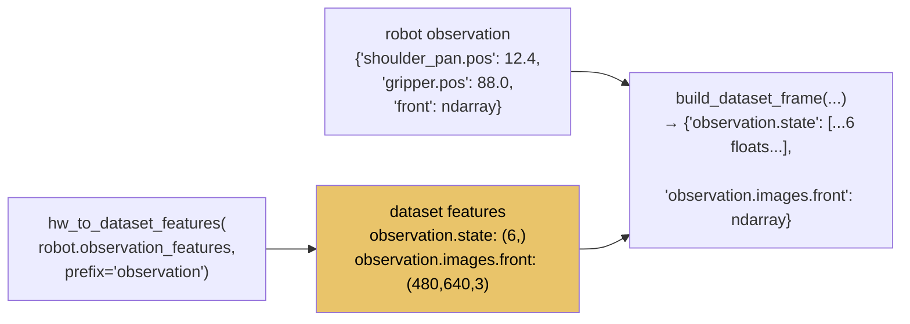
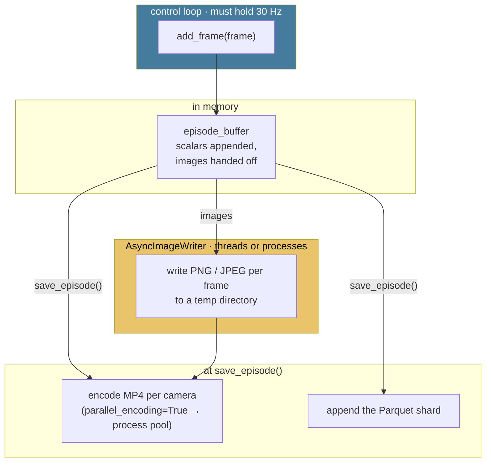
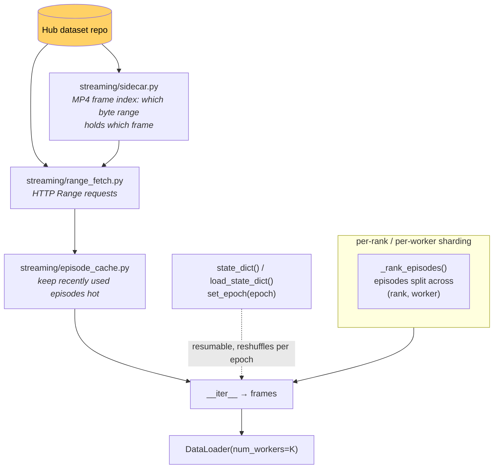

# 07 · LeRobotDataset

[← Motors & Calibration](./06-motors-and-calibration.md) · [Index](./README.md) · [Next: Processor Pipeline →](./08-processor-pipeline.md)

---

## 1. The problem it solves

Robotics data is heterogeneous and large: 30 Hz joint states (tiny, dense), multi-camera
video (huge), and natural-language task labels (text). Before a standard format existed,
every lab had its own pickle layout and no two datasets could be combined.

`LeRobotDataset` v3.0 fixes that with one rule: **decouple storage from the user API.**

- Storage is optimised for *machines*: few large Parquet and MP4 files.
- The API is optimised for *people*: `dataset[42]` returns one frame, with video already
  decoded.

Episode boundaries are reconstructed from **metadata**, not from file names. That is what
lets the format scale to millions of episodes without creating millions of files.

---

## 2. On-disk layout

```
<root>/
├── meta/
│   ├── info.json              ← canonical schema: features, shapes, dtypes, fps,
│   │                             codebase_version, and the PATH TEMPLATES below
│   ├── stats.json             ← per-feature mean/std/min/max → normalization
│   ├── tasks.parquet          ← natural-language task strings ↔ integer task_index
│   └── episodes/
│       └── chunk-000/
│           ├── file-000.parquet   ← per-episode records: length, tasks,
│           └── file-001.parquet      dataset_from_index, dataset_to_index, …
├── data/
│   ├── chunk-000/
│   │   ├── file-000.parquet   ← MANY episodes of tabular frames per file
│   │   └── file-001.parquet
│   └── chunk-001/…
└── videos/
    ├── observation.images.laptop/
    │   └── chunk-000/
    │       ├── file-000.mp4   ← MANY episodes of frames per file, per camera
    │       └── file-001.mp4
    └── observation.images.phone/…
```

The path templates live in `info.json` and default to
(`src/lerobot/datasets/utils.py`):

```python
DEFAULT_CHUNK_SIZE   = 1000                        # max files per chunk directory
CHUNK_FILE_PATTERN   = "chunk-{chunk_index:03d}/file-{file_index:03d}"
INFO_PATH            = "meta/info.json"
STATS_PATH           = "meta/stats.json"
DEFAULT_TASKS_PATH   = "meta/tasks.parquet"
DEFAULT_EPISODES_PATH = "meta/episodes/" + CHUNK_FILE_PATTERN + ".parquet"
DEFAULT_DATA_PATH     = "data/"           + CHUNK_FILE_PATTERN + ".parquet"
DEFAULT_VIDEO_PATH    = "videos/{video_key}/" + CHUNK_FILE_PATTERN + ".mp4"
```

Because the templates are *data*, a dataset can relocate its shards without a code change,
and a reader can discover the whole layout by fetching one small JSON file — before
downloading a single byte of video.

### What changed from v2.1



| Property | v2.1 | v3.0 |
|---|---|---|
| Files per episode | ≥ 2 (+1 per camera) | 0 — episodes share files |
| Episode lookup | by filename | by metadata offsets |
| Init cost at 100k episodes | directory listing dominates | one `info.json` + episode metadata |
| Hub streaming | impractical | first-class (`StreamingLeRobotDataset`) |
| Backends | Parquet + MP4 | Parquet + MP4, or LanceDB tables |

Conversion script: `src/lerobot/scripts/convert_dataset_v21_to_v30.py`. A v2.1 dataset
loaded by a v3 client prompts for the conversion rather than failing obscurely.

---

## 3. Component model



The facade is deliberately thin — most methods are a delegation plus a mode check:

```python
def add_frame(self, frame: dict) -> None:
    self._require_writer("add_frame").add_frame(frame)

def __getitem__(self, idx: int | slice):
    if isinstance(idx, slice):
        return [self[i] for i in range(*idx.indices(len(self)))]
    return self._ensure_reader().get_item(idx)
```

A dataset is in **read mode** or **write mode**, never usefully both: `_require_writer`
raises if you call `add_frame` on a loaded dataset, and `__getitem__` raises if the dataset
is mid-recording and `finalize()` has not been called.

---

## 4. Reading

### 4.1 Construction

```python
from lerobot.datasets.lerobot_dataset import LeRobotDataset

# straight from the Hub
ds = LeRobotDataset("lerobot/aloha_mobile_cabinet")

# a subset of episodes, with action chunking windows
ds = LeRobotDataset(
    "lerobot/svla_so101_pickplace",
    episodes=[0, 1, 5],
    delta_timestamps={"action": [0.0, 0.033, 0.066, 0.099]},
    image_transforms=my_transforms,
    tolerance_s=1e-4,
)

# only long episodes
ds = LeRobotDataset("user/ds", episode_filter=lambda ep: ep["length"] >= 100)
```

Notable constructor parameters (full list in the docstring at
`datasets/lerobot_dataset.py:53`):

| Parameter | Effect |
|---|---|
| `root` | Where files live. If unset, local lookup under `$HF_LEROBOT_HOME/{repo_id}`, Hub downloads into a revision-safe snapshot cache. May be an object-store URI like `hf://datasets/{repo_id}` |
| `episodes` / `episode_filter` | Select a subset; intersected when both are given |
| `delta_timestamps` | Per-feature temporal windows — see §4.3 |
| `tolerance_s` | How far a timestamp may deviate from `k/fps` before it is an error (default `1e-4`) |
| `revision` | Git revision of the dataset repo; defaults to the codebase-version tag |
| `download_videos` | Skip video download for state-only training |
| `video_backend` | `torchcodec` when available, else `pyav` |
| `image_transforms` | Applied inside `__getitem__`, after decode; swappable later |

### 4.2 The read path



### 4.3 `delta_timestamps` — how action chunking is fed

Policies like ACT and the π-family do not predict one action; they predict a *chunk*.
Training them needs, for each sample, a window of future actions. `delta_timestamps`
expresses that declaratively:

```python
delta_timestamps = {
    "action": [0.0, 0.033, 0.066, 0.099],        # now, +1, +2, +3 frames at 30fps
    "observation.images.front": [-0.1, 0.0],     # one frame of history
}
```

At construction the dataset validates and converts them to integer index offsets:

```python
# datasets/dataset_reader.py:165
self.delta_indices = None
if delta_timestamps is not None:
    check_delta_timestamps(delta_timestamps, meta.fps, tolerance_s)   # must be multiples of 1/fps
    self.delta_indices = get_delta_indices(delta_timestamps, meta.fps)
```



Two properties to internalise:

- **Windows never cross episode boundaries.** `delta_window` clamps to
  `[dataset_from_index, dataset_to_index)`, so a sample near the end of an episode repeats
  its last frame rather than bleeding into the next episode's.
- **Padding is reported, not hidden.** Every key with a window gets a companion
  `"<key>_is_pad"` boolean tensor. Policies use it to mask the loss on padded steps — if
  you write a policy and ignore `*_is_pad`, you are training on duplicated frames.

### 4.4 Column pruning — a performance detail with teeth

Reading a low-dimensional column (`action`, `timestamp`) out of an image-bearing dataset
naively decodes *every embedded camera image of every queried row*. The reader avoids that
with cached single-column views:

```python
# datasets/dataset_reader.py:321
def _column_view(self, key: str) -> datasets.Dataset:
    """``select_columns`` is a zero-copy schema projection: row queries on the view fetch
    and decode only ``key``. By contrast, ``hf_dataset[indices]`` (and, since a custom
    transform disables the lazy-``Column`` fast path in ``datasets`` >= 4.4, also
    ``hf_dataset[key][indices]``) fetches and decodes entire rows. On image datasets that
    decodes every embedded camera image of every queried row just to read a
    low-dimensional column like ``action`` (#2895)."""
```

The batch path (`__getitems__`) also does **one** Arrow read per key over the *union* of
rows the whole batch needs, then redistributes — preserving per-item order and duplicates.
That is why `DataLoader` with a `batch_sampler` is dramatically faster than looping
`__getitem__`.

---

## 5. Writing

### 5.1 The three-call protocol



> ⚠️ **`finalize()` is not optional.** From its docstring:
> *"Must be called after data collection/conversion, otherwise footer metadata won't be
> written to the parquet files and the dataset will be invalid."*
> It is idempotent, and `DatasetWriter.__del__` is a best-effort safety net — but a process
> killed before `finalize()` can leave an unreadable shard.

`has_pending_frames()` tells you whether there is anything to save, with a subtlety worth
quoting because it would otherwise look like a bug:

```python
def has_pending_frames(self) -> bool:
    if self.writer is None:
        return False
    # save_episode pops "size", so a buffer abandoned mid-save has nothing pending.
    return self.writer.episode_buffer is not None and self.writer.episode_buffer.get("size", 0) > 0
```

### 5.2 Where the frames come from

In `lerobot-record`, the frame dict is assembled from the robot's feature schema:

```python
observation_frame = build_dataset_frame(dataset.features, obs_processed, prefix=OBS_STR)   # "observation"
action_frame      = build_dataset_frame(dataset.features, action_values,  prefix=ACTION)   # "action"
frame = {**observation_frame, **action_frame, "task": single_task}
dataset.add_frame(frame)
```

`build_dataset_frame` is the bridge between the *flat hardware dict* (§2.1 of
[02 · Architecture](./02-architecture.md)) and the *dataset schema*:



Scalar `.pos` keys are **concatenated into a single `observation.state` vector**, in schema
order, while camera keys become `observation.images.<name>`. That is why the ordering of
`observation_features` is semantically significant and why it must be stable.

### 5.3 Off the hot path

Encoding images synchronously inside `add_frame` would blow the control-loop budget. So:



Two knobs trade latency against throughput:

- `batch_encoding_size=N` — accumulate N episodes before encoding video. `1` encodes
  immediately (lowest memory/disk churn), higher values amortise ffmpeg startup.
- `streaming_encoding=True` with `encoder_threads=K` — pipe frames into the encoder as
  they arrive instead of staging PNGs, with a bounded `encoder_queue_maxsize`. This is the
  recommended mode for long recordings; it avoids writing one PNG per frame per camera to
  disk entirely.

`record_loop` is decorated with `@safe_stop_image_writer`, which shuts the writer pool down
cleanly if the loop raises — otherwise a crash would leave worker threads holding temp
files.

### 5.4 `resume`

`LeRobotDataset.resume(...)` reopens an existing dataset in write mode and continues
appending episodes. This is what lets `lerobot-record` be interrupted and restarted
without re-recording, and what `--dataset.num_episodes` counts against.

---

## 6. Metadata

`LeRobotDatasetMetadata` (`datasets/dataset_metadata.py:67`) is the index over everything.
Its public surface is mostly derived properties:

| Property / method | Source | Used by |
|---|---|---|
| `fps`, `robot_type`, `features`, `shapes`, `names` | `info.json` | schema checks, policy construction |
| `storage_format`, `data_path`, `video_path`, `chunks_size` | `info.json` | path resolution |
| `stats` | `stats.json` | the normalizer processor step |
| `image_keys`, `video_keys`, `depth_keys`, `camera_keys` | features | decode routing, feature transforms |
| `total_episodes`, `total_frames`, `total_tasks` | `info.json` | logging, sampling |
| `episodes[ep]` → `dataset_from_index` / `dataset_to_index` / `length` / `task_index` | `meta/episodes/*.parquet` | episode-aware sampling, `delta_window` clamping |
| `get_task_index(task)` / `save_episode_tasks(tasks)` | `tasks.parquet` | task-conditioned policies |
| `get_data_file_path(ep)` / `get_video_file_path(ep, cam)` | path templates | selective `snapshot_download` |
| `has_language_columns`, `tools` | features / info | annotation + tool-use datasets |
| `rescale_depth_stats(unit)` | stats | depth unit conversion (mm ↔ m) |

`get_data_file_path` / `get_video_file_path` are what make **partial downloads** work: with
`episodes=[0, 1, 5]`, the reader computes just the shard paths those episodes live in and
passes them as `allow_patterns` to `snapshot_download`:

```python
# datasets/dataset_reader.py:280
fpaths = [str(self._meta.get_data_file_path(ep_idx)) for ep_idx in episodes]
if len(self._meta.video_keys) > 0:
    fpaths += [str(self._meta.get_video_file_path(ep_idx, k))
               for k in self._meta.video_keys for ep_idx in episodes]
# episodes are stored in the same files, so we return unique paths only
fpaths = list(set(fpaths))
```

The dedup matters: in v3 three episodes very often live in *one* file, so the naive list
would download the same shard three times.

---

## 7. Streaming

`StreamingLeRobotDataset` (`datasets/streaming_dataset.py:129`) is an
`IterableDataset` that reads straight from the Hub — no full download, no local copy.



Key capabilities:

- **No download.** Random access into MP4 is possible because a *sidecar* index maps frame
  → byte range; `lerobot-build-mp4-sidecar` generates it. Without a sidecar you would have
  to decode from the start of the file.
- **Sharded.** `_rank_episodes()` partitions episodes across distributed ranks *and*
  DataLoader workers, so `--num_workers` actually multiplies throughput (upstream #4874
  measured up to 2.5×).
- **Resumable.** `state_dict()` / `load_state_dict()` checkpoint the iteration position, so
  a streaming run survives a restart.
- **Epoch-aware.** `set_epoch(epoch)` changes the shuffle.

Enable it from the CLI with `--dataset.streaming=true`. The training script then skips
handing the dataloader to `accelerate.prepare` (an `IterableDataset` has no sampler to
shard) and moves batches to the device itself:

```python
if cfg.dataset.streaming:
    batch = send_to_device(batch, device, non_blocking=device.type == "cuda")
```

---

## 8. Dataset tooling

| Command / module | What it does |
|---|---|
| `lerobot-edit-dataset` | Delete episodes, split by indices or fractions, add/remove features, merge datasets |
| `lerobot-dataset-viz` | Visualise frames and signals; the Hub Space version renders in-browser |
| `lerobot-build-mp4-sidecar` | Build the frame index that makes streaming random access cheap |
| `lerobot-annotate` | VLM-assisted language annotation (`annotations/steerable_pipeline/`) |
| `datasets/aggregate.py` | Combine many datasets into one |
| `datasets/multi_dataset.py` | `LeRobotMultiDataset` for training across datasets (note: `--dataset.repo_id` as a *list* currently raises `NotImplementedError` in `TrainPipelineConfig.validate`) |
| `datasets/compute_stats.py` | (Re)compute `stats.json` |
| `scripts/augment_dataset_quantile_stats.py` | Add quantile statistics for policies that normalize by quantile |
| `scripts/convert_dataset_v21_to_v30.py` | Format migration |

---

## 9. The LanceDB backend

`datasets/lance_backend.py` is an alternative storage format: the dataset becomes a
[LanceDB](https://lancedb.com) table. The trade-off:

| | Parquet + MP4 | Lance |
|---|---|---|
| Random access | needs video decode | native, indexed |
| Reads in place from object storage | partial | yes |
| Ecosystem tooling | universal (`.parquet`, `.mp4`, `.json`) | Lance-specific |
| Best for | sharing, archival, portability | large-scale shuffled training directly off S3/GCS |

`meta.storage_format` records which one a dataset uses; the reader dispatches on it, so the
facade API is unchanged.

---

## 10. Gotchas

1. **Forgetting `finalize()`** produces a dataset whose Parquet footers are missing. Always
   use try/finally or let `lerobot-record` own the lifecycle.
2. **`fps` mismatch.** `record_loop` refuses to run if `dataset.fps != fps`:
   `ValueError("The dataset fps should be equal to requested fps")`. The dataset's fps is
   baked into `info.json` and into every timestamp check.
3. **`tolerance_s`.** Timestamps must satisfy `|t_{k+1} − t_k − 1/fps| ≤ tolerance_s`. A
   recording that ran slow fails the check at load time, not at record time — fix the
   cadence, don't raise the tolerance.
4. **Ignoring `*_is_pad`** silently trains on duplicated end-of-episode frames.
5. **`observation_features` ordering** determines the `observation.state` layout. Reorder it
   and old checkpoints no longer match the new datasets.
6. **ffmpeg is required for tests** that touch video decoding (`AGENTS.md`).
7. **`delta_timestamps` must be multiples of `1/fps`** — `check_delta_timestamps` enforces
   it, so `[0.0, 0.05]` on a 30 fps dataset is an error, not a rounding.

---

## 11. Next

[08 · Processor Pipeline](./08-processor-pipeline.md) — how the frames read here are
transformed on their way into a policy, and how that transformation is itself a versioned
Hub artifact.
