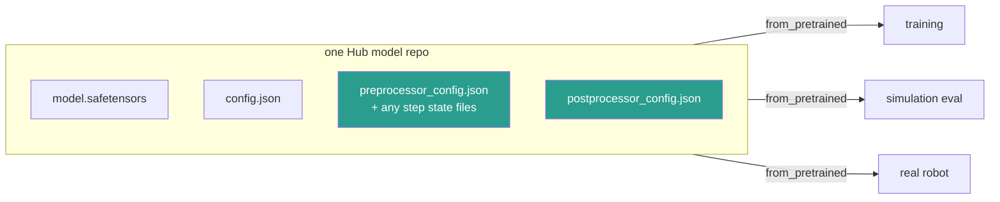
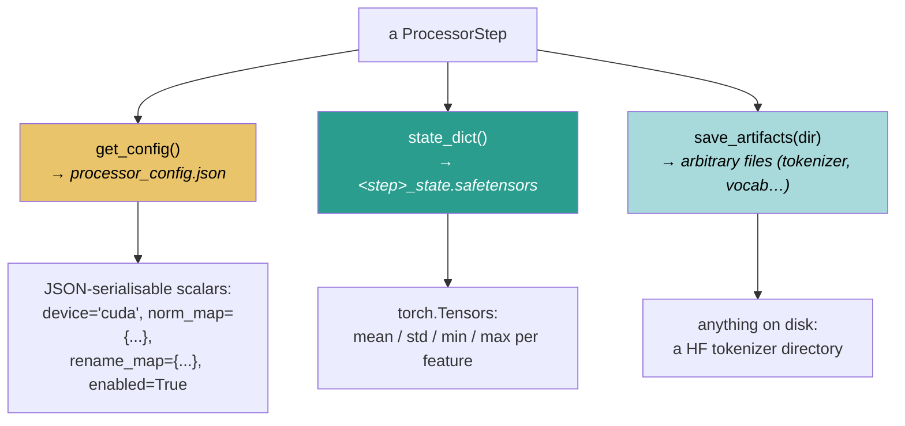
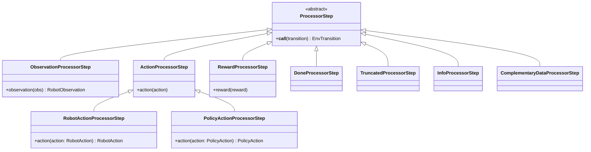
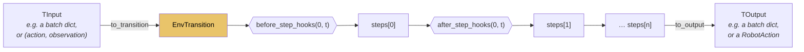
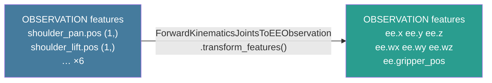
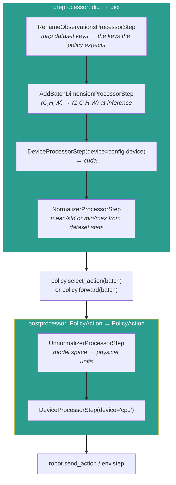
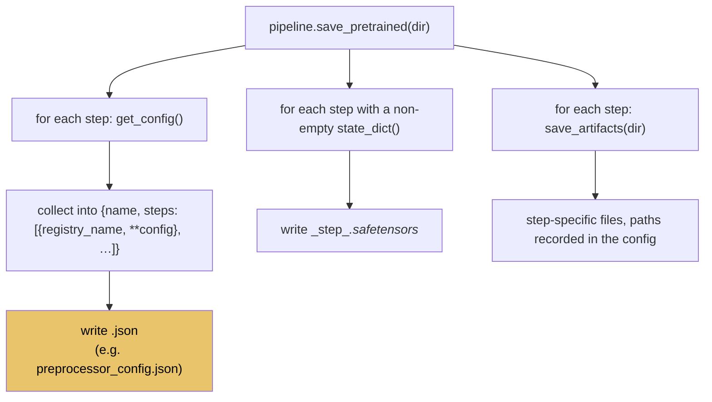
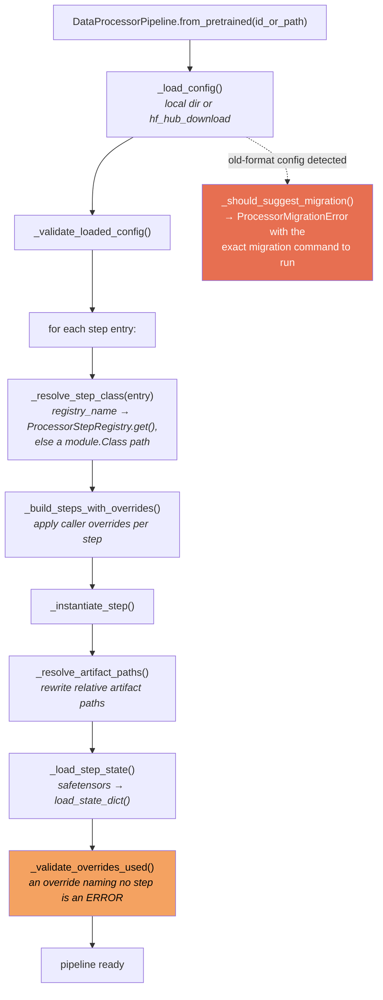
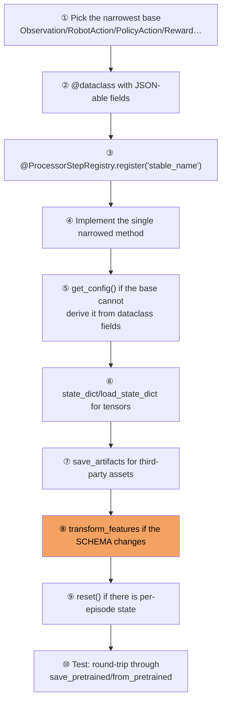

# 08 · The Processor Pipeline

[← LeRobotDataset](./07-dataset.md) · [Index](./README.md) · [Next: Policies →](./09-policies.md)

---

## 1. The problem

A policy does not consume what a robot produces. Between them sit renames, batching, device
placement, normalization, tokenization, image resizing, kinematics, relative→absolute
action conversion… and the *exact same* chain must run at training time and at inference
time, on a different machine, months later.

If that chain lives as free functions called from the training script, deployment silently
diverges and your policy is fed differently-scaled inputs than it was trained on. This is
the single most common cause of "it worked in training, it flails on the robot".

LeRobot's answer: the transformation chain is a **first-class, serialisable object** that
travels with the weights.



---

## 2. `EnvTransition`: the universal carrier

Every step consumes and returns the same TypedDict
(`src/lerobot/lerobot_types.py:46`):

```python
class EnvTransition(TypedDict):
    observation: RobotObservation | None
    action: PolicyAction | RobotAction | EnvAction | None
    reward: float | torch.Tensor | None
    done: bool | torch.Tensor | None
    truncated: bool | torch.Tensor | None
    info: dict[str, Any] | None
    complementary_data: dict[str, Any] | None
```

All seven keys are always present (possibly `None`); build one with `create_transition`.
Keys are addressed through `TransitionKey.OBSERVATION`, `.ACTION`, etc.

**Why one fat dict instead of per-step signatures?** Because steps must compose in any
order without the pipeline knowing their types, and because a step sometimes needs a
*different* field than the one it modifies. The kinematics steps are the clearest example:
they transform the **action**, but to do so they must read joint positions from the
**observation**:

```python
# robots/so_follower/robot_kinematic_processor.py — EEReferenceAndDelta
q_raw = np.array(
    [float(v) for k, v in observation.items() if isinstance(k, str) and k.endswith(".pos")],
    dtype=float,
)
t_curr = self.kinematics.forward_kinematics(q_raw)   # current EE pose from measured joints
```

A signature of `action -> action` could not express that. The transition can.

---

## 3. `ProcessorStep`

`src/lerobot/processor/pipeline.py:150`

```python
class ProcessorStep(ABC):
    @abstractmethod
    def __call__(self, transition: EnvTransition) -> EnvTransition: ...

    def get_config(self) -> dict[str, Any]: ...            # JSON-serialisable hyperparameters
    def state_dict(self) -> dict[str, torch.Tensor]: ...   # tensors (e.g. normalization stats)
    def load_state_dict(self, state) -> None: ...
    def save_artifacts(self, save_directory: Path) -> dict[str, str]: ...  # e.g. a tokenizer
    def reset(self) -> None: ...                           # clear per-episode internal state
    def transform_features(self, features) -> dict: ...    # how this step changes the SCHEMA
```

### The three-way split of persistence

This is the part worth memorising, because getting it wrong means your processor cannot
round-trip through the Hub.



| Mechanism | Format | Use for | Mistake it prevents |
|---|---|---|---|
| `get_config()` | JSON | hyperparameters | putting a tensor in JSON (lossy / huge) |
| `state_dict()` | safetensors | learned/derived tensors | storing stats as JSON floats (precision loss) |
| `save_artifacts()` | files | third-party assets | pickling a tokenizer |

### Convenience base classes

Most steps touch exactly one field, so the module provides narrowed bases that do the
transition unwrapping/rewrapping for you:



So a trivial step is three lines:

```python
@ProcessorStepRegistry.register("my_clip")
@dataclass
class ClipGripper(RobotActionProcessorStep):
    lo: float = 0.0
    hi: float = 100.0

    def action(self, action: RobotAction) -> RobotAction:
        return {**action, "gripper.pos": min(self.hi, max(self.lo, action["gripper.pos"]))}
```

Note `RobotActionProcessorStep` vs `PolicyActionProcessorStep`: the distinction is the
*type* of the action (`dict[str, Any]` vs `torch.Tensor`) and it is enforced by the type
checker. A step that assumes a dict but is placed in a policy pipeline is a static error,
not a runtime surprise.

### The registry

```python
# processor/pipeline.py:66
class ProcessorStepRegistry:
    @classmethod
    def register(cls, name: str | None = None): ...
    @classmethod
    def get(cls, name: str) -> type[ProcessorStep]: ...
    @classmethod
    def unregister(cls, name) / list() / clear(): ...
```

The registry name is what is written into `processor_config.json`:

```json
{
  "name": "policy_preprocessor",
  "steps": [
    {"registry_name": "rename_observations_processor", "rename_map": {}},
    {"registry_name": "add_batch_dimension_processor"},
    {"registry_name": "device_processor", "device": "cuda"},
    {"registry_name": "normalizer_processor", "features": {...}, "norm_map": {...}}
  ]
}
```

> ⚠️ **The registry name is a public API.** Rename it and every previously published
> checkpoint stops loading. `_resolve_step_class` falls back to a fully-qualified
> `module.Class` path for unregistered steps, but registered names are the stable contract.

---

## 4. `DataProcessorPipeline`

`src/lerobot/processor/pipeline.py:274`

```python
class DataProcessorPipeline[TInput, TOutput](HubMixin):
    steps: Sequence[ProcessorStep]
    name: str = "DataProcessorPipeline"
    to_transition: Callable[[TInput], EnvTransition]
    to_output:     Callable[[EnvTransition], TOutput]
    before_step_hooks: list[Callable[[int, EnvTransition], None]]
    after_step_hooks:  list[Callable[[int, EnvTransition], None]]

    def __call__(self, data: TInput) -> TOutput:
        transition = self.to_transition(data)
        transformed = self._forward(transition)
        return self.to_output(transformed)
```



The two converters are what make one class serve every call site. The generic parameters
are *real* — a pipeline's type tells you what it accepts and returns:

```python
# from record_loop's signature
RobotProcessorPipeline[tuple[RobotAction, RobotObservation], RobotAction]   # action pipelines
RobotProcessorPipeline[RobotObservation, RobotObservation]                   # observation pipeline
PolicyProcessorPipeline[dict[str, Any], dict[str, Any]]                      # policy preprocessor
PolicyProcessorPipeline[PolicyAction, PolicyAction]                          # policy postprocessor
```

`RobotProcessorPipeline` and `PolicyProcessorPipeline` are both aliases of
`DataProcessorPipeline` — the distinction is documentary and type-level:

```python
# processor/pipeline.py:1864
RobotProcessorPipeline  = DataProcessorPipeline[TInput, TOutput]
PolicyProcessorPipeline = DataProcessorPipeline[TInput, TOutput]
```

Converters live in `processor/converters.py`: `batch_to_transition` /
`transition_to_batch` (the defaults), `observation_to_transition` /
`transition_to_observation`, `policy_action_to_transition`, and so on.

### Debugging: `step_through` and hooks

```python
for i, transition in enumerate(preprocessor.step_through(batch)):
    print(i, {k: type(v).__name__ for k, v in transition.items() if v is not None})
```

`step_through` yields the transition **before** any step and then after each one, so index
`i` is "the state entering step `i`". For non-invasive instrumentation there are hooks:

```python
def log_shapes(idx, transition):
    obs = transition[TransitionKey.OBSERVATION]
    print(idx, preprocessor.steps[idx].__class__.__name__,
          {k: getattr(v, "shape", None) for k, v in (obs or {}).items()})

preprocessor.register_after_step_hook(log_shapes)
```

`docs/source/debug_processor_pipeline.mdx` documents this workflow for users.

### `reset()`

Stateful steps (action queues, running statistics, relative-action baselines) must clear
themselves between episodes. `pipeline.reset()` fans out to every step's `reset()`, and
`PreTrainedPolicy.reset()` is called at episode boundaries in both `lerobot-eval` and the
rollout controller.

---

## 5. Feature transformation: the schema side

A pipeline transforms *data* at runtime, but it also transforms the *schema*. Two consumers
need that: the dataset writer (what columns to create) and the policy factory (what input
shapes to build for).

```python
def transform_features(
    self, features: dict[PipelineFeatureType, dict[str, PolicyFeature]]
) -> dict[PipelineFeatureType, dict[str, PolicyFeature]]: ...
```

The canonical example — forward kinematics replaces joint columns with EE columns:

```python
# ForwardKinematicsJointsToEEObservation.transform_features
def transform_features(self, features):
    # We only use the ee pose in the dataset, so we don't need the joint positions
    for n in self.motor_names:
        features[PipelineFeatureType.OBSERVATION].pop(f"{n}.pos", None)
    for k in ["x", "y", "z", "wx", "wy", "wz", "gripper_pos"]:
        features[PipelineFeatureType.OBSERVATION][f"ee.{k}"] = PolicyFeature(
            type=FeatureType.STATE, shape=(1,)
        )
    return features
```



> ⚠️ **`transform_features` and `__call__` must agree.** The FK step *pops* the joint keys
> at both levels. Any step placed *after* it that expects `.pos` keys will receive none —
> and if its guard for that case is wrong, the failure is obscure. That is exactly
> [deep dive 05](../issue-deep-dives/05-kinematics-empty-joints-guard.md): the guard read
> `if q_raw is None`, but `q_raw` is `np.array([])` — never `None` — so an `IndexError`
> from `q_raw[-1]` escaped instead of the documented `ValueError`.

`PipelineFeatureType` distinguishes `OBSERVATION` from `ACTION` so one step can rewrite
both independently (`ForwardKinematicsJointsToEE` composes the observation and action
variants and dispatches on which fields are present).

---

## 6. The standard policy pipelines

`processor/factory.py` builds the canonical step set shared by nearly every policy:

```python
@dataclass
class DefaultPolicyProcessorSteps:
    """The canonical processor steps shared by most policies' pre/post pipelines.

    Policies compose these in their own order (step ORDER is a Hub-serialized contract
    and intentionally stays explicit per policy) and interleave their custom steps.
    """
    rename_observations: RenameObservationsProcessorStep
    add_batch_dim:       AddBatchDimensionProcessorStep
    to_device:           DeviceProcessorStep
    normalize:           NormalizerProcessorStep
    unnormalize:         UnnormalizerProcessorStep
    to_cpu:              DeviceProcessorStep
```



Policies that need more interleave their own steps. Tokenizing VLAs insert a
`TokenizerProcessorStep` (whose tokenizer is persisted through `save_artifacts`); π0.5
inserts task-string handling; the multi-task DiT policy dedups task strings in its
processor for speed.

The construction is guarded so a half-resolved config cannot silently produce a wrong
pipeline:

```python
if config.device is None or config.input_features is None or config.output_features is None:
    raise ValueError(
        "PreTrainedConfig.device, input_features and output_features must be resolved before "
        "building the default policy processor steps."
    )
```

### Why step **order** is explicit per policy

The comment above is load-bearing: order is serialised and therefore a compatibility
contract. `make_default_policy_processor_steps` returns the steps as named *fields*, not as
a list, specifically so a policy must write out its own order rather than inherit one that
could later change underneath published checkpoints.

### Robot-side pipelines

`make_default_processors()` returns the three identity pipelines `record_loop` takes
by default:

```python
teleop_action_processor, robot_action_processor, robot_observation_processor = make_default_processors()
```

They are identity by design — the default recording path should not transform anything.
You populate them when you want EE-space recording, action clipping as a step, or
observation filtering.

---

## 7. Save / load

### Saving



### Loading



Two design decisions worth calling out:

**Overrides must be used.** `_validate_overrides_used` raises if you pass
`preprocessor_overrides={"nonexistent_step": {...}}`. A typo in an override key would
otherwise silently do nothing — and "my device override didn't apply" is a very expensive
bug to find on a GPU cluster.

**Migration is explicit.** Loading a pre-refactor processor config raises
`ProcessorMigrationError` carrying the command to fix it
(`processor/migrate_policy_normalization.py`), instead of constructing a subtly wrong
pipeline.

### Overrides in practice

`lerobot_train.py` uses them to re-point a loaded processor at the current run's device,
features and rename map:

```python
preprocessor_overrides = {
    "device_processor":     {"device": device.type},
    "normalizer_processor": {"features": {**policy.config.input_features, **policy.config.output_features},
                             "norm_map":  policy.config.normalization_mapping},
    "rename_observations_processor": {"rename_map": cfg.rename_map},
}
postprocessor_overrides = {
    "unnormalizer_processor": {"features": policy.config.output_features,
                               "norm_map": policy.config.normalization_mapping},
}
# On resume, the checkpoint's saved processor stats are authoritative: they may have
# been adapted by the policy (e.g. EVO1 pads state/action stats to max_state_dim),
# and force-feeding raw dataset stats over them crashes normalization (#4006).
if not cfg.resume:
    preprocessor_overrides["normalizer_processor"]["stats"] = processor_dataset_stats
    postprocessor_overrides["unnormalizer_processor"]["stats"] = processor_dataset_stats
```

That `if not cfg.resume` guard, and its referenced issue, is a good illustration of the
general rule: **on resume, the checkpoint's processor state wins over the dataset's.**

---

## 8. Step catalogue

| Module | Step(s) | What it does |
|---|---|---|
| `rename_processor.py` | `RenameObservationsProcessorStep` | Map dataset/robot keys to the keys a policy expects (`--rename_map`) |
| `batch_processor.py` | `AddBatchDimensionProcessorStep` | Add/remove the leading batch dim |
| `device_processor.py` | `DeviceProcessorStep` | Move tensors to a device/dtype |
| `normalize_processor.py` | `NormalizerProcessorStep`, `UnnormalizerProcessorStep` | mean/std, min/max or quantile normalization driven by `norm_map` |
| `observation_processor.py` | image/state observation shaping | Layout and dtype conventions |
| `image_augmentation_processor.py` | augmentation steps | Train-time augmentation (CPU or GPU backend) |
| `tokenizer_processor.py` | `TokenizerProcessorStep` | Text → token ids for VLAs; tokenizer saved via `save_artifacts` |
| `newline_task_processor.py` | task-string cleanup | Normalise task text |
| `render_messages_processor.py` | chat-template rendering | For VLM-style policies |
| `delta_action_processor.py`, `relative_action_processor.py` | relative ↔ absolute | `use_relative_actions` pairs a relative step in pre with an absolute step in post |
| `gym_action_processor.py`, `env_processor.py` | Gym adapters | `EnvAction` ↔ `PolicyAction`, env observation shaping |
| `policy_robot_bridge.py` | bridge | `PolicyAction` (tensor) ↔ `RobotAction` (dict) |
| `hil_processor.py` | HIL steps | Human-in-the-loop intervention handling |
| `converters.py` | — | The `to_transition` / `to_output` function library |
| `robots/so_follower/robot_kinematic_processor.py` | `EEReferenceAndDelta`, `ForwardKinematicsJointsToEE*`, `InverseKinematicsEEToJoints`, `GripperVelocityToJoint`, `InverseKinematicsRLStep` | Joint ↔ end-effector space |

---

## 9. Writing a step: checklist



Rules learned the hard way in this repo:

- **Return a new dict, don't mutate in place.** Steps that mutate the caller's observation
  break `step_through` debugging and any hook that captured an earlier reference.
- **Guard on what the value *is*, not on what you assume it is.** `np.array([])` is not
  `None`; `if q_raw is None` is not an emptiness check. Use `np.size(x) == 0`.
  ([deep dive 05](../issue-deep-dives/05-kinematics-empty-joints-guard.md))
- **Keep `transform_features` in lockstep with `__call__`.** If one pops a key, so must the
  other.
- **Treat the registry name as frozen** once a checkpoint using it has been published.
- **Round-trip in a test.** `save_pretrained` → `from_pretrained` → assert the configs and
  state dicts match. Most processor regressions are serialisation regressions.

---

## 10. Next

[09 · Policies](./09-policies.md) — what sits between the preprocessor and the
postprocessor.
