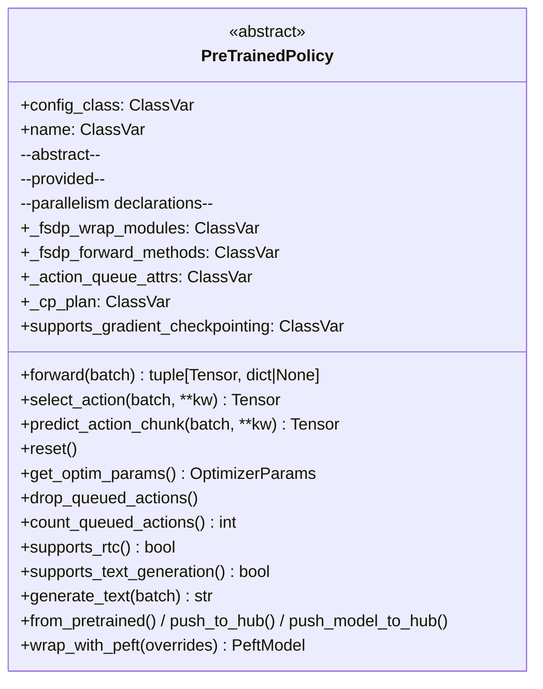
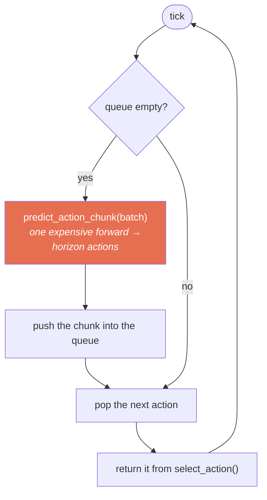
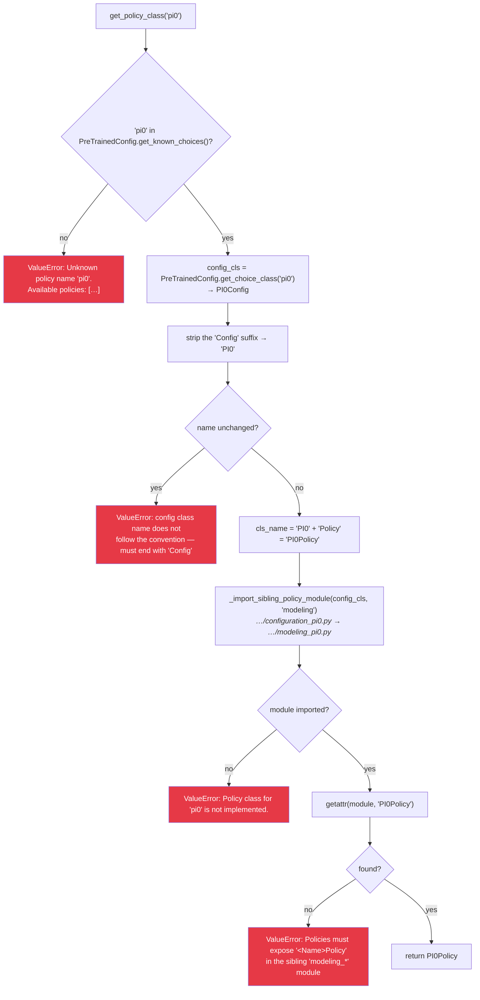
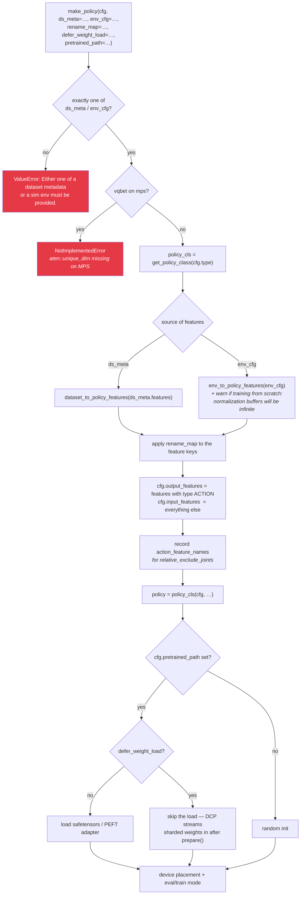
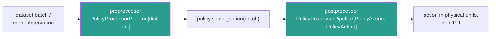
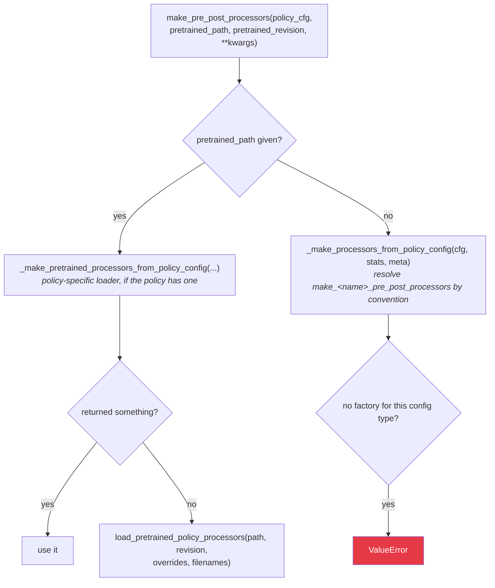
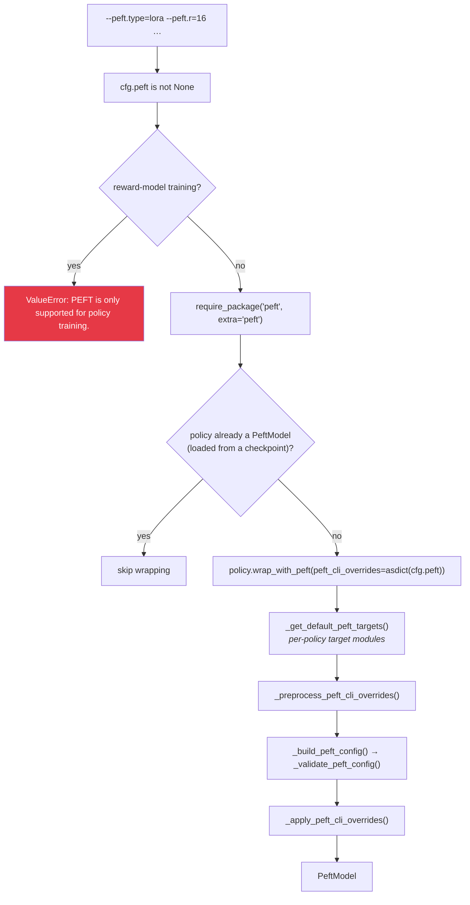
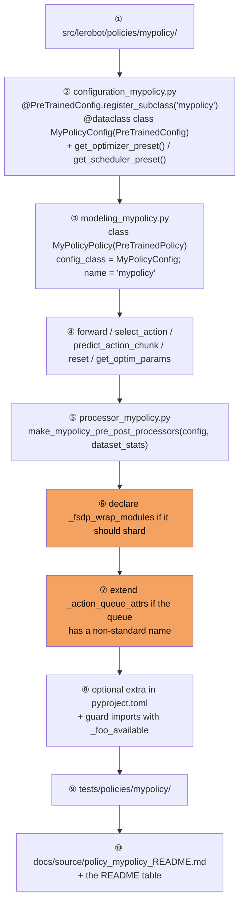

# 09 · Policies

[← Processor Pipeline](./08-processor-pipeline.md) · [Index](./README.md) · [Next: Training →](./10-training.md)

---

## 1. One contract, twenty-five models

`src/lerobot/policies/` is ~40 % of the codebase (72k of 176k lines) and holds ACT, Diffusion
Policy, VQ-BeT, TDMPC, π0, π0-FAST, π0.5, SmolVLA, GR00T N1.7, XVLA, EO-1, MolmoAct2,
WALL-OSS, EVO1, DM05, FineART-VLA, LingBot-VA, FastWAM, LaWAM, FLUX-3-Action, VLA-JEPA,
Multi-Task DiT, RTC and more.

What makes that tractable is that **all of them implement one 6-method contract**. Read
`policies/pretrained.py` once and you can navigate any of them.

```
src/lerobot/policies/
├── pretrained.py          ← PreTrainedPolicy: the contract
├── factory.py             ← get_policy_class, make_policy, make_pre_post_processors
├── utils.py / common/     ← shared layers and helpers
├── act/
│   ├── configuration_act.py   ← @PreTrainedConfig.register_subclass("act")
│   ├── modeling_act.py        ← ACTPolicy
│   └── processor_act.py       ← make_act_pre_post_processors
├── diffusion/ · vqbet/ · tdmpc/
├── pi0/ · pi05/ · pi0_fast/ · smolvla/ · groot/ · xvla/ · eo1/ · …
├── rtc/                   ← Real-Time Chunking wrapper
└── gaussian_actor/        ← used by the RL stack
```

The `configuration_*` / `modeling_*` / `processor_*` triplet is a **convention the factory
depends on**, not just tidiness — see §4.

---

## 2. `PreTrainedPolicy`

```python
class PreTrainedPolicy(nn.Module, HubMixin, abc.ABC):
    config_class: ClassVar[type[PreTrainedConfig]]
    name: ClassVar[str]
```

It is simultaneously a `torch.nn.Module` (so `accelerate`, FSDP and the optimizer treat it
normally) and a `HubMixin` (so `from_pretrained` / `push_to_hub` work).

### The six abstract members



| Member | Called by | Returns |
|---|---|---|
| `forward(batch)` | the training loop | `(loss, output_dict \| None)` — loss is a tensor, everything else must be logging-friendly native Python |
| `predict_action_chunk(batch)` | `select_action`, RTC, async inference | the whole action chunk `(B, horizon, action_dim)` |
| `select_action(batch)` | eval / rollout loops | **one** action `(B, action_dim)`, handling its own caching |
| `reset()` | episode boundaries | — (clears queues and caches) |
| `get_optim_params()` | `make_optimizer_and_scheduler` | parameters or param groups |

A `TODO(aliberts, rcadene)` on `forward` notes it should eventually split into `forward`
and `compute_loss` — currently one method does both.

### Subclass validation at class-creation time

`__init_subclass__` enforces the contract before an instance ever exists:

```python
def __init_subclass__(cls, **kwargs):
    super().__init_subclass__(**kwargs)
    if not getattr(cls, "config_class", None):
        raise TypeError(f"Class {cls.__name__} must define 'config_class'")
    if not getattr(cls, "name", None):
        raise TypeError(f"Class {cls.__name__} must define 'name'")
    # The rollout stack gates text queries on supports_text_generation(), so a
    # generate_text() override without it is unreachable.
    if (cls.generate_text is not PreTrainedPolicy.generate_text
            and cls.supports_text_generation is PreTrainedPolicy.supports_text_generation):
        raise TypeError(
            f"{cls.__name__} provides generate_text() but not supports_text_generation(). "
            "Override supports_text_generation() too …, otherwise the text head is never used."
        )
```

That third check is a nice piece of defensive design: a capability flag and its
implementation must be overridden *together*, because the caller gates on the flag. A
half-override would produce dead code with no error anywhere — exactly the kind of bug that
survives review.

---

## 3. Action chunking and the action queue

Most modern policies are expensive (a VLA forward pass is tens of milliseconds) and predict
a *chunk* of future actions. The control loop still needs one action per tick. The
reconciliation is a queue inside the policy.



So the cost profile is spiky: one tick in `horizon` is expensive, the rest are nearly free.
That is what Real-Time Chunking exists to smooth out (§6).

### Queue introspection on the base class

Because deployment code needs to reason about the queue without knowing the policy, the
base class provides two generic helpers driven by a declared attribute list:

```python
# Attribute names `drop_queued_actions` clears: a `populate_queues`-style `_queues` dict
# and a bare `_action_queue` deque. A chunking policy using another name must extend this
# ClassVar (or override the method), otherwise dropping the queue silently does nothing.
_action_queue_attrs: ClassVar[tuple[str, ...]] = ("_queues", "_action_queue")

def drop_queued_actions(self) -> None:
    for attr in self._action_queue_attrs:
        queue = getattr(self, attr, None)
        if isinstance(queue, dict):
            # populate_queues-style dict: clear only ACTION, not the observation history.
            if ACTION in queue:
                queue[ACTION].clear()
        elif queue is not None:
            queue.clear()

def count_queued_actions(self) -> int: ...
```

`drop_queued_actions` vs `reset()` is a meaningful distinction:

| | `reset()` | `drop_queued_actions()` |
|---|---|---|
| Clears action queue | yes | yes |
| Clears observation history | yes | **no** |
| When | episode boundary | mid-episode conditioning change (new instruction) |

The docstring spells out the use case: *"Forces a fresh forward pass on the next
`select_action` so a mid-episode conditioning change (e.g. a new instruction) takes effect
at once instead of after the queue drains."* That is what makes interactive re-tasking in
`lerobot-rollout` feel immediate.

The "silently does nothing" warning in the ClassVar comment is the trap: a policy that
names its queue `self._my_chunk` and forgets to extend `_action_queue_attrs` gets a
no-op `drop_queued_actions` with no error.

---

## 4. The factory: convention over configuration

`policies/factory.py` resolves a string like `"act"` to a class **by naming convention**,
with lazy imports so optional dependencies stay optional.



Three naming rules fall out, and each has a dedicated error message:

1. The config class is `<Name>Config`.
2. It lives in `configuration_<x>.py`; the model lives in the sibling `modeling_<x>.py`.
3. The policy class is `<Name>Policy`.

Because resolution goes through the draccus registry, **third-party plugin policies work
identically** — anything registered with `@PreTrainedConfig.register_subclass` is
discoverable, with no edit to `factory.py`.

### `make_policy`: where feature shapes come from



The key insight: **a policy's input/output shapes are derived, not configured.** You never
write `state_dim=6` — the dataset's `features` (or the env's spaces) determine it, and
`cfg.input_features` / `cfg.output_features` are populated by the factory before the model
is constructed. That is why `--rename_map` exists: fine-tuning a checkpoint on a dataset
whose camera is called `left` instead of `camera1` is a *key* problem, not a shape problem.

`defer_weight_load` is a subtle but important flag:

> *Build the exact policy `from_pretrained` would build — same config resolution, same
> stats-derived buffers, same device placement and eval mode — but skip the safetensors
> weight load. Used when resuming from a DCP checkpoint, whose sharded weights stream in
> after `accelerator.prepare()`.*

Loading then overwriting multi-GB weights is pure waste; skipping the load but keeping
every other construction side effect is the correct optimisation.

---

## 5. The policy ↔ processor pair

A policy is never used alone. `make_pre_post_processors` returns the two pipelines that
bracket it, and they are saved and loaded as part of the same checkpoint.



Resolution order in `make_pre_post_processors`:



Most policies' factories are one line, because the defaults are right:

```python
# policies/act/processor_act.py
def make_act_pre_post_processors(config: ACTConfig, dataset_stats=None):
    return make_default_pre_post_processors(config, dataset_stats, normalizer_device=config.device)
```

See [08 · Processor Pipeline §6](./08-processor-pipeline.md#6-the-standard-policy-pipelines)
for the step list and why order is an explicit per-policy contract.

---

## 6. Real-Time Chunking (RTC)

The chunking spike (§3) has a real cost on hardware: while the policy computes a new chunk,
the robot is either waiting or executing stale actions. RTC overlaps inference with
execution and blends the chunks.

```python
class RTCActionSelectKwargs(TypedDict, total=False):
    """Keyword arguments Real-Time Chunking passes to `predict_action_chunk`."""
    inference_delay: int | None
    prev_chunk_left_over: Tensor | None
    execution_horizon: int | None
```



```mermaid
gantt
    title Naive chunking vs RTC
    dateFormat X
    axisFormat %s
    section Naive
    infer chunk 1      :0, 3
    execute chunk 1    :3, 12
    infer chunk 2      :12, 15
    execute chunk 2    :15, 24
    section RTC
    infer chunk 1      :0, 3
    execute chunk 1    :3, 12
    infer chunk 2      :9, 12
    execute chunk 2 (blended at the seam) :12, 21
```

A policy opts in by overriding the capability gate:

```python
def supports_rtc(self) -> bool:
    """Whether this policy implements Real-Time Chunking inference semantics."""
    return False
```

The machinery lives in `policies/rtc/` (`modeling_rtc.py`, `action_queue.py`,
`configuration_rtc.py`) and is consumed by the rollout/inference stack
([11 · Inference & Rollout](./11-inference-and-rollout.md)). `inference_delay` tells the
policy how many steps of the previous chunk will already have executed by the time the new
one lands, so it can condition on that instead of planning from a stale state.

---

## 7. Text generation

Some VLAs can answer questions or propose the next subtask. That is exposed as an optional
capability:

```python
def supports_text_generation(self) -> bool: return False

def generate_text(self, batch: dict[str, Any]) -> str:
    """Run the policy's text head on a preprocessed observation batch.

    The request rides on ``batch`` as complementary data (QUERY_KIND / QUERY_TEXT); a
    ``next_subtask`` reply is fed straight into ``set_task``, so it must be exactly one
    subtask, not a plan or a numbered list.  Returns the generated text, and must not
    mutate action-producing state (queues, observation history).
    """
```

Three constraints worth noting, all enforced socially rather than mechanically:

1. The request travels in `complementary_data` — i.e. through the *same* `EnvTransition`
   plumbing as everything else, so no new channel is needed.
2. A `next_subtask` answer is fed to `set_task` verbatim, so it must be one subtask.
3. `generate_text` **must not** mutate action state. If it drained the action queue, asking
   the robot a question would change its motion.

And per §2, overriding `generate_text` without `supports_text_generation` is a
`TypeError` at import time.

---

## 8. Distributed-training declarations

Rather than special-casing policies in the training script, each policy *declares* how it
should be sharded:

```python
# Module CLASS names forming the FSDP2 wrap units … Resolved onto the accelerate plugin
# right before `accelerator.prepare()` by `lerobot.distributed.set_fsdp_wrap_modules`;
# sharded training with no wrap source anywhere fails loudly instead of silently
# wrapping only the root.
_fsdp_wrap_modules: ClassVar[list[str] | None] = None

# Non-`forward` entry points that must trigger FSDP2 unshard/reshard hooks when called on
# a sharded policy …; calling them unregistered crashes on mixed Tensor/DTensor.
_fsdp_forward_methods: ClassVar[tuple[str, ...]] = ("select_action", "predict_action_chunk")

supports_gradient_checkpointing: ClassVar[bool] = False
_cp_plan: ClassVar[dict[str, Any] | None] = None     # reserved for context parallelism
```

Why this matters in practice:

- **`_fsdp_wrap_modules`**: FSDP2 needs to know the transformer-block class to shard at.
  Wrapping only the root module "works" but gives no memory benefit — so the code *fails
  loudly* rather than silently wasting a multi-GPU run.
- **`_fsdp_forward_methods`**: `select_action` is not `forward`, so FSDP's hooks don't fire
  automatically. Evaluating a sharded policy without registering them crashes on mixed
  `Tensor`/`DTensor` operands.

Saving is also sharding-aware:

```python
def _save_pretrained(self, save_directory: Path) -> None:
    """…under FSDP2 the full state dict is gathered through a COLLECTIVE, so when the policy
    is sharded this method (via `save_pretrained`) must be called on EVERY rank — a
    rank-0-gated call deadlocks. File writes happen on the main process only."""
```

"Call on every rank, write on one" is the correct pattern for any collective-backed save,
and `if is_main_process(): policy.save_pretrained(...)` is the deadlock.

---

## 9. PEFT (LoRA and friends)

Fine-tuning a 7B VLA on a consumer GPU needs parameter-efficient methods. The base class
owns the wrapping:



`_get_default_peft_targets()` is the per-policy hook that names which submodules to adapt.
Keeping it on the policy (rather than in a config table) is why "which modules does LoRA
touch for π0.5?" has a single answer that lives next to the model. A real defect of exactly
this kind — a dead `state_proj` entry in π0.5's default targets — was fixed upstream in
#4751.

A PEFT run also publishes differently: `push_model_to_hub` marks the artifact as an
*adapter of its base model* in the model card (upstream #4952), so the Hub shows the
lineage rather than a standalone 7B repo.

---

## 10. The catalogue

| Category | Policies | Notes |
|---|---|---|
| **Imitation learning** | ACT, Diffusion Policy, VQ-BeT, Multi-Task DiT | The classic chunking baselines; ACT is the recommended first policy |
| **Reinforcement learning** | HIL-SERL (SAC), TDMPC | See [12 · Reinforcement Learning](./12-reinforcement-learning.md) |
| **VLAs** | π0, π0-FAST, π0.5, SmolVLA, GR00T N1.7, XVLA, EO-1, MolmoAct2, WALL-OSS, EVO1, DM05, FineART-VLA | Language-conditioned; most need a tokenizer step and a `[peft]` extra |
| **World models** | VLA-JEPA, LingBot-VA, FastWAM, LaWAM, FLUX-3-Action | Predict future observations/latents |
| **Reward models** | SARM, TOPReward, Robometer, classifier | In `src/lerobot/rewards/`, trained by the same `lerobot-train` |
| **Wrappers** | RTC, `gaussian_actor` | RTC wraps a chunking policy; `gaussian_actor` is the RL actor head |

Per-policy documentation lives in `docs/source/policy_*_README.md` and the `.mdx` guides;
`docs/source/hardware_guide.mdx` lists GPU/RAM requirements and expected training time.

---

## 11. Adding a policy



The naming conventions in ②/③/⑤ are *mandatory* — `get_policy_class` and
`_make_processors_from_policy_config` resolve by name and will raise a convention error
otherwise.

Out of tree? Register the config from your own package and the factory finds it; see
`docs/source/bring_your_own_policies.mdx`.

---

## 12. Next

[10 · Training](./10-training.md) — how `lerobot-train` assembles a dataset, a policy, a
processor pair, an optimizer and an accelerator into one run.
