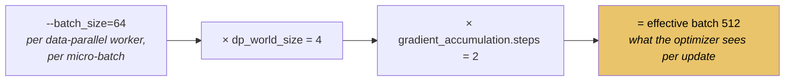
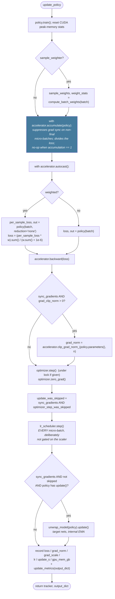
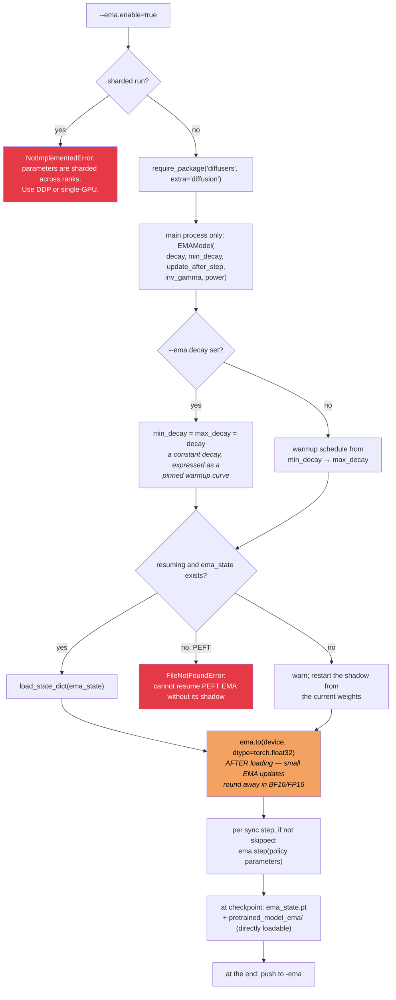
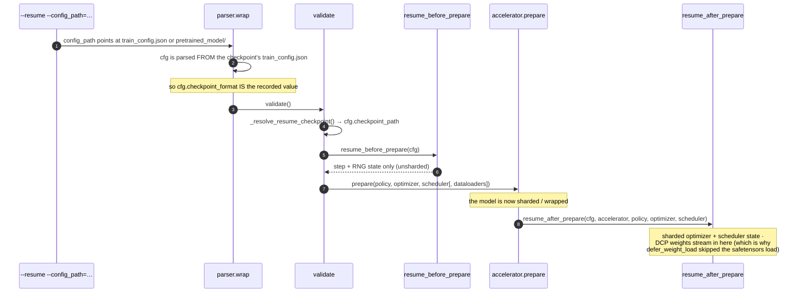
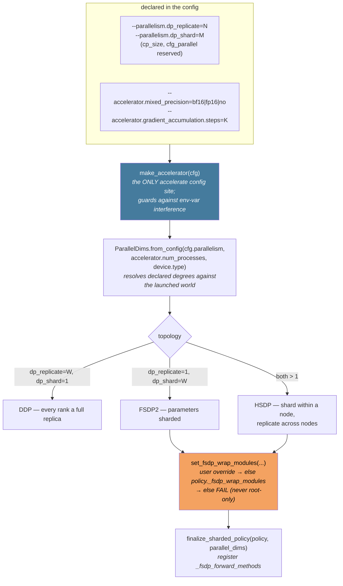
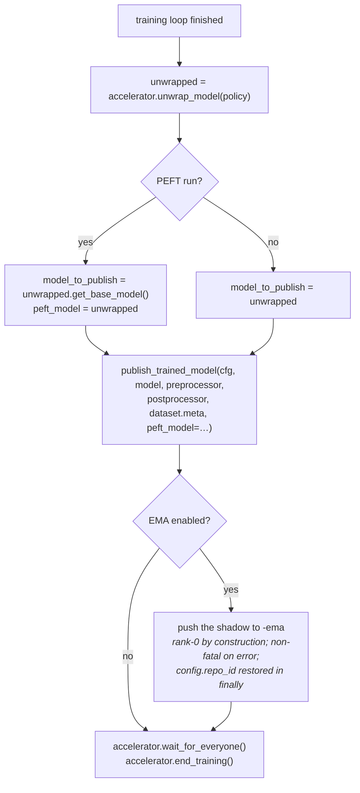

# 10 · Training

[← Policies](./09-policies.md) · [Index](./README.md) · [Next: Inference & Rollout →](./11-inference-and-rollout.md)

---

## 1. The command

```bash
lerobot-train \
  --policy.type=act \
  --dataset.repo_id=lerobot/aloha_mobile_cabinet \
  --batch_size=64 \
  --steps=200000 \
  --wandb.enable=true \
  --policy.repo_id=${HF_USER}/my-act-policy
```

`src/lerobot/scripts/lerobot_train.py` is ~1200 lines and is the single most instructive
file in the repository: it touches the config system, the dataset, the processor pipeline,
the policy, `accelerate`, checkpointing and the Hub. This document walks it in execution
order.

---

## 2. The whole pipeline at a glance

```mermaid
flowchart TD
    START(["lerobot-train …"]) --> WRAP["@parser.wrap() → TrainPipelineConfig"]
    WRAP --> REMOTE{"cfg.job.is_remote?"}
    REMOTE -->|yes| HFJOB["submit_to_hf(cfg)<br/><i>dispatch to HF Jobs and return</i>"]
    REMOTE -->|no| VAL["cfg.validate()<br/><i>ALL fail-fasts fire here</i>"]

    VAL --> ACC["make_accelerator(cfg)<br/>ParallelDims.from_config(...)<br/>init_logging / WandBLogger / set_seed"]
    ACC --> DATA["make_train_eval_datasets(cfg)<br/><i>main process downloads first,<br/>peers then read the warm cache</i>"]
    DATA --> MODEL{"policy or reward model?"}
    MODEL -->|reward_model| RM["make_reward_model(...)<br/><i>reject zero-shot models</i>"]
    MODEL -->|policy| POL["make_policy(cfg, ds_meta=dataset.meta,<br/>rename_map, defer_weight_load,<br/>pretrained_path)"]
    RM --> PEFT
    POL --> PEFT

    PEFT{"cfg.peft set?"} -->|yes| PW["policy.wrap_with_peft(...)"]
    PEFT -->|no| PROC
    PW --> PROC

    PROC["make_pre_post_processors(...)<br/><i>or make_reward_pre_post_processors</i>"]
    PROC --> AUG["_make_image_augmentation(...)<br/><i>GPU-side transforms, if enabled</i>"]
    AUG --> OPT["make_optimizer_and_scheduler(cfg, policy)<br/><i>BEFORE prepare — FSDP2 needs<br/>model+optimizer in one call</i>"]

    OPT --> R1{"cfg.resume?"}
    R1 -->|yes| RB["resume_before_prepare(cfg)<br/><i>step + RNG only</i>"]
    R1 -->|no| DL
    RB --> DL

    DL["make_dataloaders(cfg, dataset, eval_dataset, step, parallel_dims)"]
    DL --> FSDP["set_fsdp_wrap_modules(accelerator, policy)"]
    FSDP --> PREP["accelerator.prepare(policy, optimizer, lr_scheduler[, dataloader][, eval_dataloader])"]
    PREP --> FIN["finalize_sharded_policy(policy, parallel_dims)"]
    FIN --> R2{"cfg.resume?"}
    R2 -->|yes| RA["resume_after_prepare(...)<br/><i>sharded optimizer/scheduler/DCP weights</i>"]
    R2 -->|no| AUX
    RA --> AUX

    AUX["sample_weighter · EMA shadow ·<br/>MetricsTracker · banner · tqdm"]
    AUX --> LOOP

    LOOP["▶ the training loop (§4)"]
    LOOP --> PUB["publish_trained_model(...)<br/>+ sibling <repo>-ema push if EMA on"]
    PUB --> END["accelerator.wait_for_everyone()<br/>accelerator.end_training()"]

    style VAL fill:#e76f51,color:#fff
    style PREP fill:#457b9d,color:#fff
    style LOOP fill:#2a9d8f,color:#fff
```



### The construction-order contract

The ordering above is not incidental; several steps are order-sensitive and the code says
so in comments:

| Must happen… | …because |
|---|---|
| `validate()` **before** any distributed init | a config error should not cost you a multi-node allocation |
| `make_accelerator` is the **only** accelerate configuration site | it guards against env-var interference and resolves declared parallelism against the launched world |
| dataset on the main process **first**, barrier, then peers | avoids N processes downloading the same dataset |
| optimizer **before** `prepare` | accelerate's FSDP2 path requires model+optimizer in one `prepare()` call and rebinds param groups itself |
| `set_fsdp_wrap_modules` immediately **before** `prepare` | the wrap-unit class names resolve from user override, else the policy's `_fsdp_wrap_modules`; root-only wrapping is never silently accepted |
| resume in **two phases** around `prepare` | step/RNG are unsharded state; optimizer and DCP weights are sharded and must load after |
| auxiliaries (sample weighter, EMA) **after** the core assembly | they wrap/observe the prepared policy |

---

## 3. Setup details worth knowing

### 3.1 Remote dispatch

```python
if cfg.job.is_remote:
    return submit_to_hf(cfg)
```

The very first thing `train()` does. `--job.*` turns the same command into an HF Jobs
submission; the pod then runs it locally with `is_remote` false. One code path, two
execution venues.

### 3.2 cuDNN and TF32

```python
if cfg.cudnn_deterministic:
    torch.backends.cudnn.deterministic = True
    torch.backends.cudnn.benchmark = False
else:
    torch.backends.cudnn.benchmark = True
torch.backends.cuda.matmul.allow_tf32 = True
```

`benchmark=True` is the default (autotunes convolutions); `--cudnn_deterministic=true`
trades ~10–20 % throughput for reproducibility. TF32 matmul is always on.

### 3.3 Reward-model training shares the pipeline

```python
active_cfg = cfg.trainable_config          # policy or reward_model; validate() guarantees one
if isinstance(active_cfg, RewardModelConfig):
    policy = make_reward_model(cfg=active_cfg, pretrained_path=…, dataset_stats=…, dataset_meta=…)
    if not policy.is_trainable:
        raise ValueError(
            f"Reward model '{policy.name}' is zero-shot and cannot be trained via lerobot-train. "
            "Use it directly for inference via compute_reward() (e.g. offline precompute)."
        )
```

From here on the variable is called `policy` regardless. This is why `cfg.trainable_config`
exists ([03 §5](./03-configuration-and-cli.md#5-phase-2-validate-and-the-pretrained-source-priority)) —
one handle for two kinds of trainable.

### 3.4 Processor overrides and the resume rule

```python
processor_pretrained_path = resume_pretrained_dir or active_cfg.pretrained_path

if not cfg.resume and getattr(active_cfg, "recipe", None) is not None:
    # Language fine-tuning must use the active recipe, not the saved processor recipe.
    processor_pretrained_path = None
```

and then:

```python
# On resume, the checkpoint's saved processor stats are authoritative: they may have
# been adapted by the policy (e.g. EVO1 pads state/action stats to max_state_dim),
# and force-feeding raw dataset stats over them crashes normalization (#4006).
if not cfg.resume:
    preprocessor_overrides["normalizer_processor"]["stats"] = processor_dataset_stats
    postprocessor_overrides["unnormalizer_processor"]["stats"] = processor_dataset_stats
```

**The rule: on resume, the checkpoint wins; on fresh fine-tuning, the dataset wins.** The
device, feature set and rename map are always re-pointed at the current run.

### 3.5 Effective batch size

```python
samples_per_step      = cfg.batch_size * parallel_dims.dp_world_size
effective_batch_size  = samples_per_step * cfg.accelerator.gradient_accumulation.steps
```



And the loop's unit of work is defined precisely:

```python
step = 0  # number of loop steps (= micro-batches consumed per data-parallel worker)
```

So `--steps=200000` with `gradient_accumulation.steps=2` performs 100 000 *optimizer*
updates. This distinction trips people up when comparing runs.

### 3.6 Metrics and rank reduction

```python
train_metrics = {
    "loss":          AverageMeter("loss",   ":.3f", reduction="mean"),
    "grad_norm":     AverageMeter("grdn",   ":.3f"),
    "lr":            AverageMeter("lr",     ":0.1e"),
    "dataloading_s": AverageMeter("data_s", ":.3f", reduction="max"),
    "preprocessing_s": AverageMeter("prep_s", ":.3f", reduction="max"),
    "update_s":      AverageMeter("updt_s", ":.3f", reduction="max"),
    "step_s":        AverageMeter("step_s", ":.3f", reduction="max"),
    "samples_per_s": AverageMeter("smp/s",  ":.0f"),
}
```

The `reduction` choices are deliberate and documented inline:

- **`loss` → `mean`**: a per-rank loss reflects only one shard of the global batch; the mean
  recovers what the data-parallel group is actually optimising.
- **timings → `max`**: report the *slowest* rank, so multi-GPU runs surface the real
  straggler instead of rank 0's optimistic view.
- **`grad_norm` / `lr` → no reduction**: already identical on every rank after gradient
  sync / a deterministic scheduler, so reducing would be a wasted collective.
- **`grad_scale`** is added only under fp16: a falling scale is the visible signature of
  skipped updates.

---

## 4. The training loop

```mermaid
flowchart TD
    S([for _ in range step, cfg.steps]) --> B["batch = next(dl_iter)"]
    B --> SD{"streaming dataset?"}
    SD -->|yes| MOVE["send_to_device(batch, device, non_blocking=cuda)<br/><i>IterableDataset isn't prepared by accelerate</i>"]
    SD -->|no| AUG
    MOVE --> AUG
    AUG{"image_augmentation?"}
    AUG -->|yes| AUG2["batch = image_augmentation.observation(batch)"]
    AUG -->|no| PP
    AUG2 --> PP
    PP["_preprocess_dataset_batch(batch, camera_keys, rename_map, preprocessor)"]
    PP --> UP["update_policy(...)  ← §5"]
    UP --> EMA{"EMA on AND sync_gradients<br/>AND step not skipped?"}
    EMA -->|yes| EMA2["ema.step(policy parameters)"]
    EMA -->|no| INC
    EMA2 --> INC
    INC["step += 1 · progbar · train_tracker.step()"]
    INC --> FLAGS["is_log_step · is_saving_step ·<br/>is_env_eval_step · is_eval_step"]

    FLAGS --> L{"log step?"}
    L -->|yes| L2["train_tracker.reduce_across_ranks()<br/><i>COLLECTIVE — every rank, before<br/>the main-process gate</i>"]
    L2 --> L3["main process: log + wandb"]
    L -->|no| E
    L3 --> E

    E{"eval step AND eval_dataloader?"}
    E -->|yes| E2["policy.eval(); compute eval_loss;<br/>accelerator.reduce(mean); policy.train()"]
    E -->|no| C
    E2 --> C

    C{"save_checkpoint AND saving step?"}
    C -->|yes| C2["save_checkpoint(...) — COLLECTIVE<br/>+ EMA shadow + pretrained_model_ema/<br/>+ update_last_checkpoint<br/>+ optional push_checkpoint_to_hub<br/>+ accelerator.wait_for_everyone()"]
    C -->|no| V
    C2 --> V

    V{"cfg.env AND env eval step?"}
    V -->|yes| V2["eval_policy_all(...) in the sim env<br/><i>optionally under the EMA weights</i>"]
    V -->|no| S
    V2 --> S

    style L2 fill:#f4a261,color:#000
    style C2 fill:#f4a261,color:#000
```



### Collectives must not be behind `if is_main_process()`

This is the recurring hazard in the loop and the code is explicit about it twice:

```python
if is_log_step:
    # Collective reduce must run on every rank, before the main-process gate below.
    train_tracker.reduce_across_ranks()
    if is_main_process():
        ...
```

```python
if cfg.save_checkpoint and is_saving_step:
    # Collective: every rank participates (gathers / DCP shard writes); rank-0-only file
    # writes are gated inside save_checkpoint — no rank branches at the call site.
```

Put a collective inside a rank-0 branch and the other ranks wait forever. The pattern used
throughout is **call on every rank, gate the file I/O inside**.

### Two kinds of evaluation

| | `--eval_steps` | `--env_eval_freq` |
|---|---|---|
| What | held-out **loss** on `dataset.eval_split` | **success rate / reward** by rolling out in a Gym env |
| Needs | `dataset.eval_split > 0` (enforced in `validate()`) | `--env.type=…` |
| Cost | one forward pass per eval batch | full episodes — expensive |
| Measures | fit | task performance |

Both are optional and independently scheduled. Only the env eval tells you whether the
policy actually works.

---

## 5. `update_policy` — one step in detail



Five non-obvious details, each with a comment in the source explaining why:

**1. `policy(batch)`, never `policy.forward(batch)`**

```python
# `policy(...)`, never `policy.forward(...)`: FSDP2 all-gathers parameters through
# nn.Module forward hooks, which only run via __call__.
```

Calling `.forward()` directly bypasses the hooks and crashes on sharded parameters. This is
the single easiest way to break FSDP support.

**2. Clip only on sync micro-batches, with the full parameter list**

```python
# Gradients are complete only on sync micro-batches; clipping partial gradients would
# be meaningless. Always pass the full parameter list: accelerate's FSDP2 path requires
# an exact match with the prepared model's parameters for a globally correct norm.
```

**3. `optimizer_step_was_skipped` is stale off sync steps**

```python
# `optimizer_step_was_skipped` is only refreshed on sync micro-batches, so elsewhere it
# is a stale value from the previous update and must be read together with
# `sync_gradients`. It is always False without a scaler ("no"/bf16 runs).
```

Hence `update_was_skipped = accelerator.sync_gradients and accelerator.optimizer_step_was_skipped`
— never the flag alone.

**4. The scheduler advances per micro-batch, on purpose**

```python
# Step through pytorch scheduler at every batch instead of epoch. Deliberately not
# gated on the scaler: the schedule is a function of micro-batches consumed, and under
# gradient accumulation it already advances on micro-batches that apply no update.
```

**5. Don't record a skipped step's gradient norm**

```python
# A skipped step's norm is inf/nan by construction (that is what the scaler detected);
# recording it would poison the whole logging window's average.
if grad_norm is not None and not update_was_skipped:
    train_metrics.grad_norm = grad_norm.item()
```

The same gating applies to `policy.update()` (target networks, internal EMA): those track
*applied optimizer updates*, not micro-batches, so a skipped fp16 step must not advance
them against unchanged weights.

---

## 6. EMA

An exponential moving average of the weights (Chi et al. 2023, *Diffusion Policy* §V.D)
often evaluates better than the live weights.



Design notes:

- The shadow lives on the **main process only** — safe under DDP, where every rank holds
  identical weights after each gradient sync; impossible under FSDP2, hence the hard error.
- `_ema_weights(ema, policy)` is a context manager that temporarily swaps the shadow in for
  evaluation and exactly undoes the swap, *on the main process only* while other ranks wait
  at a barrier — so the live weights stay rank-consistent.
- Checkpoints get both `ema_state.pt` (for exact resume) **and** a full
  `pretrained_model_ema/` directory, so you can evaluate the EMA weights directly with
  `lerobot-eval --policy.path=<checkpoint>/pretrained_model_ema`.
- The final push sends the live model to `<repo_id>` and the shadow to `<repo_id>-ema`, and
  the EMA push is explicitly non-fatal: *"the live model is already up if this fails."*

---

## 7. Checkpoint layout and resume

```
outputs/train/2026-11-20/14-03-11_act/
├── checkpoints/
│   ├── 020000/
│   │   ├── pretrained_model/
│   │   │   ├── config.json                    ← policy config (incl. "type")
│   │   │   ├── model.safetensors              ← weights
│   │   │   ├── preprocessor_config.json       ← + any *_state.safetensors
│   │   │   └── postprocessor_config.json
│   │   ├── pretrained_model_ema/              ← same, with the EMA weights (if enabled)
│   │   └── training_state/
│   │       ├── train_config.json              ← the EXACT config of this run
│   │       ├── optimizer_state / scheduler_state
│   │       ├── rng_state
│   │       └── ema_state.pt                   ← (if enabled)
│   ├── 040000/
│   └── last → 040000                          ← update_last_checkpoint()
```

The two-phase resume:



```python
defer_weight_load = cfg.resume and cfg.checkpoint_format.wants_dcp
```

For a DCP (distributed-checkpoint) format, loading safetensors before `prepare` would just
be overwritten — so the policy is built *identically* but without the weight load.

Resuming from the Hub works too: `--config_path=<repo_id>` downloads the latest checkpoint
into a fresh local run directory (`outputs/train/<date>/<time>_resume`) and continues from
there. `pretrained_path` keeps naming the model the run originally started from, so the
published card's `base_model` stays truthful.

---

## 8. Distributed training



`_validate_distributed()` rejects everything outside the verified scope *up front*:

- context parallelism (`cp_size > 1`) — not implemented
- CFG parallelism ≠ 1 — inference-only
- `--accelerator.compile` and activation checkpointing — placeholders, not wired
- a DCP checkpoint format on a non-sharded run
- fp16 on a CPU device
- under sharding: PEFT, reward-model training, in-training env eval, multi-optimizer configs

Each is an explicit `ValueError` with the reason. This is the "fail fast with a sentence
that tells you what to do" philosophy applied to the hardest-to-debug part of the stack.

Note also the `numel()` detail in the banner: on DTensors it reports the **global** shape,
so the parameter-count log line stays correct after sharding.

---

## 9. Publishing



What lands in the model repo: weights, `config.json`, **both processor configs**, and a
model card that records the base model and the dataset. That bundle is exactly what
`lerobot-eval --policy.path=…` and `lerobot-rollout` need — which is the payoff of
[08 · Processor Pipeline](./08-processor-pipeline.md): train/deploy parity is a
serialisation property, not a discipline you have to maintain by hand.

---

## 10. Running it

```bash
# single GPU
lerobot-train --policy.type=act --dataset.repo_id=lerobot/aloha_mobile_cabinet

# 4-GPU DDP
accelerate launch --num_processes=4 $(which lerobot-train) \
  --policy.type=pi0 --dataset.repo_id=… --parallelism.dp_replicate=4

# FSDP2 for a large VLA
accelerate launch --num_processes=8 $(which lerobot-train) \
  --policy.type=pi05 --dataset.repo_id=… \
  --parallelism.dp_shard=8 --accelerator.mixed_precision=bf16

# LoRA fine-tune
lerobot-train --policy.path=lerobot/smolvla_base --dataset.repo_id=… \
  --peft.type=lora --peft.r=16

# streaming — no local dataset copy
lerobot-train --policy.type=act --dataset.repo_id=… --dataset.streaming=true --num_workers=8

# resume
lerobot-train --resume=true --config_path=outputs/train/…/checkpoints/last/training_state/train_config.json

# dispatch to HF Jobs
lerobot-train --policy.type=act --dataset.repo_id=… --job.flavor=a10g-large
```

`docs/source/multi_gpu_training.mdx` and `docs/source/peft_training.mdx` cover the
distributed and PEFT paths in user-facing detail.

---

## 11. Next

[11 · Inference & Rollout](./11-inference-and-rollout.md) — getting the published
checkpoint to drive something.
