# 11 · Inference & Rollout

[← Training](./10-training.md) · [Index](./README.md) · [Next: Reinforcement Learning →](./12-reinforcement-learning.md)

---

## 1. Three deployment targets

A trained checkpoint can be driven in three different places, and LeRobot has a distinct
entry point for each:

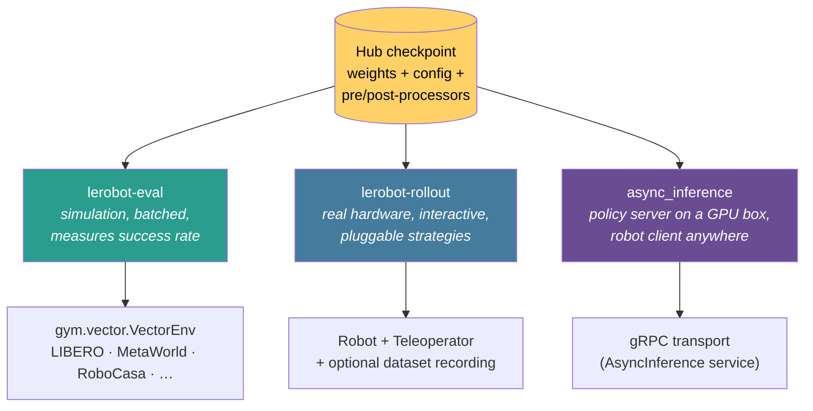

| | `lerobot-eval` | `lerobot-rollout` |
|---|---|---|
| Runs on | simulated envs | real hardware |
| Parallel | yes — `gym.vector.VectorEnv` | no — one robot |
| Episode end | env `terminated`/`truncated` | time limit or human |
| Human in the loop | no | yes (DAgger, highlight, interactive session) |
| Output | success rate, reward, videos | optionally a new `LeRobotDataset` |

---

## 2. `lerobot-eval`

```bash
lerobot-eval \
  --policy.path=lerobot/pi0_libero_finetuned \
  --env.type=libero \
  --env.task=libero_object \
  --eval.n_episodes=10
```

### The four pipelines

The eval `rollout()` function takes **four** processor pipelines, which is more than it
first looks like it needs:

```python
def rollout(
    env: gym.vector.VectorEnv,
    policy: PreTrainedPolicy,
    env_preprocessor:  PolicyProcessorPipeline[dict, dict],   # env obs  → canonical obs
    env_postprocessor: PolicyProcessorPipeline[dict, dict],   # action   → env action
    preprocessor:      PolicyProcessorPipeline[dict, dict],   # canonical obs → model input
    postprocessor:     PolicyProcessorPipeline[PolicyAction, PolicyAction],  # model out → canonical action
    ...
) -> dict
```

```mermaid
flowchart LR
    E["env.step() →<br/>gym observation dict"]
    E --> EP["env_preprocessor<br/><i>env-specific key/layout fixes</i>"]
    EP --> PP["preprocessor<br/><i>the policy's OWN pipeline,<br/>loaded from the checkpoint</i>"]
    PP --> POL["policy.select_action()"]
    POL --> PO["postprocessor<br/><i>the policy's OWN pipeline</i>"]
    PO --> EPO["env_postprocessor<br/><i>PolicyAction → EnvAction (np.ndarray)</i>"]
    EPO --> E2["env.step(action)"]

    style PP fill:#2a9d8f,color:#fff
    style PO fill:#2a9d8f,color:#fff
    style EP fill:#e9c46a,color:#000
    style EPO fill:#e9c46a,color:#000
```

The separation is the point: the **inner** pair travels with the checkpoint and must be
byte-identical to training; the **outer** pair is environment-specific adaptation and must
*not* be baked into the model. Collapse them and you can no longer evaluate one policy on
two benchmarks.

### Resetting the processors, not just the policy

```python
# Reset the policy, its processors and the environments. The processors matter: a step that
# latches per-episode state -- e.g. ``RelativeActionsProcessorStep``'s cached anchor -- would
# otherwise carry the previous batch of episodes' value into this one.
# ``SyncInferenceEngine`` already does this on the robot.
policy.reset()
preprocessor.reset()
postprocessor.reset()
observation, info = env.reset(seed=seeds, options={NEW_ROLLOUT_OPTION: True})
```

A stale relative-action anchor from the previous episode is a textbook silent failure: the
policy still produces plausible-looking deltas, applied to the wrong origin. This is why
`reset()` fans out over the whole pipeline ([08 §4](./08-processor-pipeline.md)).

`NEW_ROLLOUT_OPTION` distinguishes a genuine new episode from Gymnasium's argument-less
autoreset of a sub-env that already finished — some wrappers (`FreezeAfterEpisodeEnd`) need
to tell those apart.

### Batched rollout semantics

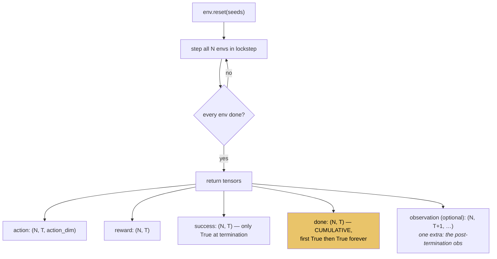

Two gotchas straight from the docstring:

> *"all environments in the batch are run until the last environment is done. This means
> some data will probably need to be discarded (for environments that aren't the first one
> to be done)."*

The cumulative `done` mask is exactly what you use to discard it. And observations have
`T+1` entries because the post-termination observation is included — off-by-one bugs here
are common.

`predicted_latents_callback` is an extension hook for world-model policies: LingBot-VA and
friends stash predicted video latents on `policy.last_predicted_latents` after each
`select_action`, and the callback lets the caller accumulate chunks and decode once instead
of per step.

### The command structure

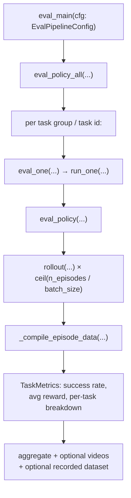

`eval_policy_all` is also imported by `lerobot_train.py` — in-training env evaluation
(`--env_eval_freq`) calls the same code path, so a number you see mid-training is
comparable to one from a standalone eval.

---

## 3. `lerobot-rollout` — the real-hardware stack

Deploying on hardware is harder than simulation: there is no reset button, a human may need
to intervene, you may want to record what happened, and the policy may need re-tasking
mid-episode. `src/lerobot/rollout/` factors that into four components with a strict
call direction.

The module docstring states the architecture precisely:

> An interactive rollout is built from four components: `InferenceEngine` (owns the
> policy), `RolloutStrategy` (the real-time tick loop), `RolloutController` (lifecycle
> state machine) and `InteractiveSession` (text I/O over the controller). Calls point
> downward only — session → controller → {strategy, engine}, strategy → engine — and
> nothing under `strategies/` or `inference/` references the controller, so strategies stay
> usable non-interactively. Controller commands only record intent under the controller
> lock; `serve()` is the only place intent becomes motion.

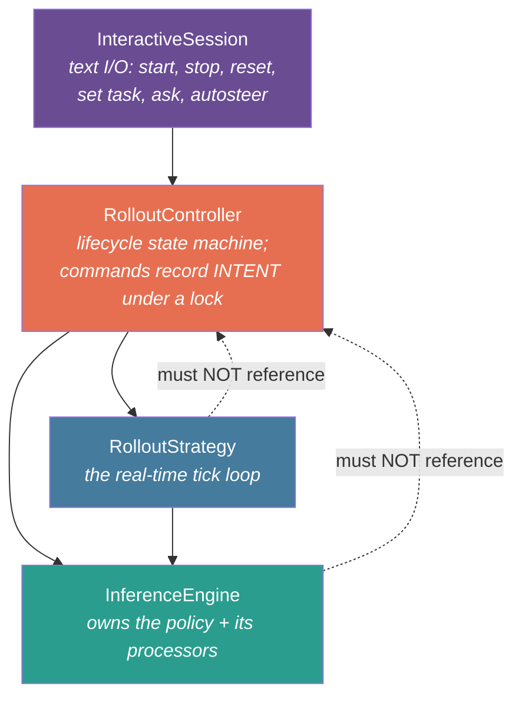

Two design rules worth internalising:

1. **No upward references.** Strategies and engines never import the controller, so every
   strategy also works headless (in a script, in CI, from another program).
2. **Intent vs. motion.** `start()`, `stop()`, `reset()`, `set_task()` only *record* what
   the user asked for, under the controller lock. `serve()` is the single place where
   recorded intent is turned into robot motion. That means a keyboard interrupt can never
   land halfway through a command.

### The context objects

`rollout/context.py` groups what a rollout needs into five dataclasses, assembled by
`build_rollout_context()`:

| Context | Holds |
|---|---|
| `RuntimeContext` | fps, duration, display settings, timers |
| `HardwareContext` | the `Robot`, the `Teleoperator`(s) |
| `PolicyContext` | the `PreTrainedPolicy` |
| `ProcessorContext` | pre/post-processors and the robot-side pipelines |
| `DatasetContext` | the `LeRobotDataset` being written, if any |
| `RolloutContext` | the composition of all of the above |

This is what keeps strategy constructors from having fifteen parameters, and makes "what
does a rollout need?" answerable by reading one file.

### Strategies

`RolloutStrategyConfig` is a `ChoiceRegistry`, so `--strategy.type=` selects one:

```mermaid
flowchart TD
    subgraph BASE["base — autonomous, no recording"]
        B1["policy drives the robot<br/>until shutdown or duration"]
    end
    subgraph SENTRY["sentry — autonomous, always recording"]
        S1["episode length derived from<br/>camera resolution × fps ×<br/>target_video_file_size_mb"]
        S2["so episode boundaries align with<br/>the dataset's video file chunks →<br/>push_to_hub uploads COMPLETE files"]
        S3["upload_every_n_episodes"]
        S1 --> S2 --> S3
    end
    subgraph HL["highlight — autonomous, on-demand recording"]
        H1["ring buffer continuously captures<br/>the last ring_buffer_seconds"]
        H2["press save_key → flush the buffer<br/>to the dataset, keep recording"]
        H3["bounded by ring_buffer_max_memory_mb"]
        H1 --> H2 --> H3
    end
    subgraph EP["episodic — mirrors lerobot-record"]
        E1["num_episodes × episode_time_s<br/>+ reset_time_s between them"]
        E2["→ end early · ← discard & redo · Esc stop"]
        E3["smooth leader↔follower handover<br/>at the reset boundary"]
        E1 --> E2 --> E3
    end
    subgraph DA["dagger — human in the loop"]
        D1["alternates autonomous execution<br/>and human correction"]
        D2["correction frames tagged<br/>intervention=True"]
        D3["keyboard or foot pedal:<br/>pause_resume · correction · upload"]
        D1 --> D2 --> D3
    end
```

Details that show how much real-world experience is encoded here:

- **Sentry's episode length** is computed from the *video file size target*, not from a
  clock. Reason, from the docstring: *"This aligns episode boundaries with the dataset's
  video file chunking, so each `push_to_hub` call uploads complete video files rather than
  re-uploading a growing file that hasn't crossed the chunk boundary."* A time-based
  boundary would re-upload the same partially-filled MP4 over and over.
- **Highlight's ring buffer** solves "the interesting thing already happened". You cannot
  predict when a failure will occur, so you buffer the recent past and let a human
  retroactively keep it. `rollout/ring_buffer.py`.
- **Episodic's handover** interpolates between the leader and follower pose at the reset
  boundary so the arm does not snap. And it is *disableable* for clutch-style teleoperators
  (VR controllers) that re-reference at the current pose — there the interpolation only
  adds latency.
- **DAgger** records corrections as their own episodes by default
  (`record_autonomous=False`), because that is the data you actually want to train on. It
  also blocks `push_to_hub` while a correction is in progress.

Strategies declare their requirements as ClassVars, which is how the CLI validates
combinations up front:

```python
supports_interactive: ClassVar[bool] = True
dataset_mode: ClassVar[str] = "required"      # "required" | (absent → optional)

def requires_streaming_encoding(self) -> bool: return True   # sentry
```

### The controller state machine

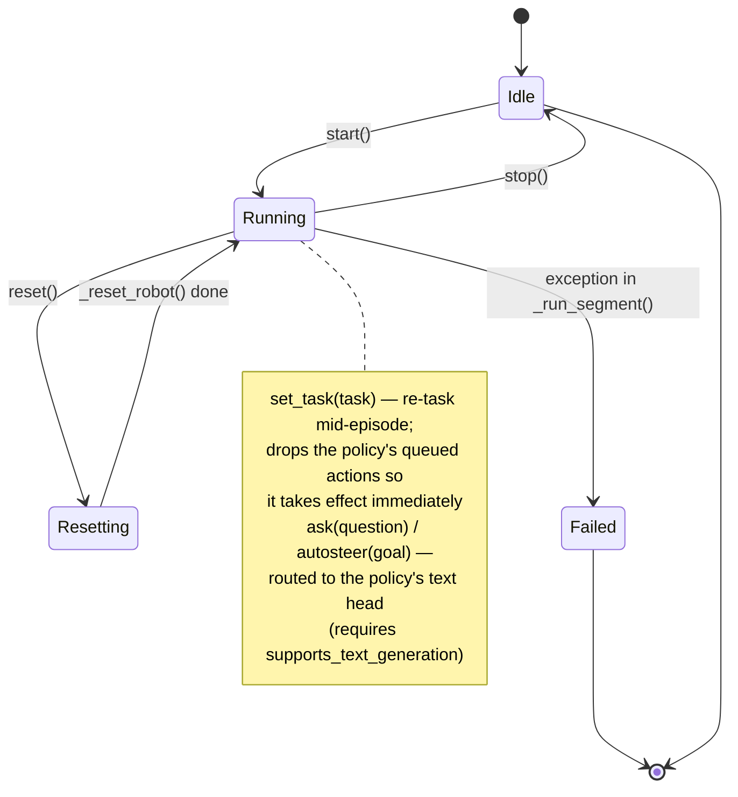

`RolloutController` exposes `running`, `stopped`, `failed`, `failure_traceback`,
`task`, `initial_task`, plus `AskResult` / `RolloutEvent` enums so a UI can subscribe to
transitions. `LinkedEvent` is a small `threading.Event` subclass that ORs a parent event in
— used so a child wait is cancelled when the session shuts down.

`set_task()` is where [09 §3](./09-policies.md#3-action-chunking-and-the-action-queue)'s
`drop_queued_actions()` earns its keep: re-tasking must not wait for the current chunk to
drain.

---

## 4. Inference engines

`rollout/inference/` provides the engine abstraction that strategies talk to:

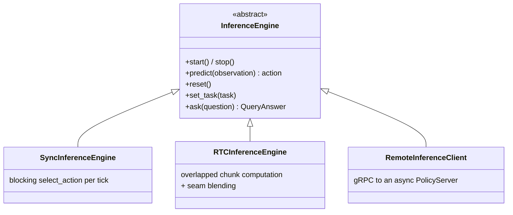

### Sync vs RTC

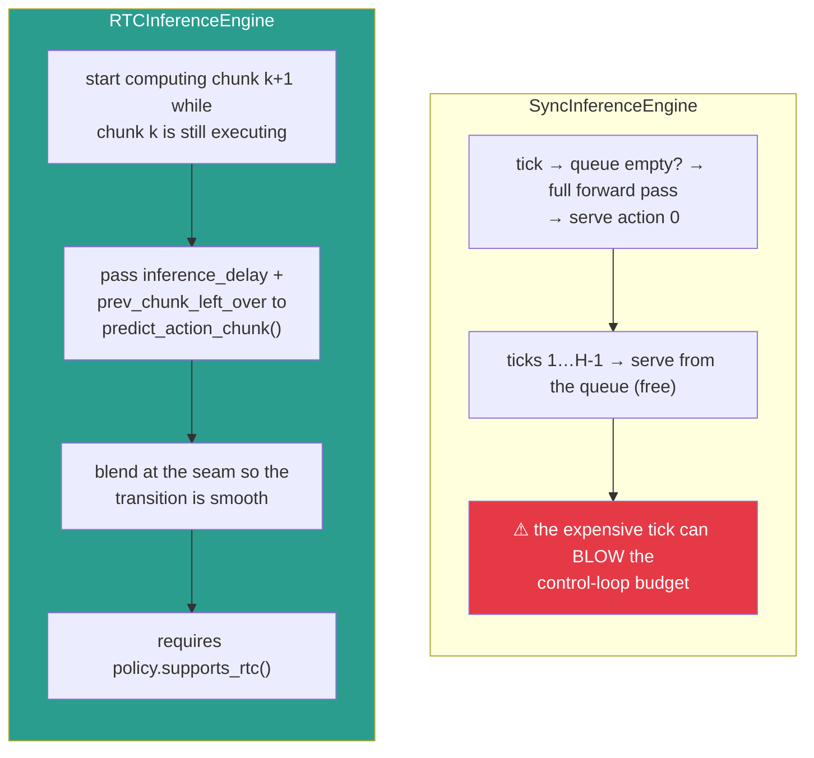

The RTC kwargs are declared on the base policy class so the contract is explicit:

```python
class RTCActionSelectKwargs(TypedDict, total=False):
    """Keyword arguments Real-Time Chunking passes to `predict_action_chunk`."""
    inference_delay: int | None
    prev_chunk_left_over: Tensor | None
    execution_horizon: int | None
```

`inference_delay` is the number of steps of the previous chunk that will already have
executed by the time the new chunk lands — the policy conditions on that instead of
planning from a state the robot has already left. See `docs/source/rtc.mdx` and
`docs/source/policy_rtc_README.md`.

---

## 5. Async inference: splitting the loop across the network

A 7B VLA does not run on a Raspberry Pi. `src/lerobot/async_inference/` splits the loop:
the robot keeps the control loop, a GPU box keeps the policy.

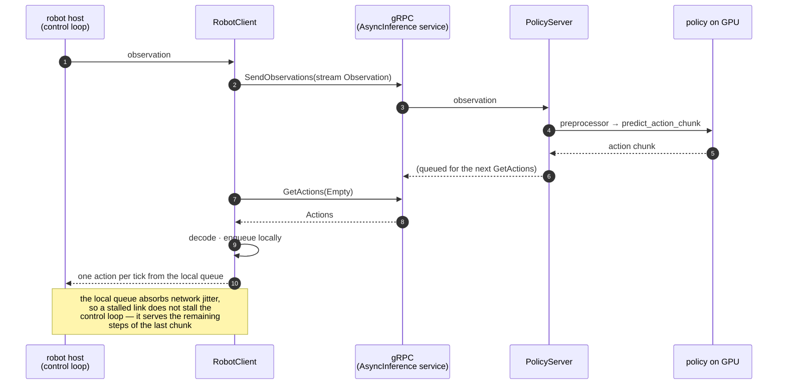

The gRPC contract is declared in `src/lerobot/transport/services.proto`:

```proto
service AsyncInference {
  rpc SendObservations(stream Observation) returns (Empty);
  rpc GetActions(Empty) returns (Actions);
  rpc SendPolicyInstructions(PolicySetup) returns (Empty);
  rpc Ready(Empty) returns (Empty);
}
```

Note the shape: observations are a **client-streaming** call, actions are pulled with a
unary `GetActions`. `SendPolicyInstructions` configures the server's policy once at
session start, and `Ready` is the handshake the client blocks on before it starts acting.

| File | Role |
|---|---|
| `src/lerobot/async_inference/policy_server.py` | `PolicyServer` (the `AsyncInferenceServicer`) and its `serve(cfg)` entry point |
| `src/lerobot/async_inference/robot_client.py` | `RobotClient` and its `async_client(cfg)` entry point |
| `src/lerobot/async_inference/configs.py` | `PolicyServerConfig`, `RobotClientConfig` |
| `src/lerobot/async_inference/helpers.py` | observation/action serialisation and queue plumbing |
| `src/lerobot/async_inference/constants.py` | shared protocol constants |
| `src/lerobot/transport/services.proto` + generated `services_pb2*.py` | the wire contract |
| `src/lerobot/transport/utils.py` | tensor (de)serialisation helpers |

It is behind an extra — importing the package checks for it up front:

```python
"""Async inference server/client.

Requires: ``pip install 'lerobot[async]'``
"""
require_package("grpcio", extra="async", import_name="grpc")
```

Runnable examples live in `examples/tutorial/async-inf/` (`policy_server.py`,
`robot_client.py`); the user-facing guides are `docs/source/async.mdx` and
`docs/source/inference.mdx`.

The design constraint that shapes all of it: **the control loop must keep ticking even
when the network stalls.** Hence chunk-based streaming plus a local action queue, rather
than a request/response per tick.

> Upstream has since replaced this module with a reworked `lerobot.remote_inference`
> package (a Zenoh transport alongside gRPC, a `lerobot-policy-server` console script, and
> an explicit chunk contract). This branch predates that change, so the above is what the
> code here actually contains.

## 6. `lerobot-replay`

The simplest deployment of all — no policy at all:

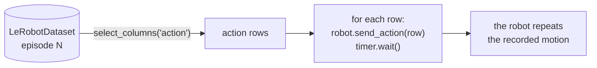

Invaluable for debugging: if replay reproduces the recorded motion, your calibration and
action plumbing are correct and the problem is in the policy. If replay *doesn't*, the
problem is below the policy — calibration, normalization, or the recorded-vs-sent action
divergence noted in [02 §4](./02-architecture.md#4-the-control-loop--the-shape-every-runtime-shares).
`dataset.select_columns` exists precisely so replay does not decode video it will not use.

---

## 7. Choosing an entry point

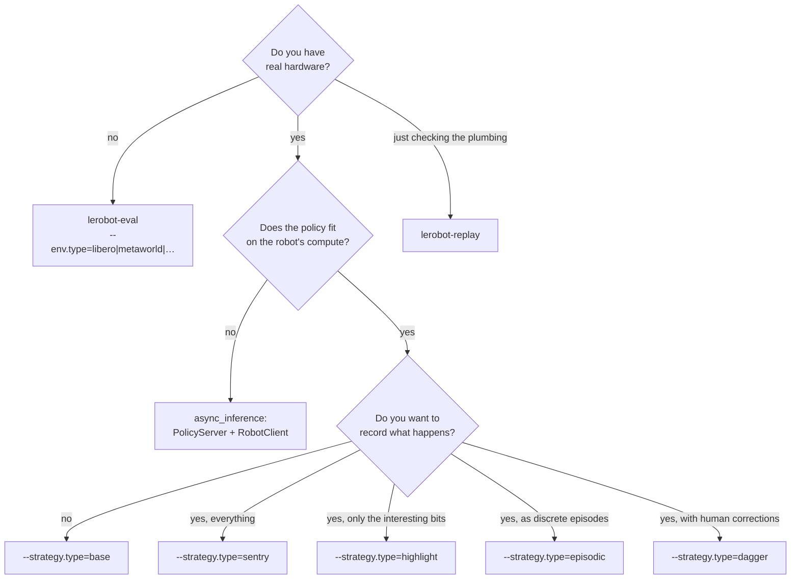

---

## 8. Next

[12 · Reinforcement Learning](./12-reinforcement-learning.md) — when evaluation feeds back
into training online.
