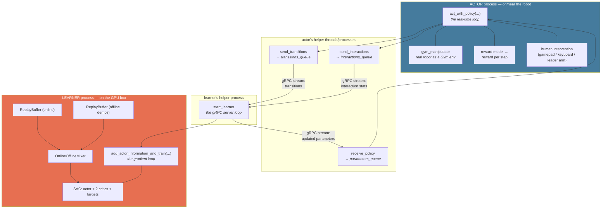
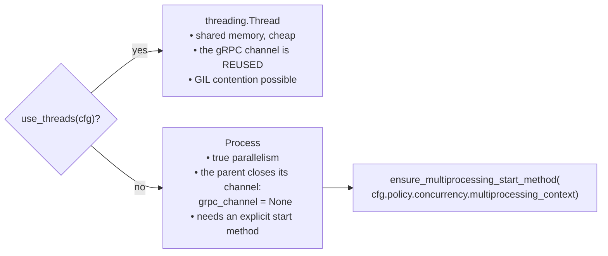
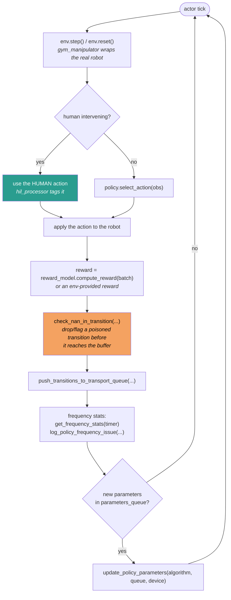
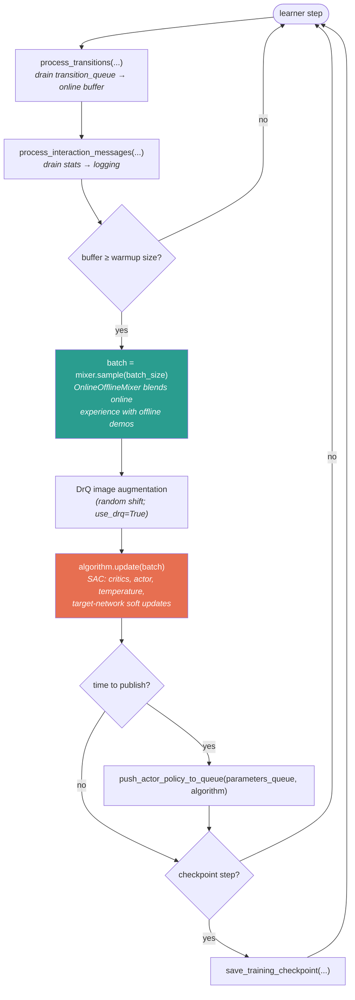
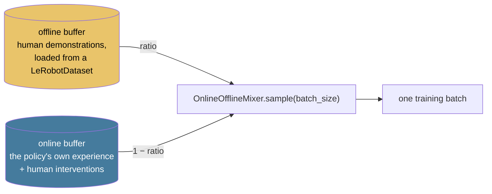
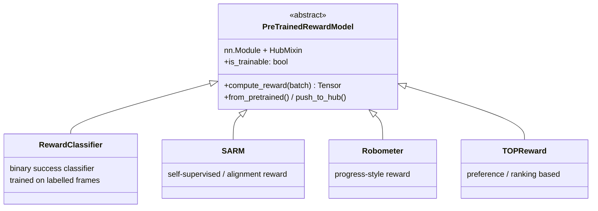
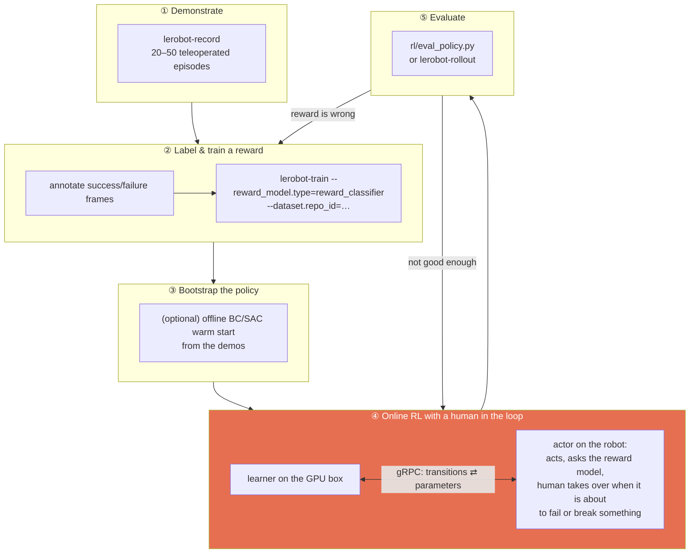
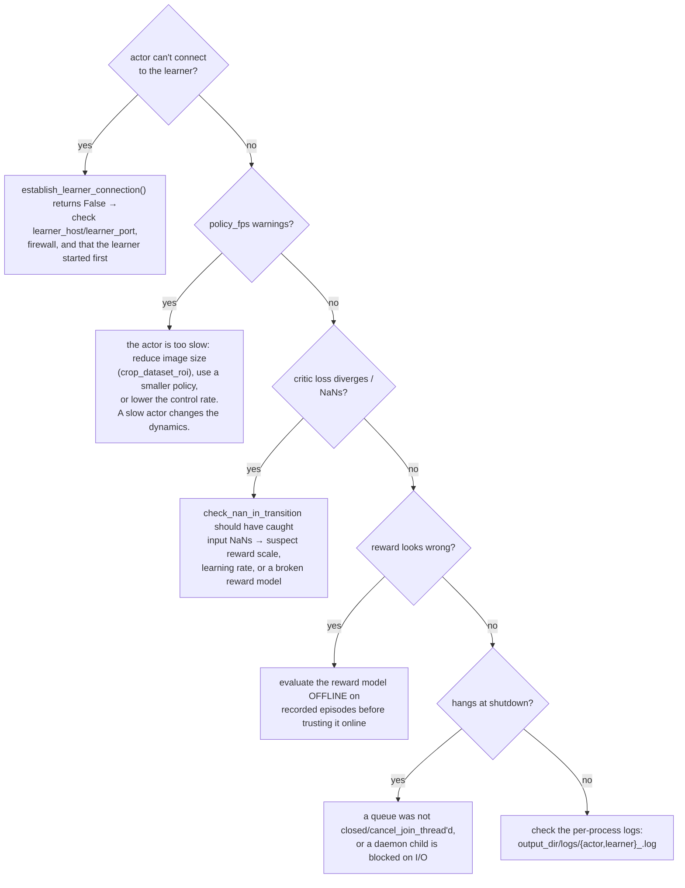

# 12 · Reinforcement Learning (HIL-SERL)

[← Inference & Rollout](./11-inference-and-rollout.md) · [Index](./README.md)

---

## 1. Why RL needs a different shape

Everything in [10 · Training](./10-training.md) is **offline**: a fixed dataset, a
deterministic loop, a checkpoint at the end. Online RL breaks every one of those
assumptions:

- the data is produced *while* training, by the policy being trained;
- the robot runs in real time and cannot wait for a gradient step;
- a human may need to intervene to keep the robot safe and to bootstrap learning;
- the reward usually has to be *learned*, because nobody instruments a real kitchen with a
  success sensor.

LeRobot's answer is a **distributed actor/learner** architecture, implemented in
`src/lerobot/rl/`, with HIL-SERL (Human-In-the-Loop Sample-Efficient Robot RL) as the
flagship recipe.

```
src/lerobot/rl/
├── actor.py              ← the robot-side process: acts, streams transitions
├── learner.py            ← the GPU-side process: trains, streams parameters
├── learner_service.py    ← the gRPC service the actor talks to
├── train_rl.py           ← TrainRLServerPipelineConfig (extends TrainPipelineConfig)
├── trainer.py            ← RLTrainer
├── buffer.py             ← ReplayBuffer
├── queue.py              ← queue plumbing
├── data_sources/
│   └── data_mixer.py     ← DataMixer, OnlineOfflineMixer
├── algorithms/
│   ├── base.py           ← RLAlgorithm
│   ├── configs.py        ← RLAlgorithmConfig, TrainingStats
│   ├── factory.py        ← make_algorithm
│   └── sac/              ← SAC implementation
├── gym_manipulator.py    ← wraps a real robot as a Gym env
├── eval_policy.py
├── crop_dataset_roi.py
└── joint_observations_processor.py
```

The module docstring draws the dependency line clearly:

> Distributed actor / learner entry points (`actor`, `learner`, `learner_service`) require
> `pip install 'lerobot[hilserl]'`. Algorithms, buffer, data sources and trainer are
> gRPC-free and usable standalone.

So you can use `ReplayBuffer` and SAC in a notebook without any of the distributed
machinery.

---

## 2. The actor/learner topology



The asymmetry is the whole design:

| | Actor | Learner |
|---|---|---|
| Runs at | the robot's control rate (e.g. 10–30 Hz) | as fast as the GPU allows |
| Blocking on the other side? | **never** | never |
| Sends | transitions + interaction stats | policy parameters |
| Hardware | robot, cameras, human input | GPU |

Neither side waits for the other. The actor keeps acting with slightly stale parameters;
the learner keeps training on whatever is in the buffer. Decoupling them is what makes
real-time RL on physical hardware possible at all.

---

## 3. Threads or processes — chosen by config

Both sides use the same pattern, selected by `use_threads(cfg)`:

```python
if use_threads(cfg):
    from threading import Thread
    concurrency_entity = Thread
else:
    from multiprocessing import Process         # actor
    # from torch.multiprocessing import Process # learner
    concurrency_entity = Process
```



The gRPC channel detail is easy to miss and important:

```python
if not use_threads(cfg):
    # If we use multithreading, we can reuse the channel
    grpc_channel.close()
    grpc_channel = None
```

A gRPC channel cannot be inherited across a fork safely, so in process mode the parent
closes it and each child creates its own. The learner's child uses
`torch.multiprocessing.Process` specifically (CUDA tensor sharing).

Shutdown is coordinated by one `shutdown_event` from `ProcessSignalHandler`, and the
learner's `finally` block does the full teardown dance — `close()`, `join()`, then
`cancel_join_thread()` on every queue — because a multiprocessing queue with unflushed
data will otherwise hang the interpreter at exit. This is the same class of problem as the
camera shutdown in [05 · Cameras](./05-cameras.md): a bounded, explicit teardown of
background workers.

---

## 4. The actor loop



Two pieces of hard-won engineering:

**`check_nan_in_transition`** — a NaN that reaches the replay buffer silently poisons every
future gradient step that samples it. Checking at the boundary is far cheaper than
debugging a diverged critic.

**`log_policy_frequency_issue(policy_fps, cfg, interaction_step)`** — the actor measures its
own achieved frequency and warns when it falls below the configured rate. In real-time RL,
a slow actor does not just collect data slowly: it changes the *dynamics* the policy
experiences, so the warning is a correctness signal, not just a performance one.

---

## 5. The learner loop



### `OnlineOfflineMixer` — why offline demos matter



`DataMixer` is a tiny abstract interface — `sample(batch_size)` plus an infinite async
iterator — so other curricula can be dropped in. Mixing demonstrations into every batch is
what makes HIL-SERL sample-efficient: pure online RL on a real arm would need orders of
magnitude more interaction.

### `ReplayBuffer` memory controls

```python
ReplayBuffer(
    capacity: int,
    device: str = "cuda:0",             # where sampled batches land
    state_keys: Sequence[str] | None = None,
    image_augmentation_function: Callable | None = None,
    use_drq: bool = True,               # DRQ-style random-shift augmentation on sample
    storage_device: str = "cpu",        # where the buffer itself lives
    optimize_memory: bool = False,      # don't duplicate next_state when next_state[i] == state[i+1]
)
```

Image observations make replay buffers enormous. Three knobs fight that, and the docstring
spells out the trade-offs:

| Knob | Effect | Cost |
|---|---|---|
| `storage_device="cpu"` | buffer in host RAM, batches moved on sample | PCIe transfer per batch |
| `optimize_memory=True` | store each frame once instead of as both `state[i]` and `next_state[i-1]` | ~2× memory saving; requires the sequential-episode assumption |
| `capacity` | hard cap | older experience is dropped |

Tensors are allocated lazily — *"It will allocate tensors on the specified device, when the
first transition is added"* — so the buffer sizes itself from the actual observation
shapes rather than from a declared spec.

---

## 6. Reward models

`src/lerobot/rewards/` is where "did the robot succeed?" becomes a learned function.



Selected by `--reward_model.type=reward_classifier|sarm|robometer|topreward`, or loaded
with `--reward_model.path=<repo_id>`.

### Reward models train through `lerobot-train`

This is the integration point described in
[10 §3.3](./10-training.md#33-reward-model-training-shares-the-pipeline): a reward model is
just another trainable, so it reuses the entire offline training pipeline — dataset,
processors, accelerate, checkpointing, Hub publishing.

The `is_trainable` gate matters:

```python
if not policy.is_trainable:
    raise ValueError(
        f"Reward model '{policy.name}' is zero-shot and cannot be trained via lerobot-train. "
        "Use it directly for inference via compute_reward() (e.g. offline precompute)."
    )
```

Some reward models are zero-shot (a pretrained VLM scoring frames); trying to train them is
a user error caught with a sentence that says what to do instead.

### The `--reward_model.pretrained_revision` path

Loading a reward-model config goes through `RewardModelConfig.from_pretrained`, whose
`revision` kwarg controls the `hf_hub_download` of `config.json` — while `cli_overrides`
are applied by draccus *after* the download. Reward models are iterated on fast (you
retrain the success classifier whenever the task changes), so pinning a revision is a real
workflow need, and it was silently ignored:
[deep dive 06](../issue-deep-dives/06-reward-model-pretrained-revision.md).

---

## 7. The HIL-SERL recipe end to end



The human intervention in ④ does double duty: it keeps the robot from destroying itself
*and* it produces exactly the corrective transitions the policy most needs. The
`hil_processor` steps tag those frames so the learner can weight them.

Running it:

```bash
# terminal 1 — the learner (GPU box)
python -m lerobot.rl.learner --config_path=path/to/hilserl_config.json

# terminal 2 — the actor (robot host)
python -m lerobot.rl.actor --config_path=path/to/hilserl_config.json
```

`TrainRLServerPipelineConfig` extends `TrainPipelineConfig`, so every flag from
[03 · Configuration & CLI](./03-configuration-and-cli.md) still applies, plus
`policy.actor_learner_config.learner_host` / `learner_port` and
`policy.concurrency.*`.

User-facing guides: `docs/source/hilserl.mdx` (real robot),
`docs/source/hilserl_sim.mdx` (simulation first — strongly recommended),
`docs/source/hil_data_collection.mdx`.

---

## 8. Supporting pieces

| Module | Purpose |
|---|---|
| `rl/gym_manipulator.py` | Wraps a real `Robot` as a `gym.Env` so the RL code is env-agnostic |
| `rl/joint_observations_processor.py` | Assembles joint observations into the state vector the algorithm expects |
| `rl/crop_dataset_roi.py` | Crop a region of interest — smaller images, faster critics, less overfitting to background |
| `rl/queue.py` | The transport queue plumbing between the loops |
| `rl/trainer.py` | `RLTrainer`: the gRPC-free training driver |
| `rl/algorithms/base.py` | `RLAlgorithm`: `update(batch)` → `TrainingStats` |
| `rl/algorithms/sac/` | Soft Actor-Critic: twin critics, target networks, learned temperature |
| `policies/gaussian_actor/` | The squashed-Gaussian actor head SAC uses |

Note that `lerobot.rl` is **excluded from mypy's checked paths** (`[tool.mypy]` in
`pyproject.toml`), per `AGENTS.md`. Treat its type annotations as documentation rather than
as verified.

---

## 9. Debugging distributed RL

The failure modes are different from offline training, and the ordering of these checks
reflects how often each one is the culprit:



Each process writes its own log file (`init_logging(log_file=…, display_pid=True)` in
process mode), which is the first place to look — interleaved stdout from two processes is
unreadable.

---

## 10. End of the guide

You have now read the whole framework:

| | |
|---|---|
| [01 Overview](./01-project-overview.md) | what LeRobot is |
| [02 Architecture](./02-architecture.md) | the layers and the two currencies |
| [03 Config & CLI](./03-configuration-and-cli.md) | how a command becomes a config |
| [04](./04-robots-and-teleoperators.md) · [05](./05-cameras.md) · [06](./06-motors-and-calibration.md) | the hardware layer |
| [07](./07-dataset.md) · [08](./08-processor-pipeline.md) · [09](./09-policies.md) | the learning layer |
| [10](./10-training.md) · [11](./11-inference-and-rollout.md) · [12](./12-reinforcement-learning.md) | the orchestration layer |

**Next: see the theory fail.** The six analyses in
[`docs/issue-deep-dives/`](../issue-deep-dives/) take real defects from this fork and walk
the reproduction, the root cause, the fix and the regression test. They are the best test
of whether the models in this guide are actually in your head.
