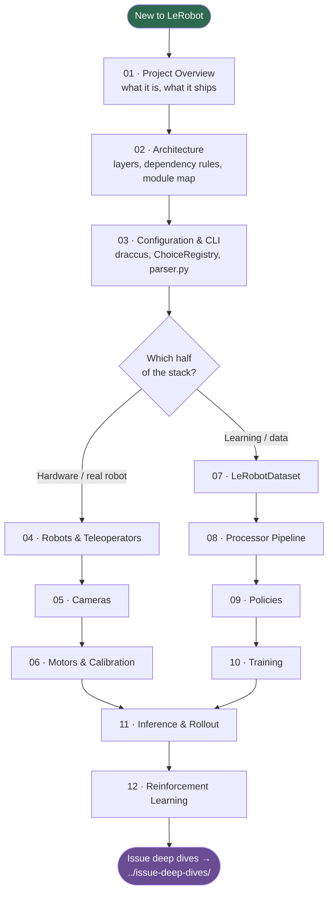

# LeRobot — Introduction & Architecture Guide

A self-contained onboarding guide to this repository: what LeRobot is, how it is put
together, and how the code actually flows at runtime. Every document is heavy on
flowcharts (Mermaid, rendered natively by GitHub) and every claim is anchored to a
concrete file and symbol in `src/lerobot/`.

> **Scope note.** This guide documents the code as it exists on `main` in this fork. It is a
> *reading* guide — it does not replace the user-facing docs under
> [`docs/source/`](../source), which are published to
> <https://huggingface.co/docs/lerobot>. Where the two overlap, `docs/source/` is the
> canonical user documentation and this guide is the canonical *map of the code*.

---

## How to read this

---

## Table of contents

| # | Document | What it covers |
|---|---|---|
| 01 | [Project Overview](./01-project-overview.md) | Mission, the five pillars, repo layout, install, the CLI surface, the end-to-end user journey |
| 02 | [Architecture](./02-architecture.md) | Layered design, allowed dependency directions, module-by-module map, the core abstractions and how they compose |
| 03 | [Configuration & CLI](./03-configuration-and-cli.md) | draccus dataclass configs, `ChoiceRegistry` polymorphism, `--policy.path` two-phase resolution, `configs/parser.py` helpers |
| 04 | [Robots & Teleoperators](./04-robots-and-teleoperators.md) | The `Robot` / `Teleoperator` contracts, connect/calibrate lifecycle, bimanual composition, third-party plugin discovery |
| 05 | [Cameras](./05-cameras.md) | The `Camera` contract, the background read thread, `read` vs `async_read` vs `read_latest`, OpenCV / RealSense / ZMQ backends |
| 06 | [Motors & Calibration](./06-motors-and-calibration.md) | `MotorsBus`, control tables, normalization, `MotorCalibration`, the calibrate → write → read-back loop |
| 07 | [LeRobotDataset](./07-dataset.md) | The v3 on-disk format, metadata, `__getitem__` and delta timestamps, writing/recording, streaming |
| 08 | [Processor Pipeline](./08-processor-pipeline.md) | `EnvTransition`, `ProcessorStep`, `DataProcessorPipeline`, the registry, feature transformation, save/load |
| 09 | [Policies](./09-policies.md) | `PreTrainedPolicy`, the policy factory, action chunking & queues, the pre/post-processor pair, PEFT |
| 10 | [Training](./10-training.md) | `lerobot-train` end to end: config → data → policy → accelerate → loop → checkpoint → Hub |
| 11 | [Inference & Rollout](./11-inference-and-rollout.md) | `lerobot-eval`, `lerobot-rollout`, the inference engine / strategy / controller split, RTC, async inference |
| 12 | [Reinforcement Learning](./12-reinforcement-learning.md) | HIL-SERL actor/learner topology, replay buffer, reward models, gRPC transport |

---

## Companion folder: issue deep dives

[`docs/issue-deep-dives/`](../issue-deep-dives/) analyses six real defects that were
found and fixed in this fork — four medium, two hard. Each one has a reproduction, a
root-cause flowchart, the fix, and the regression test that pins it. They are the fastest
way to learn how the subsystems above actually behave under stress.

| Difficulty | Issue | Subsystem |
|---|---|---|
| 🔴 Hard | [ZMQ `_cleanup()` closed a socket under a live reader](../issue-deep-dives/01-zmq-cleanup-stops-read-thread.md) | Cameras / threading |
| 🔴 Hard | [Read loops published a frame after stop was requested](../issue-deep-dives/02-camera-read-loop-stop-parity.md) | Cameras / threading |
| 🟠 Medium | [`DynamixelMotorsBus.write_calibration` never wrote `Drive_Mode`](../issue-deep-dives/03-dynamixel-write-drive-mode.md) | Motors |
| 🟠 Medium | [Both bimanual arms shared one calibration file](../issue-deep-dives/04-bimanual-calibration-id-collision.md) | Robots |
| 🟠 Medium | [The kinematics "missing joints" guard was unreachable](../issue-deep-dives/05-kinematics-empty-joints-guard.md) | Processor / kinematics |
| 🟠 Medium | [`--reward_model.pretrained_revision` was silently ignored](../issue-deep-dives/06-reward-model-pretrained-revision.md) | Config / CLI |

---

## Conventions used in this guide

- **`file.py:123`** — a clickable anchor into the repo at that line.
- Mermaid `flowchart` — control flow and data flow.
- Mermaid `sequenceDiagram` — interaction over time between components/threads.
- Mermaid `classDiagram` — type relationships and contracts.
- 🔴 / 🟠 / 🟢 — hard / medium / easy, used in the deep-dive folder.
- A box with a **dashed** border in a flowchart marks the point where a bug lived.
