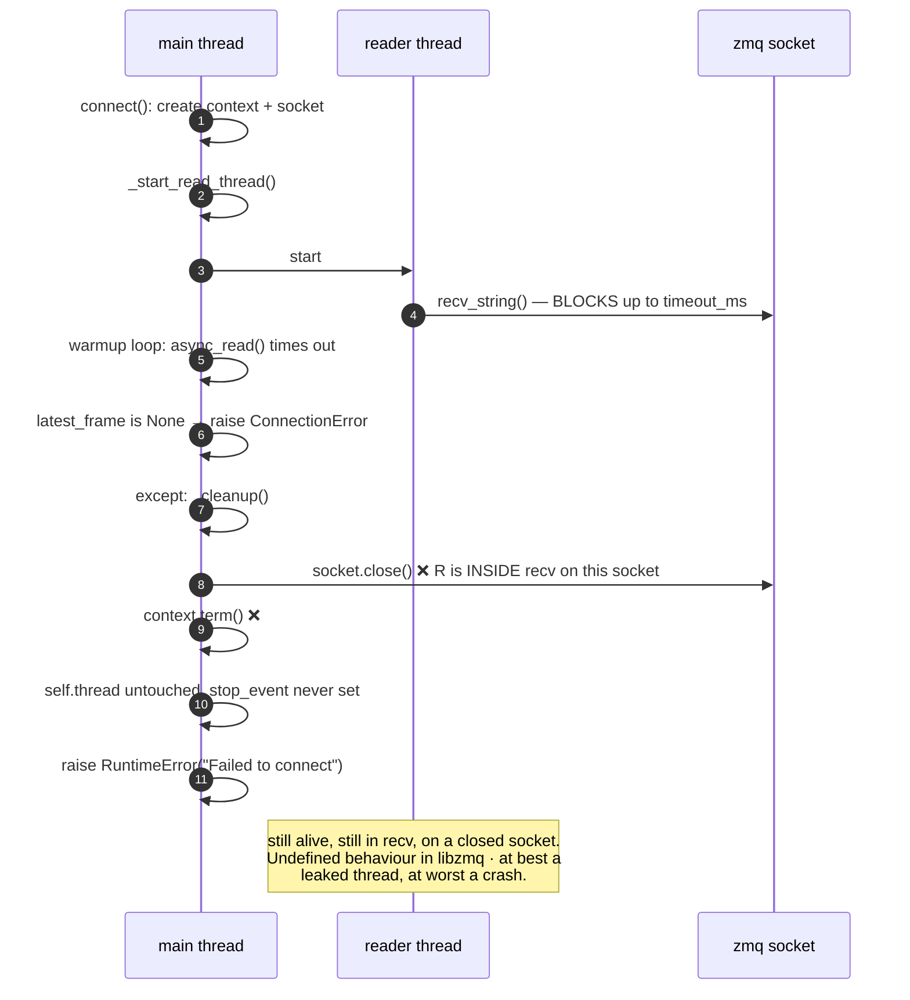
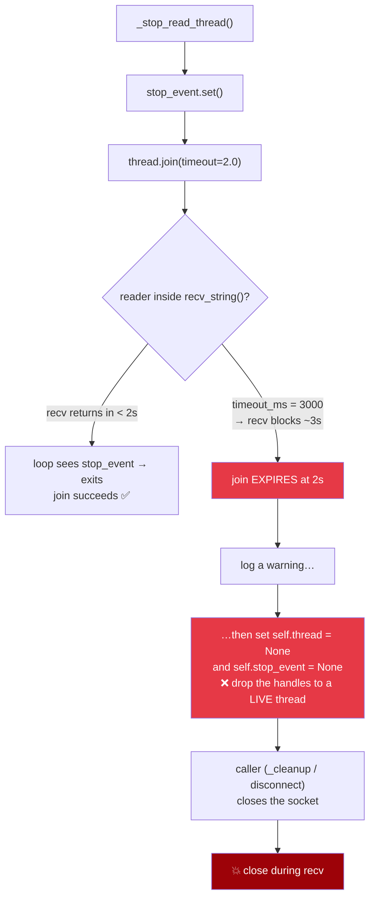
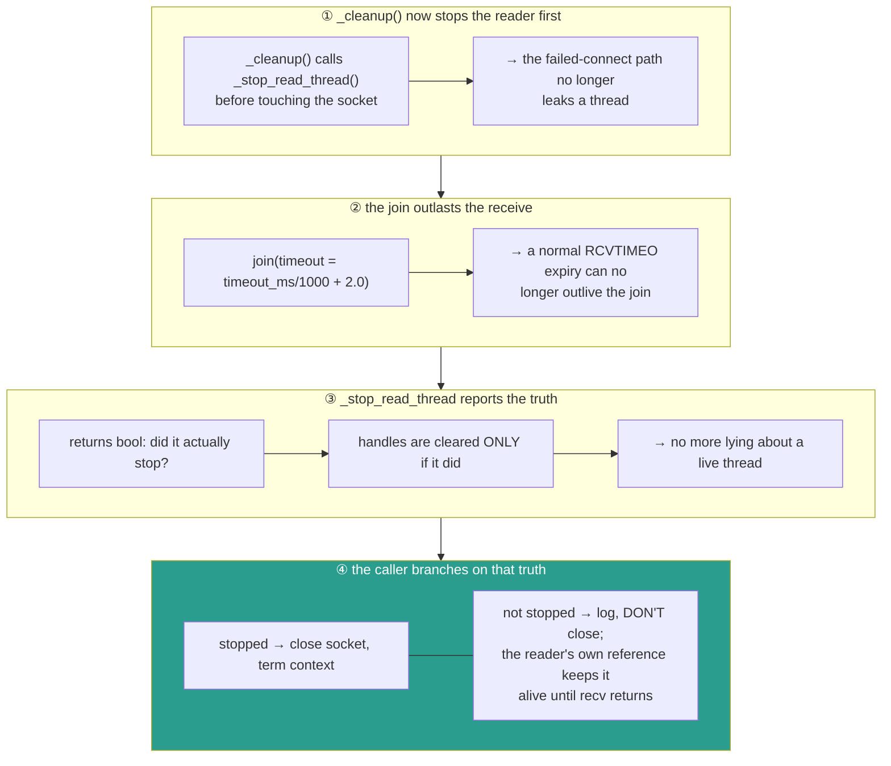
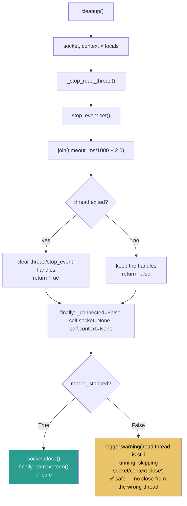
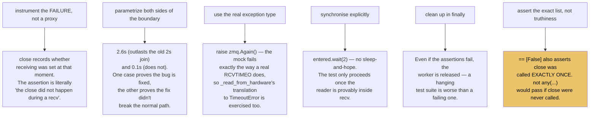

# 01 · 🔴 Hard — `_cleanup()` closed a ZMQ socket under a live reader thread

**Branch:** `fix/zmq-cleanup-stops-read-thread`
**Files:** `src/lerobot/cameras/zmq/camera_zmq.py`, `tests/cameras/test_zmq.py`
**Commits:** `6b61cc89` (stop the thread when `connect()` fails) · `e4d3b571` (wait out the receive timeout before closing)

[← Index](./README.md) · Background: [intro 05 · Cameras](../intro/05-cameras.md)

---

## 1. Symptom

Two related failures, both on a `ZMQCamera` (a remote camera consumed over a `zmq.SUB`
socket — this is how a LeKiwi's cameras reach the host):

1. **Thread leak on a failed connect.** A `connect()` that fails during warmup — the
   publisher is not up yet, the address is wrong, the network is down — leaves its
   background reader thread *running*, blocked in `recv_string()` on a socket that has
   just been closed from another thread. A retry loop accumulates one such thread per
   attempt. `camera.thread` and `camera.stop_event` stay populated, so a subsequent
   `connect()` sees inconsistent state.

2. **Close-during-receive.** Even on a clean `disconnect()`, if the reader was inside
   `recv_string()` for longer than the hard-coded 2 s join, the socket was closed under it.
   Symptoms range from a libzmq assertion failure in the reader thread to a process
   crash, depending on pyzmq/libzmq version and timing.

Failure (2) is not an edge case. `ZMQCamera` sets the receive timeout from config:

```python
self.socket.setsockopt(zmq.RCVTIMEO, self.timeout_ms)
```

A `timeout_ms` above 2000 — entirely reasonable for a camera over a flaky link — makes
`recv_string()` block *longer than the join by design*.

---

## 2. Reproduction

```python
from lerobot.cameras.zmq import ZMQCamera, ZMQCameraConfig

# Nothing is publishing on this port, so the warmup read never gets a frame.
cfg = ZMQCameraConfig(
    server_address="127.0.0.1", port=55917,
    width=640, height=480,
    timeout_ms=500, warmup_s=1,
)
cam = ZMQCamera(cfg)

try:
    cam.connect()
except RuntimeError:
    pass

print(cam.thread)        # before the fix: <Thread ... started>   ← leaked, still in recv
print(cam.stop_event)    # before the fix: <Event ... unset>
print(cam.is_connected)  # False — so disconnect() will refuse to clean up
```

And for failure (2), with a receive that outlasts the join:

```python
# timeout_ms=3000, a mocked recv that takes 2.6s, then _cleanup()
# → socket.close() is called while the reader is inside recv_string()
```

---

## 3. The code before the fix

### `connect()` — the failure path

```python
# src/lerobot/cameras/zmq/camera_zmq.py:116
@check_if_already_connected
def connect(self, warmup: bool = True) -> None:
    logger.info(f"Connecting to {self}...")
    try:
        self.context = zmq.Context()
        self.socket = self.context.socket(zmq.SUB)
        self.socket.setsockopt_string(zmq.SUBSCRIBE, "")
        self.socket.setsockopt(zmq.RCVTIMEO, self.timeout_ms)
        self.socket.setsockopt(zmq.CONFLATE, True)
        self.socket.connect(f"tcp://{self.server_address}:{self.port}")
        self._connected = True

        if self.width is None or self.height is None:
            temp_frame = self._read_from_hardware()       # direct read, thread not running yet
            self.height, self.width = temp_frame.shape[:2]

        self._start_read_thread()                         # ⟵ a thread now exists

        if warmup:
            start_time = time.time()
            while time.time() - start_time < (self.config.warmup_s):
                self.async_read(timeout_ms=self.config.warmup_s * 1000)
                time.sleep(0.1)
            with self.frame_lock:
                if self.latest_frame is None:
                    raise ConnectionError(f"{self} failed to capture frames during warmup.")

    except Exception as e:
        self._cleanup()                                   # ⟵ does NOT stop the thread
        raise RuntimeError(f"Failed to connect to {self}: {e}") from e
```

### `_cleanup()`

```python
def _cleanup(self):
    """Clean up ZMQ resources."""
    self._connected = False
    if self.socket:
        self.socket.close()        # ← closed while another thread may be inside recv_string()
        self.socket = None
    if self.context:
        self.context.term()        # ← terminated likewise
        self.context = None
```

### `_stop_read_thread()`

```python
def _stop_read_thread(self) -> None:
    if self.stop_event is not None:
        self.stop_event.set()

    if self.thread is not None and self.thread.is_alive():
        self.thread.join(timeout=2.0)          # ← FIXED 2s, regardless of timeout_ms
        if self.thread.is_alive():
            logger.warning(f"{self} read thread did not terminate within timeout.")

    self.thread = None                          # ← cleared even when the thread is ALIVE
    self.stop_event = None                      # ← and the stop handle is thrown away

    with self.frame_lock:
        self.latest_frame = None
        self.latest_timestamp = None
        self.new_frame_event.clear()
```

### `disconnect()`

```python
def disconnect(self) -> None:
    if not self.is_connected and self.thread is None:
        raise DeviceNotConnectedError(f"{self} not connected.")

    if self.thread is not None:
        self._stop_read_thread()

    self._cleanup()

    with self.frame_lock:                       # duplicate of what _stop_read_thread just did
        self.latest_frame = None
        self.latest_timestamp = None
        self.new_frame_event.clear()

    logger.info(f"{self} disconnected.")
```

---

## 4. Root cause

There are **two** independent defects, which is why the branch has two commits.

### Defect A — `_cleanup()` is reachable with a live thread, and does not stop it



Why `disconnect()` cannot save you: after `_cleanup()`, `self._connected is False`, so
`is_connected` is `False`. `disconnect()`'s first line is
`if not self.is_connected and self.thread is None: raise DeviceNotConnectedError` — the
thread *is* non-`None`, so it does not raise… but the user never calls it, because
`connect()` raised and from the caller's point of view there is nothing to disconnect.
The leak is invisible.

### Defect B — the join timeout is shorter than the blocking call it waits on



Setting `self.thread = None` after a failed join is the compounding mistake: it *erases the
evidence*. The object now claims no thread exists, so every downstream check
(`disconnect()`'s guard, `async_read`'s `thread.is_alive()` test) is answered with a lie.

### Why "just close the socket anyway" is not an option

Unlike an OpenCV `VideoCapture` — where `release()` *unblocks* a pending `read()` and is
therefore the correct way to free a stuck reader — **pyzmq sockets are not thread-safe.**
Closing one while another thread is inside `recv` is explicitly outside libzmq's contract.
So the fix cannot be "release to unblock"; it has to be "wait, and if waiting fails, don't
close."

---

## 5. The fix

```diff
     def _cleanup(self):
-        """Clean up ZMQ resources."""
-        self._connected = False
-        if self.socket:
-            self.socket.close()
+        """Stop background reads and release the ZMQ socket/context, including after partial setup."""
+        socket = self.socket
+        context = self.context
+
+        reader_stopped = True
+        try:
+            reader_stopped = self._stop_read_thread()
+        finally:
+            self._connected = False
             self.socket = None
-        if self.context:
-            self.context.term()
             self.context = None
+            if not reader_stopped:
+                # Closing a socket another thread is blocked on in recv is unsafe, so leave it to
+                # be released once the reader returns and drops its reference.
+                logger.warning(f"{self} read thread is still running; skipping socket/context close.")
+            else:
+                try:
+                    if socket is not None:
+                        socket.close()
+                finally:
+                    if context is not None:
+                        context.term()
```

```diff
-    def _stop_read_thread(self) -> None:
+    def _stop_read_thread(self) -> bool:
+        """Stop the read thread and return True if it has exited (or never ran).
+
+        The reader may be blocked in `recv_string()` for up to `timeout_ms`, so the join must
+        outlast that, otherwise the caller would dispose of the socket while it is still in use.
+        """
+        stopped = True
         if self.stop_event is not None:
             self.stop_event.set()

         if self.thread is not None and self.thread.is_alive():
-            self.thread.join(timeout=2.0)
+            self.thread.join(timeout=self.timeout_ms / 1000.0 + 2.0)
             if self.thread.is_alive():
+                stopped = False
                 logger.warning(f"{self} read thread did not terminate within timeout.")

-        self.thread = None
-        self.stop_event = None
+        if stopped:
+            self.thread = None
+            self.stop_event = None

         with self.frame_lock:
             self.latest_frame = None
             self.latest_timestamp = None
             self.new_frame_event.clear()
+        return stopped
```

```diff
     def disconnect(self) -> None:
         """Disconnect from ZMQ camera."""
         if not self.is_connected and self.thread is None:
             raise DeviceNotConnectedError(f"{self} not connected.")

-        if self.thread is not None:
-            self._stop_read_thread()
-
         self._cleanup()

-        with self.frame_lock:
-            self.latest_frame = None
-            self.latest_timestamp = None
-            self.new_frame_event.clear()
-
         logger.info(f"{self} disconnected.")
```

### Four distinct changes



### The local-variable dance

```python
socket  = self.socket      # take local references FIRST
context = self.context
try:
    reader_stopped = self._stop_read_thread()
finally:
    self._connected = False
    self.socket = None     # the object no longer exposes them
    self.context = None
    ...
```

The instance attributes are cleared unconditionally — so the camera is consistently "not
connected" even on the skip path — while the locals keep the objects alive just long enough
to decide whether to close them. In the skip case the locals go out of scope and the only
remaining reference is the reader thread's own; the socket is freed when `recv` returns and
the frame drops. No close is ever issued from the wrong thread.

`finally` guarantees the state reset even if `_stop_read_thread` itself raises.

### New behaviour, in one diagram



---

## 6. Why not the simpler fixes

| Candidate | Why it fails |
|---|---|
| Add `self._stop_read_thread()` at the top of `_cleanup()` and leave everything else | Fixes defect A only. The 2 s join still expires on `timeout_ms > 2000`, and `_stop_read_thread` still nulls the handles, so the close still happens under a live reader. |
| `join()` with no timeout | An unbounded join. A permanently wedged driver read hangs `disconnect()` — and therefore the control loop and the whole program — forever. The repo deliberately keeps every join bounded. |
| Make `recv` non-blocking and poll | Changes the camera's latency characteristics, burns CPU at the robot's control rate, and rewrites the hot path to fix a shutdown bug. |
| Lower `timeout_ms` so it is always < 2 s | Makes the camera less tolerant of a slow link to work around a bug in teardown. Treats the symptom; also silently caps a documented config field. |
| `thread.daemon = True` and ignore it | Already true. A daemon thread still holds the socket for the lifetime of the process, and the close-during-recv crash happens long before interpreter exit. |
| Close the socket to unblock the reader (the OpenCV trick) | Valid for `cv2.VideoCapture.release()`, **invalid for pyzmq** — that *is* the undefined behaviour being avoided. |

The chosen fix is minimal in a precise sense: it changes a return type from `None` to
`bool` and lets the caller act on information it previously threw away.

---

## 7. The regression tests

`tests/cameras/test_zmq.py` — new file, two tests, no hardware and no publisher.

### Test A — the failed connect must not leak a thread

```python
# A port with no publisher, so the warmup read never gets a frame.
_SILENT_PORT = 55917


def test_failed_connect_stops_the_read_thread():
    """A `connect()` that fails after the read thread started must not leave it running.

    The failure path calls `_cleanup()`, which closed the socket and terminated the
    context but never asked the thread to stop -- so the thread stayed blocked in
    `recv_string()` on a socket being closed from another thread, and a retry loop
    accumulated live threads.
    """
    config = ZMQCameraConfig(
        server_address="127.0.0.1", port=_SILENT_PORT,
        width=640, height=480, timeout_ms=500, warmup_s=1,
    )
    camera = ZMQCamera(config)

    with pytest.raises(RuntimeError, match="Failed to connect"):
        camera.connect()

    assert camera.thread is None
    assert camera.stop_event is None
    assert not camera.is_connected
    assert camera.latest_frame is None
```

`width`/`height` are set so `connect()` skips the resolution auto-detect read and reaches
`_start_read_thread()` — the test needs a thread to exist before the failure.
`timeout_ms=500` keeps the run fast; `warmup_s=1` guarantees the warmup loop gives up.

### Test B — `_cleanup()` must not close during a receive

```python
@pytest.mark.parametrize("read_outlasts_first_join", [True, False])
def test_cleanup_does_not_close_socket_during_receive(read_outlasts_first_join):
    """`_cleanup()` must not close the socket while the reader is inside `recv_string()`.

    The receive timeout (`timeout_ms`) can be longer than the old fixed 2 s join, so a
    reader still blocked in recv outlived the join and the socket was closed under it.
    The mock receive "returns" (zmq.Again, like a real RCVTIMEO expiry) after
    `recv_duration_s`, which exceeds 2 s in the outstanding-read case.
    """
    recv_duration_s = 2.6 if read_outlasts_first_join else 0.1
    camera = ZMQCamera(ZMQCameraConfig(server_address="127.0.0.1", port=_SILENT_PORT,
                                       width=640, height=480, timeout_ms=3000))
    receiving = Event()
    entered = Event()
    closed_while_receiving: list[bool] = []

    def recv_string():
        receiving.set()
        entered.set()
        try:
            time.sleep(recv_duration_s)
            raise zmq.Again()                 # exactly what a real RCVTIMEO expiry raises
        finally:
            receiving.clear()

    def close():
        closed_while_receiving.append(receiving.is_set())   # ← the assertion's evidence

    camera.socket = MagicMock(recv_string=recv_string, close=close)
    camera.context = MagicMock()
    camera._connected = True
    camera._start_read_thread()
    worker = camera.thread
    try:
        assert entered.wait(2)                # the reader really is inside recv
        camera._cleanup()
        assert not worker.is_alive()
        assert closed_while_receiving == [False]
    finally:
        if camera.stop_event is not None:
            camera.stop_event.set()
        worker.join(5)
```

### What makes this a good test



That last point is the subtlest and the best: `closed_while_receiving == [False]` is
simultaneously "close happened", "it happened once", and "it happened outside a receive".

---

## 8. Generalisation

The same shape — *bounded join, then release the resource the thread is blocked on* —
exists in every camera backend. Audit checklist for any of them:

- [ ] Is the join timeout ≥ the maximum time the blocking read can take?
- [ ] Does the stop function report whether the thread actually exited?
- [ ] Does the cleanup path branch on that report before releasing the device?
- [ ] For this driver, does releasing the device *unblock* a pending read (OpenCV:
      yes → release then re-join) or is it *unsafe* during one (ZMQ: yes → do not release)?
- [ ] Is cleanup reachable from the `connect()` failure path, and does it cover partial
      setup?
- [ ] Are the instance handles cleared unconditionally so the object is never in a
      half-connected state?

`OpenCVCamera._cleanup_resources()` is the reference implementation of the "release
unblocks the read" variant:

```python
try:
    self._stop_read_thread()
finally:
    self.videocapture = None
    try:
        if videocapture is not None:
            videocapture.release()
    finally:
        # Releasing the device may unblock a hardware read that outlived
        # the first bounded join in _stop_read_thread().
        if read_thread is not None and read_thread.is_alive():
            read_thread.join(timeout=2.0)
            if read_thread.is_alive():
                logger.warning(f"{self} read thread remained alive after releasing the capture.")
```

Same skeleton, opposite conclusion about the device — which is the real lesson:
**resource-release semantics are per-driver, and the teardown code has to encode which one
it is talking to.**

---

Next: [02 · Read loops published a frame after stop was requested](./02-camera-read-loop-stop-parity.md)
— the other half of this story.
