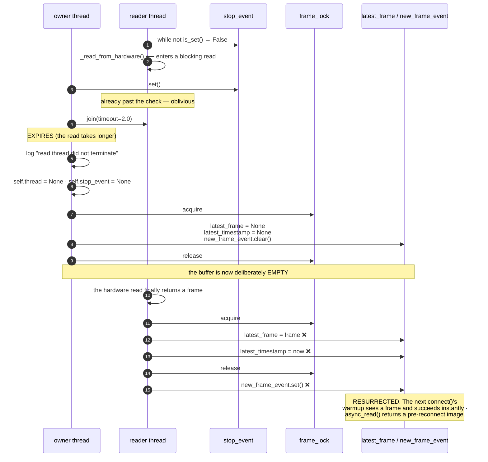
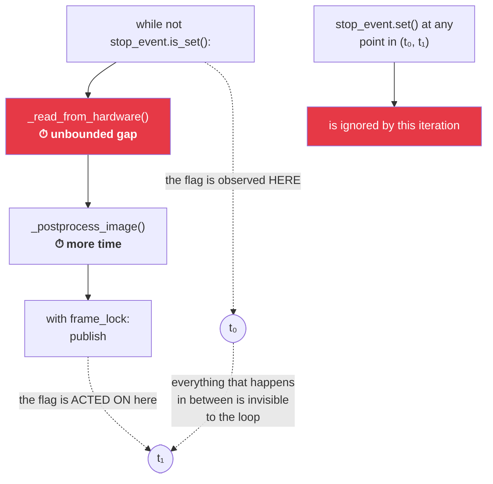
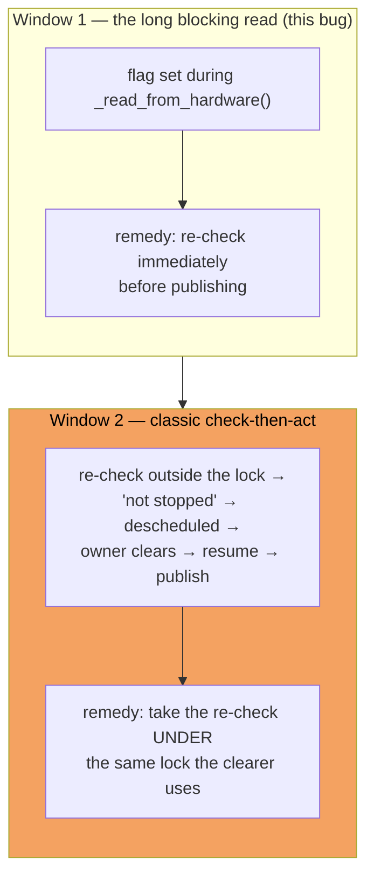
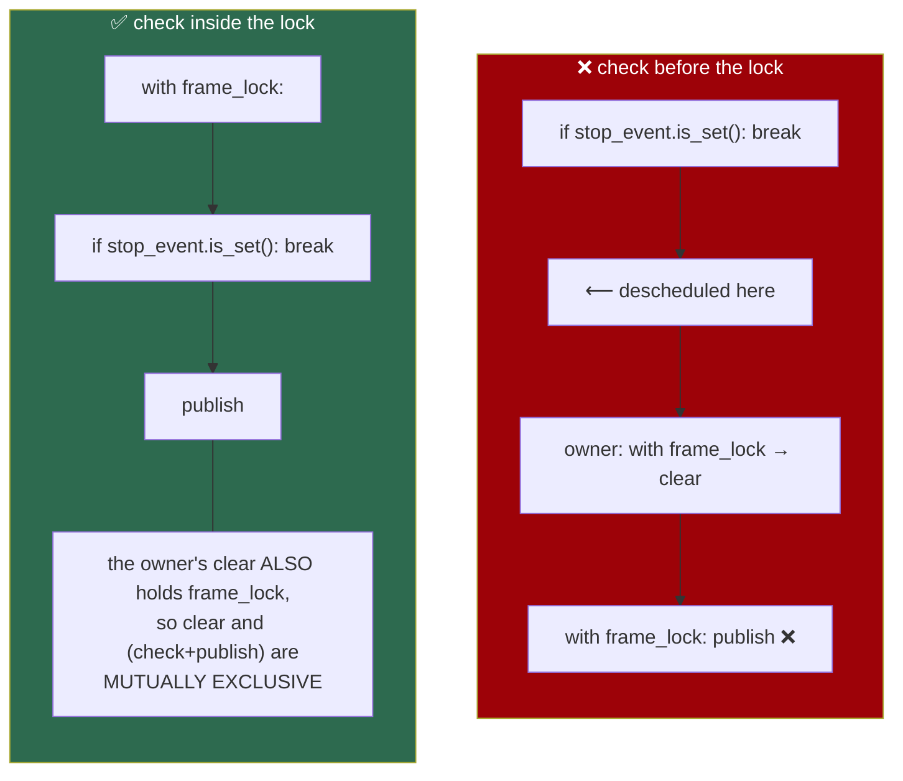
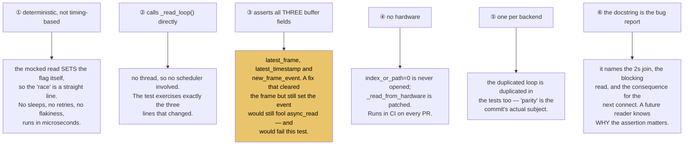
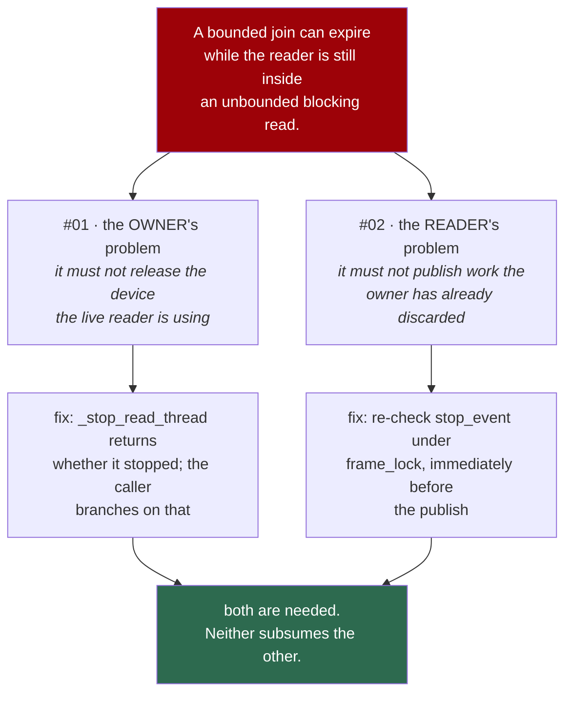

# 02 · 🔴 Hard — a late frame resurrected the buffer that `_stop_read_thread()` had cleared

**Branch:** `fix/camera-read-loop-stop-parity`
**Files:** `src/lerobot/cameras/opencv/camera_opencv.py`, `src/lerobot/cameras/zmq/camera_zmq.py`, `tests/cameras/test_opencv.py`, `tests/cameras/test_zmq.py`
**Commit:** `f9a410de` — *fix(cameras): don't publish a late frame after a stop was requested*
**Size:** 3 lines of production code per backend. 82 lines of test.

[← 01 · ZMQ cleanup](./01-zmq-cleanup-stops-read-thread.md) · [Index](./README.md) · Background: [intro 05 · Cameras](../intro/05-cameras.md)

---

## 1. Symptom

Intermittent, timing-dependent, and nasty: **a camera serves a frame from a previous
session as if it were fresh.**

Concretely, after a `disconnect()` whose join timed out, or after a reconnect cycle:

- `camera.latest_frame` is non-`None` even though `_stop_read_thread()` just set it to
  `None`;
- `camera.new_frame_event` is **set** even though it was just cleared;
- so the next `connect()`'s warmup loop succeeds *immediately* — it sees a frame and
  concludes the camera is alive — and the first `async_read()` returns a stale image
  without blocking;
- a policy or a dataset frame is therefore built from an image that may be seconds old,
  taken before the reconnect, possibly of a completely different scene.

There is no exception, no log line, and no stack trace. The only visible effect is a policy
that behaves as if it is looking slightly into the past.

---

## 2. Reproduction

The window is: *a stop is requested while a hardware read is in flight, and the read
returns after the owner has already cleared the buffer.*

```python
from threading import Event
from unittest.mock import patch
import numpy as np

from lerobot.cameras.zmq import ZMQCamera, ZMQCameraConfig

camera = ZMQCamera(ZMQCameraConfig(server_address="127.0.0.1", width=640, height=480, warmup_s=0))
camera.stop_event = Event()

def read_then_request_stop():
    camera.stop_event.set()                       # the stop lands while this read is in flight
    return np.zeros((480, 640, 3), np.uint8)

with patch.object(camera, "_read_from_hardware", side_effect=read_then_request_stop):
    camera._read_loop()

# before the fix:
assert camera.latest_frame is not None            # ← the buffer was repopulated
assert camera.new_frame_event.is_set()            # ← and advertised as fresh
```

Collapsing the race into a single deterministic call — making the mocked read set
`stop_event` itself — is the trick that turns an unreproducible production bug into a
one-line test. The mock *is* the interleaving.

---

## 3. The code before the fix

The read loop, identical in structure in both backends:

```python
# src/lerobot/cameras/opencv/camera_opencv.py:457
def _read_loop(self) -> None:
    stop_event = self.stop_event
    if stop_event is None:
        raise RuntimeError(f"{self}: stop_event is not initialized before starting read loop.")

    failure_count = 0
    while not stop_event.is_set():                  # ← checked ONCE per iteration, at the top
        try:
            raw_frame = self._read_from_hardware()  # ← BLOCKS, unbounded
            processed_frame = self._postprocess_image(raw_frame)
            capture_time = time.perf_counter()

            with self.frame_lock:
                self.latest_frame = processed_frame # ← publishes unconditionally
                self.latest_timestamp = capture_time
            self.new_frame_event.set()
            failure_count = 0

        except DeviceNotConnectedError:
            break
        except Exception as e:
            if failure_count <= 10:
                failure_count += 1
                logger.warning(f"Error reading frame in background thread for {self}: {e}")
            else:
                raise RuntimeError(f"{self} exceeded maximum consecutive read failures.") from e
```

And the stop function, which clears the buffer *under the lock*:

```python
def _stop_read_thread(self) -> None:
    if self.stop_event is not None:
        self.stop_event.set()

    if self.thread is not None and self.thread.is_alive():
        self.thread.join(timeout=2.0)
        if self.thread.is_alive():
            logger.warning(f"{self} read thread did not terminate within timeout.")

    self.thread = None
    self.stop_event = None

    with self.frame_lock:                 # ← the clear, holding frame_lock
        self.latest_frame = None
        self.latest_timestamp = None
        self.new_frame_event.clear()
```

Both functions are individually correct. The loop checks the stop flag before doing work;
the stopper sets the flag, waits, and clears the buffer under the lock. The defect lives
entirely in the interleaving.

---

## 4. Root cause

### The failing interleaving



### Why the top-of-loop check is not enough



A loop condition answers "should I start another iteration?" It does **not** answer "is the
work I just finished still wanted?" Those are different questions, and the code only asked
the first one.

### Why `_stop_read_thread`'s clear can't win the race

The clear happens *before* the late write, so "last writer wins" works against it. And
`_stop_read_thread` cannot simply clear *again* afterwards, because it has no idea when
"afterwards" is — the whole premise is that the join expired, i.e. it does not know when
the reader will return.

The only place with the information needed to make the right decision is the reader itself,
at the moment it is about to publish.

### The two race windows

There are actually two distinguishable hazards, and they need different remedies:



A fix that re-checks *before* `with self.frame_lock:` would close Window 1 and leave
Window 2 open. The actual fix closes both.

---

## 5. The fix

Three lines, in each of the two backends:

```diff
                 capture_time = time.perf_counter()

                 with self.frame_lock:
+                    # Under the lock, so a late frame cannot resurrect the buffer _stop_read_thread() cleared.
+                    if stop_event.is_set():
+                        break
                     self.latest_frame = processed_frame
                     self.latest_timestamp = capture_time
                 self.new_frame_event.set()
```

```python
# the resulting loop body
while not stop_event.is_set():
    try:
        raw_frame = self._read_from_hardware()
        processed_frame = self._postprocess_image(raw_frame)
        capture_time = time.perf_counter()

        with self.frame_lock:
            # Under the lock, so a late frame cannot resurrect the buffer _stop_read_thread() cleared.
            if stop_event.is_set():
                break
            self.latest_frame = processed_frame
            self.latest_timestamp = capture_time
        self.new_frame_event.set()
        failure_count = 0
    ...
```

### Why *inside* the `with` block

This is the whole design of the fix and it is worth being explicit about.



`_stop_read_thread()` does its clearing under `frame_lock`. By taking the check under that
same lock, the reader makes "observe the flag" and "write the buffer" a single critical
section with respect to the clear. Two orderings remain, and both are correct:

| Interleaving | Result |
|---|---|
| reader acquires first | flag not yet set → publishes → releases → owner clears afterwards → buffer empty ✅ |
| owner acquires first | owner clears → releases → reader acquires → flag **is** set → `break`, no publish ✅ |

There is no third case. The race is closed, not merely narrowed.

### Why `break` and not `continue` / `return`

- `break` exits the `while`, so `_read_loop` returns and the thread terminates — exactly
  what the stop requested.
- `continue` would re-evaluate `while not stop_event.is_set()` and also exit, so it is
  *behaviourally* the same here — but `break` states the intent ("we are done") rather than
  relying on the loop condition to notice.
- `return` from inside a `with` would work too; `break` keeps the single exit path through
  the end of the function.

Note also that `break` is placed so the frame is **dropped**, not stored-then-cleared. The
frame object is simply never published and is garbage after the iteration.

### `stop_event` is a local, deliberately

```python
stop_event = self.stop_event
if stop_event is None:
    raise RuntimeError(f"{self}: stop_event is not initialized before starting read loop.")
```

Both the loop condition and the new check read the **local** `stop_event`, not
`self.stop_event`. That matters because `_stop_read_thread()` sets `self.stop_event = None`,
and `_start_read_thread()` replaces it with a *new* `Event`. Reading the attribute would
mean a restarted camera's old reader could end up consulting the **new** session's event —
which is unset — and happily publish into the new session's buffer. Capturing the local
binds each reader to its own generation of the stop flag for its entire lifetime.

---

## 6. Why not the simpler fixes

| Candidate | Why it fails |
|---|---|
| Check `stop_event` right after `_read_from_hardware()` returns, before the lock | Closes Window 1, leaves Window 2 (check-then-act) wide open. Strictly worse than the real fix for the same amount of code. |
| Have `_stop_read_thread` clear the buffer *after* the join instead of before | It already does clear after the join. The problem is the join *expired* — there is no "after the thread actually stopped" moment available to the owner. |
| Make the join unbounded so a late write is impossible | An unbounded join hangs `disconnect()` on a wedged driver, taking the control loop with it. The repo keeps every join bounded on purpose. |
| Guard `async_read` instead: refuse to serve a frame when `thread is None` | `async_read` already checks `self.thread is None or not self.thread.is_alive()`. But `_stop_read_thread` sets `self.thread = None` *and then a new* `connect()` sets a live thread — at which point the guard passes and the stale frame is served. The staleness has to be prevented at write time, not filtered at read time. |
| Have `_start_read_thread` clear the buffer at startup | It already does. The bug is that the *old* reader can write after the *new* session cleared — this is precisely the `self.stop_event` vs local-`stop_event` subtlety above. Clearing at startup is necessary but not sufficient. |
| Use a sequence/generation number on each frame and have readers validate it | Correct, but a much larger change to the buffer protocol for no additional benefit over a 3-line flag check. |
| Rely on `latest_timestamp` + `read_latest(max_age_ms)` to reject stale frames | `read_latest` does reject old frames — but the resurrected frame's `latest_timestamp` is set to `time.perf_counter()` *at the moment of the late write*, so it looks brand new. Staleness of the *capture* is not what the timestamp records. |

---

## 7. The regression tests

One per backend, structurally identical, 30 lines each, no hardware.

### OpenCV

```python
def test_read_loop_does_not_publish_after_stop_requested():
    """A read landing after a stop was requested must not repopulate the frame buffer.

    `_stop_read_thread` gives up joining after 2s while a hardware read can block for
    longer, so a late frame would otherwise resurrect the buffer that was just cleared
    and be seen as a fresh frame by the next connect attempt.
    """
    config = OpenCVCameraConfig(index_or_path=0, warmup_s=0)
    camera = OpenCVCamera(config)
    camera.stop_event = Event()

    def read_then_request_stop():
        # the stop lands while this read is in flight
        camera.stop_event.set()
        return MagicMock()

    with (
        patch.object(camera, "_read_from_hardware", side_effect=read_then_request_stop),
        patch.object(camera, "_postprocess_image", return_value=np.zeros((480, 640, 3), np.uint8)),
    ):
        camera._read_loop()

    assert camera.latest_frame is None
    assert camera.latest_timestamp is None
    assert not camera.new_frame_event.is_set()
```

### ZMQ

```python
def test_read_loop_does_not_publish_after_stop_requested():
    """A read landing after a stop was requested must not repopulate the frame buffer.

    `_stop_read_thread` gives up joining after 2s while `recv_string` blocks for up to
    `timeout_ms`, so a late frame would otherwise resurrect the buffer that was just
    cleared and be seen as a fresh frame by the next connect attempt.
    """
    config = ZMQCameraConfig(server_address="127.0.0.1", width=640, height=480, warmup_s=0)
    camera = ZMQCamera(config)
    camera.stop_event = Event()

    def read_then_request_stop():
        camera.stop_event.set()
        return np.zeros((480, 640, 3), np.uint8)

    with patch.object(camera, "_read_from_hardware", side_effect=read_then_request_stop):
        camera._read_loop()

    assert camera.latest_frame is None
    assert camera.latest_timestamp is None
    assert not camera.new_frame_event.is_set()
```

### What makes these good tests



The OpenCV variant patches `_postprocess_image` as well, because the real one validates
frame dimensions and channel count against the configured capture size and would reject a
`MagicMock`. Patching it keeps the test focused on the publish decision rather than on
image validation.

---

## 8. Relationship to deep dive 01

The two camera bugs are the same underlying tension seen from opposite ends.



Fixing only #01 leaves a reader that resurrects buffers. Fixing only #02 leaves a socket
closed under a live `recv`. They were found together and fixed on separate branches
because they are separate defects with separate tests.

---

## 9. Generalisation

The pattern **"a worker publishes to shared state that an owner may concurrently
invalidate"** appears wherever LeRobot has a background producer. The audit question is
always the same:

> Between observing "I should keep going" and committing the result, can the owner have
> changed its mind? If so, re-check **under the lock that protects the state you are about
> to write**.

Places in the repo with this shape:

| Producer | Shared state | Invalidated by |
|---|---|---|
| `Camera._read_loop` (opencv, zmq, realsense, reachy2) | `latest_frame` / `new_frame_event` | `_stop_read_thread` |
| `AsyncImageWriter` workers (`datasets/image_writer.py`) | queued frames, temp files | `safe_stop_image_writer` on a loop exception |
| RL actor helper threads (`rl/actor.py`) | `transitions_queue`, `interactions_queue` | `shutdown_event` |
| Remote-inference client receive loop | the local action queue | session teardown / reconnect |

A reusable formulation, for anyone writing the next backend:

```python
with self.state_lock:
    if stop_event.is_set():     # the owner's clear also holds state_lock
        break                   # → check and write are mutually exclusive with it
    self.shared_state = result
self.ready_event.set()
```

And the companion checklist, from [intro 05 §8](../intro/05-cameras.md#8-implementing-a-camera-backend-the-checklist):

- [ ] A read returning *after* `stop_event` was set does not repopulate the buffer.
- [ ] The re-check is inside the same `with lock:` block as the write.
- [ ] The loop captures `stop_event` into a local so a restarted camera's old reader cannot
      consult the new session's flag.
- [ ] All three buffer fields (`frame`, `timestamp`, `ready event`) are asserted in the
      test, not just the frame.

---

Next: [03 · `DynamixelMotorsBus.write_calibration` never wrote `Drive_Mode`](./03-dynamixel-write-drive-mode.md)
