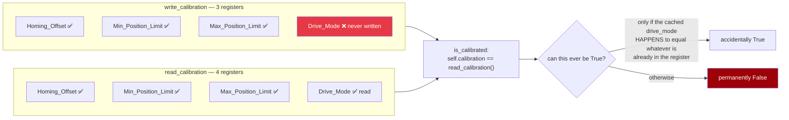
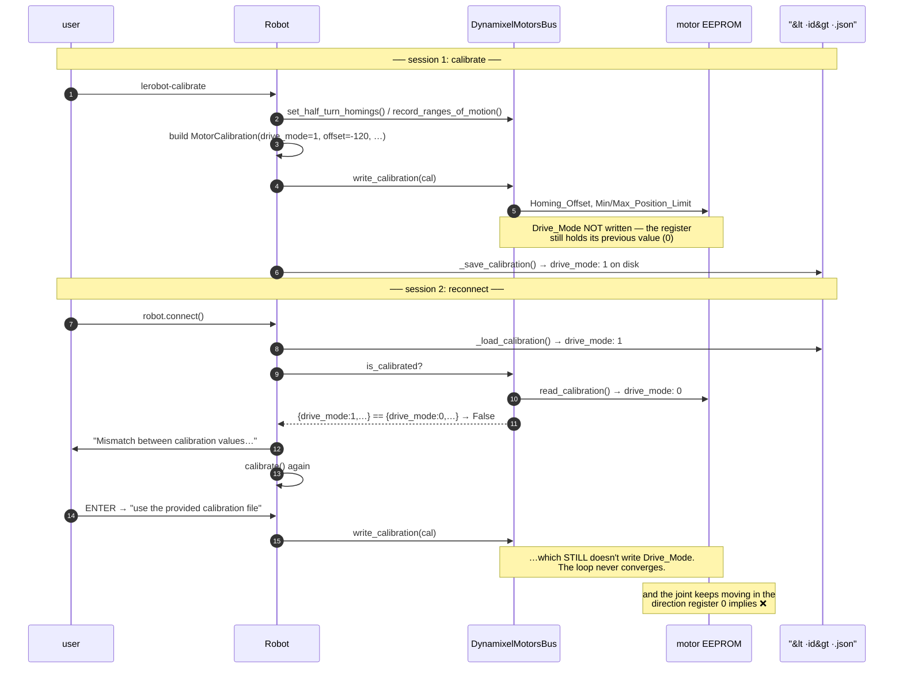
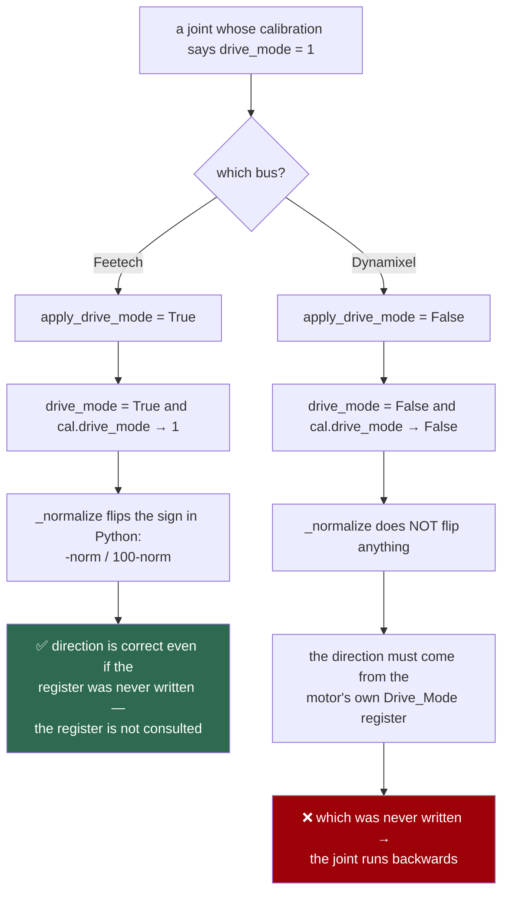
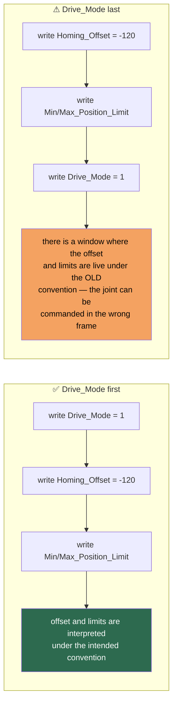

# 03 · 🟠 Medium — `DynamixelMotorsBus.write_calibration` never wrote `Drive_Mode`

**Branch:** `fix/dynamixel-write-drive-mode`
**Files:** `src/lerobot/motors/dynamixel/dynamixel.py`, `tests/motors/test_dynamixel.py`
**Commit:** `3c251ecb` — *fix(motors): write Drive_Mode back in `DynamixelMotorsBus.write_calibration`*
**Size:** 1 line of production code (+ a 4-line comment). 36 lines of test.

[← 02 · Camera stop parity](./02-camera-read-loop-stop-parity.md) · [Index](./README.md) · Background: [intro 06 · Motors & Calibration](../intro/06-motors-and-calibration.md)

---

## 1. Symptom

Two symptoms, one cause, on any Dynamixel-based robot (Koch, OMX, OpenArm, …):

**A. `is_calibrated` is permanently `False`.** Every `connect()` decides the robot needs
calibrating and — on robots that auto-calibrate — re-runs the interactive sweep, or prints
the mismatch warning, forever:

```
Mismatch between calibration values in the motor and the calibration file
or no calibration file found
```

You calibrate. You save. You reconnect. The same message. The calibration file on disk is
correct; the robot refuses to believe it.

**B. An inverted joint runs backwards.** This is the dangerous one. If calibration recorded
`drive_mode=1` for a joint (a motor physically mounted so that increasing encoder counts
move it the "wrong" way), reusing that saved calibration leaves the motor's own
`Drive_Mode` register at whatever it was — and **nothing in LeRobot compensates**, because
`DynamixelMotorsBus.apply_drive_mode` is `False`. Commanding "move up" moves the joint
down.

Symptom A is annoying. Symptom B moves a physical arm in the wrong direction.

---

## 2. Reproduction

```python
from lerobot.motors import Motor, MotorCalibration, MotorNormMode
from lerobot.motors.dynamixel import DynamixelMotorsBus

bus = DynamixelMotorsBus(port="/dev/ttyUSB0", motors={"j1": Motor(1, "xl330-m077", MotorNormMode.DEGREES)})
bus.connect()

cal = {"j1": MotorCalibration(id=1, drive_mode=1, homing_offset=-120, range_min=900, range_max=3200)}
bus.write_calibration(cal)          # writes Homing_Offset, Min/Max_Position_Limit … and NOT Drive_Mode

print(bus.calibration == bus.read_calibration())
# False  ← read_calibration() reports the motor's ACTUAL Drive_Mode (0), not the 1 we asked for
print(bus.is_calibrated)
# False  ← forever
```

Using the real robot path: calibrate a Koch arm with an inverted joint, accept the saved
calibration file on the next connect, and watch that joint move the wrong way.

---

## 3. The code before the fix

The reader and the writer, side by side — this is the entire bug:

```python
# src/lerobot/motors/dynamixel/dynamixel.py

@property
def is_calibrated(self) -> bool:
    return self.calibration == self.read_calibration()        # ← a field-by-field equality

def read_calibration(self) -> dict[str, MotorCalibration]:
    offsets     = self.sync_read("Homing_Offset",      normalize=False)
    mins        = self.sync_read("Min_Position_Limit", normalize=False)
    maxes       = self.sync_read("Max_Position_Limit", normalize=False)
    drive_modes = self.sync_read("Drive_Mode",         normalize=False)   # ← READ (4 registers)

    calibration = {}
    for motor, m in self.motors.items():
        calibration[motor] = MotorCalibration(
            id=m.id,
            drive_mode=int(drive_modes[motor]),                           # ← and used
            homing_offset=int(offsets[motor]),
            range_min=int(mins[motor]),
            range_max=int(maxes[motor]),
        )
    return calibration

def write_calibration(self, calibration_dict: dict[str, MotorCalibration], cache: bool = True) -> None:
    for motor, calibration in calibration_dict.items():
        self.write("Homing_Offset",      motor, calibration.homing_offset)
        self.write("Min_Position_Limit", motor, calibration.range_min)
        self.write("Max_Position_Limit", motor, calibration.range_max)
        #                                                             ← WROTE only 3 registers
    if cache:
        self.calibration = calibration_dict
```

And the field that makes `drive_mode` load-bearing on *this* bus specifically:

```python
class DynamixelMotorsBus(SerialMotorsBus):
    apply_drive_mode = False          # ← the firmware owns the direction convention
```

```python
class FeetechMotorsBus(SerialMotorsBus):
    apply_drive_mode = True           # ← LeRobot flips the sign in software
```

How `apply_drive_mode` is consumed, in `SerialMotorsBus._normalize` / `_unnormalize`:

```python
drive_mode = self.apply_drive_mode and self.calibration[motor].drive_mode
...
normalized_values[id_] = -norm if drive_mode else norm        # RANGE_M100_100
normalized_values[id_] = 100 - norm if drive_mode else norm   # RANGE_0_100
```

---

## 4. Root cause

### The broken round-trip



A `MotorCalibration` is a plain dataclass, so `==` compares all five fields:

```python
@dataclass
class MotorCalibration:
    id: int
    drive_mode: int
    homing_offset: int
    range_min: int
    range_max: int
```

So if `drive_mode` differs, the whole comparison is `False` — and since nothing ever wrote
it, it differs whenever the recorded value differs from the device's current value.

### The lifecycle consequence



### Why the direction is not compensated



`False and 1` evaluates to `False`, so on Dynamixel the cached `drive_mode` has **zero**
effect in software. It is purely a mirror of a hardware register — which makes writing it
to the hardware the only way it can mean anything.

This is why the identical omission in `FeetechMotorsBus.write_calibration` would be
*harmless*: there, `drive_mode` is a software parameter and the cached value is
authoritative. Same missing line, completely different severity. That asymmetry is exactly
what made the bug survive: a reviewer comparing the two buses would see "neither writes
Drive_Mode, so it must be fine".

---

## 5. The fix

```diff
     def write_calibration(self, calibration_dict: dict[str, MotorCalibration], cache: bool = True) -> None:
         for motor, calibration in calibration_dict.items():
+            # `Drive_Mode` selects the direction convention that `Homing_Offset` and the position
+            # limits are expressed in, and `read_calibration()` reads it back. Omitting it here left
+            # `is_calibrated` permanently False -- and the joint running backwards, since
+            # `apply_drive_mode` is False for Dynamixel so nothing compensates it in software.
+            self.write("Drive_Mode", motor, calibration.drive_mode)
             self.write("Homing_Offset", motor, calibration.homing_offset)
             self.write("Min_Position_Limit", motor, calibration.range_min)
             self.write("Max_Position_Limit", motor, calibration.range_max)

         if cache:
             self.calibration = calibration_dict
```

### Order matters: `Drive_Mode` goes first

The comment's first clause states why: *"`Drive_Mode` selects the direction convention that
`Homing_Offset` and the position limits are expressed in."*



Writing the convention *before* the values expressed in it is simply the correct ordering,
and it costs nothing.

### Why the comment is four lines for a one-line fix

Because the line looks removable. A future reader seeing
`self.write("Drive_Mode", motor, calibration.drive_mode)` in the Dynamixel bus, and *not*
in the Feetech bus, will reasonably wonder whether it is a copy-paste artifact. The comment
pre-answers that: it names `read_calibration()` (the symmetry argument), `is_calibrated`
(the symptom), and `apply_drive_mode` (why Dynamixel differs from Feetech).

This is the right amount of comment for a line whose *absence* was the bug.

---

## 6. Why not the simpler fixes

| Candidate | Why it fails |
|---|---|
| Drop `drive_mode` from `read_calibration()` so the comparison stops failing | Fixes symptom A, keeps symptom B — and makes it *undetectable*. The robot would now report `is_calibrated == True` while the joint runs backwards. Strictly worse than the bug. |
| Exclude `drive_mode` from the equality (custom `__eq__` on `MotorCalibration`) | Same objection, plus it breaks `MotorCalibration` equality everywhere else, including the test that asserts `bus.calibration == dummy_calibration`. |
| Set `apply_drive_mode = True` for Dynamixel | Would make LeRobot flip the sign in software **on top of** whatever the firmware does. Where the register happens to already be correct, you would get a double inversion. It also silently changes the meaning of every existing Dynamixel calibration file. |
| Write `Drive_Mode` in `reset_calibration()` only | `reset_calibration` sets offset 0 and the full range; it is the *factory-reset* path. It does not help the "apply this saved calibration" path, which is the one `connect()` uses. |
| Have `calibrate()` write `Drive_Mode` directly, bypassing `write_calibration` | Fixes the fresh-calibration path and not the reuse-saved-file path — and the reuse path is the common one (`write_calibration(self.calibration)` when the user presses ENTER). The fix belongs in the shared writer. |
| Also add the line to `FeetechMotorsBus` for symmetry | Defensible, but Feetech's `write_calibration` is a different method with different semantics (`apply_drive_mode = True`), and changing what it writes to EEPROM is a behaviour change with no bug behind it. Out of scope for a fix branch. |

The chosen fix restores the round-trip invariant, which simultaneously resolves both
symptoms. That is the signature of a correct fix rather than a patch: *one* change, *both*
symptoms.

---

## 7. The regression test

```python
def test_write_calibration_writes_drive_mode(mock_motors, dummy_motors, dummy_calibration):
    """`Drive_Mode` must be written back, because `read_calibration()` reads it.

    Without it `is_calibrated` can never become True for a device that calibrates an inverted
    joint, and the joint keeps running in the stale direction -- `apply_drive_mode` is False for
    Dynamixel, so nothing compensates for it in software.
    """
    write_stubs = []
    for motor in dummy_motors.values():
        calibration = dummy_calibration[next(name for name, m in dummy_motors.items() if m.id == motor.id)]
        write_stubs += [
            mock_motors.build_write_stub(
                *X_SERIES_CONTROL_TABLE["Drive_Mode"], motor.id, calibration.drive_mode
            ),
            mock_motors.build_write_stub(
                *X_SERIES_CONTROL_TABLE["Homing_Offset"],
                motor.id,
                encode_twos_complement(calibration.homing_offset, 4),
            ),
            mock_motors.build_write_stub(
                *X_SERIES_CONTROL_TABLE["Min_Position_Limit"], motor.id, calibration.range_min
            ),
            mock_motors.build_write_stub(
                *X_SERIES_CONTROL_TABLE["Max_Position_Limit"], motor.id, calibration.range_max
            ),
        ]

    bus = DynamixelMotorsBus(port=mock_motors.port, motors=dummy_motors)
    bus.connect(handshake=False)

    bus.write_calibration(dummy_calibration)

    assert all(mock_motors.stubs[stub].called for stub in write_stubs)
    assert bus.calibration == dummy_calibration
```

### What makes this a good test

```mermaid
flowchart TD
    A["① asserts at the PROTOCOL level"] --> A1["build_write_stub(*X_SERIES_CONTROL_TABLE['Drive_Mode'],<br/>motor.id, value) encodes address + length + id + value.<br/>A regression that writes the right value to the<br/>WRONG register fails."]
    B["② uses the control table, not literals"] --> B1["*X_SERIES_CONTROL_TABLE['Drive_Mode'] → (10, 1).<br/>If the table is ever corrected, the test<br/>follows it instead of contradicting it."]
    C["③ encodes the sign explicitly"] --> C1["encode_twos_complement(homing_offset, 4) documents<br/>that a negative offset goes on the wire as<br/>two's complement — the encoding is part of<br/>the asserted contract."]
    D["④ asserts ALL FOUR registers"] --> D1["not just the new one. A future change that<br/>adds Drive_Mode but drops a limit write<br/>still fails."]
    E["⑤ asserts the cache too"] --> E1["bus.calibration == dummy_calibration closes<br/>the cache=True half of the method."]
    F["⑥ no hardware"] --> F1["mock_motors is a stubbed serial device;<br/>handshake=False skips the ping phase<br/>so no motor has to answer."]
    G["⑦ the docstring states the stake"] --> G1["'the joint keeps running in the stale<br/>direction' — a future reader knows this<br/>test guards physical behaviour, not tidiness."]

    style A1 fill:#e9c46a,color:#000
    style D1 fill:#e9c46a,color:#000
```



### What it does *not* assert — and why that's a reasonable line to draw

The test does not assert the **order** of the four writes, even though §5 argues the order
matters. Asserting order with `build_write_stub` would mean checking a call sequence rather
than a set of calls, which couples the test to an implementation detail that is correct
today for a reason the comment already records. A stricter test would be defensible; the
current one covers the invariant that actually broke.

### The lookup, explained

```python
calibration = dummy_calibration[next(name for name, m in dummy_motors.items() if m.id == motor.id)]
```

`dummy_motors` is `{name: Motor}` and `dummy_calibration` is `{name: MotorCalibration}`,
but the loop iterates over `Motor` *values*. The generator maps back from `motor.id` to the
name so the right calibration is paired with the right motor id — the test is asserting
per-motor values, not one shared value.

---

## 8. Generalisation

> **Any `write_X` / `read_X` pair that is compared for equality must cover the same field
> set.**

This generalises well beyond motors. The audit, for every bus in `src/lerobot/motors/`:

| Bus | `apply_drive_mode` | `read_calibration` reads | `write_calibration` must write |
|---|---|---|---|
| `DynamixelMotorsBus` | `False` | Homing_Offset, Min/Max_Position_Limit, Drive_Mode | all four ✅ (after this fix) |
| `FeetechMotorsBus` | `True` | (its own field set) | the same field set |
| `damiao`, `robstride` (CAN) | — | — | verify the same way |

The generic test you can write once per bus:

```python
def test_calibration_round_trips(bus, cal):
    bus.write_calibration(cal)
    assert bus.read_calibration() == cal     # ← the invariant, stated directly
    assert bus.is_calibrated
```

That single assertion would have caught this bug on day one, and it catches the next
missing field for free — which is why
[intro 06 §9](../intro/06-motors-and-calibration.md#9-checklist-adding-a-motor-family)
lists it as a requirement for adding a motor family.

The same shape, elsewhere in the repo:

| Pair | Compared how |
|---|---|
| `ProcessorStep.get_config()` / `_instantiate_step()` | a config key that is written but not accepted on load → `from_pretrained` fails |
| `ProcessorStep.state_dict()` / `load_state_dict()` | a tensor saved but not restored → silently wrong normalization |
| `LeRobotDataset` `features` / `build_dataset_frame` | a feature declared but never populated → a column of nulls |
| `Robot.observation_features` / `get_observation()` | the invariant `SOFollower._cameras_ft` calls out in a comment: *"Same predicate as `get_observation()`, so the two key sets always agree."* |

In every case the rule is the same: **test the round-trip, not each half.**

---

Next: [04 · Both bimanual arms shared one calibration file](./04-bimanual-calibration-id-collision.md)
