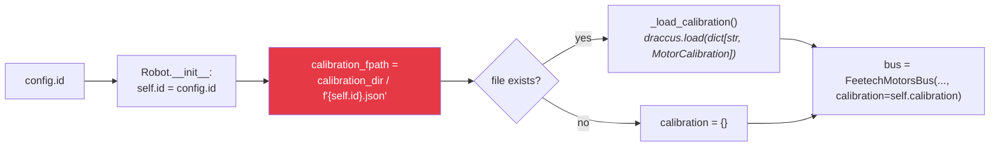
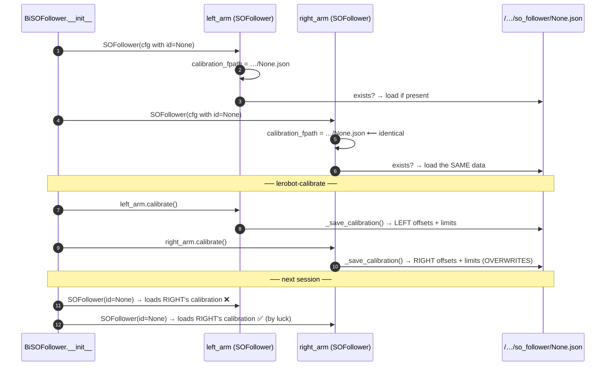
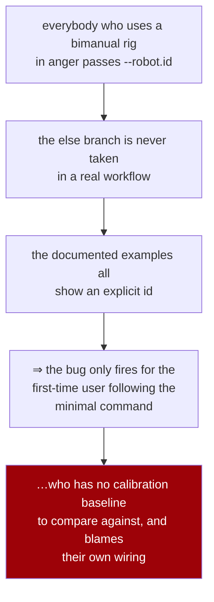
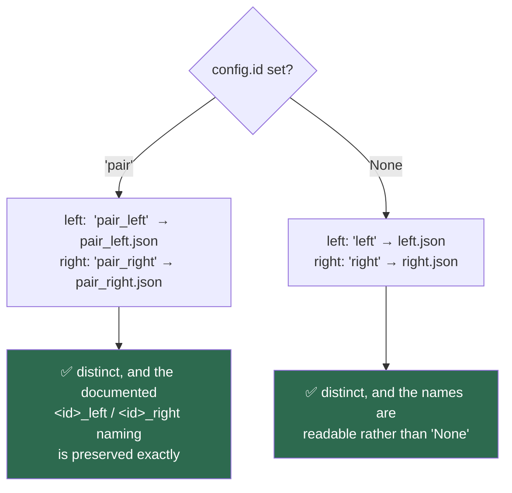
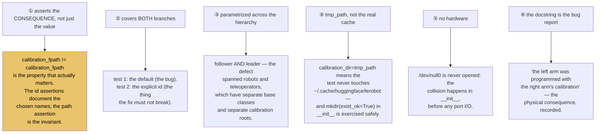
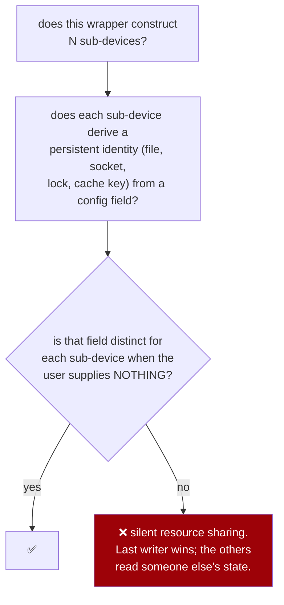

# 04 · 🟠 Medium — both bimanual arms defaulted to `id=None`, i.e. one shared `None.json`

**Branch:** `fix/bimanual-calibration-id-collision`
**Files:** 7 production files (3 robots, 4 teleoperators) + `tests/robots/test_bimanual_calibration_ids.py`
**Commit:** `94a83305` — *fix(robots): give each bimanual arm its own calibration file by default*
**Size:** 14 changed lines (one token each, in 14 places). 73 lines of test.

[← 03 · Dynamixel Drive_Mode](./03-dynamixel-write-drive-mode.md) · [Index](./README.md) · Background: [intro 04 · Robots & Teleoperators](../intro/04-robots-and-teleoperators.md)

---

## 1. Symptom

On **any** bimanual device used without an explicit `--robot.id` / `--teleop.id`:

```bash
lerobot-calibrate --robot.type=bi_so_follower \
  --robot.left_arm_config.port=/dev/ttyACM0 \
  --robot.right_arm_config.port=/dev/ttyACM1
```

- Calibrating the pair writes the left arm's calibration to
  `~/.cache/huggingface/lerobot/calibration/robots/so_follower/None.json`, then the right
  arm's calibration to **the same file**, overwriting it.
- On the next `connect()`, both arms load that one file — so **the left arm is programmed
  with the right arm's homing offsets and joint limits.**
- The left arm's zero is wrong, its software limits are wrong, and if the two arms are
  mirrored (the usual mounting), its motion can be inverted.
- `is_calibrated` is `False` for one of the two arms at every connect, because its motors
  hold values that no longer match the shared file.

The arm physically moves to the wrong places. There is no error message anywhere — both
`_load_calibration()` and `_save_calibration()` did exactly what they were asked.

---

## 2. Reproduction

```python
from lerobot.robots.bi_so_follower import BiSOFollower, BiSOFollowerConfig
from lerobot.robots.so_follower import SOFollowerConfig

device = BiSOFollower(BiSOFollowerConfig(
    calibration_dir="/tmp/cal",
    left_arm_config=SOFollowerConfig(port="/dev/null0"),
    right_arm_config=SOFollowerConfig(port="/dev/null1"),
))

print(device.left_arm.id)                 # before: None
print(device.right_arm.id)                # before: None
print(device.left_arm.calibration_fpath)  # before: /tmp/cal/None.json
print(device.right_arm.calibration_fpath) # before: /tmp/cal/None.json   ← SAME FILE
```

No hardware, no ports opened — `/dev/null0` is never touched, because the collision happens
in `__init__`, before any I/O.

All seven affected device types reproduce identically:

| Robots | Teleoperators |
|---|---|
| `bi_so_follower` | `bi_so_leader` |
| `bi_openarm_follower` | `bi_openarm_leader` |
| `bi_rebot_b601_follower` | `bi_openarm_mini` |
| | `bi_rebot_102_leader` |

---

## 3. The code before the fix

Every bimanual wrapper builds two per-arm configs from one top-level config. The `id`
derivation was the same everywhere:

```python
# src/lerobot/robots/bi_so_follower/bi_so_follower.py:53
left_arm_config = SOFollowerRobotConfig(
    id=f"{config.id}_left" if config.id else None,      # ← the defect
    calibration_dir=config.calibration_dir,
    port=config.left_arm_config.port,
    ...
)

right_arm_config = SOFollowerRobotConfig(
    id=f"{config.id}_right" if config.id else None,     # ← the same defect
    calibration_dir=config.calibration_dir,
    port=config.right_arm_config.port,
    ...
)

self.left_arm  = SOFollower(left_arm_config)
self.right_arm = SOFollower(right_arm_config)
```

And the base class that turns `id` into a filename, eagerly, at construction:

```python
# src/lerobot/robots/robot.py:45
def __init__(self, config: RobotConfig):
    self.robot_type = self.name
    self.id = config.id
    self.calibration_dir = (
        config.calibration_dir if config.calibration_dir
        else HF_LEROBOT_CALIBRATION / ROBOTS / self.name
    )
    self.calibration_dir.mkdir(parents=True, exist_ok=True)
    self.calibration_fpath = self.calibration_dir / f"{self.id}.json"   # ← "None.json"
    self.calibration: dict[str, MotorCalibration] = {}
    if self.calibration_fpath.is_file():
        self._load_calibration()                                        # ← eager load
```

`Teleoperator.__init__` is the same, under `HF_LEROBOT_CALIBRATION / TELEOPERATORS`.

Note what the conditional expression *looks* like it is doing. The `if config.id` guard
reads as "only add a suffix if there is something to suffix" — which is reasonable for a
display name. It is wrong for an identifier that names a file, because the fallback is a
**shared constant**.

---

## 4. Root cause

### `id` is the primary key of a calibration file



`str(None)` is `"None"`, so `id=None` resolves to a perfectly valid path. Nothing rejects
it; nothing warns. Two `SOFollower` instances with `id=None` and the same
`calibration_dir` are, from the filesystem's point of view, the same device.

### The collision, step by step



The left arm's calibration is not merely missing — it is **replaced by plausible-looking
values from a different arm**. That is the worst failure mode available: no file-not-found,
no schema error, no empty dict. Six motors, five sensible-looking integers each. The arm
confidently moves to the wrong coordinates.

### Why it hid so well



Add to that: the `if config.id else None` idiom appeared **14 times across 7 files**, so it
read as an established convention rather than a mistake. Consistency is not correctness.

---

## 5. The fix

One token, fourteen times:

```diff
         left_arm_config = SOFollowerRobotConfig(
-            id=f"{config.id}_left" if config.id else None,
+            id=f"{config.id}_left" if config.id else "left",
             calibration_dir=config.calibration_dir,
```

```diff
         right_arm_config = SOFollowerRobotConfig(
-            id=f"{config.id}_right" if config.id else None,
+            id=f"{config.id}_right" if config.id else "right",
             calibration_dir=config.calibration_dir,
```

Applied to all seven device types:

| File | Changes |
|---|---|
| `src/lerobot/robots/bi_so_follower/bi_so_follower.py` | 2 |
| `src/lerobot/robots/bi_openarm_follower/bi_openarm_follower.py` | 2 |
| `src/lerobot/robots/bi_rebot_b601_follower/bi_rebot_b601_follower.py` | 2 |
| `src/lerobot/teleoperators/bi_so_leader/bi_so_leader.py` | 2 |
| `src/lerobot/teleoperators/bi_openarm_leader/bi_openarm_leader.py` | 2 |
| `src/lerobot/teleoperators/bi_openarm_mini/bi_openarm_mini.py` | 2 |
| `src/lerobot/teleoperators/bi_rebot_102_leader/bi_rebot_102_leader.py` | 2 |

### Resulting behaviour



Three properties that make `"left"` / `"right"` the right choice:

1. **Distinct by construction.** Not "distinct if the user remembers a flag".
2. **Backwards compatible for explicit ids.** The `if config.id` branch is untouched, so
   every existing `pair_left.json` / `pair_right.json` keeps working.
3. **Human-readable.** `left.json` tells you what it is. `None.json` tells you somebody
   forgot something.

### What about existing `None.json` files?

They are orphaned, not corrupted — nothing reads them any more. The first connect after the
fix finds no `left.json`, reports "no calibration file found", and runs calibration. That
is the correct outcome: the old file contained one arm's calibration masquerading as both,
so it *should* be discarded. A migration that split it in two would be guessing which arm
it actually belonged to.

---

## 6. Why not the simpler fixes

| Candidate | Why it fails |
|---|---|
| Make `id` a required field on bimanual configs | A breaking CLI change for every existing user and every doc example, to fix a default. Defaults exist so the minimal command works. |
| Raise if `config.id is None` | Same objection, plus it makes the quickstart path fail with a config error instead of just working. |
| Derive the suffix from the port (`id=f"{port}_left"`) | Ports are unstable (`/dev/ttyACM0` swaps between boots) and contain `/`, which is illegal in a filename. Calibration would un-stick itself whenever the enumeration order changed. |
| Put each arm in its own `calibration_dir` subdirectory | Equivalent in effect, but larger: `calibration_dir` is a user-facing config field, and nesting it silently would surprise anyone who points it at a known location. The `id` *is* the designed discriminator — use it. |
| Keep `None` but have `Robot.__init__` reject it | Would break every single-arm robot, which legitimately defaults to `id=None` and gets a `None.json` of its own. The collision is specific to two sibling instances sharing a directory. |
| Generate a UUID when `id` is `None` | Calibration would never be found again on the next run — the file name has to be stable across sessions. |
| Fix only `bi_so_follower` (the one that was noticed) | Six other device types have the identical defect. A fix branch for a copy-pasted bug has to cover every copy. |

The chosen fix is the minimum change that makes the *default* correct while leaving the
*explicit* path byte-identical.

---

## 7. The regression tests

`tests/robots/test_bimanual_calibration_ids.py` — new file, two parametrized tests covering
a follower and a teleoperator.

```python
def _bi_so_follower(calibration_dir):
    return BiSOFollower(BiSOFollowerConfig(
        calibration_dir=calibration_dir,
        left_arm_config=SOFollowerConfig(port="/dev/null0"),
        right_arm_config=SOFollowerConfig(port="/dev/null1"),
    ))


def _bi_so_leader(calibration_dir):
    return BiSOLeader(BiSOLeaderConfig(
        calibration_dir=calibration_dir,
        left_arm_config=SOLeaderConfig(port="/dev/null0"),
        right_arm_config=SOLeaderConfig(port="/dev/null1"),
    ))


@pytest.mark.parametrize("make_device", [_bi_so_follower, _bi_so_leader], ids=["follower", "leader"])
def test_arms_do_not_share_a_calibration_file_without_an_explicit_id(make_device, tmp_path):
    """Both arms used to fall back to `id=None`, i.e. the same `None.json`.

    Calibrating a pair then left the right arm's homing offsets and limits in the file the
    left arm reads back, so the left arm was programmed with the right arm's calibration.
    """
    device = make_device(tmp_path)

    assert device.left_arm.id == "left"
    assert device.right_arm.id == "right"
    assert device.left_arm.calibration_fpath != device.right_arm.calibration_fpath


@pytest.mark.parametrize("make_device", [_bi_so_follower, _bi_so_leader], ids=["follower", "leader"])
def test_explicit_id_still_prefixes_each_arm(make_device, tmp_path):
    """An explicit id keeps the documented `<id>_left` / `<id>_right` naming."""
    device = make_device(tmp_path)
    device.config.id = "pair"
    rebuilt = type(device)(device.config)

    assert rebuilt.left_arm.id == "pair_left"
    assert rebuilt.right_arm.id == "pair_right"
    assert rebuilt.left_arm.calibration_fpath != rebuilt.right_arm.calibration_fpath
```

### What makes these good tests



### The `rebuilt = type(device)(device.config)` trick

```python
device = make_device(tmp_path)
device.config.id = "pair"
rebuilt = type(device)(device.config)
```

Mutating `device.config.id` after construction would *not* change `device.left_arm.id` —
the per-arm configs were already built in `__init__`. So the test reconstructs the wrapper
from the mutated config. `type(device)` keeps the helper generic across the two
parametrized cases without a second factory function.

This also quietly documents a real property of the design: **per-arm ids are frozen at
construction.** Changing `config.id` on a live object has no effect, which is worth knowing
before you try it in a debugger.

### Coverage gap, honestly stated

Only `bi_so_follower` and `bi_so_leader` are tested; the other five device types received
the same one-token fix without a test. Extending the parametrize list would be
straightforward (`_bi_openarm_follower`, `_bi_rebot_b601_follower`, …) and is the obvious
next improvement — the two tested cases cover the two *base classes*, which is the
structural axis, but not every copy of the idiom.

---

## 8. Generalisation

> **A value that names a persistent resource must be unique per instance by construction —
> never by a user-supplied flag, and never with a shared constant as its fallback.**

The grep that finds the rest of this bug class:

```bash
rg 'if config\.id else None'           # the exact idiom
rg 'f"\{config\.id\}_'                 # id-derived identifiers
rg 'calibration_dir / f"\{.*\}\.json"' # anything that turns an id into a path
```

The audit question for any composite device:



Other places in this repo with the same shape, worth checking:

| Composite | Sub-device identity | Risk |
|---|---|---|
| `bi_*` robots/teleoperators | `<id>_left` / `<id>_right` → `<id>.json` | **this bug** |
| `hope_jr` (arm + hand) | two devices under one wrapper | same question applies |
| `unitree_g1` embodiments | multiple sub-controllers | same question applies |
| `BiSOFollower` **camera** keys | `left_` / `right_` prefixes + top-level | already guarded — see below |

The camera-key case is instructive, because the *same file* gets it right:

```python
self._top_level_cam_keys = set(config.cameras)
_collisions = (self._top_level_cam_keys & set(config.left_arm_config.cameras)
               | self._top_level_cam_keys & set(config.right_arm_config.cameras))
if _collisions:
    raise ValueError(f"Top-level camera names collide with per-arm camera names: {sorted(_collisions)}")
```

An explicit collision check, because `{**a, **b}` would silently drop a duplicate key. The
author of that check reasoned about exactly the right hazard for camera names — and the
`id=None` fallback eight lines below had the identical hazard, unguarded. **Being careful
in one place does not transfer.**

A structural defence, if this class of bug recurs: have `Robot.__init__` refuse an `id` that
would collide with a sibling already constructed in the same `calibration_dir` during the
same wrapper `__init__`. That is more machinery than the problem currently warrants, but it
is the version that cannot be forgotten.

---

Next: [05 · The kinematics "missing joints" guard was unreachable](./05-kinematics-empty-joints-guard.md)
