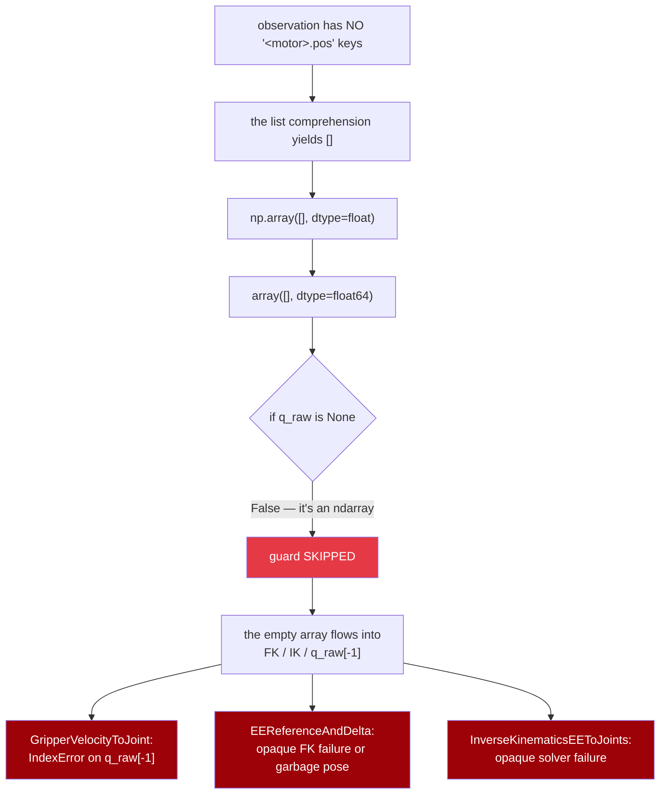
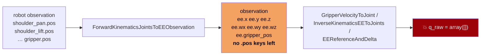
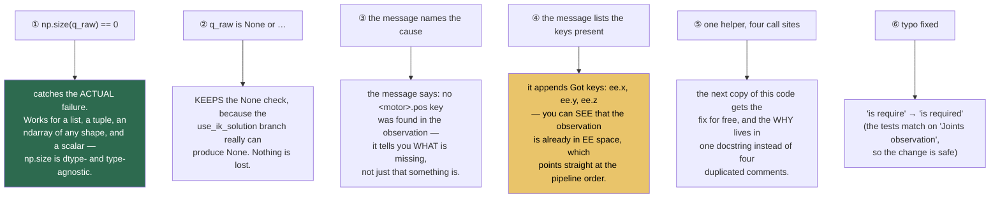
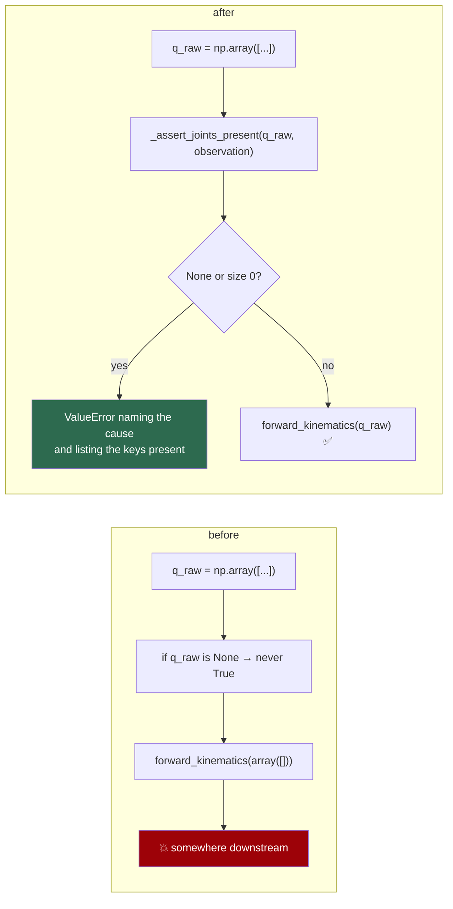
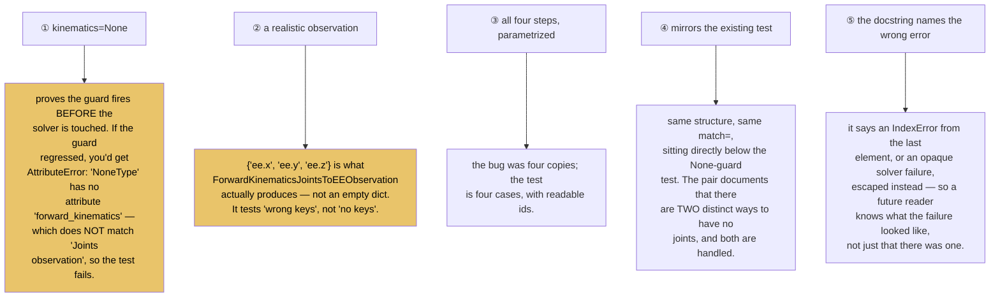

# 05 · 🟠 Medium — the kinematics "joints observation is required" guard was unreachable

**Branch:** `fix/kinematics-empty-joints-guard`
**Files:** `src/lerobot/robots/so_follower/robot_kinematic_processor.py`, `tests/robots/test_robot_kinematic_processor.py`
**Commit:** `82e11dbe` — *fix(so_follower): make the kinematics joints guard reachable*
**Size:** 13 lines added, 8 removed (one helper replacing four copies of a dead check). 32 lines of test.

[← 04 · Bimanual calibration ids](./04-bimanual-calibration-id-collision.md) · [Index](./README.md) · Background: [intro 08 · Processor Pipeline](../intro/08-processor-pipeline.md)

---

## 1. Symptom

Build an end-effector-space pipeline that maps the observation to EE coordinates *before* a
kinematics step — which is the natural thing to do when you want to record EE-space
datasets — and you get one of these instead of a useful error:

```
IndexError: index -1 is out of bounds for axis 0 with size 0
```

```
# or, from the FK/IK solver, with an empty joint vector:
ValueError: operands could not be broadcast together with shapes (0,) (6,)
# or a silent garbage pose
```

The code *contains* a guard whose entire purpose is to produce a clear message in exactly
this situation:

```python
if q_raw is None:
    raise ValueError("Joints observation is require for computing robot kinematics")
```

It never fires. Four copies of it, in four processor steps, all dead.

---

## 2. Reproduction

```python
from lerobot.processor.converters import create_transition
from lerobot.robots.so_follower.robot_kinematic_processor import GripperVelocityToJoint

step = GripperVelocityToJoint()

# an observation that has already been mapped to EE space — no "<motor>.pos" keys left
transition = create_transition(
    action={"ee.x": 0.0, "ee.y": 0.0, "ee.z": 0.0, "ee.gripper_vel": 0.0, ...},
    observation={"ee.x": 0.0, "ee.y": 0.0, "ee.z": 0.0},
)

step(transition)
# before the fix: IndexError: index -1 is out of bounds for axis 0 with size 0
# after the fix:  ValueError: Joints observation is required for computing robot kinematics:
#                 no '<motor>.pos' key was found in the observation. Got keys: ['ee.x', 'ee.y', 'ee.z']
```

The realistic way to get here is a pipeline ordering:

```python
RobotProcessorPipeline(steps=[
    ForwardKinematicsJointsToEEObservation(kinematics=k, motor_names=MOTOR_NAMES),  # pops every .pos key
    GripperVelocityToJoint(),                                                        # needs .pos keys
])
```

---

## 3. The code before the fix

The pattern, repeated in four steps. From `EEReferenceAndDelta.action`:

```python
# src/lerobot/robots/so_follower/robot_kinematic_processor.py:79
def action(self, action: RobotAction) -> RobotAction:
    raw_observation = self.transition.get(TransitionKey.OBSERVATION)

    if raw_observation is None:
        raise ValueError("Joints observation is require for computing robot kinematics")   # ← reachable

    observation = raw_observation.copy()

    complementary_data = self.transition.get(TransitionKey.COMPLEMENTARY_DATA)
    if self.use_ik_solution and complementary_data is not None and "IK_solution" in complementary_data:
        q_raw = complementary_data["IK_solution"]
    else:
        q_raw = np.array(                                     # ← ALWAYS an ndarray
            [
                float(v)
                for k, v in observation.items()
                if isinstance(k, str) and k.endswith(".pos")
                and k.removesuffix(".pos") in self.motor_names
            ],
            dtype=float,
        )

    if q_raw is None:                                          # ← DEAD for the else branch
        raise ValueError("Joints observation is require for computing robot kinematics")

    # Current pose from FK on measured joints
    t_curr = self.kinematics.forward_kinematics(q_raw)          # ← receives array([], dtype=float64)
```

Where the empty array actually lands, per step:

```python
# EEReferenceAndDelta
t_curr = self.kinematics.forward_kinematics(q_raw)              # solver gets 0 joints

# InverseKinematicsEEToJoints / InverseKinematicsRLStep
self.q_curr = q_raw
q_target = self.kinematics.inverse_kinematics(self.q_curr, t_des, orientation_weight=...)

# GripperVelocityToJoint
# TODO: This assumes gripper is the last specified joint in the robot
gripper_pos = float(np.clip(q_raw[-1] + delta, self.clip_min, self.clip_max))   # ← IndexError
```

And the step that creates the condition:

```python
# ForwardKinematicsJointsToEEObservation.transform_features
def transform_features(self, features):
    # We only use the ee pose in the dataset, so we don't need the joint positions
    for n in self.motor_names:
        features[PipelineFeatureType.OBSERVATION].pop(f"{n}.pos", None)
    for k in ["x", "y", "z", "wx", "wy", "wz", "gripper_pos"]:
        features[PipelineFeatureType.OBSERVATION][f"ee.{k}"] = PolicyFeature(type=FeatureType.STATE, shape=(1,))
    return features
```

---

## 4. Root cause

### `np.array([...])` is never `None`



The guard is a **type confusion**, not a logic error. `q_raw is None` would be the correct
test if `q_raw` came from `observation.get("joints")`. It is the wrong test for the result
of `np.array(...)`, which is always an array — possibly of length zero.

### Why the guard *looked* correct

Two things conspired:

1. **There is an adjacent, genuine `None` check.** `raw_observation is None` is real and
   reachable (`create_transition(action=...)` sets `OBSERVATION` to `None`), and it raises
   the *same message*. A reader skimming sees two checks with one message and assumes they
   are the same check applied twice defensively.
2. **`q_raw` can legitimately be `None` in one branch.** The `use_ik_solution` path takes
   `q_raw = complementary_data["IK_solution"]`, which is not under the code's control and
   *could* be `None`. So the check is not dead in general — only for the array branch,
   which is the branch that runs in practice.

That is the signature of a medium-difficulty bug: the line is defensible, just not for the
case that occurs.

### The pipeline ordering that triggers it



The new helper's docstring states it exactly:

> `ForwardKinematicsJointsToEE*` pops every `<motor>.pos` key, so a pipeline that maps the
> observation to end-effector space before a kinematics step leaves it with nothing to read.

This is also a reminder of the
[intro 08 §5](../intro/08-processor-pipeline.md#5-feature-transformation-the-schema-side)
rule: `transform_features` and `__call__` must agree. They *do* agree here — the FK step
pops the keys at both levels, correctly. The problem is a *downstream* step that assumed
they would be present.

---

## 5. The fix

A shared helper replacing all four dead checks:

```diff
+def _assert_joints_present(q_raw: Any, observation: dict[str, Any]) -> None:
+    """Raise if the observation carried no joint positions.
+
+    `ForwardKinematicsJointsToEE*` pops every `<motor>.pos` key, so a pipeline that maps the
+    observation to end-effector space before a kinematics step leaves it with nothing to read.
+    """
+    if q_raw is None or np.size(q_raw) == 0:
+        raise ValueError(
+            "Joints observation is required for computing robot kinematics: no '<motor>.pos' key "
+            f"was found in the observation. Got keys: {sorted(k for k in observation if isinstance(k, str))}"
+        )
```

and at each of the four call sites:

```diff
-        if q_raw is None:
-            raise ValueError("Joints observation is require for computing robot kinematics")
+        _assert_joints_present(q_raw, observation)
```

Applied in `EEReferenceAndDelta`, `InverseKinematicsEEToJoints`, `GripperVelocityToJoint`
and `InverseKinematicsRLStep`.

### Four improvements in thirteen lines



### Why `np.size` and not `len`

| Expression | On `array([])` | On `array([[1,2],[3,4]])` | On a scalar `np.float64(1.0)` | On `None` |
|---|---|---|---|---|
| `len(x) == 0` | `True` | `False` (len is 2) | **`TypeError`** | `TypeError` |
| `x.size == 0` | `True` | `False` | `False` | `AttributeError` |
| `np.size(x) == 0` | `True` | `False` | `False` (size 1) | `1` → falsy branch, handled by the `is None` test first |
| `not x` | `True` | **`ValueError`** (ambiguous truth value) | `False` | `True` |

`np.size` is the only one that is total over everything `q_raw` can be, including the
`complementary_data["IK_solution"]` value, whose type is not under this module's control.
`not q_raw` — the idiomatic Python choice — would raise *"The truth value of an array with
more than one element is ambiguous"* on the normal, non-empty path. That is a trap worth
remembering.

### Before and after, at the call site



---

## 6. Why not the simpler fixes

| Candidate | Why it fails |
|---|---|
| `if q_raw is None or len(q_raw) == 0:` inline, four times | Works, but `len` raises `TypeError` on a scalar `IK_solution`, and duplicating the check keeps the "why" in four places — which is how it diverged in the first place. |
| `if not q_raw:` | Raises `ValueError: The truth value of an array with more than one element is ambiguous` on the **normal** path. Turns a dead guard into a guaranteed crash. |
| Make the list comprehension return `None` when empty | Changes the type of `q_raw` to `ndarray | None` for the benefit of one check, and the `IK_solution` branch still bypasses it. The guard, not the producer, is what was wrong. |
| Fix only `GripperVelocityToJoint` (the one with the visible `IndexError`) | The other three fail too — just more obscurely, inside a solver. The branch intentionally covers all four. |
| Have the FK step *not* pop the joint keys | That would break the FK step's documented purpose (*"We only use the ee pose in the dataset, so we don't need the joint positions"*) and bloat every EE-space dataset with redundant columns. The pipeline ordering is the user's choice; the error message is the fix. |
| Validate the pipeline order statically, at construction | Genuinely attractive — `transform_features` already knows the schema, so a pipeline could in principle reject "EE-space observation feeding a joints-consuming step" before it runs. But that is a feature, not a bug fix, and it needs every step to declare its *required* input keys (none do today). The runtime guard is the right scope for this branch. |

---

## 7. The regression test

Added alongside the existing `test_missing_observation_raises_value_error`, which covers
the *reachable* `raw_observation is None` guard. The new test covers the dead one, with the
same four steps:

```python
@pytest.mark.parametrize(
    ("step", "action"),
    [
        (EEReferenceAndDelta(kinematics=None, end_effector_step_sizes={}, motor_names=MOTOR_NAMES), dict(EE_ACTION)),
        (InverseKinematicsEEToJoints(kinematics=None, motor_names=MOTOR_NAMES), dict(EE_ACTION)),
        (GripperVelocityToJoint(), {**EE_ACTION, "ee.gripper_vel": 0.0}),
        (InverseKinematicsRLStep(kinematics=None, motor_names=MOTOR_NAMES), dict(EE_ACTION)),
    ],
    ids=[
        "ee_reference_and_delta",
        "inverse_kinematics_ee_to_joints",
        "gripper_velocity_to_joint",
        "inverse_kinematics_rl_step",
    ],
)
def test_observation_without_joint_keys_raises_value_error(step, action):
    """An observation already mapped to EE space carries no `<motor>.pos` keys.

    `ForwardKinematicsJointsToEEObservation` pops every joint key, so a pipeline that runs it
    before these steps leaves them with an empty `q_raw`. The guard below them tested
    `q_raw is None`, which `np.array(...)` never is, so an `IndexError` from `q_raw[-1]` or an
    opaque solver failure escaped instead of the documented ValueError.
    """
    transition = create_transition(action=action, observation={"ee.x": 0.0, "ee.y": 0.0, "ee.z": 0.0})

    with pytest.raises(ValueError, match="Joints observation"):
        step(transition)
```

### What makes this a good test



The `kinematics=None` choice is the cleverest part. It is simultaneously a convenience (no
URDF, no kinematic model needed) and an assertion: the test can only pass if nothing
touches `self.kinematics`, which is exactly the property "the guard runs first".

---

## 8. Generalisation

> **Guard on the property you mean, not on a sentinel the producing expression cannot
> produce.**

### The `is None` audit

`is None` is correct for `dict.get(...)`, an optional field, or an uninitialised attribute.
It is *wrong* for anything built by a constructor that always returns a value:

| Producer | Can be `None`? | Correct emptiness test |
|---|---|---|
| `dict.get(key)` | yes | `is None` |
| `np.array([...])` | **no** | `np.size(x) == 0` |
| `torch.tensor([...])` | **no** | `x.numel() == 0` |
| `[x for …]` | **no** | `len(x) == 0` / `not x` |
| `"".join(...)` | **no** | `not s` |
| `re.match(...)` | yes | `is None` |

Grep for the risky combination:

```bash
# an `is None` check on something freshly constructed from a comprehension
rg -B4 'is None' src/lerobot | rg -A4 'np\.array|torch\.tensor'
```

### The `.pos`-suffix contract

There is a second, broader lesson here. Four steps independently reimplement the same
extraction:

```python
q_raw = np.array(
    [float(v) for k, v in observation.items() if isinstance(k, str) and k.endswith(".pos")],
    dtype=float,
)
```

Three of them take *every* `.pos` key; `EEReferenceAndDelta` additionally filters on
`k.removesuffix(".pos") in self.motor_names`. So the four steps do not agree on what counts
as a joint — on a bimanual rig, where keys are `left_shoulder_pan.pos`, three of them would
happily build a 12-element vector and hand it to a 6-DoF solver.

And `GripperVelocityToJoint` carries its own acknowledged assumption:

```python
# TODO: This assumes gripper is the last specified joint in the robot
gripper_pos = float(np.clip(q_raw[-1] + delta, self.clip_min, self.clip_max))
```

plus, in `InverseKinematicsEEToJoints`:

```python
# TODO: This is sentitive to order of motor_names = q_target mapping
```

Those `TODO`s are the same class of latent defect as the one fixed here: **an implicit
contract about dictionary key order and naming, relied on by positional indexing.** A
shared `extract_joint_positions(observation, motor_names)` helper — one that filters by
`motor_names`, preserves their declared order, and calls `_assert_joints_present` — would
retire the dead-guard bug, the ordering `TODO`s and the bimanual hazard in one move.

That is the natural follow-up to this fix, and the reason this analysis is worth more than
its 13-line diff.

---

Next: [06 · `--reward_model.pretrained_revision` was silently ignored](./06-reward-model-pretrained-revision.md)
