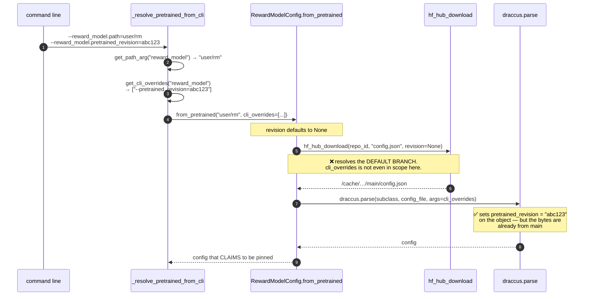
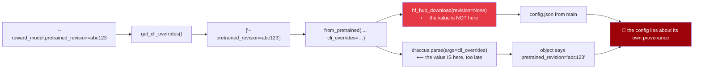
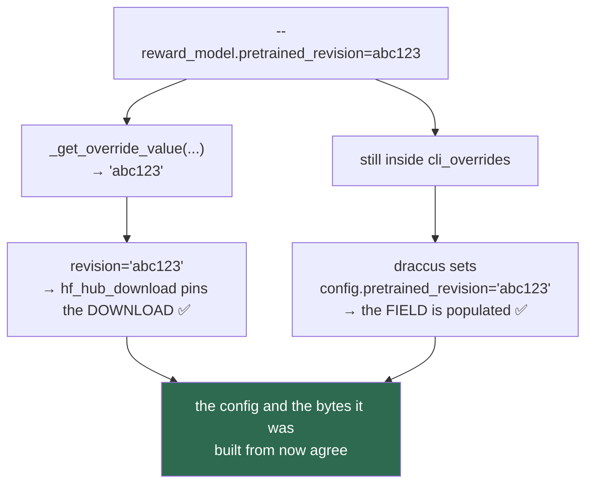
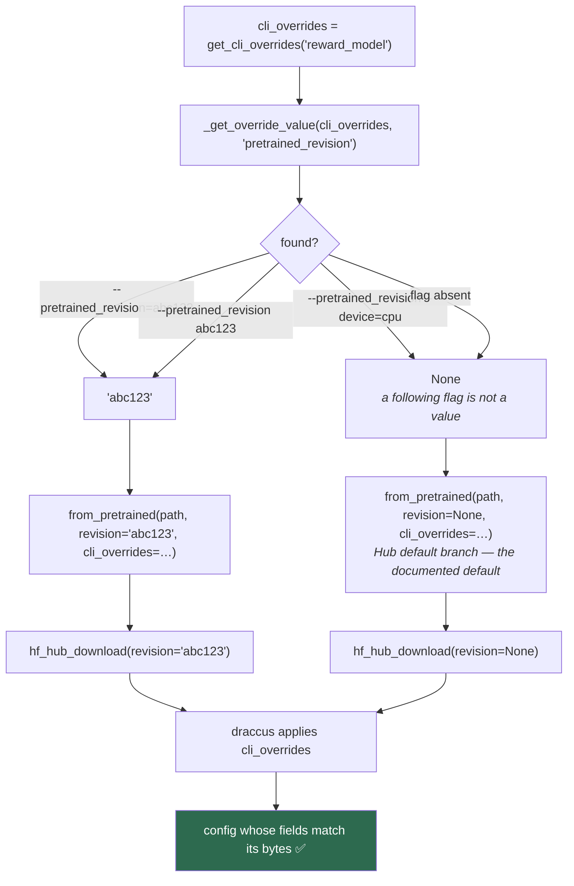
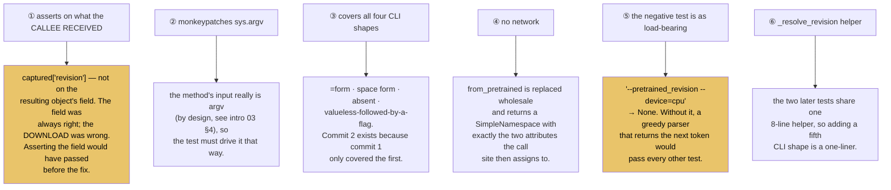
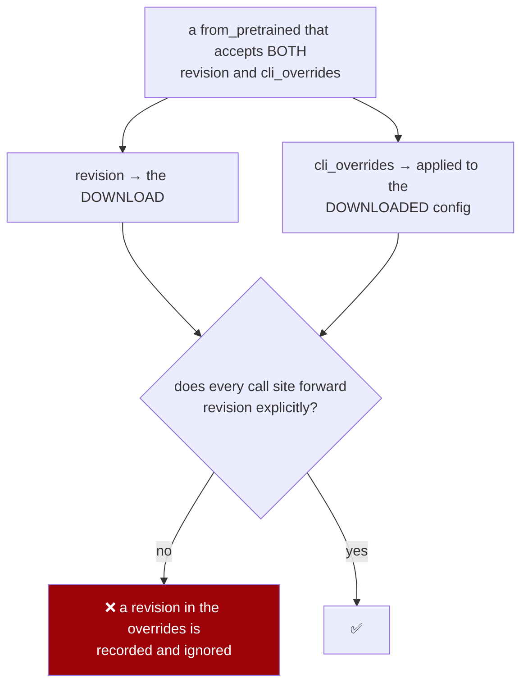

# 06 · 🟠 Medium — `--reward_model.pretrained_revision` was recorded but never used

**Branch:** `fix/reward-model-pretrained-revision`
**Files:** `src/lerobot/configs/train.py`, `tests/configs/test_reward_model_revision.py`
**Commits:** `a829f73d` (pin the revision) · `9352f7bd` (accept the space-separated form)
**Size:** 16 lines of production code. 108 lines of test.

[← 05 · Kinematics guard](./05-kinematics-empty-joints-guard.md) · [Index](./README.md) · Background: [intro 03 · Configuration & CLI](../intro/03-configuration-and-cli.md)

---

## 1. Symptom

```bash
lerobot-train \
  --reward_model.path=user/my-reward-model \
  --reward_model.pretrained_revision=abc123 \
  --dataset.repo_id=user/my-dataset
```

The run downloads `config.json` from the Hub's **default branch**, not from `abc123`. But
the resulting config object reports `pretrained_revision == "abc123"`, and so does the
`train_config.json` written into every checkpoint.

So:

- you pin a revision, and get an unpinned config;
- the run *records* that it was pinned, so the checkpoint's provenance is wrong;
- re-running the "same" command next week, after the reward model's `main` has moved, gives
  a different architecture — silently;
- the weights may then be loaded against a mismatched config, which surfaces much later as
  a shape error, or worse, as a quietly wrong reward.

The equivalent flag for policies, `--policy.path` + overrides, works — which makes this
look like a reward-model-specific regression rather than a design hazard. It is the latter.

---

## 2. Reproduction

```python
import sys
from types import SimpleNamespace
from lerobot.configs.rewards import RewardModelConfig
from lerobot.configs.train import TrainPipelineConfig

captured = {}
def fake_from_pretrained(path, **kwargs):
    captured["path"] = str(path)
    captured["revision"] = kwargs.get("revision")
    return SimpleNamespace(pretrained_path=None, pretrained_revision=None)

RewardModelConfig.from_pretrained = classmethod(lambda cls, p, **kw: fake_from_pretrained(p, **kw))
sys.argv = ["lerobot-train", "--reward_model.path=user/rm", "--reward_model.pretrained_revision=abc123"]

cfg = object.__new__(TrainPipelineConfig)
cfg.resume = False; cfg.policy = None; cfg.reward_model = None
cfg._resolve_pretrained_from_cli()

print(captured)
# before the fix: {'path': 'user/rm', 'revision': None}      ← the download was unpinned
# after  the fix: {'path': 'user/rm', 'revision': 'abc123'}
```

---

## 3. The code before the fix

### The call site

```python
# src/lerobot/configs/train.py:196
def _resolve_pretrained_from_cli(self) -> None:
    """Resolve the pretrained source passed on the CLI into a loaded config.

    The pretrained paths (`--policy.path`, `--reward_model.path`) and `--config_path`
    are only recoverable by re-reading the CLI args: draccus has already consumed them
    by the time `validate()` runs, so they are not reflected on `self`. Exactly one
    source applies, in priority order: reward-model path, policy path, then resume.
    """
    reward_model_path = parser.get_path_arg("reward_model")
    policy_path = parser.get_path_arg("policy")

    if reward_model_path:
        cli_overrides = parser.get_cli_overrides("reward_model")
        self.reward_model = RewardModelConfig.from_pretrained(
            reward_model_path, cli_overrides=cli_overrides        # ← no `revision=`
        )
        self.reward_model.pretrained_path = str(Path(reward_model_path))
    elif policy_path:
        ...
```

### The loader

```python
# src/lerobot/configs/rewards.py:112
@classmethod
def from_pretrained(
    cls, pretrained_name_or_path, *,
    force_download=False, resume_download=None, proxies=None, token=None,
    cache_dir=None, local_files_only=False,
    revision: str | None = None,            # ← ① used for the download
    **reward_kwargs,
):
    model_id = str(pretrained_name_or_path)
    if Path(model_id).is_dir():
        ...
    else:
        config_file = hf_hub_download(
            repo_id=model_id,
            filename=CONFIG_NAME,
            revision=revision,              # ← ① here, and only here
            cache_dir=cache_dir, force_download=force_download,
            proxies=proxies, resume_download=resume_download,
            token=token, local_files_only=local_files_only,
        )

    # HACK: Parse the original config to get the config subclass, so that we can
    # apply cli overrides.
    with draccus.config_type("json"):
        orig_config = draccus.parse(cls, config_file, args=[])

    with open(config_file) as f:
        config = json.load(f)
    config.pop("type", None)
    with tempfile.NamedTemporaryFile("w+", delete=False, suffix=".json") as f:
        json.dump(config, f)
        config_file = f.name

    cli_overrides = reward_kwargs.pop("cli_overrides", [])
    with draccus.config_type("json"):
        return draccus.parse(orig_config.__class__, config_file, args=cli_overrides)
                                                       # ← ② applied AFTER the download
```

### And the override list it was given

```python
# configs/parser.py:71 — the de-nesting, abridged
def get_cli_overrides(field_name, args=None):
    if args is None:
        args = sys.argv[1:]
    attr_level_args = []
    detect_string = f"--{field_name}."
    excluded_names = (draccus.CHOICE_TYPE_KEY, PATH_KEY)      # ("type", "path")
    for index, arg in enumerate(args):
        if not arg.startswith(detect_string):
            continue
        denested_arg = arg.removeprefix(detect_string)
        if denested_arg.split("=", maxsplit=1)[0] in excluded_names:
            continue
        attr_level_args.append(f"--{denested_arg}")
        if "=" not in arg and index + 1 < len(args) and not args[index + 1].startswith("--"):
            attr_level_args.append(args[index + 1])           # ← the space-separated form
    return attr_level_args
```

So `--reward_model.pretrained_revision=abc123` arrives as
`["--pretrained_revision=abc123"]`, and `--reward_model.pretrained_revision abc123` arrives
as `["--pretrained_revision", "abc123"]` — two list shapes for one flag.

---

## 4. Root cause

### Order of operations



The defect is a **temporal** one: `revision` must take effect *before* a side effect
(the download), but the mechanism that carried it (`cli_overrides`) is applied *after*.
No amount of reading `from_pretrained` in isolation reveals it — both halves are correct.
The bug is in which channel the value travelled through.



### The second defect: the space-separated form

The first commit fixed the ordering. The second fixed the *parsing*, because
`get_cli_overrides` can produce either shape:

| CLI | `get_cli_overrides("reward_model")` |
|---|---|
| `--reward_model.pretrained_revision=abc123` | `["--pretrained_revision=abc123"]` |
| `--reward_model.pretrained_revision abc123` | `["--pretrained_revision", "abc123"]` |
| `--reward_model.pretrained_revision --reward_model.device=cpu` | `["--pretrained_revision", "--device=cpu"]` |

A naive extractor — split on `=` and take the right-hand side — handles row 1 and silently
returns `None` for row 2. Row 3 is the trap on the other side: a *valueless* flag followed
by another flag must yield `None`, not `"--device=cpu"`.

### The lurking `args=None` default

```python
def parse_arg(arg_name: str, args: Sequence[str] | None = None) -> str | None:
    if args is None:
        args = sys.argv[1:]          # ← the fallback that silently breaks a de-nested search
```

Calling `parser.parse_arg("pretrained_revision")` without `args` searches the **raw**
command line, where the flag is still `--reward_model.pretrained_revision` — so the lookup
would never match, and the function would return `None` with no error. The fix has to pass
the list explicitly, and the code says so.

---

## 5. The fix

```diff
+def _get_override_value(overrides: list[str] | None, name: str) -> str | None:
+    """Return the value of `--<name>=<value>` or `--<name> <value>` in a de-nested override list.
+
+    The list is the one produced by `parser.get_cli_overrides`, whose entries have already had
+    their `--<field>.` prefix stripped. A bare `--<name>` followed by another `--flag` has no value.
+    """
+    # The explicit list stops `parse_arg` from falling back to `sys.argv`.
+    return parser.parse_arg(name, args=overrides or [])
```

```diff
         if reward_model_path:
             cli_overrides = parser.get_cli_overrides("reward_model")
+            # `pretrained_revision` has to be passed explicitly: draccus only applies
+            # `cli_overrides` once the config has already been downloaded, so relying on
+            # them alone would always resolve the Hub default branch.
             self.reward_model = RewardModelConfig.from_pretrained(
-                reward_model_path, cli_overrides=cli_overrides
+                reward_model_path,
+                revision=_get_override_value(cli_overrides, "pretrained_revision"),
+                cli_overrides=cli_overrides,
             )
             self.reward_model.pretrained_path = str(Path(reward_model_path))
```

### Why reuse `parse_arg` instead of writing a parser

```python
def parse_arg(arg_name: str, args: Sequence[str] | None = None) -> str | None:
    if args is None:
        args = sys.argv[1:]
    option = f"--{arg_name}"
    for index, arg in enumerate(args):
        if arg.startswith(f"{option}="):
            return arg.removeprefix(f"{option}=")                           # ← the = form
        if arg == option and index + 1 < len(args) and not args[index + 1].startswith("--"):
            return args[index + 1]                                           # ← the space form
    return None
```

`parse_arg` **already** handles both shapes and already returns `None` for a valueless
flag. A hand-rolled extractor would have had to re-derive all three behaviours — and would
be a second place to keep in sync with `get_cli_overrides`. The helper's entire job is to
call it with the right `args`, and the one-line comment explains why that argument is not
optional:

```python
# The explicit list stops `parse_arg` from falling back to `sys.argv`.
return parser.parse_arg(name, args=overrides or [])
```

`overrides or []` also normalises `None` — `get_cli_overrides` is typed
`-> list[str] | None`.

### `cli_overrides` is still passed

Note that `revision=` is passed **in addition to** `cli_overrides`, not instead of it. The
revision therefore does double duty:



That consistency is the real deliverable. Before the fix the field and the bytes disagreed,
which is worse than either being wrong alone, because `train_config.json` recorded the
false claim into every checkpoint.

### Resulting flow



---

## 6. Why not the simpler fixes

| Candidate | Why it fails |
|---|---|
| `revision = next((a.split("=")[1] for a in cli_overrides if a.startswith("--pretrained_revision=")), None)` | Handles only the `=` form. Silently `None` for `--reward_model.pretrained_revision abc123`, which is exactly the second commit on this branch. |
| `parser.parse_arg("reward_model.pretrained_revision")` on `sys.argv` | Works today — but duplicates the de-nesting knowledge that `get_cli_overrides` owns (its exclusion list, its handling of `path`/`type`). Two parsers for one flag will drift. |
| Make `from_pretrained` inspect `cli_overrides` for a revision itself | Pushes CLI-shaped parsing into a Hub loader that otherwise knows nothing about argv. It would also have to be duplicated in `PreTrainedConfig.from_pretrained`, `DataProcessorPipeline.from_pretrained`, and every future loader. |
| Apply `cli_overrides` *before* the download | Impossible by construction: the overrides can only be decoded once the concrete config **subclass** is known, and the subclass is read from the `config.json` that the download fetches. The ordering is forced, which is precisely why the call site must forward the revision. |
| Require `--config_path` with a pinned revision instead | Replaces a one-flag workflow with a file. Does not fix the flag that already exists and appears to work. |
| Document that the flag doesn't work | A config that reports a revision it did not use is a provenance bug. Documenting it would make every checkpoint's `train_config.json` knowingly inaccurate. |

---

## 7. The regression tests

`tests/configs/test_reward_model_revision.py` — new file, four tests, no network.

### The fixture trick

```python
def _bare_train_config() -> TrainPipelineConfig:
    """A TrainPipelineConfig with only the fields `_resolve_pretrained_from_cli` touches.

    `__post_init__`/`validate` pull in a dataset, an optimizer and a device, none of which
    matter here; bypassing them keeps the test focused on the resolution step.
    """
    cfg = object.__new__(TrainPipelineConfig)
    cfg.resume = False
    cfg.policy = None
    cfg.reward_model = None
    return cfg
```

`object.__new__` skips `__init__`, so the test does not need a `DatasetConfig`, an
optimizer, or a device. Only the three attributes `_resolve_pretrained_from_cli` reads are
set. This is a deliberate, documented bypass — the docstring says what is skipped and why —
and it is what makes the test a *unit* test of one method rather than an integration test
of the whole config.

### The four cases

```python
def test_reward_model_pretrained_revision_reaches_from_pretrained(monkeypatch):
    """`--reward_model.pretrained_revision` must pin the revision the config is loaded from.

    The revision is only present in the de-nested CLI overrides, which draccus applies *after*
    `from_pretrained` has already downloaded `config.json`. Unless the call site forwards it
    explicitly, the download silently resolves `main`.
    """
    captured = {}

    def fake_from_pretrained(pretrained_name_or_path, **kwargs):
        captured["path"] = str(pretrained_name_or_path)
        captured["revision"] = kwargs.get("revision")
        return SimpleNamespace(pretrained_path=None, pretrained_revision=None)

    monkeypatch.setattr(RewardModelConfig, "from_pretrained", fake_from_pretrained)
    monkeypatch.setattr(sys, "argv", [
        "lerobot-train",
        "--reward_model.path=user/reward-model",
        "--reward_model.pretrained_revision=abc123",
    ])

    cfg = _bare_train_config()
    cfg._resolve_pretrained_from_cli()

    assert captured["path"] == "user/reward-model"
    assert captured["revision"] == "abc123"
```

```python
def test_reward_model_revision_defaults_to_none_when_not_given(monkeypatch):
    """Without the flag the revision stays `None`, so the Hub default branch is used."""
    ...
    assert captured["revision"] is None


def test_reward_model_pretrained_revision_space_separated(monkeypatch):
    """`--reward_model.pretrained_revision release/v2` (no `=`) must pin the revision too."""
    revision = _resolve_revision(monkeypatch, ["--reward_model.pretrained_revision", "release/v2"])
    assert revision == "release/v2"


def test_reward_model_pretrained_revision_without_value_is_none(monkeypatch):
    """A following `--flag` is not mistaken for the revision value."""
    revision = _resolve_revision(
        monkeypatch, ["--reward_model.pretrained_revision", "--reward_model.device=cpu"]
    )
    assert revision is None
```

### What makes these good tests



Point ① is the crux, and it is the thing most people get wrong when testing this class of
bug. The *observable* state after the call (`cfg.reward_model.pretrained_revision`) was
correct **before** the fix — draccus set it. The only way to detect the defect is to
observe the argument that crossed the boundary into `from_pretrained`. Choosing the right
observation point is what makes this test actually test the bug.

---

## 8. Generalisation

> **When a parameter must take effect before a side effect, carrying it through a channel
> that is applied after the side effect is a silent no-op.**

### Audit: every `from_pretrained` that takes both



The loaders with this shape:

| Loader | `revision` | `cli_overrides` / overrides | Call sites to check |
|---|---|---|---|
| `RewardModelConfig.from_pretrained` | ✔ | ✔ | `_resolve_pretrained_from_cli` — **fixed** |
| `PreTrainedConfig.from_pretrained` | ✔ | ✔ (yaml + cli) | `_resolve_pretrained_from_cli`'s `elif policy_path:` branch |
| `PreTrainedPolicy.from_pretrained` | ✔ | — | `make_policy` |
| `DataProcessorPipeline.from_pretrained` | ✔ | `preprocessor_overrides` / `postprocessor_overrides` | `make_pre_post_processors` (which *does* take an explicit `pretrained_revision`) |
| `LeRobotDataset.__init__` | ✔ | — | `make_train_eval_datasets` |

`make_pre_post_processors` is the positive example — it takes `pretrained_revision` as a
named parameter and forwards it into the loader, so the processor pipeline is pinned the
same way the policy is.

### The structural fix, if this recurs

The real defect is that `from_pretrained(path, revision=…, cli_overrides=…)` lets you
specify the revision in two places with different meanings. Two ways to make that
impossible:

1. **Reject it.** Have `from_pretrained` raise if `cli_overrides` contains
   `--pretrained_revision` and `revision` was not also passed. A loud error beats a silent
   mis-pin.
2. **Extract it.** Have `from_pretrained` itself pull `pretrained_revision` out of
   `cli_overrides` and use it for the download. This removes the footgun from every call
   site at once — at the cost of putting CLI-shaped parsing inside a Hub loader, which is
   why the fix branch did not do it.

Option 1 is cheap and is the natural follow-up.

### The wider lesson about this config system

[intro 03](../intro/03-configuration-and-cli.md) describes the two-phase CLI resolution:
draccus consumes `argv`, then `validate()` **re-reads** `sys.argv` to recover
`--policy.path` / `--reward_model.path`. That design is necessary — the path determines
which subclass to build, so it cannot go through draccus — but it means a handful of flags
live outside the type-checked config and are handled by string matching.

Those flags are exactly where bugs like this live:

- [ ] Is the flag's value read with `parse_arg` (both forms) rather than a hand-rolled
      split?
- [ ] Is the `args=` list passed explicitly, so `parse_arg` does not fall back to the raw
      `sys.argv` where the names are still prefixed?
- [ ] Does the value reach the *side effect* it is supposed to influence, not just the
      object that records it?
- [ ] Is there a test asserting on what the callee received, not on the caller's final
      state?

Four questions; this bug failed three of them.

---

[← Index](./README.md) · Back to [`docs/intro/`](../intro/README.md)
