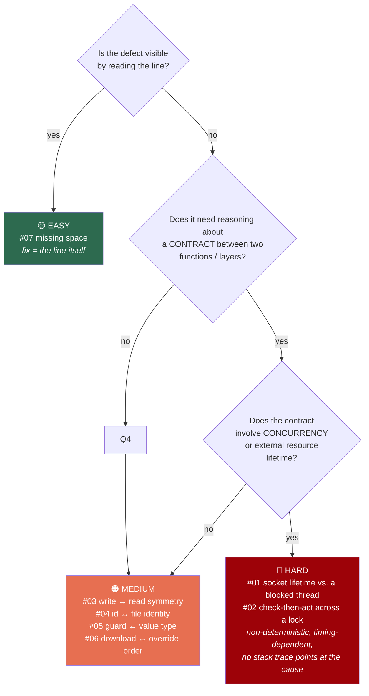

# Issue Deep Dives

Six real defects found and fixed in this fork of LeRobot — two hard, four medium — each
analysed end to end: the user-visible symptom, a reproduction, a root-cause flowchart over
the actual code, the fix, why *that* fix and not an easier one, and the regression test
that pins it.

These are the companion to [`docs/intro/`](../intro/README.md). That guide explains how the
subsystems are *supposed* to work; this folder shows what it looks like when an assumption
inside one of them turns out to be false.

---

## The catalogue

| # | Difficulty | Issue | Subsystem | Branch |
|---|---|---|---|---|
| [01](./01-zmq-cleanup-stops-read-thread.md) | 🔴 Hard | `_cleanup()` closed a ZMQ socket while the reader thread was blocked in `recv` | Cameras / threading | `fix/zmq-cleanup-stops-read-thread` |
| [02](./02-camera-read-loop-stop-parity.md) | 🔴 Hard | A read landing after a stop was requested resurrected the cleared frame buffer | Cameras / threading | `fix/camera-read-loop-stop-parity` |
| [03](./03-dynamixel-write-drive-mode.md) | 🟠 Medium | `DynamixelMotorsBus.write_calibration` never wrote `Drive_Mode`, so `is_calibrated` could never become `True` | Motors | `fix/dynamixel-write-drive-mode` |
| [04](./04-bimanual-calibration-id-collision.md) | 🟠 Medium | Both arms of every bimanual device defaulted to `id=None`, i.e. one shared `None.json` | Robots / teleoperators | `fix/bimanual-calibration-id-collision` |
| [05](./05-kinematics-empty-joints-guard.md) | 🟠 Medium | The "joints observation is required" guard tested `is None` on a value that is always an array | Processor / kinematics | `fix/kinematics-empty-joints-guard` |
| [06](./06-reward-model-pretrained-revision.md) | 🟠 Medium | `--reward_model.pretrained_revision` was recorded on the config but never used for the download | Config / CLI | `fix/reward-model-pretrained-revision` |

A seventh, trivially easy one is in the fork for contrast:
`fix/opencv-open-error-message` — a missing space in
`f"Failed to open {self}.Run `lerobot-find-cameras opencv`..."`. One character, no test.
It is the control group: it shows what "easy" actually looks like next to the six below.

---

## What makes them hard, medium, or easy



The two hard ones share a signature: **nothing in the code is wrong when read in
isolation.** `_cleanup()` correctly closes a socket. `_read_loop()` correctly publishes a
frame. `_stop_read_thread()` correctly joins with a timeout. Each is defensible on its own;
the defect only exists in the interleaving.

The four medium ones share a different signature: **an invariant spanning two functions,
where only one side was updated.** They are findable by reading both sides together — which
is exactly what nobody does during review.

---

## Cross-cutting lessons

### 1. A bounded wait is a *conditional* wait

`thread.join(timeout=2.0)` returns whether or not the thread finished. Code after it that
assumes the thread is gone is wrong whenever the timeout expires — and if the thing the
thread is blocked on can legitimately take longer than the timeout (#01: a
user-configurable `zmq.RCVTIMEO`), the timeout expires in *normal operation*, not just
under failure.

> **Rule.** Make the join timeout a function of the maximum blocking time, and have
> `_stop_read_thread` **return whether it actually stopped** so the caller can branch.

### 2. Check-then-act needs the same lock as the state it checks

In #02 the reader checked `stop_event` at the top of the loop and wrote the frame buffer
later. The clearer held `frame_lock` while emptying that buffer. Moving the check *inside*
the `with frame_lock:` block is what makes "is a stop pending?" and "write the buffer"
atomic with respect to the clear.

> **Rule.** The guard and the mutation go under the lock that protects the mutated state.

### 3. Writers must cover every field the reader reads

#03 is the purest form: `read_calibration()` read four registers, `write_calibration()`
wrote three, and `is_calibrated` is `cached == read()`. The comparison could never succeed.

> **Rule.** When two functions form a round-trip, test the round-trip, not each half.

### 4. `None` is not "empty"

#05's guard was `if q_raw is None`, but `q_raw = np.array([...])` is never `None` — it is
`array([])` when the observation has no joint keys. The guard was dead code, and the real
failure surfaced several lines later as `IndexError` from `q_raw[-1]`.

> **Rule.** Guard on the property you mean (`np.size(x) == 0`), not on a sentinel that the
> producing expression cannot produce.

### 5. An identity that defaults to a constant is not an identity

#04: `id=f"{config.id}_left" if config.id else None` gave *both* arms `None`, and
`Robot.__init__` turns `id` straight into `calibration_dir / f"{self.id}.json"`. Two
objects, one file, eager load at construction → the left arm silently adopted the right
arm's calibration.

> **Rule.** If a value names a file, it must be distinct per instance by construction —
> never by the user remembering to pass `--robot.id`.

### 6. Order of operations is part of an API's contract

#06: `from_pretrained(path, revision=…, cli_overrides=…)` uses `revision` for the
`hf_hub_download` and applies `cli_overrides` *after*. A revision that arrives only in
`cli_overrides` is therefore recorded on the resulting object but never used to fetch
anything. The config *claimed* to be pinned.

> **Rule.** When a parameter must take effect before a side effect, the signature should
> make that impossible to get wrong — and until it does, the call site must forward it
> explicitly.

---

## How each analysis is structured

1. **Symptom** — what a user actually observes.
2. **Reproduction** — the smallest sequence that triggers it.
3. **The code before the fix** — verbatim, with the relevant surroundings.
4. **Root cause** — a flowchart of the failing interleaving or the broken invariant.
5. **The fix** — the diff, annotated.
6. **Why not the simpler fix** — the alternatives that look right and are not.
7. **The regression test** — and what makes it a *good* test.
8. **Generalisation** — where else in the repo the same shape could exist.

---

## Running the regression tests

Each fix lives on its own branch in this fork, and so does its test. **These test files are
not on `main`/`intro`** — check out the branch first:

```bash
# 01 — ZMQ cleanup (needs the pyzmq extra; the test skips without it)
git checkout fix/zmq-cleanup-stops-read-thread
uv run pytest tests/cameras/test_zmq.py -v

# 02 — read-loop stop parity (both backends)
git checkout fix/camera-read-loop-stop-parity
uv run pytest tests/cameras/test_opencv.py::test_read_loop_does_not_publish_after_stop_requested \
               tests/cameras/test_zmq.py::test_read_loop_does_not_publish_after_stop_requested -v

# 03 — Dynamixel Drive_Mode
git checkout fix/dynamixel-write-drive-mode
uv run pytest tests/motors/test_dynamixel.py::test_write_calibration_writes_drive_mode -v

# 04 — bimanual calibration ids
git checkout fix/bimanual-calibration-id-collision
uv run pytest tests/robots/test_bimanual_calibration_ids.py -v

# 05 — kinematics joints guard
git checkout fix/kinematics-empty-joints-guard
uv run pytest tests/robots/test_robot_kinematic_processor.py -v

# 06 — reward-model revision
git checkout fix/reward-model-pretrained-revision
uv run pytest tests/configs/test_reward_model_revision.py -v
```

To watch a test fail first, revert just the production change and re-run:

```bash
git checkout fix/dynamixel-write-drive-mode
git checkout main -- src/lerobot/motors/dynamixel/dynamixel.py
uv run pytest tests/motors/test_dynamixel.py::test_write_calibration_writes_drive_mode -v   # fails
```

Every one of these runs **without hardware** — mocks, monkeypatched `sys.argv`, and
`tmp_path`. That is not a coincidence: a bug class that can only be reproduced with a robot
on the desk does not get a regression test, and therefore comes back.

---

## A note on the code quoted here

Line numbers and "before the fix" snippets are taken from `main` as it stood when each
branch was cut, and the diffs are the branches' own. Where a branch is based on a different
upstream snapshot than `main`, the analysis follows the branch. If a quoted line has since
moved, the surrounding symbol names (`_cleanup`, `write_calibration`,
`_resolve_pretrained_from_cli`, …) are the stable handles to grep for.
